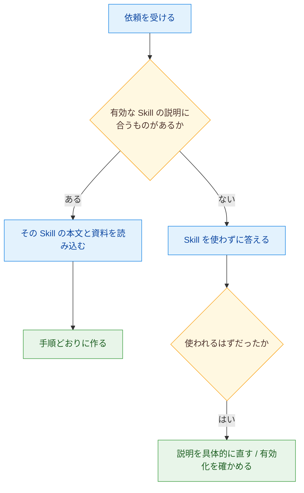

# Skills の仕組みと使いどころ

> ドメイン: 5. 設定とナレッジの管理（15%） ／ 更新: 2026-11-26

!!! abstract "ひとことで"
    Skill は、決まった仕事のやり方を詰めたフォルダで、==関係する依頼のときだけ Claude が自分で読み込む==。何度も同じ手順で作るものは Skill にし、毎回効かせたい振る舞いは Project instructions に置く。

## 仕組み

Skill は、指示・スクリプト・資料を入れたフォルダだ。中心は SKILL.md という Markdown のファイルで、冒頭に名前（name）と説明（description）を書く。Claude は依頼を受けると、有効な Skill の説明を見て、関係するものだけ本文を読み込む。だから説明に「何をする Skill で、いつ使うか」を具体的に書かないと、使ってほしい場面で呼ばれない。

| 種類 | 作る人 | 使い始め方 |
|---|---|---|
| Anthropic の Skill | Anthropic（Excel・Word・PowerPoint・PDF の作成など） | コード実行とファイル作成を有効にすれば、関係する依頼で自動で使われる |
| 組織が用意した Skill | Team / Enterprise のオーナー | 全員の一覧に出る。既定で有効にするかはオーナーが決める。各自が切れる（「必須」の選択肢の効き方は未確認） |
| 自作の Skill | 自分（SKILL.md を入れたフォルダを ZIP で上げる。Claude に作らせることもできる） | 上げた本人だけが使える。共有するか、組織に公開して広げる |
| パートナーの Skill | Notion・Figma・Atlassian など | 各社の connector と組み合わせて使う |

Projects との違いは、効き方にある。Project の knowledge と instructions は、その Project のチャットで常に読み込まれる背景だ。Skill は Project をまたいで使え、関係する依頼のときだけ読み込まれる。そのため、マーケティング部の「ブランドガイドに沿った資料の作り方」のように、どの Project でも繰り返す手順が Skill に向く。顧客ごとの事情や、その仕事でだけ守る口調は Project に置く。

バージョンの扱いは、渡し方で違う。特定の人に共有した Skill は、作者が直すと、受け取った人も次に使うときから新しい版になる。組織に公開した Skill は、直したら公開し直す。公開の設定が「Requires review」（管理者の承認が要る）の組織では、承認されるまで全員が承認済みの版のままだ。Team の既定の「Open」なら審査なしで公開される。共有された Skill は閲覧のみで、受け取った人は中身を変えられない。

??? info "細かい決まり・注記"
    - Skills にはコード実行（Code execution）の有効化が要る。Skills の欄が出ない、灰色になるときはまずここを確かめる
    - SKILL.md の name は64文字まで、description は200文字まで。フォルダ名は Skill の名前と合わせ、ZIP の最上位に Skill のフォルダを置く
    - 1つの Skill は1つの仕事に絞る。大きな1つより、小さな複数の方が組み合わせやすい。Claude は複数の Skill を自動で組み合わせて使える
    - API キーやパスワードを Skill に書き込まない。出どころの分からない Skill は、中のファイル（特にスクリプトと外部への通信）を読んでから有効にする
    - 個人アカウントから組織へ移るとき、自作の Skill は移らない。先にダウンロードしておく
    - SKILL.md に版番号を書く欄があるかは、ヘルプで確認できなかった（未確認）。claude.ai の画面で過去の版に戻せるかも未確認

## 試験での見分け方

| 問われること | ○ 正しい | × ひっかけ |
|---|---|---|
| 複数の Project で同じ手順の資料を作る | 手順を1つの Skill にする | 各 Project の instructions に同じ手順を貼る |
| Skill が使われない | 有効になっているか、説明が具体的かを確かめる | 本文の手順を長く詳しくする（呼ばれる判断は説明で決まる） |
| 同僚から受け取った Skill を直したい | 作者に直してもらう | 受け取った側で中身を書き換える（閲覧のみ） |
| 組織に公開した Skill を直した | 公開し直す（承認が要る設定なら承認を待つ） | 直した時点で全員に反映されると考える |
| 出どころの分からない Skill | 中身を読んでから有効にする | 便利そうなのですぐ有効にする |

## 確認問題

**Q1.** 研修担当が、新人研修の資料を社内テンプレートどおりに作る Skill を作り、有効にした。ところが「来週の研修のスライドを作って」と頼んでも、その Skill が使われない。最初に確かめることとして最も適切なものはどれか。（1つ選べ）
{ .quiz-q }

- A. SKILL.md の説明に、何を作る Skill で、どんな依頼で使うかが具体的に書かれているか
- B. SKILL.md の本文の手順が、スライド1枚ずつの細部まで書かれているか
- C. 研修の Project の instructions に、Skill の本文を貼り付けてあるか
- D. Skill を使わない設定のモデルを選んでいないか、別のモデルに替えて試す

??? success "答えと解説"
    **正解: A。** Claude は Skill の説明を見て、読み込むかを決める。呼ばれないときは説明を直す。

    - B: 本文は読み込まれた後に使われる。呼ばれるかどうかには効かない
    - C: 本文を instructions に貼ると Skill を使う意味がなくなり、ほかのチャットにも毎回効いてしまう
    - D: Skill が呼ばれるかはモデルの選び方の問題ではない。先に有効化と説明を確かめる

**Q2.** オペレーション部のリーダーが、月次の業務報告を部の書式で作る Skill を作った。部員にも使ってもらいたい。適切な進め方はどれか。（2つ選べ）
{ .quiz-q }

- A. 部員それぞれに ZIP を渡し、各自で中身を書き換えて使ってもらう
- B. 部員に Skill を共有し、受け取った部員が自分で有効にして使う
- C. Skill の本文を部の共有 Project の説明欄に貼り、そこから使ってもらう
- D. 書式を直すたびに、部員に共有し直してもらう必要があると周知する
- E. 書式の変更は作者が Skill を直し、部員は次に使うときから新しい版を使う

??? success "答えと解説"
    **正解: B と E。** 共有した Skill は受け取った人が有効にして使い、作者が直すと次に使うときから新しい版になる。

    - A: 各自が書き換えると版がばらばらになり、部の書式がそろわない
    - C: 説明欄は Claude から見えず、Skill としても読み込まれない
    - D: 特定の人への共有なら、直した版は自動で届く。共有し直す必要はない

**Q3.** 営業企画部が、提案書の構成を決める Skill を組織に公開している。この組織では、組織への公開に管理者の承認が要る設定になっている。作者が構成の一部を直した版を公開し直したが、翌日になっても部員の提案書は古い構成のままだ。最も考えられる理由はどれか。（1つ選べ）
{ .quiz-q }

- A. 部員が Skill を無効にしたままなので、新しい版が読み込まれていない
- B. Skill は Project を作り直さないと、新しい版が読み込まれない
- C. 新しい版がまだ承認されておらず、部員は承認済みの古い版を使っている
- D. 公開した Skill は、部員が自分で ZIP を上げ直さないと更新されない

??? success "答えと解説"
    **正解: C。** 公開に承認が要る組織では、直した版が承認されるまで、全員が承認済みの版のままだ。

    - A: 無効なら Skill そのものが使われず、古い版の構成が出続けることもない
    - B: Skill は Project とは別に、アカウントの単位で有効になる。Project の作り直しとは関係ない
    - D: 承認されれば、使う人には自動で新しい版が届く

## 出典
- Claude Certified Associate – Foundations Exam Guide v1.1, Domain 5「Project Configuration」（公式、PDF）
- [What are skills?](https://support.claude.com/en/articles/12512176-what-are-skills)（公式）
- [Use skills in Claude](https://support.claude.com/en/articles/12512180-use-skills-in-claude)（公式。共有・公開・更新・トラブルシューティング）
- [How to create custom skills](https://support.claude.com/en/articles/12512198-how-to-create-custom-skills)（公式。SKILL.md の書き方）
- [Provision and manage skills for your organization](https://support.claude.com/en/articles/13119606-provision-and-manage-skills-for-your-organization)（公式。組織での配布と承認）
- [Introducing Agent Skills](https://claude.com/blog/skills)（公式ブログ、2025-10-16。2025-12-18 の追記あり）
