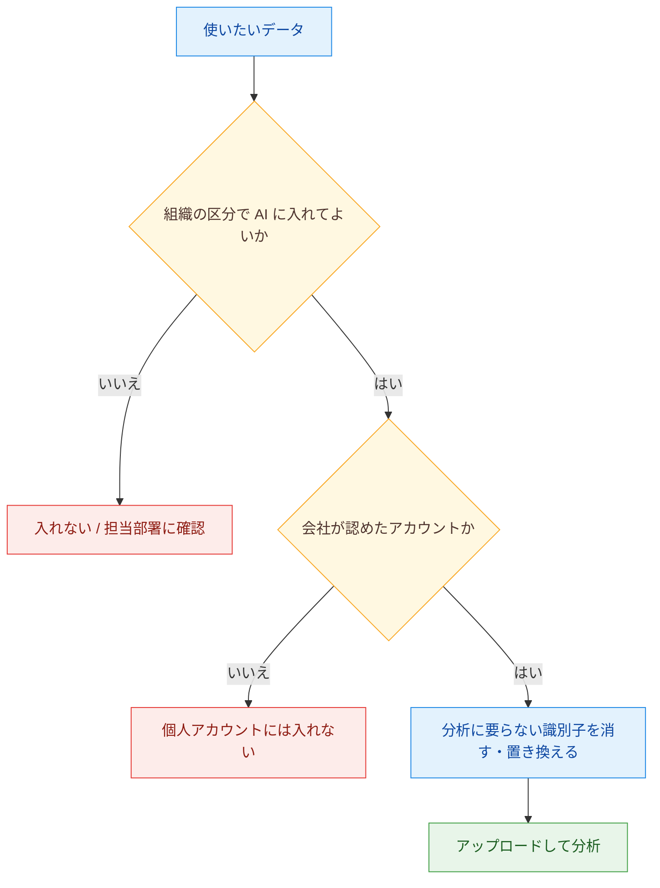

# 機密データの扱い

> ドメイン: 6. 責任ある利用・データ保護・ガバナンス（17%） ／ 更新: 2026-11-26

!!! abstract "ひとことで"
    データを入れる前に、==組織の区分== でどの機密度かを決め、その区分で Claude に入れてよいか、どのアカウントで扱ってよいかを確かめる。入れてよくても、分析に要らない個人の識別子は ==黒塗りか置き換え== で消してから渡す。

## 仕組み

判断の基準は Claude の機能ではなく、組織のデータの区分とポリシーだ。機密の区分（公開・社内・機密・規制の対象など、名前は組織ごとに違う）で、AI に入れてよいか、会社が契約した Team / Enterprise のアカウントでだけ扱うかが決まる。次に、入れてよい区分でも、渡す量を最小にする。集計や傾向を見る分析の多くは、氏名やメールアドレスが無くても成り立つので、識別子を消すか仮の ID に置き換えてから渡す。

| 手当て | やること | 向く場面 |
|---|---|---|
| 黒塗り（redaction） | 氏名・連絡先・口座番号などを消す | 文書の要約、問い合わせ文の分類 |
| 仮名化 | 識別子を仮の ID に置き換え、対応表は手元に残す | 後で個人に戻す必要がある集計 |
| 集計してから渡す | 個票でなく、部署別・月別などの集計値を渡す | 傾向の分析、資料のグラフ |

仮の ID に置き換えても、部署・年齢・入社年のような項目の組み合わせで個人が分かることがある（推論）。だから、人数の少ない区分はまとめるか外す。対応表は Claude に渡さない。

コード実行で分析するとき、アップロードしたファイルは Claude の計算環境で処理される。その環境にネットワークの出口があると、インジェクションされた指示でデータが外部に送られる恐れがある、と Help Center は注意している。個人プランでは既定でネットワークが有効で、Enterprise では既定で無効だ。機密のデータを扱うときは、ネットワークの設定を組織の方針に合わせ、分析中の動きを見て、想定外のデータへのアクセスがあれば止める。

??? info "細部と未確認の点"
    - Team プランのコード実行のネットワークの既定値は、Help Center の記述が節によって食い違っていた（未確認）
    - Team / Enterprise の管理者は、コード実行のネットワークを無効にする、パッケージの取得だけに絞る、許可するドメインを列挙する、を選べる
    - memory と incognito chats で何が残るかは「[プライバシーの設定](privacy-controls.md)」にまとめた
    - 規制の対象のデータ（医療・金融など）に法令上どんな手続きが要るかは、組織の法務の判断で、このノートの範囲外

## 試験での見分け方

| 問われること | ○ 正しい | × ひっかけ |
|---|---|---|
| 入れてよいかの判断の基準 | 組織のデータの区分とポリシー | Claude が学習に使わない設定かどうかだけで決める |
| 個人の識別子を含む表の分析 | 分析に要らない列を消し、要る列は仮の ID にしてから渡す | そのまま渡し、「個人名は出力しないで」と頼む |
| 会社の機密を急ぎで分析したい | 会社が認めたアカウントで扱う | 手元の個人アカウントで済ませる |
| コード実行での分析中 | ネットワークの設定を方針に合わせ、想定外の動きを見張る | 計算環境の中だから何をしても外に出ないと考える |

## 確認問題

**Q1.** 化粧品メーカーのマーケティング担当が、顧客アンケート3,000件の表（氏名、メールアドレス、年代、購入商品、自由記述）を Claude のコード実行で分析し、年代ごとの不満の傾向をまとめたい。会社のポリシーでは、Team プランのアカウントでなら顧客データを扱ってよい。最も適切な進め方はどれか。（1つ選べ）
{ .quiz-q }

- A. 氏名とメールアドレスの列を消し、自由記述の中の名前や連絡先も黒塗りしてから、Team のアカウントでアップロードする
- B. ポリシーで認められているので、表をそのまま Team のアカウントでアップロードする
- C. 表をそのままアップロードし、「個人を特定できる情報は出力に含めないこと」と指示する
- D. 速く進めるため、表をそのまま個人の Pro アカウントで incognito chat にアップロードする

??? success "答えと解説"
    **正解: A。** 入れてよい区分でも、分析に要らない識別子は消してから渡す。

    - B: 傾向の分析に氏名やメールアドレスは要らない。渡す量を最小にしていない
    - C: 出力の指示では、渡したデータそのものは減らない
    - D: ポリシーが認めるのは Team のアカウント。incognito でも個人アカウントに入れることに変わりはない

**Q2.** 経営コンサルタントが、顧客企業の部門別の売上と社員の個票データを Claude で分析する準備をしている。データ保護として適切なものはどれか。（2つ選べ）
{ .quiz-q }

- A. 社員番号を仮の ID に置き換え、対応表も同じ会話にアップロードしておく
- B. 顧客との契約と自社のポリシーで、このデータを AI に入れてよいかを先に確かめる
- C. 部署と年齢と入社年を残したまま氏名だけ消せば、誰か分からないと考える
- D. 部門別の傾向を見るだけなら、個票でなく部門ごとの集計値を渡す
- E. 学習に使われない設定にしてあるので、区分の確認は省く

??? success "答えと解説"
    **正解: B と D。** まず入れてよいかを規則で確かめ、渡す量は目的に要る最小にする。

    - A: 対応表を一緒に渡すと、仮名化の意味が無くなる
    - C: 項目の組み合わせで個人が分かることがある
    - E: 学習の設定は、入れてよいかの判断の代わりにならない

**Q3.** 物流会社の業務分析担当が、配送ドライバーの勤務記録（個人を特定できる項目を除いたもの）を Enterprise のアカウントでアップロードし、コード実行で遅延の要因を分析している。途中で Claude が、頼んでいない外部のサイトにデータを送ろうとする動きを見せた。最も適切な対応はどれか。（1つ選べ）
{ .quiz-q }

- A. 個人を特定できる項目は除いてあるので、そのまま分析を続ける
- B. 「外部にデータを送らないこと」と会話で指示して、分析を続ける
- C. 分析を止め、組織の管理者に報告して、コード実行のネットワークの設定を確かめてもらう
- D. 会話を削除して、同じファイルで最初からやり直す

??? success "答えと解説"
    **正解: C。** 想定外のデータへのアクセスや送信が見えたら止める。ネットワークの設定は組織の管理者が決める。

    - A: 識別子を除いても、社内の業務データを外に出してよいことにはならない
    - B: インジェクションされた指示が原因なら、会話の一文では止められない
    - D: 原因を確かめないまま、同じ条件で同じことが起きうる

## 出典
- [Create and edit files with Claude](https://support.claude.com/en/articles/12111783-create-and-edit-files-with-claude)（公式、Help Center。セキュリティの注意とネットワークの既定値）
- [Usage Policy](https://www.anthropic.com/legal/aup)（公式。プライバシーの侵害の禁止）
- Claude Certified Associate – Foundations Exam Guide v1.1, Domain 6: Data Protection in Practice（公式、PDF）: https://cc.sj-cdn.net/instructor/6nizmqk8tpzpfjvt6qmmav7rh/public/1794946609/Claude_Certified_Associate_-_Foundations_Exam_Guide_Updated_Dec_7.pdf
