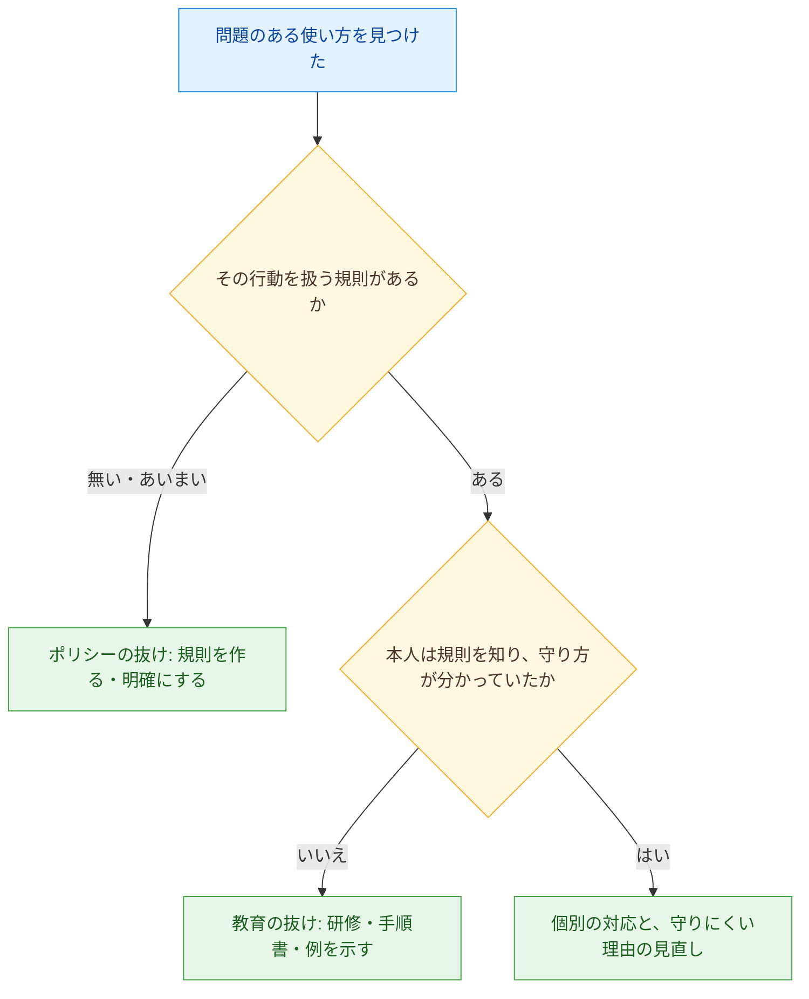

# 組織の AI ポリシー・倫理・Diligence

> ドメイン: 6. 責任ある利用・データ保護・ガバナンス（17%） ／ 更新: 2026-11-26

!!! abstract "ひとことで"
    使い方の問題を見つけたら、まず ==規則が無いのか（ポリシーの抜け）、規則はあるのに守られていないのか（教育の抜け）== を分ける。是正策は原因に合わせ、規則が無いなら規則を作り、知られていないなら教える。

## 仕組み

ガイドは、観察された使い方を組織の AI ポリシーと突き合わせ、コンプライアンスの抜け、倫理上のリスク（偏り、透明性の欠如）、Diligence の欠け、を見つけて、抜けを塞ぐ是正策を決めることを求めている。原因を取り違えると是正策が効かない。規則が無いのに研修だけしても、何を守ればよいかが決まらない。規則があるのに知られていないなら、規則を書き足しても行動は変わらない。

AI Fluency の4D のうち、責任の側を受け持つのが Diligence（AI で何をし、どうしたかに責任を持つこと）だ。AI Fluency の用語集は、これを3つに分けている。

| Diligence | 中身 | 欠けたときの例 |
|---|---|---|
| Creation Diligence | どの AI システムを選び、どう使うかを慎重に決める | 会社が認めていない個人アカウントや、出どころの怪しい Skill を使う |
| Transparency Diligence | AI の役割を、知る必要のある人に正直に伝える | 顧客向けの報告書に AI を使ったことを伝えず、自分の調査として出す |
| Deployment Diligence | 使う・共有する出力を確かめ、保証する責任を持つ | 確かめていない数字や引用を、そのまま社外に出す |

倫理上のリスクは、規則に違反していなくても起こる。応募者の書類を Claude に並べさせると、学歴や表現の癖で偏った順位が出ることがあり、出力を確かめずに使えば偏りが判断に入る。何を開示するかは、場面（個人・学業・仕事）によって期待が違う。

??? info "細部と未確認の点"
    - Diligence の3区分と定義は、AI Fluency の用語集・4D の資料（anthropic.com の PDF）の文言を検索結果の抜粋で確認した。この環境から PDF の本文は開けず、正確な文言は未確認
    - 「ポリシーの抜け」「教育の抜け」の判定の流れは、ガイドの記述をもとにした整理（推論）。ガイドは両者の区別を求めているが、手順は定めていない
    - 両方が同時に抜けていることもある。その場合は規則を作ってから教える（推論）

## 試験での見分け方

| 問われること | ○ 正しい | × ひっかけ |
|---|---|---|
| 規則に無い使い方が広がっている | ポリシーの抜け。規則を作り、明確にする | 研修だけを増やす |
| 規則はあるが、多くの人が知らない | 教育の抜け。研修や手順書で教える | 規則の文言を書き足すだけで終える |
| AI を使ったことを相手に伝えていない | Transparency Diligence の欠け。開示の手順を整える | 出力が正確なら問題ないとする |
| 確かめずに社外へ出した | Deployment Diligence の欠け。確認の手順を入れる | Claude のモデルを上位のものに変える |

## 確認問題

**Q1.** 広告代理店の監査で、複数のチームが顧客向けの提案書に Claude が書いた市場分析の文章を使っていたが、AI を使ったことを顧客に伝えていないと分かった。社内の AI ポリシーには、顧客への開示について何も書かれていない。最も適切な是正策はどれか。（1つ選べ）
{ .quiz-q }

- A. 顧客への開示の要否と方法をポリシーに定め、そのうえで各チームに周知する
- B. 開示を怠った各チームの担当者に、ポリシー違反として注意する
- C. 全社員に AI の基礎の研修を受けさせ、ポリシーは今のままにする
- D. 提案書で Claude を使うことを禁止する

??? success "答えと解説"
    **正解: A。** 規則が無いので、まずポリシーの抜けを塞ぐ。

    - B: 規則が無い以上、違反として扱えない。同じことがまた起こる
    - C: 何を開示すべきかが決まらないまま研修しても、行動の基準にならない
    - D: 開示すれば済む問題に対して過剰で、使える場面まで失う

**Q2.** 研修会社の業務分析担当が、社内の Claude の使い方を調べ、次の事例を見つけた。Diligence の欠けに当たるものはどれか。（2つ選べ）
{ .quiz-q }

- A. 講座の案内文の下書きを Claude に作らせ、担当者が事実を確かめて直してから公開した
- B. Claude がまとめた業界統計を、出典を確かめないまま顧客向けの報告書に載せた
- C. 社内の会議メモを Claude で要約し、要約であることを明記して共有した
- D. 新しい connector を使う前に、情報システム部に承認を求めた
- E. 会社が認めていない個人の AI アカウントに、顧客の研修の評価データを入れて分析した

??? success "答えと解説"
    **正解: B と E。** B は出力を確かめずに出した Deployment Diligence の欠け、E は使う AI を慎重に選ばなかった Creation Diligence の欠け。

    - A: 確かめてから公開しており、Deployment Diligence を果たしている
    - C: AI を使ったことを伝えており、Transparency Diligence を果たしている
    - D: 使う道具を慎重に選んでおり、Creation Diligence を果たしている

**Q3.** 物流会社では、AI ポリシーに「顧客の個人情報は、会社の Enterprise アカウント以外の AI に入れない」と明記している。ところが、配送センターの社員の多くが、個人のスマートフォンの無料の AI アプリに配送先の情報を入れていた。聞き取りでは、ほとんどの社員がこの規則を知らなかった。最も適切な是正策はどれか。（1つ選べ）
{ .quiz-q }

- A. ポリシーの該当の条文を、より詳しい文言に書き直す
- B. 違反した社員を特定し、全員を懲戒の対象にする
- C. 規則と、その理由、会社のアカウントでの代わりのやり方を、現場向けの研修と手順書で伝える
- D. Enterprise アカウントの利用をやめ、AI の利用を全面的に禁止する

??? success "答えと解説"
    **正解: C。** 規則はあるのに知られていない、教育の抜けである。

    - A: 規則はすでに明確。文言を変えても、知らない人には届かない
    - B: 原因は知らなかったことで、罰では同じ抜けが残る
    - D: 認められた使い方まで失い、個人のアプリに流れる理由を増やしかねない

## 出典
- Claude Certified Associate – Foundations Exam Guide v1.1, Domain 6: Policy, Ethics, and Diligence（公式、PDF）: https://cc.sj-cdn.net/instructor/6nizmqk8tpzpfjvt6qmmav7rh/public/1794946609/Claude_Certified_Associate_-_Foundations_Exam_Guide_Updated_Dec_7.pdf
- AI Fluency: Key Terminology Cheat Sheet（公式、PDF。本文は未読、検索結果の抜粋で確認）: https://www-cdn.anthropic.com/4396730ed190e691a3712cf2fd6bfe35509deca2.pdf
- The 4Ds: Diligence（公式、PDF。本文は未読、検索結果の抜粋で確認）: https://www-cdn.anthropic.com/34612aacbf37f6aa12140fc0a1aa216b63263aac.pdf
