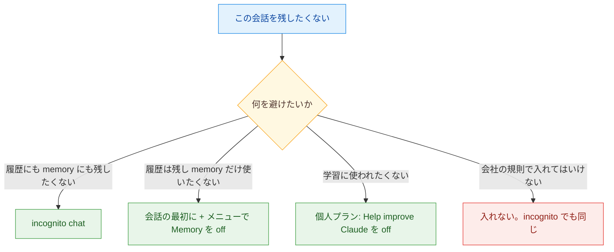

# プライバシーの設定（incognito・memory・データの保持と学習）

> ドメイン: 6. 責任ある利用・データ保護・ガバナンス（17%） ／ 更新: 2026-11-26

!!! abstract "ひとことで"
    incognito chat は ==履歴と memory に残さない== ための設定で、Anthropic のもとでデータが保持されないわけではない。学習への利用は、個人プランでは「Help improve Claude」の設定で決まり、Team / Enterprise は既定で学習に使われない。

## 仕組み

プライバシーの設定は、効く範囲がそれぞれ違う。incognito chat と memory の設定は「自分の Claude が次の会話で何を覚えているか」を決め、学習の設定と保持期間は「Anthropic がデータをどう使い、いつまで持つか」を決める。だから、機密のデータを入れてよいかの判断に incognito を使うのは筋違いで、それは組織のポリシーとアカウントの種類で決める（[機密データの扱い](data-protection.md)）。

| 設定 | 何が変わるか | 注意 |
|---|---|---|
| incognito chat | 履歴に残らず、memory も使わず・作らない。過去の会話の検索にも出ない。学習に使われない | Anthropic は既定で30日保持する。Team / Enterprise では組織のデータの書き出しに含まれ、組織の保持の方針に従う。Project の中では使えない。閉じると開き直せない |
| 会話ごとの Memory の off | その会話だけ memory を使わず・作らない | 会話は履歴に残り、後の検索で見つかる |
| memory の管理 | 設定から、覚えた内容を見る・直す・消す。一時停止（残すが使わない）とリセット（すべて消す、元に戻せない）がある | Project には Project ごとの memory があり、ほかの Project の memory は使わない |
| Help improve Claude | Free / Pro / Max（Ultra に同じ設定がかかるかは未確認）で、会話を新しいモデルの学習に使うかを決める | on なら保持は5年、off なら30日。消した会話は学習に使わない |

会社のアカウント（Team / Enterprise）は Commercial Terms のもとにあり、入力と出力は既定で学習に使われない。memory の可否や保持期間は、本人でなく組織の管理者が決める部分がある。

??? info "細かい決まり（2026-11-26 時点の Help Center とニュースの記述）"
    - memory は既定で、健康や政治などの個人的・機微な話題を保存しない。設定で含めることもできる
    - Team / Enterprise の Owner は memory を組織全体で on / off できるが、個人ごとに on にはできない。Owner はメンバーの memory を見たり直したりできない
    - Enterprise では Owner がデータの保持期間を設定できる（最短30日）。設定しなければ無期限に保持される
    - incognito chat でも、プロフィールの設定や styles は使われる
    - 5年の保持は、学習を許した場合に、新しく始めた・再開した会話にかかる。応答への評価（フィードバック）も5年保持される
    - Team / Enterprise でフィードバックを送った会話が学習に使われうるかは、プライバシーセンターの本文を読めず未確認
    - 数値と設定の場所は変わりやすい。受験に数値の暗記は要らない

## 試験での見分け方

| 問われること | ○ 正しい | × ひっかけ |
|---|---|---|
| 1回だけ、私的な相談を memory に残したくない | incognito chat を使う | memory をリセットする（それまでの memory が全部消える） |
| 会話は後で探せるように残し、memory だけ避けたい | 会話の最初に Memory を off にする | incognito を使う（履歴に残らず、閉じると戻せない） |
| 規則で入れてはいけないデータ | incognito でも入れない | incognito なら保存されないので入れてよい |
| 案件ごとに memory を混ぜたくない | 案件ごとに Project を分ける | 1つの会話で全案件を続け、都度「前の話は忘れて」と頼む |

## 確認問題

**Q1.** 製薬会社の PM が、Claude Pro の個人アカウントで、転職を考えていることについて一度だけ相談したい。この内容を今後の会話に持ち込まれたくないし、履歴にも残したくない。最も適切な方法はどれか。（1つ選べ）
{ .quiz-q }

- A. 通常の会話で相談し、終わったら memory をリセットする
- B. incognito chat で相談する
- C. 通常の会話の最初に Memory を off にして相談する
- D. 「この会話は覚えないで」と最初に頼んでから、通常の会話で相談する

??? success "答えと解説"
    **正解: B。** incognito chat は履歴にも memory にも残らない。

    - A: リセットは、それまでの memory を全部消してしまい、元に戻せない。会話も履歴に残る
    - C: memory は避けられるが、会話は履歴に残る
    - D: 頼むだけでは設定が変わらず、履歴にも残る

**Q2.** 情報システム部が、全社で使う Claude（Team プラン）について、社員向けの説明会の資料を作っている。資料に書く内容として正しいものはどれか。（2つ選べ）
{ .quiz-q }

- A. incognito chat も、組織の保持の方針に従って Anthropic に保持され、組織のデータの書き出しに含まれる
- B. incognito chat を使えば、社外秘の資料を入れてもよい
- C. 学習に使われないよう、各自が「Help improve Claude」を off にする必要がある
- D. memory は管理者が社員ごとに中身を確認して、不適切なものを消す
- E. memory に残したくない会話は、incognito を使うか、会話の最初に Memory を off にする

??? success "答えと解説"
    **正解: A と E。** incognito は保持されないわけではなく、memory を避ける手段は2つある。

    - B: 入れてよいかは社内の規則で決まる。incognito は理由にならない
    - C: Team は Commercial Terms のもとで、既定で学習に使われない。その設定は個人プランのもの
    - D: Owner はメンバーの memory を見たり直したりできない

**Q3.** 経営企画の担当者は、A社とB社の2つの買収案件を同時に Claude で進めている。最近、A社の分析を頼んだのに、B社の前提が混ざった答えが返ってくることがある。最も適切な対応はどれか。（1つ選べ）
{ .quiz-q }

- A. memory をリセットし、以後は毎回の会話で前提を貼り直す
- B. すべての案件の会話を incognito chat で行う
- C. 「別の案件の情報は使わないこと」をプロフィールの設定に書く
- D. 案件ごとに Project を分け、それぞれの Project の memory で前提を持たせる

??? success "答えと解説"
    **正解: D。** Project の memory は Project ごとに分かれ、ほかの Project の memory は使わない。ただし Project の外のチャットでたまったアカウントの memory は Project でも使われるので、完全に切り離すなら Project の設定で「Use account memory」を切る。

    - A: 全部を消すうえ、毎回の貼り直しの手間が増える。混ざる原因の仕組みは変わらない
    - B: incognito は Project の中で使えず、案件の前提を持ち越せない
    - C: 指示の一文では、同じ memory に入った情報の混ざりを確実には防げない

## 出典
- [Use incognito chats](https://support.claude.com/en/articles/12260368-use-incognito-chats)（公式、Help Center）
- [Use Claude's chat search and memory to build on previous context](https://support.claude.com/en/articles/11817273)（公式、Help Center）
- [Configure custom data retention controls for Enterprise plans](https://support.claude.com/en/articles/10440198)（公式、Help Center）
- [Updates to Consumer Terms and Privacy Policy](https://www.anthropic.com/news/updates-to-our-consumer-terms)（公式、2025-08。学習の設定と保持期間、Commercial Terms の対象外）
- Claude Certified Associate – Foundations Exam Guide v1.1, Domain 6: Data Protection in Practice（公式、PDF）: https://cc.sj-cdn.net/instructor/6nizmqk8tpzpfjvt6qmmav7rh/public/1794946609/Claude_Certified_Associate_-_Foundations_Exam_Guide_Updated_Dec_7.pdf
