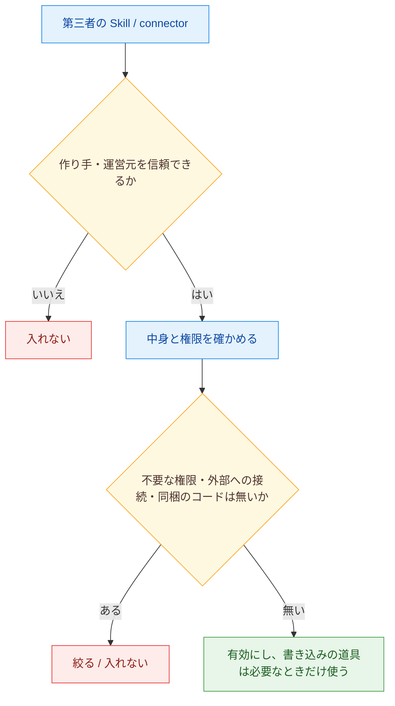

# 第三者の Skills と connectors を信頼してよいか

> ドメイン: 6. 責任ある利用・データ保護・ガバナンス（17%） ／ 更新: 2026-11-26

!!! abstract "ひとことで"
    Skills も custom connectors も、==信頼できる出どころのものだけ== を入れる。同僚から渡された Skill でも有効にする前に中身を確かめ、connector は求める権限を必要な範囲に絞る。

## 仕組み

Skill は手順だけでなく、スクリプトや外部のパッケージを持ち込み、コード実行の環境で動く。connector は Claude を外部のサービスにつなぎ、読み書きの操作をさせる。どちらも Claude が受け取る指示とデータの出入り口なので、悪意のある部品は ==プロンプトインジェクション==（隠れた指示で Claude に意図しない操作をさせる）と、データの持ち出しの経路になる。だから、入れるかどうかは便利さでなく出どころで決め、入れた後も権限と使う範囲を絞る。

| | Skills | custom connectors |
|---|---|---|
| 確かめること | 同梱のファイル、特にコードの依存関係やスクリプト、画像などの付属物。信頼できない外部のネットワークにつなぐよう指示していないか | 認証のときに求められる権限（スコープ）。不要なら拒む |
| 使い方の注意 | 同僚から共有されたものも、有効にする前に見る | 「常に許可」は、無人で動かしてよいと信頼できるサーバーと道具だけにする。research で使うときは、外部に書き込む道具を外す |
| やめるとき | 無効にする・削除する | Claude の設定か相手のサービスの側で接続を切ると、権限が取り消される |

custom connector は、Anthropic が確かめていない任意のサービスにつなげる。組織が入れたものでも、各自が自分の権限で接続するので、自分の作業に要らない道具はチャットで外しておく。

??? info "組織での管理（2026-11-26 時点の Help Center の記述）"
    - Team プランで custom connector を追加できるのは Owner と Primary Owner。Enterprise では、権限を与えられた custom role も追加できる
    - Team / Enterprise では、管理者がアップロード時の Skill のセキュリティ検査を有効にでき、検査を通らない Skill は使えない
    - 管理者は Skill の名前と共有の状態は見られるが、ファイルの中身は見られない。組織への共有は既定で off
    - Connectors Directory に載っている connector を Anthropic がどこまで審査しているかは、未確認

## 試験での見分け方

| 問われること | ○ 正しい | × ひっかけ |
|---|---|---|
| 社外のサイトで見つけた便利な Skill | 出どころを確かめ、同梱のコードと外部への接続を見てから決める | 評判が良いので、そのまま有効にする |
| 同僚がくれた Skill | 社内の人のものでも、有効にする前に中身を見る | 社内の人のものだから確認を省く |
| connector の権限の画面 | 作業に要る範囲だけを許可し、余分な権限は拒む | 後で困らないよう全部の権限を許可する |
| research で connector を使う | 外部に書き込む道具を外して実行する | 読み書きすべての道具を有効にしたまま回す |

## 確認問題

**Q1.** 広報チームのメンバーが、ブログで紹介されていた「プレスリリース自動整形」の Skill を見つけた。作者は個人で、Skill にはスクリプトが入っており、手順の中に外部のサイトから書式のデータを取ってくる記述がある。チームの共有の Project で使いたい。最も適切な対応はどれか。（1つ選べ）
{ .quiz-q }

- A. 人気のある Skill なので、すぐに有効にし、出力がおかしければ外す
- B. Project の instructions に「外部のサイトにはつながないこと」と書き足して有効にする
- C. まず自分の個人アカウントで有効にして試し、問題が無ければチームに共有する
- D. 有効にする前に、同梱のスクリプトと外部への接続の記述を確かめ、出どころを信頼できなければ入れない

??? success "答えと解説"
    **正解: D。** 信頼できない出どころの Skill は、有効にする前に中身を確かめる。

    - A: 有効にした時点で、スクリプトが動く余地を与えている
    - B: instructions の一文では、Skill が持ち込むコードや指示を止められない
    - C: 個人アカウントで試しても、確認しないまま動かす点は同じ

**Q2.** 営業企画の担当者が、会社の CRM につなぐ custom connector を初めて接続する。接続のときの対応として適切なものはどれか。（2つ選べ）
{ .quiz-q }

- A. 後で権限が足りずに止まらないよう、求められた権限をすべて許可する
- B. 認証の画面で求められる権限を確かめ、作業に不要なものは拒む
- C. 顧客データを書き換える道具は、使わない会話では外しておく
- D. 毎回の確認が手間なので、すべての道具を「常に許可」にする
- E. 社内の情報システム部が追加したものなので、権限の確認は省く

??? success "答えと解説"
    **正解: B と C。** 権限は必要な範囲に絞り、要らない道具、特に書き込みの道具は外す。

    - A: 余分な権限は、誤操作やインジェクションのときの被害を広げる
    - D: 「常に許可」は、無人で動かしてよいと信頼できる道具だけにする
    - E: 追加したのが組織でも、接続は各自の権限で行う。自分で確かめる

**Q3.** 研修会社のコンテンツ担当が、外部の開発会社が運営する教材管理サービスの custom connector を使い、research で競合の講座の情報を集めようとしている。この connector には教材を公開・削除する道具も含まれる。最も適切な準備はどれか。（1つ選べ）
{ .quiz-q }

- A. research の指示に「公開や削除はしないこと」と書き、すべての道具を有効にしたまま実行する
- B. 公開・削除などの書き込みの道具を外し、読み取りの道具だけで research を実行する
- C. research では connector を使えないので、教材の情報は手でコピーして貼る
- D. 開発会社と契約があるので、道具の設定は既定のまま実行する

??? success "答えと解説"
    **正解: B。** research では、外部に書き込む道具を外して実行する。

    - A: 指示の一文では、インジェクションされたときの書き込みを確実には止められない
    - C: research で connector は使える。手で貼る必要は無い
    - D: 契約があっても、作業に要らない書き込みの道具を残す理由にならない

## 出典
- [Use Skills in Claude](https://support.claude.com/en/articles/12512180-use-skills)（公式、Help Center）
- [Get started with custom connectors using remote MCP](https://support.claude.com/en/articles/11175166-get-started-with-custom-connectors-using-remote-mcp)（公式、Help Center）
- Claude Certified Associate – Foundations Exam Guide v1.1, Domain 6: Use-Case Appropriateness（公式、PDF）: https://cc.sj-cdn.net/instructor/6nizmqk8tpzpfjvt6qmmav7rh/public/1794946609/Claude_Certified_Associate_-_Foundations_Exam_Guide_Updated_Dec_7.pdf
