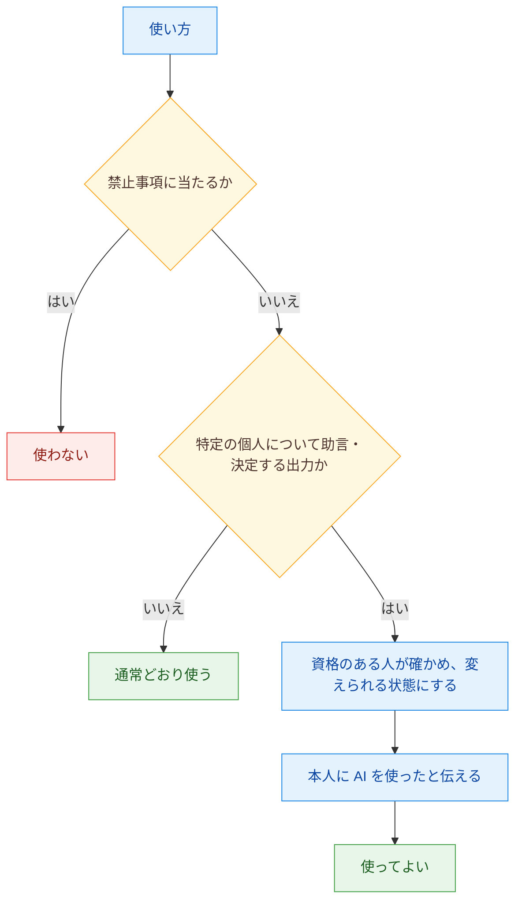

# Anthropic Usage Policy の要点

> ドメイン: 6. 責任ある利用・データ保護・ガバナンス（17%） ／ 更新: 2026-11-26

!!! abstract "ひとことで"
    Usage Policy は、誰にでも当てはまる ==禁止事項== と、個人の健康・権利・お金・暮らしを左右する ==高リスクの用途== での追加の要件からなる。高リスクの用途では、資格のある人が出力を確かめて変えられる状態にし、影響を受ける本人に AI を使ったことを伝える。

## 仕組み

Usage Policy（利用規約の一部として、claude.ai を含むすべての利用者に適用される）は3部構成だ。全員が守る Universal Usage Standards（禁止事項）、高リスクの用途の要件（High-risk Use Case Requirements）、そして特定の使い方への追加のガイドラインである。試験で効くのは前の2つの区別で、禁止事項は安全策を足しても使えないが、高リスクの用途は要件を満たせば使える。

高リスクの用途の要件がかかるのは、特定の個人について助言・決定する最終的な出力（High-risk AI Recommendation）だ。だから、同じ融資の分野でも、社内向けの調査・要約・分析や、個人を判断しない業務の文書には要件がかからない。法律の条文の一般的な説明のような、一般的な情報や教育的な内容も対象外である。確認する「資格のある人」は、その分野で出力を評価できる訓練や経験があり、法律で必要なら免許を持つ人で、届ける・決める前に ==意味のある確認と、変える権限== を持つ。

| 区分 | 例 | 要件 |
|---|---|---|
| 禁止事項 | 本人の同意の無い個人情報の収集やプロファイリング、詐欺・フィッシング、偽の口コミなどの組織的な偽装、選挙の偽情報 | 使わない |
| 高リスクの用途 | 個人への法律・医療・金融・信用・保険・住宅・雇用・教育の判断や助言 | 人の確認＋本人への開示 |
| 要件の対象外 | 内部の下書き・調査・要約・分析、一般的な説明 | 通常の見直し |

外部の人と直接話すチャットボットやエージェントは、相手に AI であることを伝える。エージェントがツールや connectors を通じて行う操作も、それを作った・動かす人の責任で Usage Policy に従わせる。違反が疑われると、Anthropic は警告や、利用の制限・停止をすることがある。

??? info "細かい決まり（2026-11-26 に確認した版）"
    - 禁止事項は15の領域（違法行為、重要インフラへの攻撃、不正アクセス、兵器、暴力・過激主義、プライバシーと本人確認の侵害、子どもの安全、心理的に有害な行為、偽情報、偽装した活動、民主的な手続きの妨害、監視・検閲、詐欺、プラットフォームの悪用、性的に露骨な内容）
    - 高リスクの領域は11（法律の助言、医療、金融、信用、保険、住宅、雇用、教育と資格、医療へのアクセス、公的給付、法的地位と裁定）。機械や医療機器など物理的な操作には別の要件（人が監視し止められること、モデルと独立した安全の制限）がある
    - 保険金の支払いのような本人に有利な決定は、法律が許せば人の確認なしでもよい。一部だけ・条件つきの承認はこの例外に入らない
    - チャットボットの開示は、少なくとも会話の始めか製品の画面で行う。Anthropic や Claude の名前を出す必要は無い
    - 人の感情を推定するシステム（医療・安全の目的を除く）、本人に知らせない信頼性・社会的な振る舞いの点数づけは禁止事項に入る
    - 規約の文言は改訂される。受験前に原文を読み直す

## 試験での見分け方

| 問われること | ○ 正しい | × ひっかけ |
|---|---|---|
| 個人への判断の文書を顧客に送る | 資格のある人が確かめて変えられるようにし、AI の関与を本人に伝える | 社内の担当者が目を通したので開示は不要とする |
| 同じ分野の社内の分析資料 | 高リスクの要件はかからない。通常の見直しで足りる | 融資の話だから高リスクの手続きを全部課す |
| 禁止事項に当たる依頼 | 安全策を足しても使わない | 「人が最後に確認するので許される」とする |
| 顧客対応のチャットボット | AI であることを相手に伝える | 自然さを優先し、人が答えているように見せる |

## 確認問題

**Q1.** 保険代理店のオペレーション担当が、保険金の請求のうち、減額や支払い不可になりそうな案件について、Claude に判断の理由書の下書きを作らせ、契約者に送る運用を考えている。Usage Policy に沿った運用として最も適切なものはどれか。（1つ選べ）
{ .quiz-q }

- A. 下書きを Claude に2回見直させ、矛盾が無ければそのまま契約者に送る
- B. 担当者が誤字だけを確認して送る。AI の関与は社内の記録に残せば足りる
- C. 査定の経験がある担当者が内容を確かめて直せるようにし、AI を使ったことを契約者に伝える
- D. 保険の判断は禁止事項なので、Claude は社内の要約にだけ使う

??? success "答えと解説"
    **正解: C。** 個人の保険の判断は高リスクの用途で、資格のある人の確認と本人への開示が要る。

    - A: Claude 自身の見直しは、資格のある人の確認の代わりにならない
    - B: 誤字だけの確認は意味のある確認ではない。開示は本人に対して行う
    - D: 保険は禁止事項ではなく、要件つきで使える高リスクの用途

**Q2.** 不動産会社のマーケティング担当が Claude の使い方を検討している。Usage Policy の禁止事項に当たるものはどれか。（2つ選べ）
{ .quiz-q }

- A. 物件の紹介文の下書きを作り、担当者が事実を確かめてから掲載する
- B. 実在しない入居者を装った好意的な口コミを大量に作り、複数のサイトに投稿する
- C. 地域の公開統計をまとめ、社内の出店検討の資料を作る
- D. 問い合わせ窓口のチャットボットの冒頭で、AI が答えていると伝える
- E. 見込み客の SNS を本人に知らせずに集め、人物像の一覧を作って他社に売る

??? success "答えと解説"
    **正解: B と E。** 偽装した口コミは偽の活動、本人に無断のプロファイルの販売はプライバシーの侵害に当たる。

    - A: 通常の業務文書で、人が確認している
    - C: 個人を判断しない内部の分析
    - D: 求められている AI の開示そのもの

**Q3.** 人事部の研修担当が、管理職向けに「Claude で書いた文書のうち、Usage Policy の高リスクの要件がかかるもの」を説明している。要件がかかるものとして最も適切なものはどれか。（1つ選べ）
{ .quiz-q }

- A. 特定の社員の降格を決めるために、上司が本人に渡す評価の結論の文書
- B. 労働法の条文が何を定めているかを、一般論として説明した社内の勉強会の資料
- C. 社員アンケートを集計し、部署ごとの傾向をまとめた経営会議の資料
- D. 来年度の採用計画の人数と予算を整理した、人事部内の検討メモ

??? success "答えと解説"
    **正解: A。** 特定の個人の雇用を左右する、本人に届く最終的な出力だけに要件がかかる。

    - B: 一般的な説明で、個人の状況に当てはめていないので対象外
    - C: 個人を判断しない業務の分析で、対象外
    - D: 内部の検討メモで、特定の個人についての判断ではない

## 出典
- [Usage Policy](https://www.anthropic.com/legal/aup)（公式。Universal Usage Standards、High-risk Use Case Requirements、Additional Use Case Guidelines）
- Claude Certified Associate – Foundations Exam Guide v1.1, Domain 6（公式、PDF）: https://cc.sj-cdn.net/instructor/6nizmqk8tpzpfjvt6qmmav7rh/public/1794946609/Claude_Certified_Associate_-_Foundations_Exam_Guide_Updated_Dec_7.pdf
