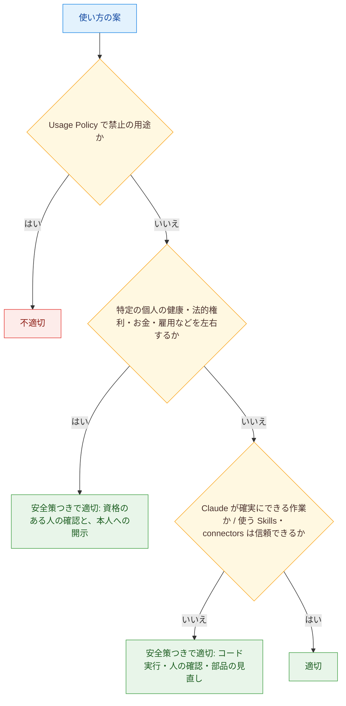

# ユースケースの適切さの分類

> ドメイン: 6. 責任ある利用・データ保護・ガバナンス（17%） ／ 更新: 2026-11-26

!!! abstract "ひとことで"
    Claude を使う案は「適切」「==安全策つきで適切==」「不適切」の3つに分け、どれにしたかの理由を書き残す。Usage Policy で禁じられた用途なら不適切、特定の個人についての重い判断に使うなら、人の確認などの安全策をつけて初めて適切になる。

## 仕組み

ガイドは、提案された使い方を、作業の向き不向き・任せられる範囲・第三者の Skills と connectors の信頼性・Anthropic Usage Policy の4つの観点で評価し、3つのどれかに分類して ==理由を文書に残す== ことを求めている。「使ってよいか」の二択で考えると、安全策を足せば使える案を全部捨てるか、危ない案をそのまま通すかになりやすい。真ん中の「安全策つきで適切」を持つことで、どの安全策が要るかを具体的に決められる。

下の流れは、ガイドの4つの観点を判断の順に並べたもの（並べ方は推論）。

| 分類 | 典型的な場面 | 残す理由の例 |
|---|---|---|
| 適切 | 社内向けの議事録の要約、企画書のたたき台 | 誤っても内部で直せる。個人を判断しない |
| 安全策つきで適切 | 融資や採用など個人への判断の材料づくり、正確な集計が要る分析 | 誰が確認し、何を開示し、どこをコード実行で確かめるか |
| 不適切 | Usage Policy の禁止事項（無断のプロファイリング、詐欺的な文面など） | どの禁止事項に当たるか |

「任せられる範囲」は、ドメイン4の Delegation の基準（やり直せるか、影響の大きさ、人の判断や共感が要るか、誰が責任を負うか）で決める。共感が要る連絡や、取り消せない決定は、Claude に下書きさせても送る・決めるのは人に残す。

??? info "分類を文書に残すときに書くこと（推論）"
    - 用途と、影響を受ける人（社内か、顧客か、特定の個人か）
    - 当てはまる Usage Policy の項目（禁止・高リスク・どちらでもない）
    - 使う機能と部品（Projects、Skills、connectors、コード実行）と、その出どころ
    - 安全策の中身（確認する人、開示の文言、検証の手順）と、見直す時期
    - ガイドは「理由を文書に残す」ことまでを求めており、書式は定めていない

## 試験での見分け方

| 問われること | ○ 正しい | × ひっかけ |
|---|---|---|
| 個人への判断に使う案 | 資格のある人の確認と開示をつけ、安全策つきで適切とする | 「AI は偏るので一律禁止」とする（安全策で使える案まで捨てる） |
| 内部の下書き・要約 | 適切と分類し、通常の見直しで足りる | 高リスク用途と同じ重い手続きを課す |
| 禁止事項に当たる案 | 不適切とし、該当する項目を理由に書く | 「人が最後に確認すれば使える」として通す |
| 分類の伝え方 | 分類と理由・安全策を文書に残す | 口頭で「問題ない」と伝えるだけ |

## 確認問題

**Q1.** 地方銀行の業務企画部が、個人向けローンの審査担当者に Claude を使わせる案をまとめている。Claude は申込書と添付資料を読んで、承認か否決かの推奨と理由を書く。担当者は数が多く、推奨をそのまま通知に使いたいという声がある。この案の分類として最も適切なものはどれか。（1つ選べ）
{ .quiz-q }

- A. 適切。審査の基準を Project の instructions に書けば、推奨をそのまま通知に使ってよい
- B. 安全策つきで適切。資格のある審査担当者が推奨を確かめて変えられるようにし、申込者に AI の関与を伝える
- C. 不適切。個人の財務に関わる判断に AI を使うことは、Usage Policy で一律に禁じられている
- D. 安全策つきで適切。推奨の根拠を Claude 自身に再確認させてから、そのまま通知に使う

??? success "答えと解説"
    **正解: B。** 個人の財務を左右する推奨は高リスクの用途で、人の確認と開示をつければ使える。

    - A: instructions を整えても、高リスクの用途で求められる人の確認と開示が無い
    - C: 一律に禁止ではない。安全策を条件に認められる用途を捨てている
    - D: Claude 自身の再確認は、資格のある人の確認の代わりにならない

**Q2.** 人材紹介会社の営業企画チームが、Claude を使う次の案を分類している。「適切」（通常の見直しで足りる）と分類してよいものはどれか。（2つ選べ）
{ .quiz-q }

- A. 社内の週次会議の議事メモから、決定事項と担当者の一覧を作る
- B. 登録者の SNS 投稿を集めて人柄を点数化し、本人に知らせずに企業へ渡す
- C. 求職者ごとに、応募先企業への推薦の可否を決めて、そのまま企業に送る
- D. 業界の公開統計をもとに、来期の営業方針の検討資料のたたき台を作る
- E. 不採用になった求職者への連絡文を Claude に書かせ、確認せずに一斉に送る

??? success "答えと解説"
    **正解: A と D。** どちらも内部の下書きで、特定の個人についての判断をしない。

    - B: 本人の同意の無いプロファイリングで、不適切
    - C: 個人の雇用に関わる判断なので、人の確認と開示を条件にした「安全策つきで適切」
    - E: 共感が要り、相手に直接届く連絡。人が確認して送る安全策が要る

**Q3.** コンサルティング会社の研修担当が、新人向けに「Claude を使う前に、その使い方が適切かを判断するチェックシート」を作っている。シートの最後の欄として最も適切なものはどれか。（1つ選べ）
{ .quiz-q }

- A. 「使ってよい／使ってはいけない」の二択に丸をつける欄
- B. Claude に同じ質問をして、使ってよいと答えたかを書く欄
- C. 上司の承認印の欄だけを置き、判断の中身は書かない
- D. 3つの分類のどれかと、その理由・必要な安全策を書く欄

??? success "答えと解説"
    **正解: D。** ガイドは、3つの分類と、その理由を文書に残すことを求めている。

    - A: 二択だと「安全策つきで適切」を表せない
    - B: 判断の責任を Claude に移しており、理由が残らない
    - C: 承認だけでは、なぜその分類にしたかが後から分からない

## 出典
- Claude Certified Associate – Foundations Exam Guide v1.1, Domain 6: Use-Case Appropriateness（公式、PDF）: https://cc.sj-cdn.net/instructor/6nizmqk8tpzpfjvt6qmmav7rh/public/1794946609/Claude_Certified_Associate_-_Foundations_Exam_Guide_Updated_Dec_7.pdf
- [Usage Policy](https://www.anthropic.com/legal/aup)（公式。High-risk Use Case Requirements）
