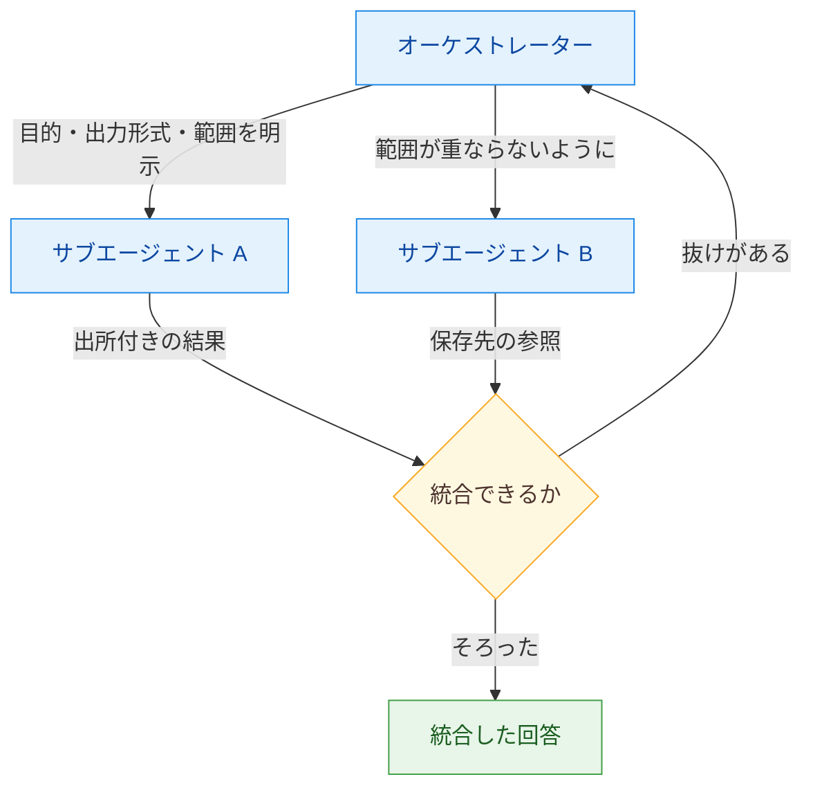

# オーケストレーターとサブエージェントの分解の評価

> ドメイン: 1. ソリューションの設計とアーキテクチャ（18%） ／ 更新: 2026-11-26

!!! abstract "ひとことで"
    分解の案は、==タスクの境界・制御の流れ・結果の統合==の3か所で壊れる。観測性とエラーからの回復の要件を当てて、どこで壊れるかを特定する。分けると速く広く調べられるが、トークンは大きく増え、文脈を共有しなければならない作業には向かない。

## 仕組み

サブエージェントは自分専用の文脈で動き、親の会話履歴を見ない。親から渡るのは委任の指示だけで、親に返るのは結果の要約だけだ。この性質が、3つの壊れ方を生む。

| 壊れる箇所 | 典型的な症状 | 直し方 |
|---|---|---|
| タスクの境界 | 2つのサブエージェントが同じことを調べ、別の範囲が抜ける | 委任ごとに、目的・出力の形・使うツールと情報源・範囲の境界を書く |
| 制御の流れ | 1つの遅いサブエージェントを待って全体が止まる。1つの失敗で最初からやり直す | 回数の上限を付け、失敗した地点から再開できるようにチェックポイントを残す |
| 結果の統合 | 根拠や出所が要約の途中で落ちる。伝言ゲームで内容が変わる | 出所付きの構造で返させる。大きな成果物は外部に保存し、参照だけを返す |



観測性の要件があるなら、各サブエージェントの呼び出しを親の呼び出しと結び付けて追えるようにする。Anthropic の調査システムでは、本番の全面的なトレースを入れて、エージェントが失敗した理由を体系的に直せるようになった。==エラーで最初からやり直さず、失敗した地点から再開する==仕組みも、長時間の処理では欠かせない。

分けるかどうかは価値で決める。マルチエージェントは、並列にしやすく価値の高い作業に向く。全員が同じ文脈を共有しなければならない作業や、依存の多い作業には向かない。

??? info "数値と仕様の細部"
    - 公式ブログの値: エージェントはチャットの約4倍、マルチエージェントは約15倍のトークンを使う。調査の性能のばらつきの 80% はトークン量で説明できた
    - Claude Code のサブエージェントは、既定で会話の下3層まで入れ子にできる（`CLAUDE_CODE_MAX_SUBAGENT_SPAWN_DEPTH` で変更）。記録は `~/.claude/projects/{project}/{sessionId}/subagents/` に1件ずつ残る
    - `claude -p --output-format stream-json` では、サブエージェントのメッセージに `parent_tool_use_id` が付き、どの呼び出しから生まれたかをたどれる
    - Agent SDK には、サブエージェントごとの経過時間の締め切りが無い。`AgentDefinition` の `maxTurns` で回数を抑える
    - Managed Agents のマルチエージェントでは、エージェントごとの作業がセッションのスレッドになり、一覧・ストリーム・中断ができる

## 試験での見分け方

<div class="vs" markdown>

| 問われること | ○ 正しい | × ひっかけ |
|---|---|---|
| 調査が重複し、範囲に抜けがある | 委任の指示に目的・出力形式・範囲の境界を書く | サブエージェントを増やす、統合役のモデルを上げる |
| 1か所の失敗で全体をやり直している | チェックポイントから、失敗した地点だけを再開する | 全体の再試行回数を増やす |
| どの主張がどこから来たか追えない | 出所付きの構造で返させ、呼び出しの親子関係をトレースする | 統合役に自由文で要約させる |
| 文脈を共有しないと進まない作業 | 1つのエージェントで進める | 並列にすれば速いとして分割する |

</div>

## 確認問題

**Q1.** 市場調査の会社が、オーケストレーターと4つのサブエージェントで競合調査のレポートを作っている。レポートは、北米の価格情報が2回重複して載り、アジアの情報が丸ごと抜けていた。各サブエージェントは正常に終わっている。委任の記録は次のとおり。最も適切な直し方はどれか。（1つ選べ）
{ .quiz-q }

```text
delegate -> sub-1: "競合の価格を調べて"
delegate -> sub-2: "競合の価格動向を調べて"
delegate -> sub-3: "競合の新製品を調べて"
delegate -> sub-4: "競合の評判を調べて"
```

<div class="quiz" data-answer="D" markdown>

- A. サブエージェントを8つに増やし、抜けた地域も誰かが拾うようにする
- B. 統合を担うオーケストレーターのモデルを上の階層にし、重複を見つけて消させる
- C. サブエージェント同士が直接やり取りして、担当を調整できるようにする
- D. 委任ごとに、目的・出力の形・使う情報源・担当する地域と範囲の境界を明示する

</div>

??? success "答えと解説"
    **正解: D。** 正常に終わったのに重複と抜けがあるので、タスクの境界の切り方が原因だ。委任には目的・出力の形・ツールと情報源の指針・範囲の境界を書く。

    - A: 境界が曖昧なままでは、数を増やしても重複が増える
    - B: 統合で重複は消せても、抜けたアジアの情報は作れない
    - C: 境界の曖昧さを残したまま、流れを追いにくくする

**Q2.** 製薬会社の文献レビューのパイプラインは、約6時間かけて 40 のサブタスクを処理する。どれか1つのサブタスクがタイムアウトすると、パイプライン全体が最初からやり直しになり、締め切りに間に合わない。最も適切な対応はどれか。（1つ選べ）
{ .quiz-q }

<div class="quiz" data-answer="B" markdown>

- A. パイプライン全体の再試行の回数を3回に増やす
- B. 終わったサブタスクの結果をチェックポイントとして保存し、失敗したサブタスクだけを再開する
- C. サブタスクのタイムアウトを外し、終わるまで待ち続ける
- D. オーケストレーターのプロンプトに「タイムアウトしないよう手短に調べること」と書く

</div>

??? success "答えと解説"
    **正解: B。** 長い処理では、最初からやり直さず、失敗した地点から再開する。

    - A: やり直す単位が全体のままなので、時間の無駄が回数分増える
    - C: 止まったサブタスクを待ち続けると、全体が止まる
    - D: 指示では処理時間を保証できず、失敗時の回復にもならない

**Q3.** 金融機関のコンプライアンス部門が、マルチエージェントの調査システムに「最終報告の各主張について、どのサブエージェントがどの資料から得たかを、運用者が後から確かめられること」を求めている。この要件を満たす設計として適切なものはどれか。（2つ選べ）
{ .quiz-q }

<div class="quiz" data-answer="A,C" markdown>

- A. サブエージェントに、主張と出所（資料と箇所）を対にした構造で返させ、大きな抜粋は保存して参照を返させる
- B. オーケストレーターに、サブエージェントの結果を読みやすい自由文の要約にまとめ直させる
- C. 各サブエージェントの呼び出しを親の呼び出しと結び付け、ツール呼び出しを含めてトレースに残す
- D. 追跡を簡単にするため、全サブエージェントに1つの会話の文脈を共有させる
- E. ログの量を抑えるため、最終報告だけを保存する

</div>

??? success "答えと解説"
    **正解: A と C。** 統合で出所が落ちないように構造で返させ、呼び出しの親子関係をトレースで追えるようにする。

    - B: 自由文にまとめ直すと、主張と出所の対応が失われる
    - D: 文脈の分離という分解の利点を捨て、追跡も易しくならない
    - E: 途中の記録が無いと、主張の出所を確かめられない

## 出典
- Claude Certified Architect – Professional Exam Guide v1.1, Domain 1「Orchestrator and Subagent Decomposition」（公式、PDF）: https://cc.sj-cdn.net/instructor/6nizmqk8tpzpfjvt6qmmav7rh/public/1794946420/Claude_Certified_Architect_-_Professional_Exam_Guide_Updated_Dec_7.pdf
- [How we built our multi-agent research system](https://www.anthropic.com/engineering/multi-agent-research-system)（公式、エンジニアリングブログ）
- [Create custom subagents](https://code.claude.com/docs/en/sub-agents)（公式、Claude Code）
- [Run Claude Code programmatically](https://code.claude.com/docs/en/headless)（公式、Claude Code。`parent_tool_use_id`）
- [Hosting the Agent SDK](https://code.claude.com/docs/en/agent-sdk/hosting)（公式、Agent SDK。既知の制限）
- [Features overview](https://platform.claude.com/docs/en/build-with-claude/overview)（公式。Managed Agents のセッションスレッド）
