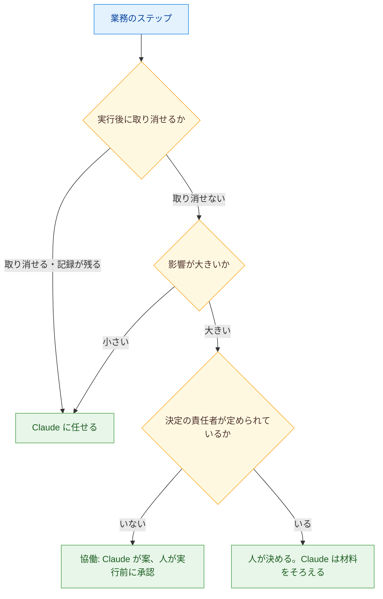

# Claude と人の分担

> ドメイン: 1. ソリューションの設計とアーキテクチャ（18%） ／ 更新: 2026-11-26

!!! abstract "ひとことで"
    業務の各ステップを「Claude に任せる」「協働（Claude が作り、人が実行前に承認する）」「人が持つ」に振り分ける。決め手は==取り消せるか・影響の大きさ・誰が責任を負うか==の3つで、承認は人の手で止まる仕組みに置く。

## 仕組み

分担は業務プロセス全体ではなく、ステップごとに決める。読む・調べる・下書きする・取り消せて記録が残る更新は Claude に任せる。取り消せないか影響の大きい操作は、Claude が案を作り、人が実行の前に承認する協働にする。法令や社内規程で名前のある人が判断の責任を負うものは、Claude が材料をそろえても、決定そのものは人が持つ（推論。ガイドは3つの基準を挙げるだけで、例は示さない）。



承認は、実行を止められる場所に置く。Claude Managed Agents の権限ポリシー（permission policy）なら、そのツールに `always_ask` を付けると、セッションが止まって `user.tool_confirmation` を待つ。`auto` はサーバーが呼び出しごとに安全かを判定する仕組みで、公式ドキュメントは ==`auto` は人のチェックポイントではない==と明記している。安全と判定された呼び出しは誰も見ないうちに実行される。モデル自身が申告する確信度や、プロンプトの「必ず確認すること」も、止める仕組みにはならない。

全部のステップに承認を挟むと、承認待ちが積み上がり、承認する人も中身を見なくなる（推論）。取り消せるステップは事後のログ確認に回し、承認は少数の取り消せない操作に絞る。

??? info "権限ポリシーの細かい決まり（Managed Agents）"
    - 種類は `always_allow`（自動で実行）、`always_ask`（承認を待つ）、`auto`（サーバーが実行・拒否・承認待ちを判定）
    - 既定は、組み込みのツール群（agent toolset）が `always_allow`、MCP のツール群が `always_ask`。`configs` でツールごとに上書きできる
    - `auto` で拒否された呼び出しは、クライアントから覆せない。`user.message` の内容は「依頼者の意図」として判定に使われるので、信頼できない利用者の入力をそのまま流す場合は、その利用者に無審査で実行させたくないツールを `always_ask` にする
    - 承認待ちのセッションは、応答があるまで無期限に待つ
    - 自前で実行するカスタムツールには権限ポリシーが効かない。承認はアプリ側で実装する

## 試験での見分け方

<div class="vs" markdown>

| 問われること | ○ 正しい | × ひっかけ |
|---|---|---|
| 取り消せない高額の操作 | 実行前に、人の承認で止まる仕組みを置く | `auto` やモデルの確信度で、承認の要否を決めさせる |
| 承認待ちが詰まっている | 取り消せる操作は事後の記録確認に回し、承認を絞る | 承認者を増やす、または承認をすべて外す |
| 責任者が定められた判断 | Claude は根拠と案をそろえ、決定は人が下す | 精度が高ければ Claude に決定まで任せる |
| 承認の実装 | ツールの実行を止める設定（`always_ask`、アプリ側の承認） | システムプロンプトに「実行前に確認を取ること」と書く |

</div>

## 確認問題

**Q1.** 医療機器メーカーの購買部門が、発注業務を Claude Managed Agents で自動化した。社内規程では「発注額 50 万円以上の発注は、購買担当者が実行前に承認する」と決まっている。監査で、60 万円の発注が誰の承認も無く送られていたと分かった。エージェントの設定は次のとおり。最も適切な直し方はどれか。（1つ選べ）
{ .quiz-q }

```yaml
tools:
  - type: mcp_toolset
    mcp_server_name: procurement   # create_order ツールを持つ
    default_config:
      permission_policy: {type: auto}
```

<div class="quiz" data-answer="B" markdown>

- A. システムプロンプトに「50 万円以上の発注は、担当者の承認を得てから送ること」と書き足す
- B. `create_order` の権限ポリシーを `always_ask` にし、承認待ちの通知を購買担当者に送る
- C. `auto` のまま、発注の前に Claude に確信度を出させ、低いときだけ承認を求めさせる
- D. 権限ポリシーを `always_allow` にし、送られた発注を翌朝に担当者がまとめて確認する

</div>

??? success "答えと解説"
    **正解: B。** `auto` は人のチェックポイントではない。実行前に人が承認すべき操作は、そのツールを `always_ask` にして止める。

    - A: プロンプトの指示は守られる保証が無く、実行を止める仕組みにならない
    - C: モデルが申告する確信度は、取り消せない操作の歯止めにならない
    - D: 事後の確認では、送られた発注を取り消せない

**Q2.** 地方銀行が、住宅ローンの審査業務に Claude を入れる。規程上、融資の可否は審査役が名前を出して決める。分担として妥当なものはどれか。（2つ選べ）
{ .quiz-q }

<div class="quiz" data-answer="A,D" markdown>

- A. 提出書類の読み取りと不足書類の洗い出しは、Claude に任せる
- B. 過去の承認例と比べて一致度が高い申込みは、Claude が可否まで決める
- C. 可否の判断を速くするため、Claude の推奨をそのまま審査役の名前で通知する
- D. Claude は審査の論点と根拠を整理した案を作り、可否は審査役が決める
- E. 誤りを防ぐため、書類の読み取りも含めて全ステップを審査役が手で行う

</div>

??? success "答えと解説"
    **正解: A と D。** 取り消せて影響の小さい作業は任せ、責任者が定められた決定は人が持つ。

    - B: 一致度が高くても、決定の責任は審査役にある。責任の所在は精度で変わらない
    - C: 中身を見ずに名前だけ付けると、責任者が判断したことにならない
    - E: 取り消せる下準備まで人に戻すと、分担の利点が無くなる

**Q3.** SaaS 企業の基盤チームが、本番データベースのスキーマ変更を Claude Code に手伝わせる。列の削除を含む変更で、実行後はバックアップからしか戻せない。最も適切な分担はどれか。（1つ選べ）
{ .quiz-q }

<div class="quiz" data-answer="D" markdown>

- A. Claude に変更の作成から本番への適用までを任せ、適用後に差分を人が確認する
- B. 列の削除が含まれるので、変更の作成も検証も、すべて人が手で行う
- C. Claude に「本番に適用してよいか自信が無ければ止まること」と指示して任せる
- D. Claude が変更と戻し手順を作って検証環境で試し、本番への適用は人が承認してから行う

</div>

??? success "答えと解説"
    **正解: D。** 取り消せない操作だけを人の承認の後ろに置き、その手前の作業は Claude に任せる協働にする。

    - A: 事後の確認では、削除した列は戻らない
    - B: 取り消せる作成と検証まで人に戻す必要は無い
    - C: モデルの自己申告は、取り消せない操作の歯止めにならない

## 出典
- Claude Certified Architect – Professional Exam Guide v1.1, Domain 1「Task Delegation Between Claude and Humans」（公式、PDF）: https://cc.sj-cdn.net/instructor/6nizmqk8tpzpfjvt6qmmav7rh/public/1794946420/Claude_Certified_Architect_-_Professional_Exam_Guide_Updated_Dec_7.pdf
- [Permission policies](https://platform.claude.com/docs/en/managed-agents/permission-policies)（公式、Managed Agents）
- [Building effective agents](https://www.anthropic.com/engineering/building-effective-agents)（公式、エンジニアリングブログ。2024-12 の記事で、ツール類の記述は古い部分があると記事自身が注記）
