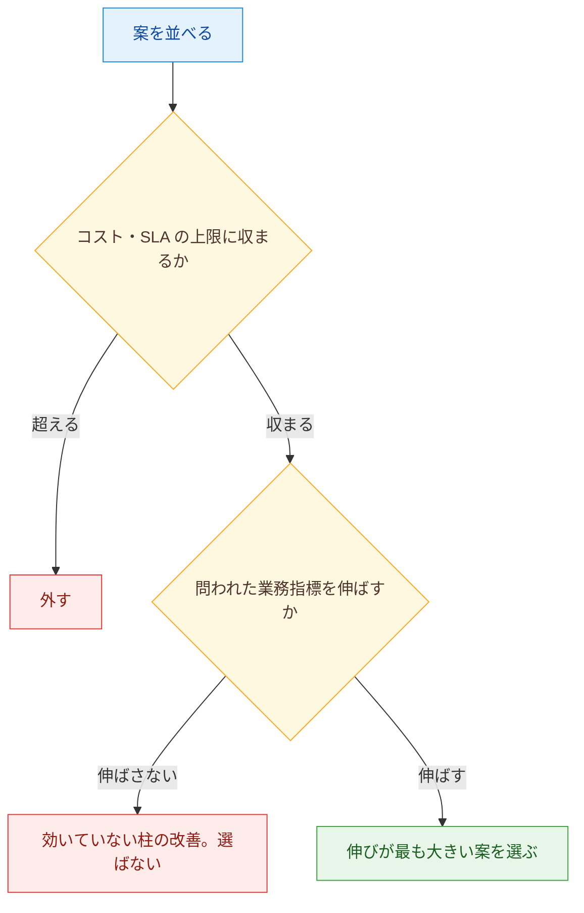

# 価値にもとづく設計の判断

> ドメイン: 1. ソリューションの設計とアーキテクチャ（18%） ／ 更新: 2026-11-26

!!! abstract "ひとことで"
    まずコストか SLA の上限を超える案を外す。残った案の中から、示された価値の柱（効率・変革・生産性・ソリューションのコスト・性能の SLA）のうち==問われている業務指標を最も伸ばす案==を選ぶ。上限の中に収まる限り、品質を最大にする案が正解とは限らない。

## 仕組み

判断は2段で行う。1段目は制約で外す段で、月の予算・1件あたりの単価・応答時間の SLA を超える案は、価値が高くても外す。2段目は残った案を比べる段で、問題文が挙げた価値の柱と業務指標（解決率、処理件数、1件あたりの時間など）で比べる。挙げられていない柱をいくら伸ばしても、点にならない（推論。ガイドは柱の名前を挙げるだけで、計算の手順は示さない）。



コストの見積もりは、1件あたりの単価 × 件数で出す。単価を動かす主なつまみは次のとおり。

| つまみ | 効き方 | 代わりに払うもの |
|---|---|---|
| モデルの階層 | 単価が階層ごとに大きく違う | 品質。評価で要件を満たすかを確かめる |
| Message Batches | 入出力とも半額 | 即時性。結果は非同期で返る |
| プロンプトキャッシュ | 繰り返す前置きの読み込みが安く速くなる | 書き込みの割増し。読み込みが少ないと元が取れない |
| 構成の複雑さ | 単純な構成ほどトークンが少ない | 開かれた問題での性能。エージェント型は遅延とコストで性能を買う |

価値は、モデルの一般的な指標でなく、==業務の指標を評価で測った値==で比べる。同じ要件を満たすなら、安い構成が「ソリューションのコスト」の柱で勝つ。

??? info "数値（2026-11-26 時点の公式料金）"
    - Message Batches は入出力とも 50% 引き。多くは1時間以内に終わるが、24時間で終わらない分は期限切れになる
    - キャッシュの書き込みは基本入力の 1.25 倍（5分）か 2 倍（1時間）。読み込みは多くのモデルで 0.1 倍（Opus 5.5・Sonnet 5.5 は 0.05 倍）。5分のキャッシュは1回の読み込みで元が取れる
    - バッチとキャッシュの割引は重ねられる
    - マルチエージェントはチャットの約15倍のトークンを使う（公式ブログ）
    - Managed Agents は、トークン代に加えてセッションの実行時間が 1 時間あたり $0.08（`running` の間だけ）。バッチ割引は効かない
    - Message Batches は、Amazon Bedrock、Google Cloud の Google 管理版、Microsoft Foundry では使えない

## 試験での見分け方

<div class="vs" markdown>

| 問われること | ○ 正しい | × ひっかけ |
|---|---|---|
| 予算の上限がある | 上限を超える案は、価値が高くても外す | 品質が最も高い案を選び、予算の増額を求める |
| 翌日までに出ればよい大量処理 | バッチで単価を下げ、浮いた分で品質の要件を満たす | 即時の API で軽いモデルにして単価を下げる |
| 応答時間はすでに SLA を満たしている | 問われた業務指標を伸ばす案に予算を使う | さらに速くする高額の選択肢に使う |
| 案の価値の比べ方 | 業務の指標を評価で測って比べる | 一般的なベンチマークの点数で比べる |

</div>

## 確認問題

**Q1.** 不動産会社が、Claude API で毎月 20,000 件の賃貸契約書を要約する。結果は翌営業日の朝までに出ればよい。予算は月 $1,000 で、要約の正確さは社内評価で 90% 以上が要件だ。1件の入力は約 30,000 トークン、出力は約 2,000 トークン。評価と料金は次のとおり。最も適切な構成はどれか。（1つ選べ）
{ .quiz-q }

```text
model        eval_accuracy  input $/MTok  output $/MTok
opus-5-5     94%            4             20
sonnet-5-5   91%            2             10
haiku-5-5    78%            0.10          0.50
```

<div class="quiz" data-answer="C" markdown>

- A. 最も正確な Opus を即時の API で使う
- B. 最も安い Haiku を即時の API で使い、予算に大きな余裕を残す
- C. Sonnet を Message Batches で使う
- D. Opus を即時の API で使い、高速モード（fast mode）で処理時間も縮める

</div>

??? success "答えと解説"
    **正解: C。** Sonnet の即時は1件 $0.08 で月 $1,600。バッチの半額なら $800 で予算に収まり、正確さ 91% も要件を満たす。翌朝までという SLA はバッチで足りる。

    - A: 1件 $0.16 で月 $3,200 になり、予算を超える
    - B: 予算には収まるが、正確さ 78% が要件に届かない
    - D: 高速モードは割増しで、予算をさらに超える。時間の SLA は効いていない

**Q2.** 通信会社のサポート部門が、Claude の支援ツールの改善案を比べている。部門の目標は「オペレーター1人が1時間に解決する問い合わせの数」（生産性）を上げること。月の追加予算は $3,000 で、最初の応答は 30 秒以内（現状 8 秒）が SLA だ。最も適切な案はどれか。（1つ選べ）
{ .quiz-q }

<div class="quiz" data-answer="A" markdown>

- A. 契約と過去の対応履歴を引く検索ツールを足し、オペレーターが調べる時間を減らす（追加 月 $900）
- B. 問い合わせごとに複数のサブエージェントで背景を調べさせる（追加 月 $11,000）
- C. 全応答に高速モードを使い、最初の応答を 3 秒に縮める（追加 月 $2,500）
- D. モデルを最上位の階層に替え、汎用ベンチマークの点数を上げる（追加 月 $2,800）

</div>

??? success "答えと解説"
    **正解: A。** 予算に収まり、問われた生産性の指標に直接効く。

    - B: 予算の上限を大きく超えるので、価値の大小を比べる前に外れる
    - C: 応答時間はすでに SLA を満たしており、効いていない柱を伸ばすだけ
    - D: 汎用の点数は業務の指標ではなく、生産性が上がるかが示されていない

**Q3.** 価値にもとづく設計の判断として正しいものはどれか。（2つ選べ）
{ .quiz-q }

<div class="quiz" data-answer="B,D" markdown>

- A. 予算に収まるなら、常に最も品質の高いモデルの階層を選ぶ
- B. コストや SLA の上限を超える案は、業務上の価値が高くても選ばない
- C. SLA をすでに満たしている項目も、さらに良くすれば価値が上がるので優先する
- D. 案の価値は、問題が挙げた業務の指標を、評価で測った値で比べる
- E. 複数の改善案には、予算を均等に配分するのが最も公平で価値が高い

</div>

??? success "答えと解説"
    **正解: B と D。** 上限で外し、残った案を問われた業務の指標で比べる。

    - A: 要件を満たす安い構成があれば、ソリューションのコストの柱で劣る
    - C: 満たしている SLA をさらに伸ばしても、問われた指標は動かない
    - E: 配分は価値で決める。均等に分ける理由は無い

## 出典
- Claude Certified Architect – Professional Exam Guide v1.1, Domain 1「Value-Based Architectural Decisions」（公式、PDF）: https://cc.sj-cdn.net/instructor/6nizmqk8tpzpfjvt6qmmav7rh/public/1794946420/Claude_Certified_Architect_-_Professional_Exam_Guide_Updated_Dec_7.pdf
- [Pricing](https://platform.claude.com/docs/en/about-claude/pricing)（公式）
- [Batch processing](https://platform.claude.com/docs/en/build-with-claude/batch-processing)（公式）
- [Building effective agents](https://www.anthropic.com/engineering/building-effective-agents)（公式、エンジニアリングブログ。2024-12 の記事で、ツール類の記述は古い部分があると記事自身が注記）
- [How we built our multi-agent research system](https://www.anthropic.com/engineering/multi-agent-research-system)（公式、エンジニアリングブログ）
