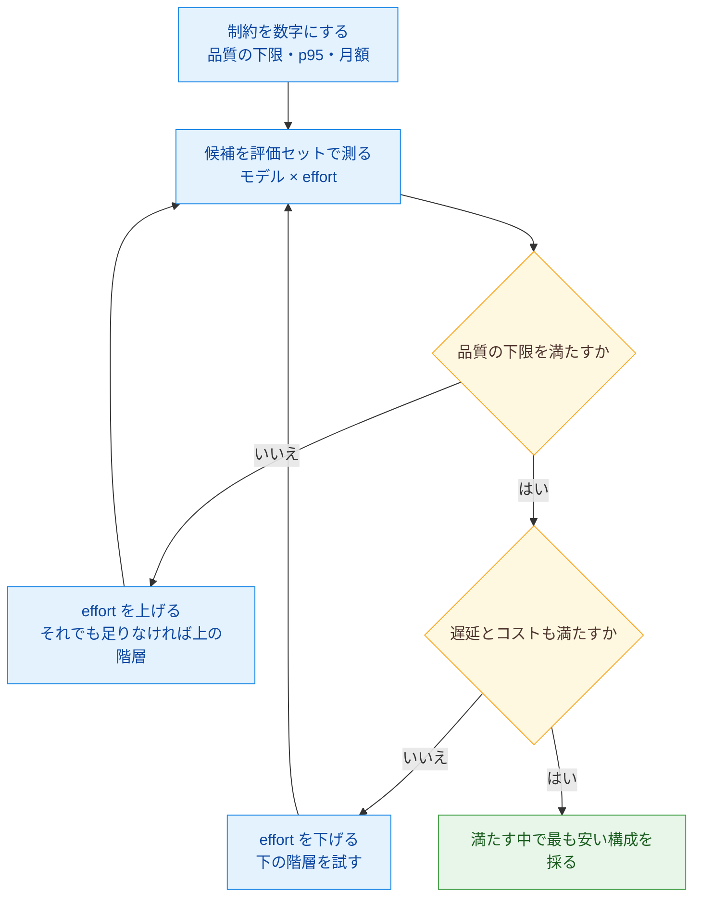

# モデルの階層の選択

> ドメイン: 2. モデル・プロンプト・コンテキストエンジニアリング（13%） ／ 更新: 2026-11-26

!!! abstract "ひとことで"
    遅延・コスト・品質の制約を==すべて同時に満たす、いちばん安い構成==を、自分の評価セットで選ぶ。モデルを替える前に、今のモデルの effort を下げて足りないかを先に確かめる。

## 仕組み

選ぶ手順は、まず制約を数字にすることから始まる。品質の下限（評価セットの合格率）、遅延の上限（p95 など）、1件あたりのコストに呼び出し回数を掛けた月額の上限だ。次に候補を評価セットで測り、どれか1つでも破る候補を外す。残った中で最も安いものを選ぶ。公式の比較表は出発点にすぎない。決めるのは、実際のプロンプトとデータで測った結果だ。



| 階層（2026-11 時点） | 公式の位置づけ | 相対的な遅延 | 向く仕事 |
|---|---|---|---|
| Fable 5.2 | 最も高い能力 | 中 | 数時間のエージェント、深い調査 |
| Opus 5.5 | 複雑なエージェント型のコーディングと業務 | 中 | 長時間の自律コーディング、大規模な改修 |
| Sonnet 5.5 | 速さと賢さの釣り合い | 速い | 日常のコード生成、データ分析、ツール利用 |
| Haiku 5.5 | 最も速く安い | 最速 | 分類・抽出・振り分け、大量処理、サブエージェント |

公式は、effort の調整がモデルの切り替えより良い手になることが多いとしている。effort は同じモデルのまま、賢さと遅延・コストを交換するつまみだ。始め方は2通りある。安いモデル（Haiku）から始めて足りなければ上げるか、強いモデル（Opus）で作ってから effort やモデルを下げていくかだ。

安いモデルと強いモデルを組み合わせる手もある。安いモデルが実行して難所だけ強いモデルに相談する advisor 型と、強いモデルが計画して作業を安いサブエージェントに配る orchestrator 型だ。公式の計測では、配る型が勝ったのは「独立した作業に分けられる」「1つのコンテキストに収まらない」場合に限られた。依存の連鎖になった1本の作業では、強いモデル単体の effort を下げた構成がどの測定でも勝っている。

??? info "価格と細かい決まり（2026-11-26 に公式で確認）"
    - 1M トークンあたりの入力／出力: Fable 5.2 $8/$40、Opus 5.5 $4/$20、Sonnet 5.5 $2/$10、Haiku 5.5 $0.10/$0.50（プロンプトが 100,000 トークンを超えるリクエストは $0.50/$2.50）
    - Haiku 5.5 は、キャッシュの読み込みも含めたプロンプト長で、リクエストごとに高い価格に切り替わる。長い文書を毎回渡す仕事では、単価の差が縮む
    - effort の既定値: Opus 5.5 と Haiku 5.5 は `medium`、Fable 5.2 と Sonnet 5.5 は `high`
    - Message Batches API は入力・出力とも 50% 引き。急がない大量処理で使う
    - fast mode は出力速度が最大 2.5 倍で、価格は割増（Opus 5.5 は $8/$40）。対象は Fable 5.2、Opus 5.5、Opus 5、Opus 4.8 など。Haiku と Sonnet 5.5 は対象外
    - Claude 4.7 以降のトークナイザーは、同じ文章で約 30% 多くトークンを数える。古いモデルからの見積もりを流用しない
    - 公式の計測例: Opus 5.5（`medium`）に Haiku 5.5 のサブエージェントを足すと、1回あたりのコストは 32% 下がったが、合格率は約 4 ポイント下がった。公式は「先に effort を下げた構成と比べよ」としている

## 試験での見分け方

<div class="vs" markdown>

| 問われること | ○ 正しい | × ひっかけ |
|---|---|---|
| 候補の選び方 | 全制約を満たす中で最も安い構成 | 正答率が最も高いモデル（遅延やコストの上限を破る） |
| コストを下げたい | 今のモデルの effort を下げた評価を先に取る | いきなり下の階層へ替え、品質の下限を割る |
| 決める根拠 | 自分のプロンプトとデータでの評価 | 公開ベンチマークの順位や「最新だから」 |
| 安いモデルを混ぜる | 独立した作業や、1コンテキストに収まらない量に限る | どんな仕事でも安い作業者に配れば得をすると考える |
| 遅延の上限 | p95 など、制約で示された指標で比べる | 平均や、ストリーミングで見かけを速くする話にすり替える |

</div>

## 確認問題

**Q1.** 問い合わせの振り分けシステムで、チケットをカテゴリに分類する。1日 200万件、p95 遅延 1.5 秒以内、正答率 94% 以上が要件だ。評価セットの結果は次のとおり。最も適切な構成はどれか。（1つ選べ）
{ .quiz-q }

```text
構成                     正答率   p95     1M件あたりの費用
Haiku 5.5 / low         95.1%   0.9s    $38
Haiku 5.5 / high        95.6%   1.7s    $61
Sonnet 5.5 / medium     96.0%   1.8s    $410
Opus 5.5 / medium       96.4%   2.6s    $820
```

<div class="quiz" data-answer="B" markdown>

- A. Opus 5.5 / medium。正答率が最も高く、誤分類による手戻りが最も少ない
- B. Haiku 5.5 / low。3つの要件をすべて満たし、費用が最も小さい
- C. Sonnet 5.5 / medium。ストリーミングで返し、遅延の要件を体感で満たす
- D. Haiku 5.5 / high。正答率の余裕を広げるため、effort を上げておく

</div>

??? success "答えと解説"
    **正解: B。** 全制約を満たす候補は Haiku 5.5 / low だけで、しかも最も安い。

    - A: p95 2.6 秒で遅延の要件を破る。費用も約 20 倍になる
    - C: 振り分けは結果のラベルがそろって初めて使える。ストリーミングでは p95 1.8 秒は縮まない
    - D: p95 1.7 秒で遅延の要件を破る。正答率はすでに下限を超えている

**Q2.** 契約書レビューのエージェントを Opus 5.5（effort は既定の `medium`）で動かしている。品質の下限は守れているが、月額が予算を 30% 超えた。弁護士が画面で結果を待つので、1分以内に返す必要がある。評価では、Opus 5.5 / `low` は品質の下限を保ち費用が 35% 下がった。Sonnet 5.5 / `medium` は下限を 3 ポイント割った。最も適切な対応はどれか。（1つ選べ）
{ .quiz-q }

<div class="quiz" data-answer="D" markdown>

- A. 単価が半分の Sonnet 5.5 に切り替え、下がった品質はプロンプトの書き足しで補う
- B. Opus 5.5 をオーケストレーターにし、条項ごとの確認を Haiku 5.5 のサブエージェントに配る
- C. レビューを Message Batches API に回し、入力と出力の費用を半分にする
- D. Opus 5.5 のまま effort を `low` に下げ、評価セットでの品質を見張り続ける

</div>

??? success "答えと解説"
    **正解: D。** 評価で、品質の下限と予算の両方を満たすと確かめられた唯一の構成だ。

    - A: 評価で品質の下限を割っている。プロンプトで戻るかは測っていない
    - B: 公式の計測でも、安いサブエージェントを混ぜると合格率が下がることがある。先に effort を下げた構成と比べるべきだ
    - C: バッチは非同期で、1分以内に返す要件を守れない

**Q3.** データ分析エージェントのモデルを決める。判断の進め方として適切なものはどれか。（2つ選べ）
{ .quiz-q }

<div class="quiz" data-answer="A,C" markdown>

- A. 実際のプロンプトとデータで評価セットを作り、正答率・端のケース・費用を候補ごとに比べる
- B. 公開ベンチマークで最上位のモデルを選び、自前の評価は本番の様子を見てから作る
- C. 安いモデルへ替える前に、今のモデルの effort を下げた構成で要件を満たせないかを測る
- D. 強いモデルが計画し安いモデルが実行する構成にすれば、品質を落とさずに必ず安くなる
- E. 将来の移行の手間を省くため、最新で最上位のモデルを選んでおく

</div>

??? success "答えと解説"
    **正解: A と C。** 決め手は自前の評価で、effort は階層を替える前に試すつまみだ。

    - B: ベンチマークは自分の仕事を測っていない。評価なしでは、どの制約を破るか分からない
    - D: 公式の計測では、配る構成が勝つのは独立した作業や大きすぎる作業に限られた。品質が下がった例もある
    - E: 遅延とコストの制約を無視している。どのモデルもいずれ移行が要る

## 出典
- Claude Certified Architect – Professional Exam Guide v1.1（Dec 7 版）, Domain 2「Model Tier Selection」（公式、PDF）: https://cc.sj-cdn.net/instructor/6nizmqk8tpzpfjvt6qmmav7rh/public/1794946420/Claude_Certified_Architect_-_Professional_Exam_Guide_Updated_Dec_7.pdf
- [Choosing the right model](https://platform.claude.com/docs/en/about-claude/models/choosing-a-model)（公式）
- [Models overview](https://platform.claude.com/docs/en/models/overview)（公式）
- [Optimizing for cost and intelligence](https://platform.claude.com/docs/en/about-claude/models/optimizing-for-cost-and-intelligence)（公式）
- [Pricing](https://platform.claude.com/docs/en/about-claude/pricing)（公式）
- [Effort](https://platform.claude.com/docs/en/build-with-claude/effort)（公式）
