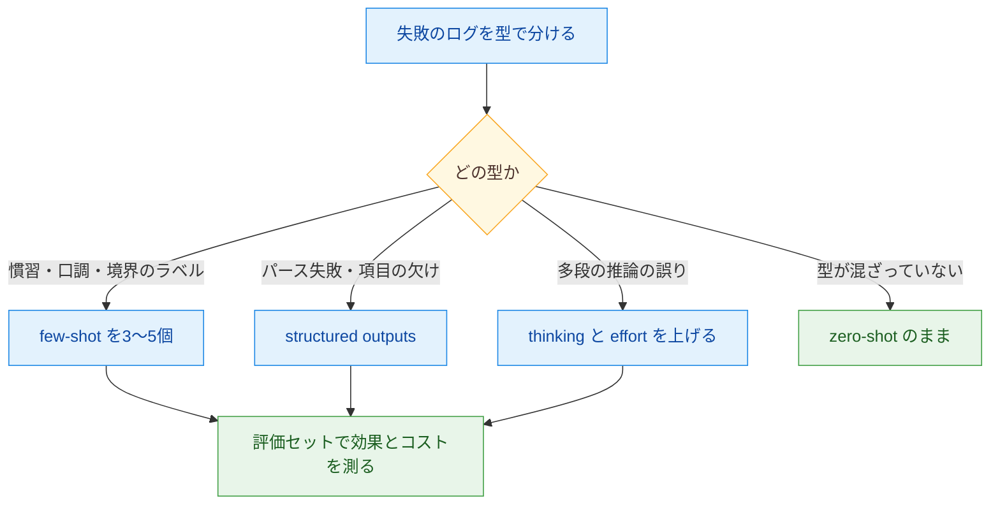

# プロンプトの技法の選択

> ドメイン: 2. モデル・プロンプト・コンテキストエンジニアリング（13%） ／ 更新: 2026-11-26

!!! abstract "ひとことで"
    観察した失敗の型に効く技法を1つ選ぶ。形や慣習のぶれには few-shot、パースの失敗には structured outputs、多段の推論の誤りには ==native thinking と effort==。失敗に効かない技法は、トークン代だけが増える。

## 仕組み

技法は失敗の型ごとに効く場所が違う。few-shot の例は、口調・形式・ラベルの付け方の慣習を伝える。structured outputs は、制約付きのデコーディングで、ほとんどの場合に JSON スキーマへの適合を保証する（拒否、`max_tokens` での打ち切り、`enum`／`const` の大文字・小文字は例外）。thinking は、答える前に推論する余地を与える。だから「出力が壊れる」問題に例を足しても保証にはならず、「社内の慣習を知らない」問題に thinking を増やしても答えは出ない。まず失敗のログを型で分け、その型に効く技法だけを足す。zero-shot で評価に通るなら、何も足さないのが最も安い。

| 観察した失敗 | 技法 | 増えるコスト | 要らない場面 |
|---|---|---|---|
| 境界の事例で、社内の慣習と違うラベルを付ける | few-shot（多様な例を3〜5個、`<example>` タグで囲む） | 毎回の入力トークン（キャッシュできる） | 指示だけで評価に通る |
| JSON が壊れる、必須の項目が抜ける | structured outputs（`output_config.format` の `json_schema`、ツールの `strict: true`） | 形式を説明する system の追加、初回の文法のコンパイル | 人が読むだけの自由文 |
| 多段の計算や推論を誤る | native thinking（adaptive）と `effort` | thinking は出力トークンとして課金 | 単純な分類や抽出 |
| thinking を使えない構成で推論が浅い | プロンプトでの推論（CoT）。最終回答は `<answer>` タグに入れさせる | 推論の文章ぶんの出力 | thinking が使えるモデル |

推論させるなら、今のモデルでは native thinking を先に選ぶ。公式は、手書きの手順を細かく指定するより「よく考えて」のような一般的な指示のほうが良い推論を生むことが多いとしている。例は thinking とも併用できる。問題・解き方・答えの形で示すと、Claude は似た問題での考え方にそれを反映する。プロンプトでの CoT は thinking を切った構成での代替で、`<thinking>` タグに推論を書かせる指示を断るモデルもある。

??? info "モデルごとの thinking の既定と、structured outputs の制限（2026-11-26 に公式で確認）"
    - Fable 5.2・Opus 5.5 は adaptive thinking が常に有効で、切れない。Sonnet 5.5・Haiku 5.5・Opus 5 は、`thinking` を省くと有効になる
    - Sonnet 5.5 は `thinking: {"type": "disabled"}` を受け付けない。最も軽い設定は `between_tools` で、effort が `high` 以下のときだけ使える。Haiku 5.5 と Opus 5 は effort が `high` 以下なら disabled にできる
    - Opus 4.6〜4.8 と Sonnet 4.6 は、`thinking` を省くと thinking が無効
    - `budget_tokens` による手動の extended thinking は、Claude 4.7 以降で 400 エラー。量は effort と `max_tokens` で制御する
    - Sonnet 5.5 と Haiku 5.5 では、プロンプトで「考えずに答えて」と頼んでも thinking は確実には減らない。減らすなら effort を下げる
    - structured outputs が受け付けないスキーマ: 再帰、`oneOf`、`minimum`／`maximum`、`minLength`／`maxLength` など。使うと 400 エラー
    - コンパイルした文法は最後の利用から24時間キャッシュされる。`output_config.format` を変えると、そのスレッドのプロンプトキャッシュが無効になる
    - 分類では、ラベルを `enum` にしたツールか structured outputs を使う、と公式は勧めている

## 試験での見分け方

| 問われること | ○ 正しい | × ひっかけ |
|---|---|---|
| JSON が数%壊れる | structured outputs で形を保証する | 例を増やす、再試行ループを厚くする（保証にならない） |
| 慣習を知らずに誤る | 境界の事例を含む多様な例を3〜5個 | effort を上げる（知らない慣習は推論しても出ない） |
| 多段の推論の誤り | thinking を使い、effort を評価で上げる | 手書きの細かい手順を推論の代わりに書く |
| thinking の量を絞る | effort を下げる | `budget_tokens` を指定する（4.7 以降は 400）、プロンプトで頼む |
| 失敗が見られない | zero-shot のまま | 念のため例と CoT を足してトークン代を増やす |

## 確認問題

**Q1.** 保険の請求書類から項目を抜き出すパイプラインで、応答の約3%が JSON としてパースできないか、必須の項目を欠く。今のプロンプトは、JSON で返すよう指示し、例を8個付けている。最も適切な対応はどれか。（1つ選べ）
{ .quiz-q }

- A. 例を15個に増やし、項目が欠けやすい書類の例も加える
- B. effort を上げ、出力の前にスキーマとの照合を考えさせる
- C. パースに失敗したら、エラーを伝えて同じ書類を再送するループを3回まで回す
- D. `output_config.format` に JSON スキーマを指定する structured outputs に切り替える

??? success "答えと解説"
    **正解: D。** 制約付きのデコーディングで、ほとんどの場合にスキーマに合う JSON が保証される。拒否と `max_tokens` での打ち切りは `stop_reason` で見分けて扱う。

    - A: 例は形を寄せるだけで、保証にはならない。毎回の入力トークンも増える
    - B: 推論を増やしても形の保証にはならず、出力トークンが増える
    - C: 失敗の後始末にすぎない。再送のぶん遅延とコストが増え、3回とも失敗しうる

**Q2.** 問い合わせを分類する Haiku 5.5 の分類器で、ラベルは `enum` のツールで返しているので形は正しい。誤りは「プラン変更に伴う返金」のような境界の事例に集中している。社内では、これを「請求」に分ける慣習がある。最も適切な対応はどれか。（1つ選べ）
{ .quiz-q }

- A. effort を `max` に上げ、境界の事例を深く考えさせる
- B. 境界の事例を含む多様な例を3〜5個、`<examples>` タグで囲んで加える
- C. 「`<thinking>` タグの中で一歩ずつ考えてから答えよ」とプロンプトに書く
- D. Opus 5.5 に切り替え、より賢いモデルに判断させる

??? success "答えと解説"
    **正解: B。** 失敗の型は「社内の慣習を知らない」なので、慣習を示す例が効く。

    - A: 知らない慣習は推論しても導けない。遅延とコストだけが増える
    - C: 同じく慣習は伝わらない。推論の文章ぶんの出力も増える
    - D: どのモデルも社内の慣習は知らない。単価が大きく上がる

**Q3.** Sonnet 5.5 で、財務諸表から複数の比率を順に計算する分析エージェントを作った。effort は `medium` に設定している。途中の計算の誤りが多い。遅延の予算には余裕がある。対応として適切なものはどれか。（2つ選べ）
{ .quiz-q }

- A. adaptive thinking のまま、評価セットで確かめながら effort を `medium` から `high` に上げる
- B. 計算の手順を12段階に細かく書き、その手順どおりに進めるよう指示して thinking の代わりにする
- C. コストを抑えるため thinking を `disabled` にし、推論は `<thinking>` タグに書かせる
- D. 問題・解き方・答えの形の計算例を数個、プロンプトに加える
- E. `budget_tokens` を 20,000 に設定し、推論の量を固定する

??? success "答えと解説"
    **正解: A と D。** 推論の誤りには thinking と effort が効き、解き方の例は thinking とも併用できる。

    - B: 公式は、細かい手順より一般的な指示のほうが良い推論を生むことが多いとしている
    - C: Sonnet 5.5 は `disabled` を受け付けず、400 エラーになる
    - E: `budget_tokens` は Claude 4.7 以降で 400 エラーになる

## 出典
- Claude Certified Architect – Professional Exam Guide v1.1（Dec 7 版）, Domain 2「Prompting Technique Selection」（公式、PDF）: https://cc.sj-cdn.net/instructor/6nizmqk8tpzpfjvt6qmmav7rh/public/1794946420/Claude_Certified_Architect_-_Professional_Exam_Guide_Updated_Dec_7.pdf
- [Prompting best practices](https://platform.claude.com/docs/en/build-with-claude/prompt-engineering/claude-prompting-best-practices)（公式）
- [Structured outputs](https://platform.claude.com/docs/en/build-with-claude/structured-outputs)（公式）
- [Steering thinking](https://platform.claude.com/docs/en/build-with-claude/thinking-steering-and-cost)（公式）
- [Effort](https://platform.claude.com/docs/en/build-with-claude/effort)（公式）
