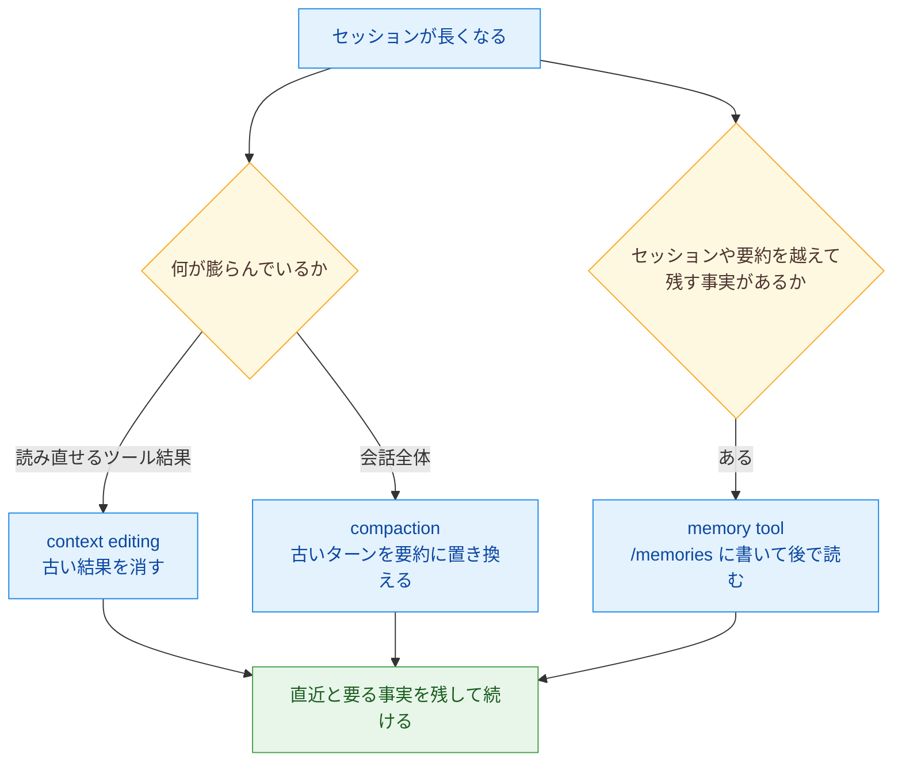

# 推論の量とコンテキストのライフサイクル

> ドメイン: 2. モデル・プロンプト・コンテキストエンジニアリング（13%） ／ 更新: 2026-11-26

!!! abstract "ひとことで"
    推論の量は ==effort== で配り、評価で確かめた段階を仕事の種類ごとに決める。長いセッションのコンテキストは、何を失ってはいけないかで選ぶ。読み直せる結果は消す（context editing）、会話全体は要約する（compaction）、セッションを越えて残すものは外に書く（memory tool）。

## 仕組み

effort（`output_config.effort`）は、応答全体にどれだけトークンを使うかの目安だ。thinking だけでなく、本文やツール呼び出しの数にも効く。`low` から `max` まであり、既定はモデルで違う。厳密な上限ではないので、出力の上限は `max_tokens` で別に決める。会話の途中でトップレベルの effort を変えると、プロンプトキャッシュが外れることがある。だから同じ会話の中では effort を固定し、仕事の種類ごとに値を分ける。対応するモデルでは、キャッシュを保ったまま一部のターンだけ effort を変える per-message effort（beta）も使える。

コンテキストのライフサイクルには3つの道具がある。どれも「古いものを手放す」仕組みだが、手放すものと残る場所が違う。



| 道具 | 何をするか | 向く場面 | 失うもの・注意 |
|---|---|---|---|
| context editing（`clear_tool_uses_20250919`） | 古いツール結果を、決まった規則で消して目印に置き換える | 読み直せるファイルや検索の結果がたまる | 消した結果の中身。消すたびにキャッシュが外れる |
| compaction | 古いターンをサーバー側で要約に置き換える | 会話のやり取りそのものが長い | 要約に入らなかった細部と、それ以前の thinking |
| memory tool（`memory_20250818`） | Claude が `/memories` のファイルを読み書きし、アプリが実行する | 日をまたぐ作業、要約の後も残す決定や進み具合 | 保存先と中身の管理はアプリの責任 |

公式の context editing のページは、ほとんどの場合は compaction を主な手段にするよう勧めている。context editing は、何を消すかを細かく決めたいときに使う。長く動くエージェントでは、compaction で作業中のコンテキストを小さく保ち、要約で失ってはいけない情報を memory に書く組み合わせが勧められている。

??? info "パラメータと数字（2026-11-26 に公式で確認）"
    - effort の既定: Opus 5.5・Haiku 5.5 は `medium`、Fable 5.2・Sonnet 5.5 は `high`。既定値を明示しても、省いたのと同じ扱い
    - `stop_reason: "max_tokens"` で切れるなら、推論が要る仕事は `max_tokens` を上げ、考えすぎなら effort を下げる
    - Sonnet 5.5 と Haiku 5.5 では、プロンプトで「考えるな」と頼んでも thinking は確実には減らない。effort を下げる
    - context editing: beta ヘッダ `context-management-2025-06-27`。`trigger` の既定は入力 100,000 トークン、`keep` の既定は直近3回のツール利用。`clear_at_least` で1回に消す最小量を決め、キャッシュの書き直しに見合うようにする。`exclude_tools` で消さないツールを指定する。thinking を消す `clear_thinking_20251015` もある
    - context editing と memory tool を併用すると、消す前に、大事なことを memory に保存するよう Claude に自動で警告が出る
    - compaction: 呼ぶ側が要求する on-demand（beta ヘッダ `compact-2026-09-04`）が、多くの場合の推奨。しきい値で自動に動く版は `compact_20260112`（beta ヘッダ `compact-2026-01-12`）で、`trigger` の既定は 150,000、最小は 50,000。返ってきた `compaction` ブロックは次のリクエストに含めて送り返す。system の末尾にブレークポイントを置けば、要約しても system のキャッシュは残る。Managed Agents では compaction が常に有効
    - memory tool: クライアント側で動くので、保存先はアプリが決める。`/memories` の外を指すパス（`../` など）を必ず拒否する。使うと、先に memory を見るよう求める指示が system に自動で入る
    - 新しいコンテキストで始め直し、進捗ファイル・テストの一覧・git の履歴から状態を読み戻す方法も、公式は選択肢に挙げている

## 試験での見分け方

<div class="vs" markdown>

| 問われること | ○ 正しい | × ひっかけ |
|---|---|---|
| 遅延の上限と品質の両立 | 種類ごとに effort を評価で決め、難しい種類だけ上げる | 全件を `max` にする、`max_tokens` を削って速くする |
| thinking を減らしたい | effort を下げる | プロンプトで頼む、`budget_tokens` を指定する |
| 読み直せるツール結果がたまる | context editing で古い結果を消し、`clear_at_least` を決める | 毎ターン少しずつ消して、キャッシュを毎回書き直す |
| 会話そのものが長い | compaction で古いターンを要約に置き換える | 全履歴を持ち続ける |
| 日をまたいで決定を残す | memory tool に書き、次のセッションで読む | 要約だけに頼る、前日の全記録を system に貼る |

</div>

## 確認問題

**Q1.** Sonnet 5.5 のサポートエージェントで、p95 を8秒以内に収める必要がある。effort が既定の `high` だと p95 は14秒だ。評価では、`medium` で大半の問い合わせの品質は保てたが、「返金の争い」の分類だけ品質が下がった。最も適切な対応はどれか。（1つ選べ）
{ .quiz-q }

<div class="quiz" data-answer="C" markdown>

- A. `max_tokens` を 1,024 に下げ、生成の時間を短くして p95 を縮める
- B. system に「深く考えずにすぐ答えること」と書き、thinking を減らす
- C. 既定を `medium` にし、返金の争いの分類だけ `high` で処理する。どちらも評価で確かめる
- D. `thinking: {"type": "disabled"}` を送って、thinking を止める

</div>

??? success "答えと解説"
    **正解: C。** 品質の下がる種類だけに推論を配り、残りは軽くして遅延の上限を守る。

    - A: thinking も `max_tokens` に含まれるので、応答が途中で切れやすくなる
    - B: Sonnet 5.5 では、プロンプトで頼んでも thinking は確実には減らない
    - D: Sonnet 5.5 は `disabled` を受け付けず、400 エラーになる

**Q2.** 長時間のコーディングエージェントで、context editing を次の設定にした。その後、`usage` では数ターンおきに大きな `cache_creation_input_tokens` が出て、費用が設定前より増えた。最も適切な直し方はどれか。（1つ選べ）
{ .quiz-q }

```json
{"type": "clear_tool_uses_20250919",
 "trigger": {"type": "input_tokens", "value": 30000},
 "keep": {"type": "tool_uses", "value": 3}}
```

<div class="quiz" data-answer="A" markdown>

- A. `clear_at_least` を設定し、1回の消去でキャッシュの書き直しに見合う量を消すようにする
- B. プロンプトキャッシュを切り、書き込みの費用が出ないようにする
- C. context editing をやめ、ツール結果を memory tool に書き写してから消させる
- D. `keep` を1に下げ、毎回より多くの結果を消す

</div>

??? success "答えと解説"
    **正解: A。** 消すたびにキャッシュが外れるので、少しずつ頻繁に消すと書き直しが増える。1回で消す最小量を決める。

    - B: 固定の前置きの割引まで失い、費用はさらに増える
    - C: 書き写す手間が増えるだけで、消すたびにキャッシュが外れる問題は残る
    - D: 頻度は変わらず、まだ使う直近の結果まで消える

**Q3.** 数日かけてデータベースを移行するエージェントを作る。毎晩セッションを終え、翌朝に続きから再開する。日中のセッションも長くなる。決めた方針と進み具合は失えない。構成として適切なものはどれか。（2つ選べ）
{ .quiz-q }

<div class="quiz" data-answer="A,B" markdown>

- A. memory tool で決定と進み具合を `/memories` に書かせ、ハンドラーはその外へのパスを拒否する
- B. 日中の会話の膨らみには compaction を使い、要約で失えない情報は memory にも書かせる
- C. compaction の要約だけを翌日の会話に引き継ぎ、memory は使わない
- D. 前日のやり取りの全記録を、翌朝の system に貼って始める
- E. `clear_thinking_20251015` で thinking を消し、決定の記録はそれで足りるとする

</div>

??? success "答えと解説"
    **正解: A と B。** セッション内は compaction で小さく保ち、セッションを越えるものは memory に書く。

    - C: 要約は細部を落とし、セッションを越えて残す仕組みでもない
    - D: 日ごとに膨らみ、劣化も費用も増える
    - E: thinking を消すのは容量の調整で、決定を残す仕組みではない

## 出典
- Claude Certified Architect – Professional Exam Guide v1.1（Dec 7 版）, Domain 2「Reasoning Effort and Context Lifecycle」（公式、PDF）: https://cc.sj-cdn.net/instructor/6nizmqk8tpzpfjvt6qmmav7rh/public/1794946420/Claude_Certified_Architect_-_Professional_Exam_Guide_Updated_Dec_7.pdf
- [Effort](https://platform.claude.com/docs/en/build-with-claude/effort)（公式）
- [Steering thinking](https://platform.claude.com/docs/en/build-with-claude/thinking-steering-and-cost)（公式）
- [Context editing](https://platform.claude.com/docs/en/build-with-claude/context-editing)（公式）
- [Compaction overview](https://platform.claude.com/docs/en/build-with-claude/compaction)（公式）
- [Compaction at a token threshold](https://platform.claude.com/docs/en/build-with-claude/compaction-threshold)（公式）
- [Memory tool](https://platform.claude.com/docs/en/agents-and-tools/tool-use/memory-tool)（公式）
- [Prompting best practices](https://platform.claude.com/docs/en/build-with-claude/prompt-engineering/claude-prompting-best-practices)（公式）
