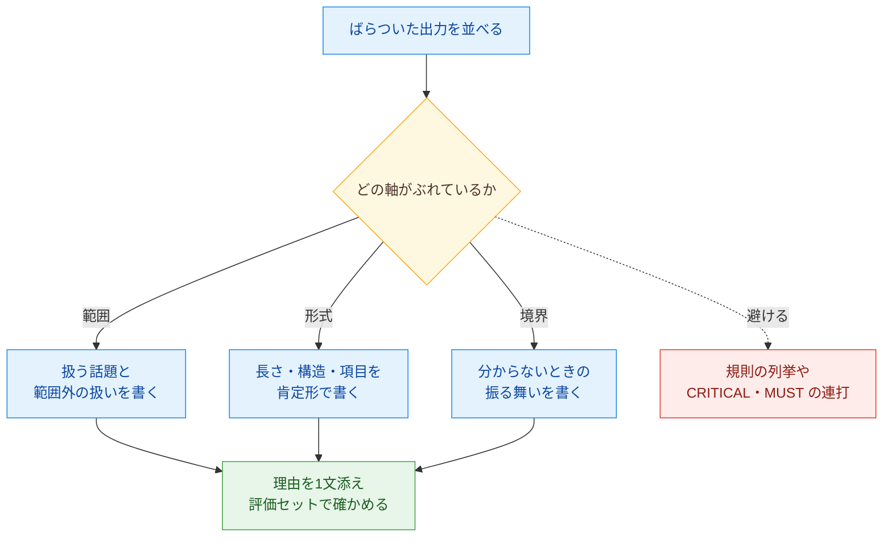

# システムプロンプトの診断と書き直し

> ドメイン: 2. モデル・プロンプト・コンテキストエンジニアリング（13%） ／ 更新: 2026-11-26

!!! abstract "ひとことで"
    出力の劣化やばらつきは、たいてい==書かれていない仕様==（範囲・形式・境界での振る舞い・その理由）から来る。直すときは抜けた仕様だけを、理由を添えて足す。正当なばらつきまで縛る規則や、強い言葉は足さない。

## 仕組み

診断は、ばらついた出力を並べて「どの軸が決まっていないか」を探す作業だ。範囲（何に答え、何に答えないか）、形式（長さ・構造・項目）、境界での振る舞い（分からない、範囲外、情報が足りない）の3つを見る。プロンプトに書いていない軸では、モデルは毎回もっともらしい別の選び方をする。だから、ばらつきの出る軸がそのまま抜けた仕様を指す。

書き直しには、避けるべき失敗が両側にある。公式のエンジニアリングブログは、これを「ちょうどよい高度（right altitude）」と呼ぶ。片側は、場合分けを if-else のように列挙した壊れやすい規則で、想定外の入力に弱く保守もしにくい。もう片側は、具体的な手がかりのない漠然とした指示だ。足すべきは、判断の基準とその理由である。理由があると、Claude は書かれていない場面にも一般化できる。



| 症状 | 抜けている仕様 | 書き直し | 縛りすぎの例 |
|---|---|---|---|
| 答える話題が回によって違う | 範囲と、範囲外の扱い | 扱う話題、範囲外のときの案内先 | 質問の型ごとの回答手順を何十個も並べる |
| 長さや見出しの有無が揃わない | 形式 | 「5文以内の段落で、根拠の規程名を添える」 | 全回答を1つのテンプレートの穴埋めにする |
| 根拠の無い断定が混じる | 境界での振る舞い | 「規程に無ければ、無いと答えて窓口を示す」 | 「絶対に間違えるな」と書く |
| 新しいモデルでツールを呼びすぎる | 強すぎる言葉 | 「〜が必要なときは〜を使う」に和らげる | 呼ばない場面の単語リストを足す |

公式によれば、Opus 4.5・4.6 は以前のモデルよりシステムプロンプトに敏感で、Claude 4.6 世代は自分から動く傾向が強い。旧モデルの呼び足りなさを補うために書いた「CRITICAL: 必ず〜」は、今のモデルでは呼びすぎを招く。公式は、こうした言葉を普通の言い方に和らげるよう勧めている。「〜するな」より「〜する」と書くほうが、形式は安定する。

??? info "書き方の細かい決まり（公式の prompting best practices より）"
    - 確かめ方: 文脈を知らない同僚に渡して、迷わず従えるかを想像する。同僚が迷うなら Claude も迷う
    - 役割を1文、システムプロンプトに書くだけでも振る舞いと口調が定まる
    - 指示・文脈・例・入力を XML タグで分けると、取り違えが減る
    - 出力の見た目はプロンプトの見た目に引っぱられる。Markdown を減らしたいなら、プロンプトの Markdown も減らす
    - 最後の assistant ターンの prefill は、Claude 4.6 以降のモデルでは 400 エラーになる。形式を固めたいときは structured outputs か直接の指示に移す
    - 最小のプロンプトから始め、観察した失敗ごとに指示を足す（エンジニアリングブログの推奨）
    - 古いモデル向けの「念入りに確かめよ」は、Opus 5 では確かめすぎを招くので消す、と公式にある

## 試験での見分け方

<div class="vs" markdown>

| 問われること | ○ 正しい | × ひっかけ |
|---|---|---|
| 出力がばらつく原因 | プロンプトに書かれていない軸（範囲・形式・境界） | モデルの性能不足と決めつけて上の階層へ替える |
| 書き直しの粒度 | 判断の基準と理由を足す | 想定ケースを if-else の規則で列挙する |
| 守らせたい制約 | 理由を添えて普通の言葉で書く | 大文字の CRITICAL や NEVER を重ねる |
| 形式の指定 | してほしい形を肯定形で書く | 禁止事項だけを並べる |
| 正当なばらつき | 内容に応じた長さや構成の違いは残す | 全回答を1つのテンプレートに固定する |

</div>

## 確認問題

**Q1.** 社内の人事規程に答えるアシスタントのシステムプロンプトは「あなたは親切な人事アシスタントです。正確に答えてください。」だけだ。ログを見ると、見出し付きの長文と1行の回答が混在し、福利厚生の質問を範囲外として断る回と、範囲外の税務相談に答える回がある。最も適切な書き直しはどれか。（1つ選べ）
{ .quiz-q }

<div class="quiz" data-answer="C" markdown>

- A. 冒頭に「CRITICAL: 絶対に誤った回答をしてはならない。必ず正確に答えること」を足す
- B. 想定される質問の型を40通り挙げ、型ごとに答える内容と手順を規則として並べる
- C. 扱う話題と範囲外の案内先、5文以内で根拠の規程名を添える形式を、社員がスマホで読むという理由とともに書く
- D. 回答のテンプレートを1つ決め、どの質問もその見出しと項目を埋める形で答えさせる

</div>

??? success "答えと解説"
    **正解: C。** ぶれている軸は範囲と形式なので、その仕様を理由とともに足す。

    - A: 範囲も形式も決まらないまま、強い言葉だけが増える
    - B: 列挙にない質問に弱く、保守もしにくい。高度が低すぎる
    - D: 質問ごとの正当な違いまで縛り、短く済む答えを無理に膨らませる

**Q2.** サポートエージェントを新しいモデルへ移したところ、遅延が増えた。トレースでは「ありがとう」のような挨拶にも `search_kb` が呼ばれている。システムプロンプトには次の1行がある。最も適切な直し方はどれか。（1つ選べ）
{ .quiz-q }

```text
CRITICAL: You MUST call search_kb before answering ANY message. If in doubt, search.
```

<div class="quiz" data-answer="A" markdown>

- A. 「ナレッジベースの事実が要る質問には search_kb を使う」と、条件付きの普通の言い方に書き換える
- B. 挨拶やお礼の言い回しを列挙し、それらのときは検索しないという例外の規則を足す
- C. `max_tokens` を小さくして、検索を含む応答全体の時間を短くする
- D. `tool_choice` を `none` にして、検索を一切呼べないようにする

</div>

??? success "答えと解説"
    **正解: A。** 新しいモデルは強い言葉に強く反応する。必要な場面を条件として書けば、呼びすぎが止まる。

    - B: 言い回しは無数にあり、列挙は漏れる。原因の強い言葉が残る
    - C: 検索の回数は減らない。応答が途中で切れるおそれも生む
    - D: 事実が要る質問でも検索できなくなり、根拠の無い回答が増える

**Q3.** 請求書から会計用の要約を作るパイプラインで、日付の書式が回ごとに違い、ときどき感想めいた一言が混じる。システムプロンプトの書き直しとして適切なものはどれか。（2つ選べ）
{ .quiz-q }

<div class="quiz" data-answer="A,B" markdown>

- A. 出力の項目と書式を、日付は ISO 8601 のように、してほしい形として具体的に書く
- B. 出力は会計システムに自動で取り込まれ、人は読まないという理由を書き添える
- C. 「コメントを書くな。絶対に書くな。NEVER」と、禁止を大文字で繰り返す
- D. assistant の最後のターンに `{"date": "` を prefill して、書式を固定する
- E. 取引先ごとの日付の書き方を、if-else の規則としてすべて列挙する

</div>

??? success "答えと解説"
    **正解: A と B。** 抜けている仕様は形式と、その理由だ。

    - C: 禁止を強めても、してほしい形は伝わらない
    - D: 最後のターンの prefill は、Claude 4.6 以降では 400 エラーになる
    - E: 列挙は壊れやすく、新しい取引先が来るたびに直す羽目になる

## 出典
- Claude Certified Architect – Professional Exam Guide v1.1（Dec 7 版）, Domain 2「System Prompt Diagnosis and Revision」（公式、PDF）: https://cc.sj-cdn.net/instructor/6nizmqk8tpzpfjvt6qmmav7rh/public/1794946420/Claude_Certified_Architect_-_Professional_Exam_Guide_Updated_Dec_7.pdf
- [Prompting best practices](https://platform.claude.com/docs/en/build-with-claude/prompt-engineering/claude-prompting-best-practices)（公式）
- [Effective context engineering for AI agents](https://www.anthropic.com/engineering/effective-context-engineering-for-ai-agents)（公式、エンジニアリングブログ）
