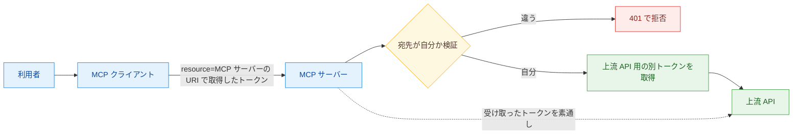

# 認証と認可の構え

> ドメイン: 3. 統合（21%） ／ 更新: 2026-11-26

!!! abstract "ひとことで"
    認証情報はモデルの文脈に入れず、ツールの実装側で持つ。トークンは==宛先（audience）に縛り、受け取ったトークンを下流へ素通ししない==。権限は最小のスコープから始め、要るときだけ引き上げる。

## 仕組み

統合の設計で見るリスクは2つある。認証情報の露出と、権限の昇格だ。露出は、鍵やトークンがプロンプト・ログ・URL・ブラウザに出て、第三者に使われること。昇格は、ある利用者や部品が、本来より広い権限で動けてしまうことだ。エージェントは外から来たテキストに操られうるので、モデルが見られるものと動かせるものを、設計で狭くしておく。

| リスク | 典型的な設計の穴 | 対策 |
|---|---|---|
| 露出 | 接続文字列や API キーをシステムプロンプトに書く | 鍵はツールの実装・環境変数・保管庫（vault）に置く。モデルにはツールだけを見せる |
| 露出 | トークンを URL のクエリに入れる、ログに残す | `Authorization: Bearer` ヘッダーで送る。短命のトークンにする |
| 露出 | ブラウザから Claude API を直接呼ぶ | 自前のバックエンドを経由する |
| 昇格 | トークンの素通し（token passthrough） | 宛先を検証し、上流には別のトークンを使う |
| 昇格 | 全テナント共通の管理者権限のサービスアカウント | 利用者ごとの委任トークンと、呼び出しごとのサーバー側の認可 |
| 昇格 | 最初から `*` や `admin:*` のスコープを要求する | 最小のスコープで始め、`insufficient_scope` の 403 で段階的に引き上げる |

MCP の認可は OAuth 2.1 に沿う。保護された MCP サーバーはリソースサーバーとして振る舞い、自分宛てに発行されたトークンだけを受け付ける。クライアントは `resource` パラメーター（RFC 8707）でトークンの宛先を指定する。この2つで、別のサービス向けのトークンの使い回しを防ぐ。**MCP サーバーは、クライアントから受け取ったトークンを上流 API に渡してはならない。** 素通しすると、上流は MCP サーバーが検証したものと誤解する。これが混乱した代理人（confused deputy）の問題だ。

テナントの分離をプロンプトの指示に頼るのは、認可ではない。呼び出しのたびに、サーバー側で「この利用者がこの資源に触れてよいか」を確かめる。

??? info "細かい決まり（MCP 仕様 2026-07-28 版、Claude の各機能）"
    - 認可は任意の機能。HTTP 系のトランスポートは仕様に従う（SHOULD）。stdio は従わず、環境から認証情報を取る（SHOULD NOT）
    - MCP サーバーは Protected Resource Metadata（RFC 9728）を実装する（MUST）。クライアントは PKCE（`S256`）を使う（MUST）
    - トークンは毎回の HTTP リクエストに付ける。URL のクエリに入れない（MUST NOT）
    - スコープが足りないときは、403 と `WWW-Authenticate: Bearer error="insufficient_scope", scope="..."` で返す（SHOULD）。クライアントは再認可を数回までにとどめる
    - 動的クライアント登録（DCR）は 2026-07-28 版で非推奨になり、Client ID Metadata Documents が推奨（SHOULD）
    - セキュリティのベストプラクティス: セッション ID を認証に使わない（MUST NOT）。セッションの情報は `<user_id>:<session_id>` のように利用者と結び付ける
    - 公開クライアントのリフレッシュトークンはローテーションする（2025-11-25 版、MUST）。2026-07-28 版で同じ要件がどこに書かれたかは未確認
    - Messages API の MCP connector は `authorization_token` を受け取るだけで、OAuth の手続きとトークンの更新は呼び出す側が行う。Managed Agents では、セッションが保管庫（vault）を参照して認証情報を渡すので、エージェントの定義に秘密が入らない
    - ZDR などの保持設定がある組織は、ブラウザ（`Origin` ヘッダー付き）から API を呼ぶと 401 になる。自前のバックエンドから送る

## 試験での見分け方

| 問われること | ○ 正しい | × ひっかけ |
|---|---|---|
| エージェントに DB を使わせたい | 認証情報はツールの実装が持つ。モデルにはツールだけを見せる | 接続文字列をシステムプロンプトに書き「漏らすな」と指示する |
| MCP サーバーが上流 API を呼ぶ | 宛先を検証し、上流用に別のトークンを取る | 受け取ったトークンをそのまま上流に転送する |
| マルチテナントの分離 | 利用者ごとのトークンと、サーバー側での毎回の認可 | 共通の管理者アカウントと、プロンプトでのテナント指定 |
| スコープの設計 | 最小で始め、`insufficient_scope` で段階的に上げる | 再同意を避けるため最初に全スコープを取る |
| ブラウザのアプリ | バックエンドを経由する | API キーをフロントエンドに埋め込む |

## 確認問題

**Q1.** 社内の人事ポータルに、MCP サーバーを介して質問に答えるエージェントを付けた。トレースを読むと、MCP サーバーはクライアントから届いた `Authorization` ヘッダーのトークンを、そのまま人事 API への呼び出しに付けて転送している。このトークンは社内 IdP がポータル向けに発行したものだ。最も適切な対策はどれか。（1つ選べ）
{ .quiz-q }

- A. MCP サーバーと人事 API の間の通信を TLS で暗号化し、トークンが盗聴されないようにする
- B. トークンの有効期限を延ばし、転送の途中で失効して呼び出しが失敗しないようにする
- C. MCP サーバーで宛先が自分宛てかを検証し、人事 API には上流の認可サーバーが発行した別のトークンを使う
- D. 転送したトークンをすべて監査ログに記録し、不正な利用があとから追えるようにする

??? success "答えと解説"
    **正解: C。** トークンの素通しは仕様で禁じられている。宛先を検証し、上流には別のトークンを使う。

    - A: 盗聴は防げるが、ポータル向けのトークンが人事 API で通ってしまう昇格の問題は残る
    - B: 長命にするほど、漏れたときの被害が大きくなる。素通しの問題も残る
    - D: トークンをログに残すこと自体が露出になる。素通しも止まらない

**Q2.** 複数の顧客企業が使う SaaS の分析エージェントで、全テナント共通のサービスアカウント（スコープ `*`）を使っている。テナントの区別は、システムプロンプトにテナント ID を書くことで行っている。レッドチームの演習で、別テナントのデータを要約させることに成功した。行うべき対策はどれか。（2つ選べ）
{ .quiz-q }

- A. 利用者ごとに委任されたトークンを使い、最小のスコープで始めて、書き込みが要るときだけ引き上げる
- B. システムプロンプトのテナント ID の指示を強め、別テナントの名前が出たら回答を拒否させる
- C. MCP サーバーのセッション ID をテナントの識別に使い、ID を知っている接続だけを通す
- D. ツールの呼び出しのたびに、要求された資源がその利用者のテナントに属するかをサーバー側で確かめる
- E. 追跡しやすいように、トークンを URL のクエリに入れてアクセスログに残す

??? success "答えと解説"
    **正解: A と D。** 権限を利用者ごとに最小化し、認可はサーバー側で毎回行う。

    - B: プロンプトの指示は認可にならない。言い換えやインジェクションで破られる
    - C: セッション ID を認証に使ってはならない。推測や漏えいでなりすましができる
    - E: トークンを URL に入れてはならない。ログからの露出を自分で作ることになる

**Q3.** 金融機関の照会エージェントのシステムプロンプトに、SQL を組み立てさせるため、データベースの接続文字列（パスワードを含む）が書かれている。プロンプトインジェクションの試験で、Claude がこの文字列を回答に出力した。最も適切な対策はどれか。（1つ選べ）
{ .quiz-q }

- A. 接続文字列をプロンプトから消し、認証情報はクエリを実行するツールの実装側に持たせる
- B. システムプロンプトに「接続情報は決して出力しない」という指示を加え、例を添える
- C. 回答の出力に正規表現のフィルタをかけ、接続文字列の形をした部分を伏せ字にする
- D. パスワードを毎週ローテーションし、漏れても1週間で使えなくなるようにする

??? success "答えと解説"
    **正解: A。** モデルの文脈に無いものは漏らせない。認証情報はツールの実装側に置く。

    - B: 指示はインジェクションで破られうる。文脈に秘密がある限り、露出の経路は残る
    - C: 形を変えた出力（分割、符号化）をすり抜ける。根本の原因が残る
    - D: 被害の期間を縮めるだけで、露出そのものは続く

## 出典
- Claude Certified Architect – Professional Exam Guide v1.1（Dec 7 版）, Domain 3「Authentication and Authorization Posture」（公式、PDF）: https://cc.sj-cdn.net/instructor/6nizmqk8tpzpfjvt6qmmav7rh/public/1794946420/Claude_Certified_Architect_-_Professional_Exam_Guide_Updated_Dec_7.pdf
- [MCP Authorization（2026-07-28）](https://modelcontextprotocol.io/specification/2026-07-28/basic/authorization)（公式、MCP 仕様）
- [MCP Authorization（2025-11-25）](https://modelcontextprotocol.io/specification/2025-11-25/basic/authorization)（公式、MCP 仕様の前版）
- [MCP Security Best Practices（2025-11-25）](https://modelcontextprotocol.io/specification/2025-11-25/basic/security_best_practices)（公式、MCP）
- [MCP connector](https://platform.claude.com/docs/en/agents-and-tools/mcp-connector)（公式。`authorization_token`、Managed Agents の vault）
- [Claude API errors](https://platform.claude.com/docs/en/api/errors)（公式。401 とブラウザからの呼び出し）
