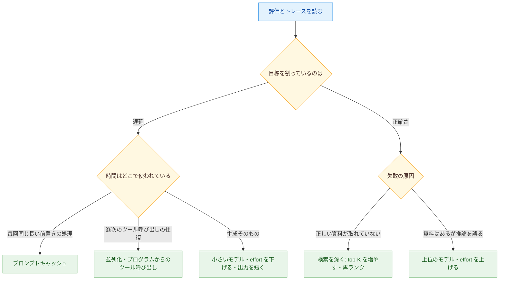

# 効いている性能の制約を緩める

> ドメイン: 3. 統合（21%） ／ 更新: 2026-11-26

!!! abstract "ひとことで"
    まず計測から、目標を割っている制約が==正確さか遅延か==を決める。次に、その制約を緩め、もう一方を最も損なわない一手を選ぶ。候補は検索の深さ・モデル・キャッシュ・呼び出し方の4つだ。

## 仕組み

性能の改善は、効いている（binding）制約を1つに絞ってから始める。正確さが目標を満たしているのに遅延が SLO を超えているなら、正確さを削る変更は選ばない。逆も同じだ。候補の変更は、たいてい片方を良くしてもう片方を悪くするので、計測で余裕がある側を確かめてから代価を払う。

| つまみ | 正確さへの効果 | 遅延・コストへの効果 |
|---|---|---|
| 検索の深さ（top-K、再ランク） | 取りこぼしが減る | 入力が増え、再ランクの分だけ遅くなる |
| モデルの段（Haiku / Sonnet / Opus）と effort | 上げると難しい推論に強くなる | 上げると遅く高くなる |
| プロンプトキャッシュ（prompt caching） | 変わらない | 同じ前置きの再処理を省き、遅延とコストが下がる |
| 呼び出し方（ストリーミング、並列、バッチ） | 変わらない | ストリーミングは最初のトークンまでの時間（TTFT）の体感を縮める。バッチは安いが即時ではない |

キャッシュは、正確さを動かさずに遅延を縮める珍しい一手だ。**ただし前置きが毎回完全に一致しないとヒットしない。** タイムスタンプやリクエストごとの値を前置きの途中に入れると、毎回書き込むだけで読まれない。`usage` の `cache_read_input_tokens` が 0 のままなら、まずそこを疑う。

逐次のツール呼び出しが多いエージェントでは、往復のたびに推論が1回挟まる。プログラムからのツール呼び出し（programmatic tool calling）でまとめて実行すると、その推論の回数が減る。

??? info "数値と細かい決まり"
    - キャッシュの前置きは `tools` → `system` → `messages` の順。区切り（`cache_control`）は1リクエストに4つまで。TTL は既定5分、`"ttl": "1h"` で1時間
    - 料金の倍率: 5分の書き込み 1.25倍、1時間の書き込み 2倍、読み出し 0.1倍（Opus 5.5・Sonnet 5.5 は 0.05倍）
    - キャッシュできる最小の長さはモデルで違う（例: Opus 5.5・Sonnet 5.5・Haiku 5.5 は 512 トークン、Opus 4.6・Haiku 4.5 は 4,096 トークン）。短いと黙ってキャッシュされない
    - ツール定義を変えると、キャッシュは全部無効になる。`tool_choice` や画像の有無を変えると、`system` 以降が無効になる
    - キャッシュから読んだトークンは ITPM のレート制限に数えない
    - Contextual Retrieval の記事: top-20 は top-5・top-10 より成績が良かった。再ランクは上位150件を取ってから20件に絞る構成で、遅延が少し増える
    - Advanced tool use の記事: プログラムからのツール呼び出しで、複雑な調査タスクのトークンが平均 43,588 から 27,297 に減った（37%減）
    - Reducing latency のページ: まず制約なしで良い出力が出るプロンプトを作り、遅延の削減はその後に試す。速度重視なら Haiku 5.5 を低い effort で使う

## 試験での見分け方

| 問われること | ○ 正しい | × ひっかけ |
|---|---|---|
| 正確さは余裕、遅延が SLO 超え。前置きは毎回同じ | プロンプトキャッシュを効かせる | 小さいモデルに替える（正確さを削る） |
| 遅延は余裕、正確さが不足。正しい資料が取れていない | top-K を増やし再ランクを足す | 上位モデルに替える（原因は検索側） |
| 遅延の主因が逐次のツール往復 | 並列化やプログラムからの一括実行 | `max_tokens` を上げる、キャッシュの TTL を延ばす |
| 利用者が待たされると感じる | ストリーミングで TTFT の体感を縮める | Message Batches に回す（即時でなくなる） |
| キャッシュを入れたのに効かない | 前置きの途中の可変値を後ろへ移す | TTL を1時間に延ばす |

## 確認問題

**Q1.** 通信会社の FAQ ボットの週次の計測は、正答率 94%（目標 90%）、p95 の遅延 9.8 秒（SLO 4 秒）だった。トレースでは、9.8 秒のうち 8.9 秒が最初のトークンまでの時間で、毎回同じ約1万2千トークンのシステムプロンプトとツール定義を送っている。`usage` は毎回 `cache_creation_input_tokens: 0`、`cache_read_input_tokens: 0` だ。最も適切な変更はどれか。（1つ選べ）
{ .quiz-q }

- A. モデルを1段小さいものに替え、effort も `low` に下げて生成を速くする
- B. 検索で渡す資料を top-20 から top-5 に減らし、入力のトークンを減らす
- C. 問い合わせを Message Batches API に回し、まとめて処理して費用を下げる
- D. 毎回同じシステムプロンプトとツール定義の末尾に `cache_control` を付け、前置きをキャッシュする

??? success "答えと解説"
    **正解: D。** 効いているのは遅延で、時間の大半は同じ前置きの処理だ。キャッシュは正確さを動かさずにここを縮める。

    - A: 正確さを削る代価を払う。遅延の主因である前置きの再処理も残る
    - B: 取りこぼしが増え、余裕のある正確さを削る
    - C: バッチは即時に返らない。対話の遅延の SLO に合わない

**Q2.** 製薬会社の社内文献アシスタントは、p95 の遅延が 3 秒（SLO 10 秒）で余裕がある。一方、正答率は 71%（目標 85%）にとどまる。失敗した問題を分析すると、6割で正しい箇所が検索の上位5件に入っていなかった。行うべき変更はどれか。（2つ選べ）
{ .quiz-q }

- A. モデルを Haiku に替え、空いた遅延の枠で同じ質問を3回生成する
- B. ストリーミングに切り替え、利用者が回答を早く読み始められるようにする
- C. 検索で渡す件数を5件から20件に増やす
- D. システムプロンプトを短く削り、入力のトークンを減らす
- E. 最初に150件ほど取り、再ランクで上位20件に絞ってから渡す

??? success "答えと解説"
    **正解: C と E。** 効いているのは正確さで、原因は検索の取りこぼしだ。遅延の余裕を使って検索を深くする。

    - A: 原因は正しい資料が渡っていないことだ。生成の回数を増やしても資料は増えない
    - B: 体感の遅延の改善で、正確さには効かない
    - D: 遅延の改善で、正確さには効かない

**Q3.** 物流会社の在庫照会エージェントは、1件の依頼で倉庫ごとの在庫ツールを15回、順番に呼ぶ。トレースでは、ツール自体は各 0.2 秒で返るが、呼び出しの間に毎回モデルの推論が挟まり、合計 40 秒かかる。正確さに問題は無い。最も適切な変更はどれか。（1つ選べ）
{ .quiz-q }

- A. より上位のモデルに替え、1回の推論で正しい倉庫を選べるようにする
- B. プログラムからのツール呼び出しで、15回の照会をコード1つにまとめて実行させる
- C. `max_tokens` を引き上げ、1回の応答で長く考えられるようにする
- D. キャッシュの TTL を1時間に延ばし、照会の結果を使い回せるようにする

??? success "答えと解説"
    **正解: B。** 遅延の主因は、呼び出しごとに挟まる推論だ。まとめて実行すれば、その推論の回数が減る。

    - A: 上位モデルは1回の推論が遅くなりがちで、往復の回数も変わらない
    - C: 往復の回数は変わらない。遅延も縮まらない
    - D: プロンプトキャッシュは前置きの再処理を省く仕組みで、ツールの結果を使い回すものではない

## 出典
- Claude Certified Architect – Professional Exam Guide v1.1（Dec 7 版）, Domain 3「Relieving the Binding Performance Constraint」（公式、PDF）: https://cc.sj-cdn.net/instructor/6nizmqk8tpzpfjvt6qmmav7rh/public/1794946420/Claude_Certified_Architect_-_Professional_Exam_Guide_Updated_Dec_7.pdf
- [Prompt caching](https://platform.claude.com/docs/en/build-with-claude/prompt-caching)（公式）
- [Reducing latency](https://platform.claude.com/docs/en/test-and-evaluate/strengthen-guardrails/reduce-latency)（公式）
- [Rate limits](https://platform.claude.com/docs/en/api/rate-limits)（公式。キャッシュ読み出しと ITPM）
- [Introducing Contextual Retrieval](https://www.anthropic.com/engineering/contextual-retrieval)（公式、エンジニアリングブログ。top-K と再ランク）
- [Advanced tool use](https://www.anthropic.com/engineering/advanced-tool-use)（公式、エンジニアリングブログ。プログラムからのツール呼び出し）
