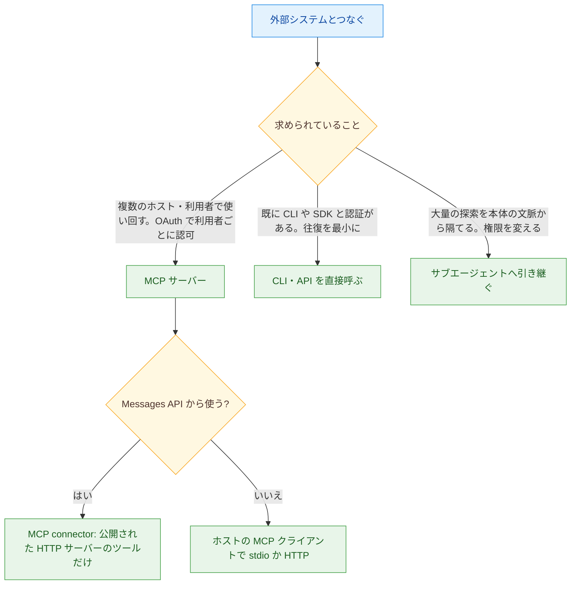

# 接続の仕組みの選択

> ドメイン: 3. 統合（21%） ／ 更新: 2026-11-26

!!! abstract "ひとことで"
    外部とのつなぎ方は、遅延・セキュリティ・状態の持ち方の制約で選ぶ。複数のホストで使い回す接続なら MCP、既に認証済みの CLI や API があるなら直接呼ぶ、文脈や権限を分けたいなら==別のエージェントへの引き継ぎ==にする。

## 仕組み

3つの仕組みは、得意な制約が違う。MCP は、ツールの発見と呼び出しを標準化し、Claude Code・Claude Desktop・自前のアプリなど複数のホストで同じサーバーを使い回せる。直接の API 呼び出しや CLI は、間に何も挟まないので最も軽い。エージェント間の引き継ぎは、作業をまるごと別の文脈と別の権限で走らせる。

| 制約 | MCP | 直接の API・CLI | エージェント間の引き継ぎ |
|---|---|---|---|
| 遅延 | stdio はネットワークの負担が無い。リモートは HTTP の往復が入る | 最も軽い | 子のエージェントの推論が丸ごと加わる。待つ間は親も止まる |
| セキュリティ | OAuth 2.1 で利用者ごとに認可できる。ツールの公開範囲を設定で絞れる | 既存の認証情報と権限の仕組みをそのまま使う | 子に渡すツールを親より狭くできる |
| 状態 | 2026-07-28 版の仕様はステートレス。続きの状態はツールが返すハンドルで持つ | 呼び出す側のコードが持つ | 子の文脈は空から始まり、渡すのはプロンプトの文字列だけ |

引き継ぎで最も多い失敗は、子に要る事実を渡し忘れることだ。**サブエージェントは親の会話履歴を受け取らない。** 親から渡るのは呼び出しのプロンプトの文字列だけで、親に返るのは子の最後のメッセージだけだ。だから、ID・確認済みの事実・決めたことは、引き継ぎのプロンプトに明示して書く。

Claude Code のベストプラクティスは、外部のシステムに CLI があれば、それが通常いちばん簡単な入口だとしている。`gh` が入ってサインイン済みなら、説明なしで PR を開ける。CLI が無いシステムに MCP を使う。

??? info "細かい決まり"
    - MCP connector（Messages API）は、MCP の機能のうちツールの呼び出しだけに対応する。サーバーは HTTP（Streamable HTTP か SSE）で公開されている必要があり、ローカルの stdio サーバーは直接つなげない。ベータで、`anthropic-beta` ヘッダーが要る
    - MCP connector の OAuth は、呼び出す側が手続きをしてトークンを取り、`authorization_token` で渡す。更新も呼び出す側が行う
    - MCP のトランスポート: stdio は同じマシンのプロセス間で、ネットワークの負担が無い。Streamable HTTP はリモートのサーバーと通信し、bearer トークンなどの HTTP の認証を使える。OAuth でトークンを得ることが推奨されている
    - MCP 仕様 2026-07-28 版は、各リクエストが必要な情報をすべて持つステートレスなプロトコルだと述べている。それより前の版（2025-11-25 など）にはセッションがあった。試験がどちらの版を前提にするかは未確認
    - 同じ版の仕様では、状態を持つツール（カート、DB のトランザクションなど）は、作成のツールが明示的なハンドルを返し、以後の呼び出しの引数で受け取る形を勧めている。ハンドルは名前にすぎないので、呼び出しのたびに認可を確かめる
    - Agent SDK のサブエージェント: 背景で走るのが既定。入れ子の深さは既定で3段、同時に走る数は既定で20まで
    - マルチエージェントの調査システムは、チャットの約15倍のトークンを使う（Anthropic のエンジニアリングブログ）
    - Code execution with MCP の記事: MCP サーバーをコードの API として見せ、エージェントにコードで呼ばせると、途中の結果がモデルの文脈を通らない。例ではトークンが約15万から約2千に減った。代わりに、生成したコードを動かすサンドボックスと監視が要る

## 試験での見分け方

| 問われること | ○ 正しい | × ひっかけ |
|---|---|---|
| CI で GitHub を操作したい。`gh` は認証済み | `gh` を直接使い、許可ルールで操作を絞る | 新しく MCP サーバーを作り OAuth を組む |
| 複数のチームと複数のホストで、同じ社内システムを使いたい | 社内の MCP サーバーを1つ作って配る | ホストごとに独自のツール定義を書く |
| Messages API からローカルの stdio サーバーを使いたい | 自前の MCP クライアントで中継するか、HTTP で公開する | MCP connector に stdio のコマンドを渡す |
| 別のエージェントに作業を渡す | 要る事実をプロンプトに明示する | 子が親の会話を覚えていると思い込む |
| 大量のファイルを読む調査で本体の文脈があふれる | サブエージェントに渡し、要約だけを受け取る | 本体で全部読み、あとで compaction に頼る |

## 確認問題

**Q1.** あるチームが CI で Claude Code をヘッドレスで動かし、PR を開いてレビューのコメントを読ませたい。CI の実行環境には `gh` が入っており、このリポジトリだけに権限を絞ったトークンでサインイン済みだ。担当者は、GitHub 用の MCP サーバーを新しく作るか迷っている。最も適切な接続の仕組みはどれか。（1つ選べ）
{ .quiz-q }

- A. GitHub 用のリモート MCP サーバーを作り、OAuth で CI 専用のトークンを発行して接続する
- B. GitHub の操作だけを担うサブエージェントを定義し、本体から作業を引き継がせる
- C. 既存の `gh` を Bash から使わせ、許可ルールを `Bash(gh pr *)` のように操作の範囲で絞る
- D. Messages API の MCP connector に、ローカルで動く GitHub の stdio サーバーを登録する

??? success "答えと解説"
    **正解: C。** 認証済みの CLI があるなら、それが最も軽く簡単な入口だ。権限は許可ルールで絞れる。

    - A: 既存の CLI と認証で足りるのに、作る・運用する部品を増やす
    - B: 文脈や権限を分ける必要は示されていない。推論の往復が増えるだけだ
    - D: MCP connector はローカルの stdio サーバーを直接つなげない

**Q2.** Messages API で動く自社アプリから、社内の MCP サーバーを使いたい。このサーバーは VPC の中でローカルの stdio として動き、ツールのほかにリソースとプロンプトも公開している。MCP connector の使い方について正しい説明はどれか。（2つ選べ）
{ .quiz-q }

- A. MCP connector が OAuth の手続きを代行するので、アプリはトークンの取得と更新を扱わなくてよい
- B. サーバー定義に stdio の起動コマンドを書けば、MCP connector がサーバーを起動して接続する
- C. MCP connector はサーバーのリソースを自動でツールに変換して、Claude に渡す
- D. MCP connector で使うには、サーバーを HTTP（Streamable HTTP か SSE）で公開する必要がある
- E. MCP connector から使えるのはツールの呼び出しだけで、リソースとプロンプトは使えない

??? success "答えと解説"
    **正解: D と E。** MCP connector は、公開された HTTP サーバーのツールの呼び出しだけに対応する。

    - A: OAuth の手続きとトークンの更新は呼び出す側の役目だ。トークンは `authorization_token` で渡す
    - B: ローカルの stdio サーバーは直接つなげない
    - C: 対応するのはツールの呼び出しだけで、リソースを変換する仕組みは無い

**Q3.** 通販会社の問い合わせ窓口で、受付のエージェントが請求の担当のサブエージェントに作業を引き継ぐ。請求の担当は毎回、顧客がすでに伝えた注文番号と、本人確認の結果を聞き直している。トレースでは、引き継ぎのプロンプトは「請求の問題に対応して」だけだった。最も適切な直し方はどれか。（1つ選べ）
{ .quiz-q }

- A. 引き継ぎのプロンプトに、注文番号・本人確認の結果・ここまでの要約を明示して書く
- B. 受付のエージェントのシステムプロンプトを、請求の担当にも同じく設定する
- C. 請求の担当を MCP サーバーに置き換え、受付から `tools/call` で呼ぶ
- D. 請求の担当の `maxTurns` を増やし、顧客に聞き直す余裕を持たせる

??? success "答えと解説"
    **正解: A。** サブエージェントに渡るのは引き継ぎのプロンプトの文字列だけだ。要る事実はそこに書く。

    - B: システムプロンプトをそろえても、この会話で得た注文番号や確認の結果は渡らない
    - C: 仕組みを替えても、渡す情報が足りない問題は残る
    - D: 聞き直しを前提にした変更で、原因の情報の欠落は直らない

## 出典
- Claude Certified Architect – Professional Exam Guide v1.1（Dec 7 版）, Domain 3「Connection Mechanism Selection」（公式、PDF）: https://cc.sj-cdn.net/instructor/6nizmqk8tpzpfjvt6qmmav7rh/public/1794946420/Claude_Certified_Architect_-_Professional_Exam_Guide_Updated_Dec_7.pdf
- [MCP connector](https://platform.claude.com/docs/en/agents-and-tools/mcp-connector)（公式）
- [Architecture overview](https://modelcontextprotocol.io/docs/learn/architecture)（公式、MCP）
- [Tools（MCP 仕様 2026-07-28）](https://modelcontextprotocol.io/specification/2026-07-28/server/tools)（公式。状態を持つツールとハンドル）
- [Subagents in the SDK](https://code.claude.com/docs/en/agent-sdk/subagents)（公式、Agent SDK）
- [Best practices for Claude Code](https://code.claude.com/docs/en/best-practices)（公式。CLI と MCP）
- [How we built our multi-agent research system](https://www.anthropic.com/engineering/multi-agent-research-system)（公式、エンジニアリングブログ）
- [Code execution with MCP](https://www.anthropic.com/engineering/code-execution-with-mcp)（公式、エンジニアリングブログ）
