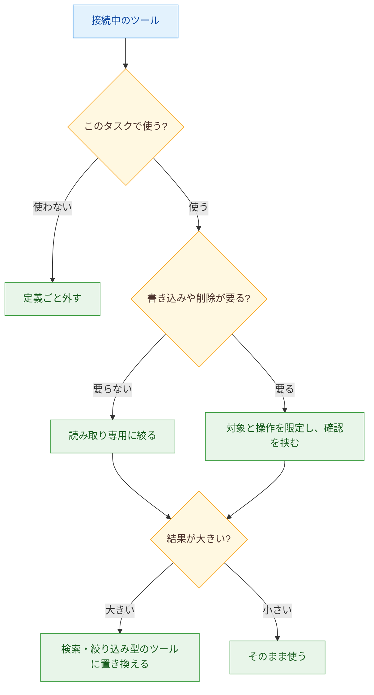

# 最小権限のツール構成

> ドメイン: 3. 統合（21%） ／ 更新: 2026-11-26

!!! abstract "ひとことで"
    ツールの接続は、==外す・絞る・コンテキストに優しい形に置き換える==の順に見直す。Agent SDK の `allowedTools` は自動承認の一覧であって、ツールを消す設定ではない。

## 仕組み

最小権限とは、タスクに要らないツールをエージェントに見せないことだ。見えているツールは、プロンプトインジェクションや誤った判断で呼ばれうる。だから「呼ばないように指示する」より先に、定義そのものを外すか、読み取りだけに絞る。



| 操作 | 何をする | 具体的な設定の例 |
|---|---|---|
| 外す | 定義をリクエストから消す | Agent SDK の `disallowedTools` に素の名前（`"Bash"`、`"mcp__crm"`）を書く。MCP connector では `mcp_toolset` の `default_config` を `enabled: false` にし、要るツールだけ `configs` で有効にする |
| 絞る | 残すツールの範囲を狭める | サブエージェントの `tools` を `Read, Grep, Glob` にする。`Bash(rm *)` のような拒否ルールを settings の `permissions.deny` に書く |
| 置き換える | 生データを返すツールを、答えに近い形を返すツールにする | `list_contacts` を `search_contacts` に。ページング・絞り込み・`response_format`（簡潔／詳細）を付ける |

ひっかけになりやすいのは Agent SDK の許可の評価順だ。`allowedTools` に書いたツールは自動承認されるが、書いていないツールも消えない。**`bypassPermissions` モードでは、`allowedTools` に無いツールも承認される。** 拒否ルール（`disallowedTools` や settings の deny）と hook は、このモードでも先に評価されて止められる。締めたいなら `allowedTools` と `dontAsk` モードを組み合わせる。`dontAsk` は、確認が必要な呼び出しをすべて拒否に変える。

サブエージェントの `tools` を省くと、親が使えるツールをほぼすべて引き継ぐ。読み取り役でも `Bash` を残すとファイルは書き換えられるので、許可リストはサンドボックスの代わりにならない。

??? info "細かい決まり"
    - Agent SDK の評価順: hook → 拒否ルール → ask ルール → 権限モード → 許可ルール → `canUseTool`。前の段で承認された呼び出しは `canUseTool` に届かない
    - `disallowedTools` に `Bash(rm *)` と書くと、Bash は残り、`rm *` に一致する呼び出しだけがどのモードでも拒否される（Agent SDK のオプション）。一方、サブエージェントのフロントマターの `disallowedTools` に同じ書き方をすると Bash ツールごと外れる。Bash を残して特定のコマンドだけ止めるなら、settings の `permissions.deny` に書く
    - 許可ルールのグロブは `mcp__<server>__` の後だけ効く。`allowed_tools=["*"]` や `["mcp__*"]` は無視される。拒否ルールでは `"*"` と `"mcp__*"` が使える
    - サブエージェントの `mcpServers` にインラインで定義したサーバーは、そのサブエージェントの起動時だけ接続され、親の会話にはツールの説明も載らない
    - Claude Code の MCP の出力は既定で 25,000 トークンまで（`MAX_MCP_OUTPUT_TOKENS`）。10,000 トークンを超えると警告が出る。上限を超えた結果はファイルに保存され、会話にはそのパスが入る
    - Writing tools for agents の例では、Slack の応答の簡潔版が 72 トークン、詳細版が 206 トークン

## 試験での見分け方

<div class="vs" markdown>

| 問われること | ○ 正しい | × ひっかけ |
|---|---|---|
| 使わないツールがつながっている | 定義ごと外す（`disallowedTools`、`enabled: false`） | システムプロンプトで「使うな」と書く。定義が見えている限り呼ばれうる |
| `bypassPermissions` で動かしている | 拒否ルールで止めるか、`allowedTools` と `dontAsk` に切り替える | `allowedTools` を短くすれば締まると考える |
| 読み取り役のサブエージェント | `tools` で読み取り系だけに絞る | `tools` を省く（ほぼ全部を引き継ぐ） |
| 全件を返すツールで文脈があふれる | 検索・絞り込み・ページング付きのツールに置き換える | 出力の上限（`MAX_MCP_OUTPUT_TOKENS`）を上げる |
| 遅延読み込み（`defer_loading`） | 文脈の節約として使う | 権限を絞る手段と取り違える。見つかれば呼べる |

</div>

## 確認問題

**Q1.** 保険会社の問い合わせ対応エージェントを Agent SDK で動かしている。設定は `allowedTools: ["Read", "Grep", "mcp__crm__get_ticket"]`、`permissionMode: "bypassPermissions"` で、`canUseTool` で削除系を断るコールバックも入れてある。監査ログに `mcp__crm__delete_ticket` が実行された記録が残っていた。最も適切な直し方はどれか。（1つ選べ）
{ .quiz-q }

<div class="quiz" data-answer="B" markdown>

- A. システムプロンプトに「チケットの削除は絶対に行わない」と書き、違反した応答を出力後に検出する
- B. `bypassPermissions` をやめて `dontAsk` にし、`delete_ticket` は `disallowedTools` で定義ごと外す
- C. `allowedTools` から `Read` と `Grep` も外し、`mcp__crm__get_ticket` だけを残す
- D. `canUseTool` のコールバックに削除系のツール名をもっと網羅的に書き足す

</div>

??? success "答えと解説"
    **正解: B。** `bypassPermissions` では一覧に無いツールも承認され、`canUseTool` にもほぼ届かない。拒否ルールとモードの変更で止める。

    - A: 定義が見えている限り呼ばれうる。事後の検出では、削除はもう起きている
    - C: `allowedTools` は自動承認の一覧で、このモードでは制限にならない。短くしても `delete_ticket` は承認される
    - D: `bypassPermissions` では、ほとんどの呼び出しがコールバックの前に承認される。網羅しても届かない

**Q2.** 社内の調査用サブエージェントの定義が次のようになっている。役割は顧客データの読み取りと要約だけだ。最小権限とコンテキストの両面から、行うべき変更はどれか。（2つ選べ）

```yaml
name: account-researcher
description: 顧客の利用状況を調べて要約する
tools: Read, Grep, Glob, Bash, mcp__crm__*
```

`mcp__crm__list_all_customers` は、呼ぶたびに約4万行を返している。
{ .quiz-q }

<div class="quiz" data-answer="B,E" markdown>

- A. `MAX_MCP_OUTPUT_TOKENS` を引き上げ、4万行が途中で切れずに届くようにする
- B. `mcp__crm__*` をやめ、読み取りに要る CRM のツール名だけを `tools` に列挙する
- C. Bash は残したまま削除のコマンドだけを止めるために、フロントマターの `disallowedTools` に `Bash(rm *)` を書く
- D. `tools` の行を消し、親の会話のツールをそのまま引き継がせて設定を単純にする
- E. `list_all_customers` を、条件で絞り込みページングする `search_customers` に置き換える

</div>

??? success "答えと解説"
    **正解: B と E。** 使う読み取りツールだけに絞り、全件を返すツールは絞り込み型に置き換える。

    - A: 文脈を食う原因はそのまま残る。上限を上げるのは置き換えの逆だ
    - C: 読み取りと要約だけの役に Bash を残す前提が誤りだ。しかも、サブエージェントのフロントマターでは、この書き方は Bash ツールごと外すので、狙いどおりにも動かない。Bash を残して特定のコマンドだけ止めるなら settings の `permissions.deny` に書く
    - D: `tools` を省くと、親が使えるツールをほぼすべて引き継ぐ。権限は広がる

**Q3.** Messages API の MCP connector で社内カレンダーの MCP サーバーにつないでいる。サーバーには予定の検索・作成・削除・公開設定の変更など40のツールがある。このエージェントは予定を読むだけでよい。最も適切な `mcp_toolset` の設定はどれか。（1つ選べ）
{ .quiz-q }

<div class="quiz" data-answer="D" markdown>

- A. 全ツールを有効にし、システムプロンプトで「読み取り以外のツールは呼ばない」と指示する
- B. 全ツールを有効のまま `default_config` に `defer_loading: true` を付け、文脈に載る量を減らす
- C. 全ツールを有効にし、`share_calendar_publicly` だけを `configs` で `enabled: false` にする
- D. `default_config` を `enabled: false` にし、`configs` で `list_events` と `search_events` だけを有効にする

</div>

??? success "答えと解説"
    **正解: D。** 既定で無効にし、要る読み取りツールだけを有効にする許可リストにする。

    - A: 定義が見えている限り、書き込み系は呼ばれうる
    - B: 遅延読み込みは文脈を節約するだけだ。検索で見つかれば書き込み系も呼べる
    - C: 拒否リストでは、作成や削除など残りの書き込み系が有効のまま残る

## 出典
- Claude Certified Architect – Professional Exam Guide v1.1（Dec 7 版）, Domain 3「Least-Privilege Tool Configuration」（公式、PDF）: https://cc.sj-cdn.net/instructor/6nizmqk8tpzpfjvt6qmmav7rh/public/1794946420/Claude_Certified_Architect_-_Professional_Exam_Guide_Updated_Dec_7.pdf
- [Configure permissions](https://code.claude.com/docs/en/agent-sdk/permissions)（公式、Agent SDK）
- [Subagents](https://code.claude.com/docs/en/sub-agents)（公式、Claude Code）
- [Subagents in the SDK](https://code.claude.com/docs/en/agent-sdk/subagents)（公式、Agent SDK）
- [MCP connector](https://platform.claude.com/docs/en/agents-and-tools/mcp-connector)（公式）
- [Connect Claude Code to tools via MCP](https://code.claude.com/docs/en/mcp)（公式。MCP の出力の上限）
- [Writing effective tools for agents](https://www.anthropic.com/engineering/writing-tools-for-agents)（公式、エンジニアリングブログ）
