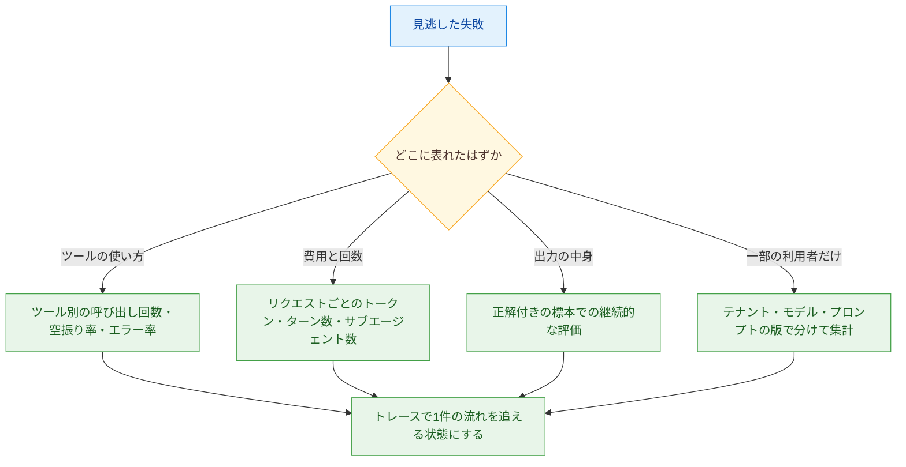

# 計測と監視の抜け

> ドメイン: 3. 統合（21%） ／ 更新: 2026-11-26

!!! abstract "ひとことで"
    エージェントの失敗の多くは、HTTP 200 のまま静かに起きる。インフラの指標だけでは拾えないので、==判断の形（ツールの選び方・回数・結果の空振り）と出力の質==を、テナントや版ごとに分けて監視する。

## 仕組み

規模の大きいエージェントでは、エラー率と遅延が平常のまま、中身だけが壊れることがある。検索が毎回0件を返す、要らないツールを何度も呼ぶ、正しい形式で誤った値を返す、といった失敗だ。これらは API から見ればすべて成功なので、見逃した失敗が「何の値に表れたはずか」から逆算して、監視を足す。

| 見逃しやすい失敗 | インフラの指標の見え方 | 拾える監視 |
|---|---|---|
| 検索ツールが0件を返し続ける | 2xx、遅延も平常 | ツール別の空振り率。プロンプトの版ごとに分ける |
| サブエージェントがループして費用が膨らむ | エラーなし | リクエストごとのトークン（キャッシュの読み書きを含む）とターン数。親子の呼び出しをつなぐトレース |
| 形式は正しいが値を取り違える | スキーマ検証は通る | 正解付きの標本を流し続ける、項目ごとの評価 |
| 特定のテナントや新しい版だけで劣化 | 全体の平均に埋もれる | 次元ごとの集計と、段階的な切り替え |

Anthropic のマルチエージェント調査の記事では、**本番で全体をトレースできるようにしたこと**で、エージェントが失敗した理由を診断できるようになった。同時に、個々の会話の中身ではなく、判断のパターンとやり取りの構造を監視して、利用者のプライバシーを守っている。中身を全部ログに残して人が読む方式は、規模にも機密にも合わない。

??? info "使える計測の材料"
    - Messages API の応答: `usage`（`input_tokens`、`cache_creation_input_tokens`、`cache_read_input_tokens`、出力）、`stop_reason`、`request_id`。レート制限の状態は `anthropic-ratelimit-*` ヘッダーに出る
    - Console の Usage ページには、入力・出力トークンのレート制限のグラフと、キャッシュの率が出る
    - Claude Code の OpenTelemetry: `CLAUDE_CODE_ENABLE_TELEMETRY=1` で有効にする。指標に `claude_code.token.usage`・`claude_code.cost.usage` など、イベントに `claude_code.tool_result`・`claude_code.api_request`・`claude_code.api_error` などがある
    - 同じく、`prompt.id` で1つのプロンプトから起きたイベントをまとめて追える。プロンプトの本文やツールの引数は既定で伏せられる（`OTEL_LOG_USER_PROMPTS`、`OTEL_LOG_TOOL_DETAILS` で出す）。トレースはベータで、`CLAUDE_CODE_ENHANCED_TELEMETRY_BETA=1` も要る
    - 管理者は managed settings で送信先を固定できる。リポジトリの `.claude/settings.json` に書いた `OTEL_*` の送信先は無視される
    - Agent SDK では、サブエージェントの中のメッセージに `parent_tool_use_id` が付く
    - マルチエージェント調査の記事: BrowseComp の評価では、トークンの使用量だけで成績の分散の8割が説明できた。マルチエージェントはチャットの約15倍のトークンを使う。エージェントは途中の状態を持つので、新しい版への切り替えは段階的に行う（rainbow deployment）

## 試験での見分け方

| 問われること | ○ 正しい | × ひっかけ |
|---|---|---|
| ダッシュボードは緑なのに品質が落ちていた | ツール別の結果（空振り率など）と出力の評価を監視する | 遅延やエラー率の閾値を厳しくする |
| 費用の急増に気づくのが遅れた | リクエストごとのトークンとターン数を、テナント別に異常検知する | 月末の請求額を確認する |
| どこで壊れたか追えない | モデル呼び出しとツール呼び出しを1本のトレースでつなぐ | 各部品のログを別々に保存する |
| 中身を見たいがプライバシーが心配 | 判断の構造を監視し、中身は伏せた既定のまま。必要な標本だけを評価に回す | 全会話の本文を記録して人が毎日読む |
| 新しいプロンプトの版で劣化 | 版ごとに分けて集計し、段階的に切り替える | 全体の平均だけを見る |

## 確認問題

**Q1.** 家電メーカーのサポートエージェントで、プロンプトを改訂してから2週間、ナレッジ検索ツールが全体の3割の依頼で0件を返していた。この間、ダッシュボードの HTTP 2xx の率、p95 の遅延、エラー率（0.1%）はどれも平常だった。この失敗を早く表に出せた監視はどれか。（1つ選べ）
{ .quiz-q }

- A. ツールごとの結果件数と0件の率を記録し、プロンプトの版ごとに分けて、急な変化に警告を出す
- B. p95 の遅延の警告の閾値を下げ、わずかな悪化でも通知されるようにする
- C. 全会話の本文を記録し、担当者が毎日まとめて読んで異常を探す
- D. Claude API の 5xx の率を監視し、一定を超えたら通知する

??? success "答えと解説"
    **正解: A。** 失敗はツールの結果に表れていた。ツール別の空振り率を、変更の単位（プロンプトの版）で分けて見る。

    - B: 遅延は平常だった。閾値を下げても、この失敗には反応しない
    - C: 規模に合わず、利用者の会話の中身を広く人目にさらす。気づくのも遅い
    - D: API は成功していた。5xx の率には表れない

**Q2.** 調査用のマルチエージェントを複数の顧客企業に提供している。ある顧客の分の費用が1週間で3倍になっていたが、月末の請求で初めて気づいた。後から見ると、特定の種類の依頼でサブエージェントが同じ検索を繰り返していた。再発を早く見つけるために加える監視はどれか。（2つ選べ）
{ .quiz-q }

- A. `max_budget_usd` を全リクエストに設定し、上限に達したリクエストを止める
- B. リクエストごとのトークン（キャッシュの読み書きを含む）、ターン数、サブエージェント数を顧客別に記録し、異常な増え方を通知する
- C. 組織の月の支出上限を設定し、上限に達したら請求の明細を確認する
- D. 親エージェントとサブエージェントの呼び出しを1本のトレースでつなぎ、どの依頼のどのサブエージェントが繰り返したかを追えるようにする
- E. 全顧客の API のリクエストとレスポンスの本文を丸ごと記録し、費用の多い会話を抜き出す

??? success "答えと解説"
    **正解: B と D。** 費用の増え方を細かい単位で検知し、トレースで原因の箇所まで追えるようにする。

    - A: 暴走を止める安全装置として有用だが、監視ではない。どこで何が増えたかは分からない
    - C: 気づくのが月末のままで、どの依頼が原因かも分からない
    - E: 会話の中身を広く保存することになり、プライバシーの面で過剰だ。数値の監視で足りる

**Q3.** 請求書の抽出パイプラインでモデルを更新した。出力はすべて JSON スキーマの検証を通り、`stop_reason` も `end_turn` のままだ。ところが経理の監査で、支払期日の項目に請求日が入っている例が約8%見つかった。この劣化を更新の直後に検知できた監視はどれか。（1つ選べ）
{ .quiz-q }

- A. スキーマ検証の合格率を監視し、下がったら警告を出す
- B. `stop_reason` の内訳を監視し、`max_tokens` の比率が増えたら警告を出す
- C. 正解付きの請求書の標本を本番と同じ経路に流し続け、項目ごとの正答率を版ごとに比べる
- D. 抽出1件あたりの遅延を監視し、更新の前後で差が出たら警告を出す

??? success "答えと解説"
    **正解: C。** 形式は正しく値だけが誤る失敗は、正解と突き合わせないと見えない。項目ごとの評価を続ける。

    - A: スキーマ検証は通っていた。値の取り違えは検証に表れない
    - B: 生成は正常に終わっていた。`stop_reason` にも表れない
    - D: 遅延は値の正しさと関係しない

## 出典
- Claude Certified Architect – Professional Exam Guide v1.1（Dec 7 版）, Domain 3「Instrumentation and Monitoring Gaps」（公式、PDF）: https://cc.sj-cdn.net/instructor/6nizmqk8tpzpfjvt6qmmav7rh/public/1794946420/Claude_Certified_Architect_-_Professional_Exam_Guide_Updated_Dec_7.pdf
- [How we built our multi-agent research system](https://www.anthropic.com/engineering/multi-agent-research-system)（公式、エンジニアリングブログ）
- [Monitoring](https://code.claude.com/docs/en/monitoring-usage)（公式、Claude Code の OpenTelemetry）
- [Rate limits](https://platform.claude.com/docs/en/api/rate-limits)（公式。応答ヘッダーと Usage ページ）
- [Prompt caching](https://platform.claude.com/docs/en/build-with-claude/prompt-caching)（公式。`usage` のキャッシュの項目）
- [Subagents in the SDK](https://code.claude.com/docs/en/agent-sdk/subagents)（公式。`parent_tool_use_id`）
