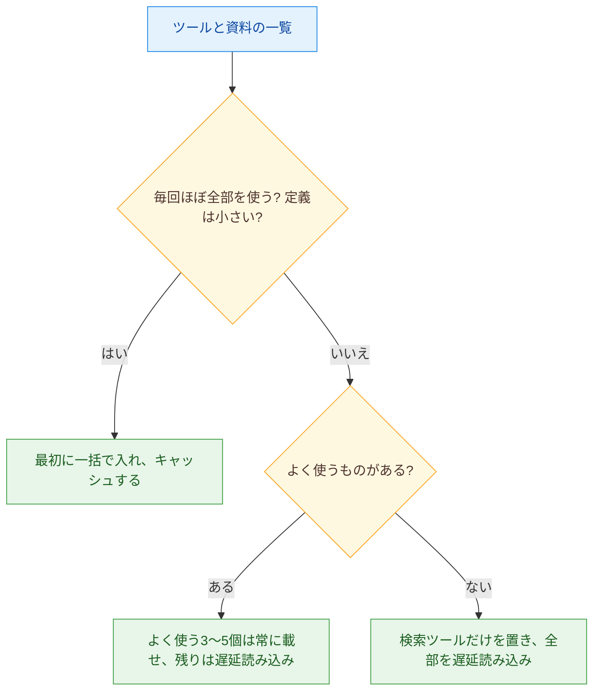

# 段階的な発見と一括の読み込み

> ドメイン: 3. 統合（21%） ／ 更新: 2026-11-26

!!! abstract "ひとことで"
    ツールや資料が多く、1回のタスクで使うのが一部だけなら、段階的な発見（progressive discovery）で必要な分だけ読み込む。少数で毎回すべて使うなら、==最初に一括で入れる方が速く単純==だ。

## 仕組み

一括の読み込みは、使わない定義や資料にも毎回トークンを払う。ツールの数が増えると、Claude が正しいツールを選ぶ精度も落ちる。段階的な発見は、最初は名前と短い説明だけを置き、要るときに本体を読む。その代わりに、探す手順が1段増えて、少し遅くなる。



| 仕組み | 最初に載るもの | 必要になったら |
|---|---|---|
| ツール検索（tool search tool） | 検索ツールと、`defer_loading` を付けないツール | 検索で見つかったツールの定義が展開される |
| Agent Skills | 各スキルの `name` と `description`（約100トークン） | `SKILL.md` の本文（5k トークン未満）を読む。さらに参照ファイルを読み、スクリプトは実行して出力だけを受け取る |
| ツールをコードの API として見せる | ファイルの一覧 | 要るツールのファイルだけを読む |
| Claude Code | CLAUDE.md は最初に入る | ファイルは glob や grep でその場で取る |

ツール検索のドキュメントは、10個以上のツールがある、定義が1万トークンを超える、ツールを増やすと選択の精度が落ちる、複数の MCP サーバーをまとめている（200以上のツール）、ツールが増え続ける、のどれかに当たれば使うよう勧めている。逆に、ツールが10個未満、毎回すべて使う、定義が小さい（合計100トークン未満）、のどれかなら通常のツール呼び出しの方が合う。

**遅延読み込みはプロンプトキャッシュを壊さない。** 遅延させたツールは前置きから外れ、見つかった定義は会話の中に展開されるからだ。ただし、遅延させたツールに `cache_control` は付けられない。キャッシュの区切りは、常に載せるツールに置く。

??? info "数値と細かい決まり"
    - ツール検索の型: `tool_search_tool_regex_20251119`（Python の正規表現、200文字まで）と `tool_search_tool_bm25_20251119`（自然文、500文字まで）
    - 遅延させるツールの定義も、毎回 `tools` 配列にすべて送る。`defer_loading` が変えるのは、文脈に入るものだけ
    - 少なくとも1つは遅延させない。検索ツール自身に `defer_loading: true` を付けない。全部を遅延させると 400 になる
    - 1回の検索で返るのは既定で5個（`limit` で 1〜10,000）。1リクエストで遅延できるのは 10,000 個まで
    - 検索ツールの呼び出し（`server_tool_use`、`srvtoolu_...`）に `tool_result` を返さない。返すと 400 になる
    - MCP connector では、`mcp_toolset` の `default_config` か `configs` で `defer_loading` を指定する
    - ドキュメントの数値: GitHub・Slack・Sentry・Grafana・Splunk の構成で定義が約55k トークン。検索で通常85%超を減らし、1回に3〜5個だけを読み込む。選択の精度は、ツールが30〜50個を超えると落ち始める
    - Claude Code の `ENABLE_TOOL_SEARCH`: 未設定なら MCP のツールをすべて遅延させる。`auto` は、遅延させる候補の定義が文脈の10%未満なら最初に読み込み、10%以上で検索を有効にする。常に見せたいサーバーには `alwaysLoad: true` を付ける
    - Code execution with MCP の記事: 例ではトークンが約15万から約2千に減った（98.7%減）

## 試験での見分け方

<div class="vs" markdown>

| 問われること | ○ 正しい | × ひっかけ |
|---|---|---|
| 数百のツールのうち、毎回使うのは数個 | ツール検索で遅延読み込みし、よく使う3〜5個は常に載せる | 説明文を磨くだけで全部を毎回載せる |
| ツール6個、毎回全部使う、定義は小さい | 一括で入れる | ツール検索を入れる（探す1段が無駄） |
| 長い手順書が一部のタスクでだけ要る | スキルにして、名前と説明だけを常に見せる | CLAUDE.md に全文を書く |
| 遅延読み込みとキャッシュ | 区切りは常に載せるツールに置く | 遅延させたツールに `cache_control` を付ける |
| 遅延読み込みを入れたら精度が落ちた | ツールの名前の接頭辞をそろえ、説明に利用者の言葉を入れる | 遅延をやめて全部を戻す |

</div>

## 確認問題

**Q1.** IT 運用の自動化エージェントが、6つの MCP サーバーから合計180個のツールにつながっている。定義は約7万トークンで、1回の依頼で実際に使うのは2〜4個だ。評価では、誤ったツールを選ぶ例が18%あり、毎回の入力のトークンも大きい。最も適切な対策はどれか。（1つ選べ）
{ .quiz-q }

<div class="quiz" data-answer="D" markdown>

- A. 依頼の種類を判定する分類器を前に置き、種類ごとに別の6つのエージェントへ振り分ける
- B. 180個のツールの説明文を書き直して違いをはっきりさせ、全部を毎回載せ続ける
- C. コンテキストウィンドウの大きいモデルに替え、7万トークンの定義を余裕をもって載せる
- D. ツール検索を入れて大半を遅延読み込みにし、よく使う数個は常に載せ、名前の接頭辞をサーバーごとにそろえる

</div>

??? success "答えと解説"
    **正解: D。** ツールが多く、毎回使うのは一部だ。段階的な発見に替えると、トークンと選択の誤りの両方が減る。

    - A: 仕組みが大きく増える。種類の中でもツールが多ければ、同じ問題が残る
    - B: 説明は大事だが、毎回の7万トークンと、数が多いことによる精度の低下は残る
    - C: 入るかどうかの問題ではない。毎回の費用と、選択の精度の低下は変わらない

**Q2.** 一括で最初に入れる方が合う場面はどれか。（2つ選べ）
{ .quiz-q }

<div class="quiz" data-answer="A,E" markdown>

- A. ツールは6個で、ほぼすべての依頼で全部を使い、定義は合計1,500トークンほど
- B. 社内の MCP サーバーが毎月増え、ツールの数が300を超えている
- C. 数十の参照資料があり、各タスクで使うのはそのうち1つだけ
- D. ツールの定義の合計が1万トークンを超え、増やすたびに選択の精度が落ちる
- E. 全応答に必ず適用する2千トークンほどの短い運用ルール

</div>

??? success "答えと解説"
    **正解: A と E。** A は、ドキュメントが通常のツール呼び出しを勧める条件のうち「ツールが10個未満」と「毎回すべて使う」に当たる。合計1,500トークンの定義は、公式の「小さい」（合計100トークン未満）には当たらないので、決め手はこの2つだ。E は毎回必ず効かせたいルールなので、探す手順を挟まず最初に入れる。

    - B: 数が多く増え続ける。ツール検索が勧められる場面だ
    - C: 一部しか使わない資料は、スキルの参照ファイルのように必要なときに読む
    - D: ドキュメントが挙げる、ツール検索を使うべき条件そのものだ

**Q3.** ツール検索を入れたリクエストが、次のエラーで失敗する。`tools` には、検索ツールを含むすべてのツールに `defer_loading: true` が付いている。また、キャッシュのために最後のツールに `cache_control` を付けている。

```text
400 invalid_request_error:
At least one tool must have defer_loading=false. All tools cannot be deferred.
```

最も適切な直し方はどれか。（1つ選べ）
{ .quiz-q }

<div class="quiz" data-answer="B" markdown>

- A. ツール検索をやめ、すべてのツールを最初に読み込む形に戻す
- B. 検索ツールとよく使う数個から `defer_loading` を外し、`cache_control` はその常に載るツールに付ける
- C. すべてのツールの `defer_loading` を `false` にし、キャッシュの区切りは今のまま残す
- D. 検索ツールの呼び出しの ID に対して `tool_result` を返し、検索を完了させる

</div>

??? success "答えと解説"
    **正解: B。** 少なくとも1つ、通常は検索ツール自身を遅延させない。遅延させたツールには `cache_control` を付けられないので、区切りは常に載るツールに置く。

    - A: エラーは設定の誤りで、段階的な発見をやめる理由にならない
    - C: 全部を最初に読み込むことになり、ツール検索の意味が無くなる
    - D: 検索ツールの呼び出しはサーバー側で実行される。`tool_result` を返すと、それ自体が 400 になる

## 出典
- Claude Certified Architect – Professional Exam Guide v1.1（Dec 7 版）, Domain 3「Progressive Discovery vs. Monolithic Context Loading」（公式、PDF）: https://cc.sj-cdn.net/instructor/6nizmqk8tpzpfjvt6qmmav7rh/public/1794946420/Claude_Certified_Architect_-_Professional_Exam_Guide_Updated_Dec_7.pdf
- [Tool search tool](https://platform.claude.com/docs/en/agents-and-tools/tool-use/tool-search-tool)（公式）
- [Agent Skills](https://platform.claude.com/docs/en/agents-and-tools/agent-skills/overview)（公式。段階的な開示の3つの段）
- [Connect Claude Code to tools via MCP](https://code.claude.com/docs/en/mcp)（公式。`ENABLE_TOOL_SEARCH`）
- [Best practices for Claude Code](https://code.claude.com/docs/en/best-practices)（公式。スキルは CLAUDE.md より文脈に軽い）
- [Effective context engineering for AI agents](https://www.anthropic.com/engineering/effective-context-engineering-for-ai-agents)（公式、エンジニアリングブログ）
- [Code execution with MCP](https://www.anthropic.com/engineering/code-execution-with-mcp)（公式、エンジニアリングブログ）
- [Advanced tool use](https://www.anthropic.com/engineering/advanced-tool-use)（公式、エンジニアリングブログ）
