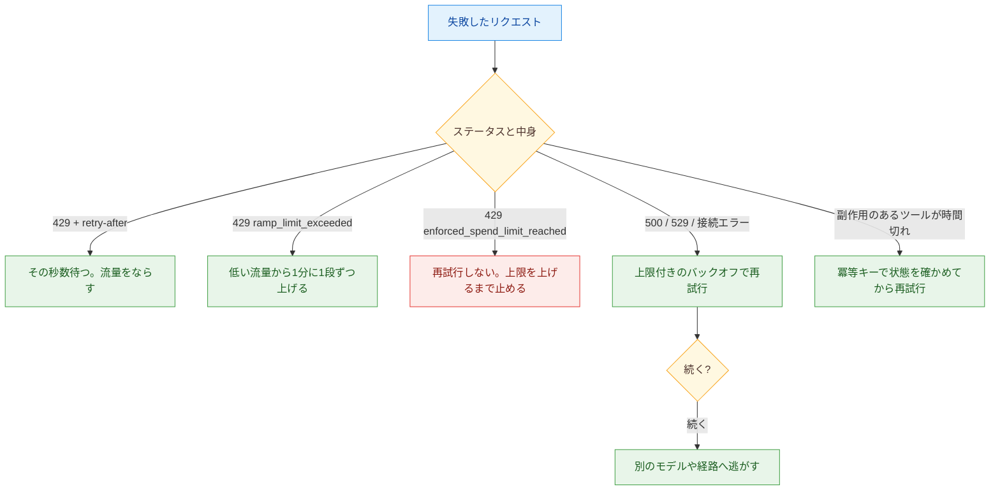

# 本番の信頼性の制御

> ドメイン: 3. 統合（21%） ／ 更新: 2026-11-26

!!! abstract "ひとことで"
    エラーのトレースから失敗の型を見分け、型に合う制御を1つ選ぶ。429 は待って流量を整える、一時的な障害は上限付きで再試行し、続けば別の経路へ逃がす。==副作用のあるツールは、再試行しても二重に効かないように冪等にする==。

## 仕組み

同じ「失敗」でも、直し方は型で違う。レート制限に当たっているのに再試行の回数を増やすと、流量がさらに増えて悪化する。支出の上限に達した 429 は、何度再試行しても通らない。副作用のあるツールを結果が分からないまま再試行すると、返金や送金が二重に起きる。だから、まずステータスとエラーの中身で型を決める。

| トレースに出る型 | 原因 | 制御 |
|---|---|---|
| 429 `rate_limit_error`、`retry-after` 付き | RPM・ITPM・OTPM のどれかを超えた。短い時間の山でも起きる | `retry-after` の秒数だけ待つ。送信をならす。キャッシュで ITPM を空ける |
| 429、`error.details.error_code` が `ramp_limit_exceeded` | 使用量の急な増加。レート制限の内側でも起きる | 通る水準で保ち、1分に1段ずつ上げる。一括の処理は低い流量で始めるか Message Batches に回す |
| 429、`enforced_spend_limit_reached`、`retry-after` なし | 利用段階（tier）の月の支出上限に達した | 再試行しない。翌月まで止まるので、段階を上げるか運用に知らせる |
| 500 `api_error` / 529 `overloaded_error` | Anthropic 側の内部エラー・過負荷 | `x-should-retry` に従い、上限付きのバックオフで再試行する |
| 504 `timeout_error`、長い生成の途中で切れる | 長いリクエスト | ストリーミングか Message Batches を使う |
| ツールの時間切れの後に、二重の実行 | 結果が分からないまま再試行した | 冪等キーで重複を弾き、再試行の前に状態を確かめる |

**冪等性は、呼び出す側の再試行ではなく、副作用を起こす側で保証する。** モデルへの「二度呼ぶな」という指示は、ハーネスや SDK が裏で行う再試行には効かない。ツールの呼び出しごとに一意のキーを付け、受け取る側がキーで重複を弾く（推論。Claude API に、ツールの冪等キーの仕組みがあるとは確認できなかった）。

逃がし先の経路は、制限の単位を見て選ぶ。レート制限はモデルの区分ごとに別に数えるので、別のモデルに逃がせば別の枠を使える。一方、支出の上限は組織全体にかかるので、別のモデルに逃がしても通らない。529 が続くときに別のモデルや別の提供先へ逃がす設計は、公式のドキュメントで手順としては確認できなかった（推論）。

??? info "SDK の再試行と細かい決まり"
    - SDK は既定で2回まで再試行する（合わせて3回）。`max_retries`（TypeScript は `maxRetries`）で変え、`0` で止める
    - SDK は `x-should-retry` ヘッダーがあれば従う。無ければ、接続エラー・タイムアウト・408・409・429・500以上を再試行する。待ち時間は `retry-after` があればその値、無ければ 0.5〜8秒の指数的なバックオフ
    - SDK は、ストリームの途中のエラーを再試行しない。SDK を使わないなら、`x-should-retry` と `retry-after` に従い、バックオフと回数の上限を自分で入れる
    - レート制限はトークンバケット方式で、決まった時刻に戻るのではなく少しずつ回復する。60 RPM が毎秒1回として適用されることがある
    - キャッシュから読んだトークンは ITPM にもランプの制限にも数えない。`max_tokens` は OTPM の計算に入らない
    - 自分で設定した支出の上限に達すると、429 ではなく 400 `invalid_request_error` になる
    - 10分を超えそうな長いリクエストは、ストリーミングか Message Batches を検討する。Message Batches はランプの制限の対象外
    - 拒否（`stop_reason: "refusal"`）は、別の Claude モデルで再試行すると応答が得られることが多い（Haiku 5.5 はサーバー側のフォールバックが無い）
    - MCP のツール注釈 `idempotentHint`（同じ引数で繰り返しても追加の効果が無い。既定は false）と `readOnlyHint`（既定は false）。クライアントは、信頼できないサーバーの注釈で判断してはならない
    - Claude Code は、`idempotentHint` か `readOnlyHint` が `true` のツールに限り、接続が切れて保留になった呼び出しを、新しい接続で1回だけ繰り返す

## 試験での見分け方

| 問われること | ○ 正しい | × ひっかけ |
|---|---|---|
| 夜間の一括処理の開始直後に 429 が集中 | 低い流量で始めて段階的に上げる。Batches に回す | 再試行の回数を増やす |
| `retry-after` の無い 429 が続く | `error_code` を見て支出の上限なら再試行を止める | バックオフを長くして再試行を続ける |
| 529 が続いて応答が返らない | 上限付きで再試行し、続けば別のモデルや経路に逃がす | 無制限に再試行する |
| 返金ツールが二重に実行された | 冪等キーで重複を弾き、時間切れの後は状態を確かめる | 「二度呼ぶな」とプロンプトに書く |
| 冪等でないツールの自動再試行 | 注釈は実態どおりに付ける（冪等でなければ付けない） | 再試行させたいので `idempotentHint: true` を付ける |

## 確認問題

**Q1.** 保険会社の請求書の要約バッチが、毎晩 2:00 に2,000件のリクエストを一斉に送る。開始から数分間、429 が大量に出る。ログの `error.details.error_code` は `ramp_limit_exceeded` で、その時間帯の ITPM と OTPM はどちらも上限の半分ほどだった。最も適切な対策はどれか。（1つ選べ）
{ .quiz-q }

- A. 低い流量で送り始めて1分に1段ずつ上げるか、即時性が要らないので Message Batches API に回す
- B. SDK の `max_retries` を10に上げ、429 が出ても最後には通るようにする
- C. 利用段階（tier）の引き上げを申請し、ITPM と OTPM の上限を上げてもらう
- D. 同じ処理を別のモデルに切り替え、そちらのモデルの上限の枠で一斉に送る

??? success "答えと解説"
    **正解: A。** レート制限の内側で出ている 429 は、急な増加によるランプの制限だ。流量を段階的に上げるか、ランプの制限の対象外の Batches に回す。

    - B: 一斉の送信に再試行が重なり、急な増加がさらに強まる
    - C: 上限には余裕があった。ランプの制限は上限の高さと別の問題だ
    - D: ランプの制限はどのモデルにもかかる。一斉に送れば同じことが起きる

**Q2.** 通販会社のサポートエージェントで、返金ツールが二重に実行された。トレースでは、ツールの実装が決済サービスを呼んで30秒で時間切れになり、ハーネスが同じ呼び出しを再試行していた。決済サービスの側では、1回目の返金も完了していた。行うべき対策はどれか。（2つ選べ）
{ .quiz-q }

- A. ハーネスの再試行をすべてのツールで止め、失敗はすべて利用者に返す
- B. 返金の呼び出しごとに一意のキー（例: `tool_use_id` から作る）を付け、決済サービスの側で同じキーの重複を弾く
- C. 時間切れの後は、再試行の前にそのキーで返金の状態を問い合わせ、完了していれば再試行しない
- D. システムプロンプトに「返金ツールは1回の依頼で1度だけ呼ぶこと」と書き足す
- E. 返金ツールの MCP の注釈に `idempotentHint: true` を付け、クライアントに自動で再試行させる

??? success "答えと解説"
    **正解: B と C。** 冪等性は副作用を起こす側で保証し、結果が分からないときは状態を確かめてから再試行する。

    - A: 読み取りのツールの一時的な失敗まで回復できなくなる。行き過ぎだ
    - D: 再試行はハーネスが行っており、モデルの指示では止まらない
    - E: 冪等でないツールに注釈を付けると、自動の再試行で二重の返金を自分で招く

**Q3.** 分析 SaaS の本番で、すべてのリクエストが失敗し始めた。ログは 429 `rate_limit_error` で `retry-after` ヘッダーが無く、`error.details.error_code` は `enforced_spend_limit_reached` だ。SDK は各リクエストを既定どおり再試行しており、キューが詰まっている。最も適切な対応はどれか。（1つ選べ）
{ .quiz-q }

- A. バックオフの待ち時間を長くし、上限が回復するまで再試行を続ける
- B. 同じ組織の API キーのまま別のモデルに切り替え、そちらで処理を続ける
- C. この `error_code` では再試行を止めて運用に知らせ、利用段階の引き上げを申請する
- D. ワーカーの並列数を増やし、詰まったキューを早く流す

??? success "答えと解説"
    **正解: C。** 利用段階の月の支出上限に達した 429 は、翌月か段階の引き上げまで通らない。再試行を止め、人が判断する。

    - A: 再試行は上限が戻るまで失敗し続ける。キューの詰まりも解けない
    - B: 支出の上限は組織全体にかかる。別のモデルでも通らない
    - D: 失敗する呼び出しが増えるだけだ

## 出典
- Claude Certified Architect – Professional Exam Guide v1.1（Dec 7 版）, Domain 3「Production Reliability Controls」（公式、PDF）: https://cc.sj-cdn.net/instructor/6nizmqk8tpzpfjvt6qmmav7rh/public/1794946420/Claude_Certified_Architect_-_Professional_Exam_Guide_Updated_Dec_7.pdf
- [Claude API errors](https://platform.claude.com/docs/en/api/errors)（公式。再試行と長いリクエスト）
- [Rate limits](https://platform.claude.com/docs/en/api/rate-limits)（公式。支出の上限とランプの制限）
- [Stop reasons and fallback](https://platform.claude.com/docs/en/build-with-claude/handling-stop-reasons)（公式。拒否時の別モデルでの再試行）
- [Connect Claude Code to tools via MCP](https://code.claude.com/docs/en/mcp)（公式。安全に繰り返せるツールの印）
- [MCP schema 2025-11-25（ToolAnnotations）](https://github.com/modelcontextprotocol/modelcontextprotocol/blob/main/schema/2025-11-25/schema.ts)（公式、MCP の GitHub）
