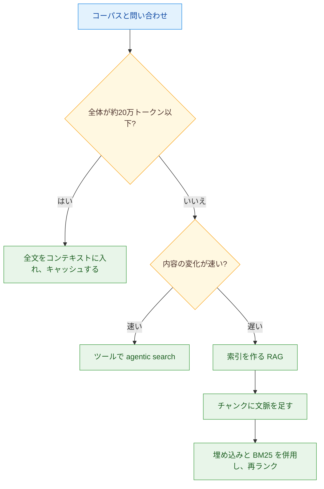

# 検索の構成の選択

> ドメイン: 3. 統合（21%） ／ 更新: 2026-11-26

!!! abstract "ひとことで"
    コーパスが小さければ全文をコンテキストに入れ、大きく静的なら索引を作る RAG、変化が速いならツールでの agentic search を選ぶ。索引を作るなら、==チャンクに文脈を足して埋め込みと BM25 の両方に載せる==（contextual retrieval）。

## 仕組み

検索の構成は、コーパスの大きさ・更新の速さ・問い合わせの形・遅延とコストの上限で決まる。全文をコンテキストに入れれば取りこぼしは起きないが、毎回の入力が大きい。RAG は速く安いが、索引を作った時点の内容しか返せず、チャンクが前後の文脈を失う。agentic search はその場で最新を調べられるが、探索の分だけ遅い。

| 構成 | 向く場面 | 弱み |
|---|---|---|
| 全文をコンテキストに | 約20万トークン（約500ページ）以下。プロンプトキャッシュで毎回の費用と遅延を抑える | コーパスが育つと入らなくなる |
| 事前に索引を作る RAG | 大きく、更新が遅いコーパス。問い合わせが多く、遅延の上限が厳しい | 索引が古くなる。チャンクが文脈を失う |
| ツールでの agentic search | 頻繁に変わる対象（コード、ログ、チケット）。識別子での検索、複数段の調べもの | 探索の分だけ遅く、手がかりが無いと迷う |

contextual retrieval は、RAG の「チャンクが文脈を失う」問題への対策だ。文書全体とチャンクを Claude に渡し、そのチャンクが文書のどこの何の話かを短い文で書かせ、チャンクの頭に足してから索引に載せる。**埋め込みだけでなく BM25（字面の一致に強い検索）にも同じ文脈付きのチャンクを載せる。** 型番・条項番号・エラーコードのような完全一致の語は、埋め込みだけだと取りこぼすからだ。さらに多めに取って再ランクで絞ると、取りこぼしはもう一段減る。

索引の検索で手応えが無いときの逃げ道も決めておく。BM25 の字面一致を併用しておくことが、識別子での検索の受け皿になる。それでも見つからなければ、ツールで原文を直接調べるか、見つからないと答えさせる（推論）。

??? info "Contextual Retrieval の記事の数値"
    - 付け足す文脈は1チャンクあたり 50〜100 トークン程度。生成には Claude 3 Haiku とプロンプトキャッシュを使い、1回限りの費用は文書100万トークンあたり約 $1.02（800 トークンのチャンク、8k トークンの文書などの前提）
    - 上位20件の取りこぼし率（1 − recall@20）: 基準 5.7% → 文脈付き埋め込み 3.7%（35%減）→ ＋文脈付き BM25 2.9%（49%減）→ ＋再ランク 1.9%（67%減）
    - 再ランクは上位150件を取ってから20件に絞る構成。遅延が少し増える
    - 渡す件数は 20 件が 5 件・10 件より良かった
    - 文書全体の要約を足す方法、仮想文書の埋め込み（HyDE）、要約での索引は効果が小さかった
    - チャンクの大きさ・境界・重なりは調整する。領域の用語集を文脈生成のプロンプトに入れると効くことがある。評価は必ず回す
    - Effective context engineering の記事: Claude Code は CLAUDE.md を最初に入れ、glob や grep で必要なファイルをその場で取る。最初に入れる分とその場で取る分を組み合わせる方式は、法務や金融のような変化の少ない内容に向くことがある

## 試験での見分け方

| 問われること | ○ 正しい | × ひっかけ |
|---|---|---|
| 300ページの手引き1冊、更新は月1回 | 全文をコンテキストに入れ、キャッシュする | ベクトル DB の RAG を作る（取りこぼしを自分で作る） |
| 数千万トークンの契約書、条項番号で引かれる | 文脈付きのチャンクを埋め込みと BM25 の両方に載せ、再ランクする | 埋め込みだけで検索し、件数を減らしてノイズを抑える |
| 毎時変わるリポジトリとログ | ツールでその場で検索する | 索引の再構築の頻度を上げる |
| チャンクが「どの契約の話か」を失う | チャンクごとの文脈を頭に足す | 文書全体の要約を全チャンクに同じく足す |
| 遅延の上限が厳しく、問い合わせが多い | 索引を作る RAG | 毎回 agentic search で探索する |

## 確認問題

**Q1.** 産業機械メーカーが、保守担当者向けに取扱説明書の質問に答えるアシスタントを作る。説明書は約300ページ（約15万トークン）で、改訂は月1回。問い合わせは1日2千件、回答は数秒以内なら許容される。最も適切な検索の構成はどれか。（1つ選べ）
{ .quiz-q }

- A. 説明書を500トークンずつに切ってベクトル DB に入れ、上位5件を渡す RAG を作る
- B. 説明書の全文をコンテキストに入れ、プロンプトキャッシュで毎回の処理を省く
- C. 説明書をファイルとして置き、毎回エージェントに grep で探させる
- D. 章ごとの要約で索引を作り、要約から選んだ章だけを渡す

??? success "答えと解説"
    **正解: B。** 約20万トークン以下なら全文を入れられる。キャッシュで費用と遅延を抑えれば、取りこぼしも起きない。

    - A: 入る大きさなのに、自分で取りこぼしの経路を作る。チャンクも文脈を失う
    - C: 探索の分だけ遅く、全文が入るのに迷う余地を作る
    - D: 全文が入るのに、選び損ねの経路を作る。要約での索引は、記事では効果が小さかった

**Q2.** 法律事務所の契約書の検索システムは、約4千万トークンを埋め込みだけで索引にしている。「第12条3項(b)」のような条項番号や、契約番号での問い合わせで正しい箇所が出ない。また、取れたチャンクの多くが、どの契約のどの当事者の話か分からない。行うべき変更はどれか。（2つ選べ）
{ .quiz-q }

- A. 文脈付きのチャンクで BM25 の索引も作り、埋め込みの検索と結果を合わせる
- B. 契約書をすべてコンテキストに入れ、索引をやめる
- C. 各チャンクの頭に、契約名・当事者・条項の位置を述べる短い文脈を足してから索引に載せる
- D. 渡す件数を20件から5件に減らし、関係の薄いチャンクを除く
- E. 各契約書の全体の要約を作り、その契約の全チャンクの頭に同じ要約を足す

??? success "答えと解説"
    **正解: A と C。** 完全一致の語は BM25 で拾い、チャンクの文脈の欠落はチャンクごとの文脈で補う。

    - B: 約4千万トークンはコンテキストに入らない
    - D: 件数を減らすと取りこぼしが増える。記事では20件の方が良かった
    - E: 文書全体の要約を足す方法は、記事では効果が小さかった。チャンクごとの位置づけにならない

**Q3.** クラウドの運用チームが、障害対応を助けるエージェントを作った。リポジトリとログを毎晩索引にし直す RAG で動かしているが、日中に削除された関数や、数時間前に出始めたエラーについて誤った回答をする。最も適切な変更はどれか。（1つ選べ）
{ .quiz-q }

- A. 索引の作り直しを毎時に増やし、古さを1時間以内に抑える
- B. 渡す件数を増やし、新しい内容に近いチャンクも入るようにする
- C. リポジトリとログの全体をコンテキストに入れて回答させる
- D. grep やファイルの読み取り、ログの検索のツールを渡し、問い合わせの時点で調べさせる

??? success "答えと解説"
    **正解: D。** 対象の変化が速いので、索引ではなくその場で調べる agentic search が合う。

    - A: 古さが縮むだけで、索引の後に起きた変化は答えられないまま残る
    - B: 索引に無い内容は、件数を増やしても取れない
    - C: リポジトリとログの全体は大きく、毎回入れるのは現実的でない

## 出典
- Claude Certified Architect – Professional Exam Guide v1.1（Dec 7 版）, Domain 3「Retrieval Architecture Selection」（公式、PDF）: https://cc.sj-cdn.net/instructor/6nizmqk8tpzpfjvt6qmmav7rh/public/1794946420/Claude_Certified_Architect_-_Professional_Exam_Guide_Updated_Dec_7.pdf
- [Introducing Contextual Retrieval](https://www.anthropic.com/engineering/contextual-retrieval)（公式、エンジニアリングブログ）
- [Effective context engineering for AI agents](https://www.anthropic.com/engineering/effective-context-engineering-for-ai-agents)（公式、エンジニアリングブログ）
- [Prompt caching](https://platform.claude.com/docs/en/build-with-claude/prompt-caching)（公式）
