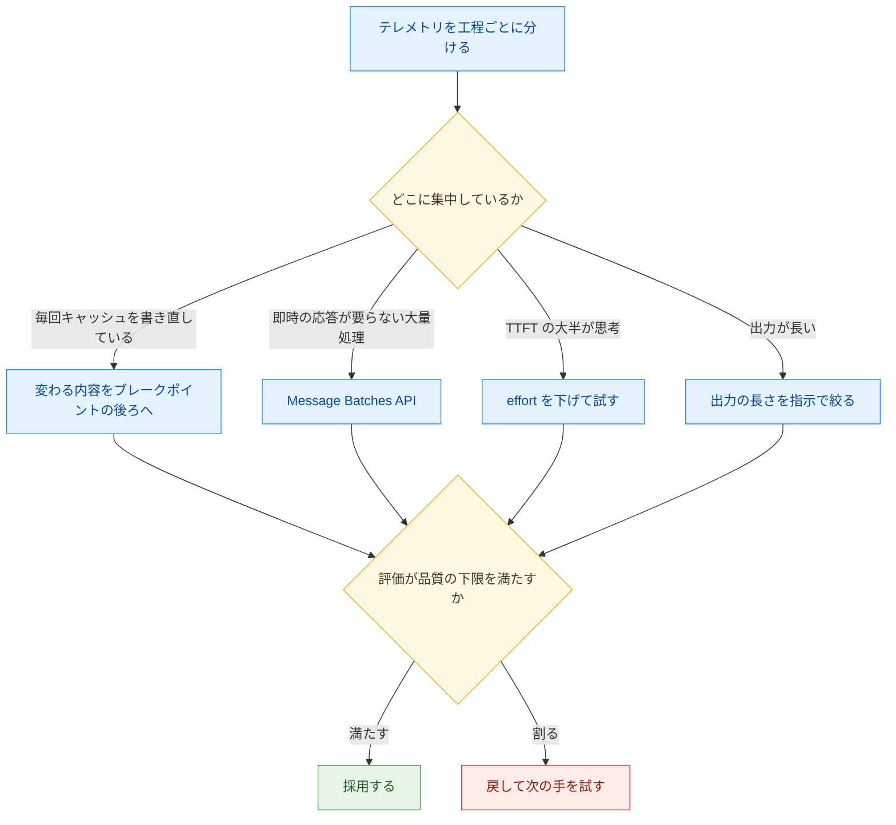

# コストと遅延の最適化

> ドメイン: 4. 評価・テスト・最適化（17%） ／ 更新: 2026-11-26

!!! abstract "ひとことで"
    まずテレメトリで、費用や待ち時間が==どこに集中しているか==を特定する（キャッシュのヒット率、入力と出力のトークン、思考の時間、呼び出しの回数）。そこに効く手を1つずつ試し、そのたびに評価を流して==決められた品質の下限==を割らないことを確かめる。

## 仕組み

費用は、キャッシュの読み出し・書き込み・キャッシュされない入力・出力のトークンに、それぞれの単価を掛けた合計だ。遅延は、最初のトークンまでの時間（TTFT）と、出力の生成の時間に分かれる。集中している場所が違えば、効く手も違う。公式ドキュメントは、まず制約なしで良く動くプロンプトを作り、その後で遅延を減らすよう勧めている。早すぎる削減は、最高の性能がどこにあるかを見えなくするからだ。



| テレメトリの症状 | 原因の見当 | 効く手 |
|---|---|---|
| `cache_read_input_tokens` が毎回 0、`cache_creation_input_tokens` が毎回同じ量 | ブレークポイントより前に、時刻など毎回変わる内容がある | 変わる内容をブレークポイントの後ろに動かす |
| 数分おきの呼び出しで、ヒットとミスが入り混じる | 既定の 5 分の TTL が切れている | 1 時間の TTL を使う |
| 夜間の大量処理の費用が大きい | 即時の応答が要らないのに同期で呼んでいる | Message Batches API に移す |
| 出力は短いのに TTFT が長い | 思考に時間を使っている | effort を下げて評価する |

ストリーミングは、応答を待つ体感をよくするが、費用は減らさない。`max_tokens` を下げるのは、上限で出力を途中で切る粗い手で、短い答えが先頭に来る用途に向く。

??? info "数字と細かい決まり"
    - 入力の合計 = `cache_read_input_tokens` + `cache_creation_input_tokens` + `input_tokens`。両方の cache の値が 0 なら、キャッシュされていない（最小の長さに届いていないことが多い）
    - 単価の倍率（基本の入力単価に対して）: 5 分の書き込み 1.25 倍、1 時間の書き込み 2 倍、読み出しは既定 0.1 倍（Claude Opus 5.5 と Sonnet 5.5 は 0.05 倍、Fable 5.2 などは 0.025 倍）
    - キャッシュの前提の順は tools → system → messages。ツールの定義を変えると全部が無効になる。`tool_choice`、画像の有無、思考の設定、effort もそろえる
    - キャッシュできる最小の長さはモデルで違う（512・1,024・2,048・4,096 トークン）。短いと、エラーなしでキャッシュされない
    - 並列のリクエストは、最初の応答が始まってから残りを送る。キャッシュはその時点から使える
    - Message Batches API: 費用は 50% 引き。ほとんどは1時間以内に終わり、24時間で終わらないものは期限切れになる。1つのバッチは 10万件か 256 MB まで。共通の文脈には 1 時間のキャッシュを使うと、ヒット率が上がる
    - キャッシュのヒットはレート制限の計算に入らないと公式ドキュメントにある

## 試験での見分け方

<div class="vs" markdown>

| 問われること | ○ 正しい | × ひっかけ |
|---|---|---|
| ヒット率が 0 | 変わる内容をブレークポイントの後ろに動かす | TTL を 1 時間にする（前提が毎回違えば何時間でもヒットしない） |
| 即時性の要らない大量の処理 | Batches API と、共通部分のキャッシュ | ストリーミングにする（費用は変わらない） |
| 費用を下げたい | 下位のモデルや低い effort を、品質の下限を評価で確かめて採用する | 評価をせずに一括で下位のモデルに替える |
| 応答が長すぎて遅い | 長さをプロンプトで指示する | `max_tokens` を下げる（文の途中で切れる） |

</div>

## 確認問題

**Q1.** 社内ヘルプデスクのチャットで、費用が見込みより高い。システムプロンプトは約 12,000 トークンで、先頭に「現在時刻: 2026-11-26 10:42:13」を入れ、末尾に `cache_control` を付けている。利用の記録は次のとおりだ。最も適切な対策はどれか。（1つ選べ）
{ .quiz-q }

```text
request  input_tokens  cache_creation_input_tokens  cache_read_input_tokens
#1041    352           12,480                       0
#1042    341           12,480                       0
#1043    365           12,480                       0
```

<div class="quiz" data-answer="C" markdown>

- A. キャッシュの TTL を 1 時間にして、エントリが長く残るようにする
- B. モデルを Haiku に替え、入力の単価を下げる
- C. 現在時刻をシステムプロンプトから外してユーザーのメッセージに移し、ブレークポイントを変わらない内容の最後に置く
- D. 問い合わせを Message Batches API で送り、費用を半分にする

</div>

??? success "答えと解説"
    **正解: C。** 前提の先頭が毎回変わるので、読み出しが 0 で、毎回書き込みの割増を払っている。

    - A: 前提が毎回違うので、TTL を延ばしてもヒットしない
    - B: 品質の下限を確かめていないうえ、原因の書き直しは残る
    - D: チャットは即時の応答が要り、バッチには向かない

**Q2.** 毎晩、4万件の契約書から要点を抜き出すジョブを、Claude Opus 5.5 への同期の呼び出しで1件ずつ処理している。結果は翌朝までにあればよい。品質の下限は、評価の事例での抽出の正確さ 95% だ。どの依頼にも、同じ約 5,000 トークンの抽出の手順が付く。費用を下げる手として適切なものはどれか。（2つ選べ）
{ .quiz-q }

<div class="quiz" data-answer="A,D" markdown>

- A. Message Batches API で送る
- B. 評価をせずに、すべての依頼を Haiku に切り替える
- C. `max_tokens` を 300 に下げ、出力の費用に上限をかける
- D. 共通の抽出の手順を、1 時間の TTL でキャッシュする
- E. ストリーミングで受け取るようにする

</div>

??? success "答えと解説"
    **正解: A と D。** 即時性が要らないのでバッチで費用を半分にし、共通の手順はバッチの処理時間に合う 1 時間のキャッシュで読み出しにする。

    - B: 品質の下限を割るかどうかを確かめていない
    - C: 長い要点が途中で切れ、正確さを割るおそれがある
    - E: ストリーミングは体感の速さの手で、費用は変わらない

**Q3.** カスタマーサポートのチャットで、応答の p95 が 9 秒あり、目標は 5 秒だ。内訳は、TTFT が平均 7.5 秒、出力は平均 150 トークン、キャッシュのヒット率は 90% だった。トレースでは、TTFT の大半が high の effort での思考に使われていた。品質の下限は、評価での解決の正確さ 92%（現在 95%）だ。最も適切な対策はどれか。（1つ選べ）
{ .quiz-q }

<div class="quiz" data-answer="A" markdown>

- A. effort を medium と low で評価し、下限を満たす中で最も速い水準を採用する
- B. ストリーミングを有効にして、最初の文字が早く出るようにする
- C. `max_tokens` を 100 に下げ、応答の時間を短くする
- D. システムプロンプトにブレークポイントを1つ足し、ヒット率を上げる

</div>

??? success "答えと解説"
    **正解: A。** 待ち時間は思考に集中しているので、effort を下げ、評価で品質の下限を確かめる。

    - B: 思考が終わるまで答えの文字は出ないので、待ち時間の大半は残る（推論）
    - C: 出力は短く、遅さの原因ではない。答えが途中で切れるおそれもある
    - D: ヒット率はもう 90% で、伸ばせる余地は小さい

## 出典
- Claude Certified Architect – Professional Exam Guide v1.1（Dec 7 版）, Domain 4「Cost and Latency Optimization」（公式、PDF）: https://cc.sj-cdn.net/instructor/6nizmqk8tpzpfjvt6qmmav7rh/public/1794946420/Claude_Certified_Architect_-_Professional_Exam_Guide_Updated_Dec_7.pdf
- [Prompt caching](https://platform.claude.com/docs/en/build-with-claude/prompt-caching)（公式）
- [Reducing latency](https://platform.claude.com/docs/en/test-and-evaluate/strengthen-guardrails/reduce-latency)（公式）
- [Batch processing](https://platform.claude.com/docs/en/build-with-claude/batch-processing)（公式）
- [Models overview](https://platform.claude.com/docs/en/models/overview)（公式。価格とキャッシュの読み出しの倍率）
