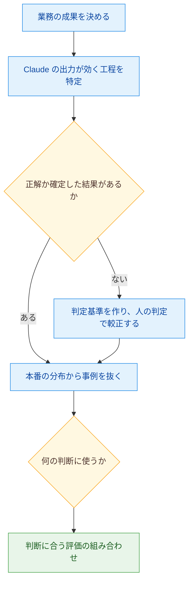

# 業務から評価を作る

> ドメイン: 4. 評価・テスト・最適化（17%） ／ 更新: 2026-11-26

!!! abstract "ひとことで"
    評価は、==支える判断（モデルの変更・プロンプトの変更・リリースの関門）ごとに==作る。成功基準は業務の成果から導き、事例は==本番で実際に流れる分布==に合わせる。

## 仕組み

業務の流れの全部が評価になるわけではない。評価に使えるのは、Claude の出力がそのまま判断に効き、正解（または後で確定した結果）が手に入る部分だ。たとえば保険金の請求の振り分けなら、査定が終わって支払いの可否が確定した過去の請求が正解付きの事例になる。顧客満足度のように多くの要因が混ざる指標は、モデルを替えた効果を切り出せないので、変更の判断には向かない（推論）。

| 支える判断 | 評価の範囲 | 合否の決め方 |
|---|---|---|
| モデルの変更 | 本番の分布に沿った広い事例。品質に加えて遅延とコスト | 現行の基準値と比べて、劣化が許容範囲か |
| プロンプトの変更 | 変えた振る舞いを狙った事例と、既存の回帰テスト | 狙った改善が出て、回帰が出ないか |
| リリースの関門 | 固定した回帰テストと、事前に決めたしきい値 | しきい値を満たすか。回帰テストはほぼ 100% の合格を保つ |

1つの手法では全部を覆えない。Anthropic のエンジニアリング記事は、リリース前と CI の自動評価、本番の監視、A/B テスト、ユーザーの反応、トランスクリプトの人による確認、体系的な人の評価を重ねる「スイスチーズ」の考え方をとる。自動評価はリリース前の判断に、本番の監視と A/B テストはリリース後の確認に使い分ける。

??? info "事例の集め方と成功基準の細部"
    - 最初は多くなくてよい。記事は「実際の失敗から集めた 20〜50 件の簡単なタスク」から始めることを勧める。サポートのチケットや手作業の確認が出どころになる
    - 能力の評価（capability eval）は低い合格率から始め、回帰の評価（regression eval）はほぼ 100% を保つ。合格率が上がった能力の評価は回帰の評価に移す
    - 公式ドキュメントの成功基準の例は、件数・しきい値・基準値との差まで書く（例: 1万件の投稿で F1 0.85 以上、95% の応答が 200ms 未満）
    - 事例の作り足しに Claude を使ってよいと公式ドキュメントにある。ただし作った事例は本番の分布の代わりにならない（推論）
    - 過去の人の判断を正解に使うときは、人の間でも判断が割れた事例を別に扱う（推論）

## 試験での見分け方

| 問われること | ○ 正しい | × ひっかけ |
|---|---|---|
| モデルを替えるかの判断に使う事例 | 結果が確定した本番の事例を、分布に沿って抜く | 公開ベンチマークや、Claude に作らせた事例だけで判断する |
| 成功基準 | 業務の成果（誤払いの率、処理時間）を、しきい値付きで書く | 「役に立つか」を 1〜5 で判定させた平均を基準にする |
| プロンプトの変更の関門 | 狙いの事例と回帰テストの両方を通す | 変えた部分の事例だけを見る |
| リリース後の確認 | 段階的に出して本番の指標を監視する | リリース前の評価が合格したので監視しない |

## 確認問題

**Q1.** 損害保険会社が、請求の振り分けに使う Claude のモデルを替えるかを判断したい。評価の事例として最も適切なものはどれか。（1つ選べ）
{ .quiz-q }

- A. 振り分けの規程を Claude に渡し、それに沿って作らせた架空の請求 500 件
- B. 過去3か月に、振り分けの後で顧客満足度の調査に答えた請求の満足度スコア
- C. 直近の四半期の請求から、査定で結果が確定したものを、本番の種類の比率に沿って抜いた事例
- D. 保険の文書の読解を扱う公開ベンチマークの、最新の点数の比較

??? success "答えと解説"
    **正解: C。** 判断に効く工程の、正解が確定した事例を、本番の分布に沿って使う。

    - A: 作った事例は本番の分布を映さない。規程から外れた実際の請求を落とす
    - B: 満足度には多くの要因が混ざり、モデルの差を切り出せない
    - D: 公開ベンチマークは、この会社の請求の分布とも振り分けの規程とも違う

**Q2.** 同じ会社の業務部門は、「誤った支払いを増やさずに、1件の処理時間を 30% 短くする」ことを目標にしている。この目標から導いた成功基準として適切なものはどれか。（2つ選べ）
{ .quiz-q }

- A. 結果が確定した事例で、誤った支払いの判断の率が、現行の人の処理の率を超えない
- B. 判定用の LLM が「役に立つ振り分けか」を 1〜5 で採点し、その平均が 4 以上になる
- C. 振り分けの理由の文面が、担当者の書いたメモと ROUGE-L で 0.6 以上一致する
- D. 同じ事例で、受け付けから振り分けまでの時間の中央値が、現行より 30% 以上短い
- E. 振り分けの理由の文面が、参照の文面と完全に一致する割合が 100% になる

??? success "答えと解説"
    **正解: A と D。** 目標の2つの条件を、そのまま測れるしきい値にしている。

    - B: 「役に立つか」は業務の成果と結びつかず、基準もあいまいだ
    - C: メモとの文面の一致は、支払いの正しさも処理時間も測らない
    - E: 理由の文面は言い換えで揺れる。完全一致は業務の目標と関係が無い

**Q3.** 同じシステムで、曖昧な請求を人に回す条件をプロンプトに足した。リリースの関門として最も適切な評価の組み合わせはどれか。（1つ選べ）
{ .quiz-q }

- A. 人に回すべき請求と回すべきでない請求を狙った事例に加え、既存の回帰テストを通し、出した後は人に回した率を監視する
- B. 人に回すべき請求を狙った事例だけを流し、そこで改善が出たら全件に出す
- C. 本番で半分の請求に新しいプロンプトを使う A/B テストを、リリース前の評価の代わりにする
- D. 担当者が新しいプロンプトの出力を10件読み、問題が無ければ出す

??? success "答えと解説"
    **正解: A。** 狙いの改善、回帰の有無、出した後の確認を、それぞれ別の手法で覆う。

    - B: 回すべきでない請求まで人に回る失敗と、既存の振る舞いの回帰を見落とす
    - C: A/B テストはリリース後の確認に使う。関門の代わりにすると、劣化を本番で受ける
    - D: 10件では分布を覆えず、回帰の有無も分からない

## 出典
- Claude Certified Architect – Professional Exam Guide v1.1（Dec 7 版）, Domain 4「Deriving Evaluations from Business Processes」（公式、PDF）: https://cc.sj-cdn.net/instructor/6nizmqk8tpzpfjvt6qmmav7rh/public/1794946420/Claude_Certified_Architect_-_Professional_Exam_Guide_Updated_Dec_7.pdf
- [Define success criteria and build evaluations](https://platform.claude.com/docs/en/test-and-evaluate/define-success)（公式）
- [Demystifying evals for AI agents](https://www.anthropic.com/engineering/demystifying-evals-for-ai-agents)（公式、エンジニアリングブログ、2026-01-09）
