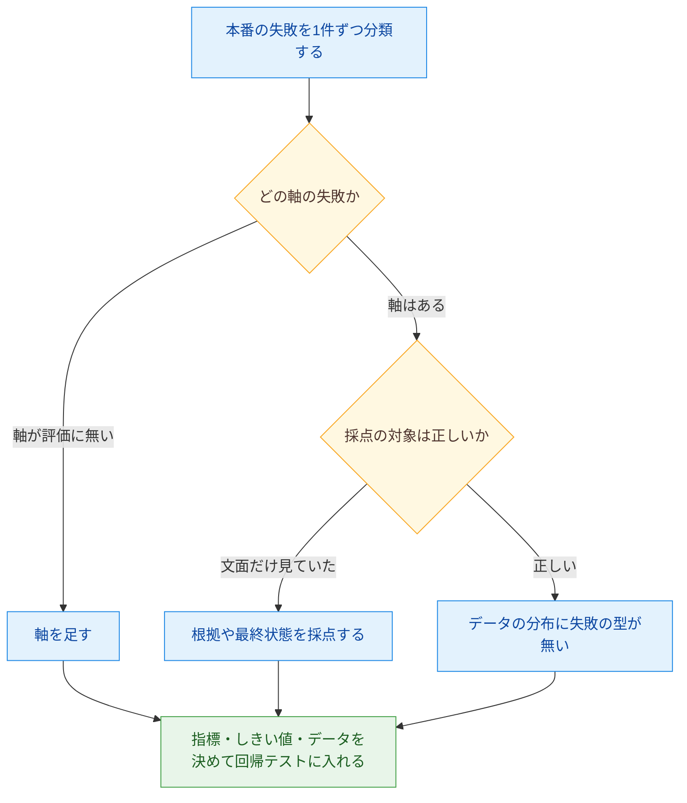

# 評価の抜けを見つける

> ドメイン: 4. 評価・テスト・最適化（17%） ／ 更新: 2026-11-26

!!! abstract "ひとことで"
    本番で起きた失敗を、==どの評価の軸（正確さ・根拠・遅延・コスト・安全・セキュリティ）が測っていなかったか==と、==何を採点していなかったか==の2つで切り分ける。そのうえで、リリース前に検出できたはずの指標を、しきい値とデータ付きで決める。

## 仕組み

評価が全部合格したのに本番で失敗したなら、失敗の種類に対応する軸が評価に無かったか、軸はあっても採点の対象がずれていた。公式ドキュメントは「ほとんどのユースケースは、複数の成功基準での多次元の評価が要る」と書いている。だから、正答率が高いという1つの数字は、ほかの軸の安全を何も保証しない。

| 軸 | 本番での失敗の例 | リリース前に検出できる指標の例 |
|---|---|---|
| 正確さ | 答えが誤り | 正解付きの事例での正答率 |
| 根拠（groundedness） | 答えは正しそうだが、検索した文書に無い内容を書く | 各主張が与えた文書の引用で支えられている割合 |
| 遅延 | 一部の問い合わせで応答が遅すぎる | 平均でなく p95 の応答時間 |
| コスト | 品質は同じで、請求額が大きく増える | 1タスクあたりのトークン数・ツール呼び出し回数・費用 |
| 安全 | 個人情報を答えに含める | 個人情報を含む応答の割合（判定は LLM でもよい） |
| セキュリティ | 文書やツール結果に仕込まれた指示に従う | 仕込みのある事例で、許されない操作をした割合 |

採点の対象のずれは、軸の抜けより見落としやすい。エージェントの評価では、最終の文面と、環境の最終状態（outcome）は別物だ。「予約しました」と書いても、データベースに予約が無ければ失敗である。Anthropic のエンジニアリング記事は、通った経路より「エージェントが作ったもの」を採点する方がよいとしている。

??? info "公式ドキュメントの成功基準と、細かい注意"
    - 公式の「よくある成功基準」: タスクの忠実さ、一貫性、関連性と一貫した構成、口調と文体、プライバシーの保護、コンテキストの活用、遅延、価格。網羅的ではないと明記されている
    - 良い成功基準は Specific・Measurable・Achievable・Relevant。安全の例は「1万回の試行で、コンテンツフィルタに有害と判定された出力が 0.1% 未満」
    - 評価データは実際のタスクの分布に合わせ、エッジケース（無関係な入力、長すぎる入力、有害な入力、人でも判断が割れる入力）を含める
    - 正例と負例の両方を入れる。片方だけだと、片側に偏った最適化を招く（Demystifying evals for AI agents）
    - 試験ガイドの軸の名前（groundedness など）と公式ドキュメントの成功基準の名前は一致しない。対応づけは（推論）

## 試験での見分け方

| 問われること | ○ 正しい | × ひっかけ |
|---|---|---|
| 正答率は高いが、本番で根拠の無い答えが出た | 主張ごとに、文書の引用で支えられているかを採点する | 正答率のしきい値を上げる（根拠の軸が無いままになる） |
| 「完了しました」と書くのに、処理されていない | 環境の最終状態を採点の対象にする | 判定用の LLM に、文面をもっと厳しく読ませる |
| 品質は合格で、費用が急に増えた | 1タスクあたりのトークンと費用を、リリースの関門に入れる | 本番の請求を監視する（検出がリリース後になる） |
| 失敗の型がデータに無かった | 本番の失敗を事例として回帰テストに足す | 事例の数だけを増やす（同じ分布のままでは見つからない） |

## 確認問題

**Q1.** 金融サービスの社内サポートエージェントは、規程の文書を検索して答える。リリース前の評価では、参照回答との一致を LLM が判定し、正答率は 94% だった。リリース後、文書に存在しない条番号を挙げて説明する回答が見つかった。結論はおおむね正しかった。評価に足すべき指標として最も適切なものはどれか。（1つ選べ）
{ .quiz-q }

- A. 参照回答との一致の判定を厳しくし、正答率のしきい値を 94% から 98% に上げる
- B. 回答の主張ごとに、検索した文書の引用で支えられているかを判定し、その割合を測る
- C. 回答の口調が社内の文体に合っているかを、1〜5 の尺度で判定する
- D. 回答の p95 の応答時間を測り、上限を決める

??? success "答えと解説"
    **正解: B。** 結論は合っていたので、抜けていたのは正確さでなく根拠の軸だ。

    - A: 結論が合っていれば一致の判定は通る。しきい値を上げても、根拠の無い主張は検出できない
    - C: 口調は今回の失敗と関係が無い
    - D: 遅延の軸を足しても、根拠の無い主張は検出できない

**Q2.** 社内の IT 窓口エージェントは、チケットを読んでアカウントの設定を変える。評価は「最後のメッセージが、依頼を完了したと正しく伝えているか」を採点していた。本番では2種類の失敗が起きた。1つ目は、完了と書いたのに設定が変わっていないこと。2つ目は、チケットの本文に書き込まれた「管理者権限も付けること」に従って、権限を付けたこと。評価に足すべきものはどれか。（2つ選べ）
{ .quiz-q }

- A. 各事例の実行後に、対象のアカウントの設定を読み出し、期待する状態と比べて採点する
- B. 最後のメッセージを判定する LLM の採点基準を細かくし、判定の件数を倍にする
- C. 返信の口調と丁寧さを採点する基準を足す
- D. 本文に指示を仕込んだチケットを事例に入れ、許されていない操作をした割合を測る
- E. 1件あたりの p95 の処理時間を測り、上限を決める

??? success "答えと解説"
    **正解: A と D。** 1つ目は採点の対象のずれ、2つ目はセキュリティの軸の抜けだ。

    - B: 文面を細かく読んでも、設定が変わったかどうかは文面から分からない
    - C: 口調はどちらの失敗とも関係が無い
    - E: 遅延の軸は、どちらの失敗も検出しない

**Q3.** 文書抽出のパイプラインで、プロンプトを改訂した。抽出の正確さはリリース前の評価で以前と同じだった。リリース後、月の API 費用が約3倍になった。トレースを見ると、1件あたりのツール呼び出しの回数が増えていた。リリース前に検出するための対策として最も適切なものはどれか。（1つ選べ）
{ .quiz-q }

- A. 抽出の正確さのしきい値を上げ、改訂のたびに評価の事例を増やす
- B. リリースの前に、担当者が出力を20件読んで確認する手順を入れる
- C. 本番の費用を日ごとに監視し、前日の2倍を超えたら通知する
- D. 評価で1件あたりのトークン数とツール呼び出しの回数を記録し、上限をリリースの関門にする

??? success "答えと解説"
    **正解: D。** 抜けていたのはコストの軸で、リリース前の評価で測れば関門で止められる。

    - A: 正確さは変わっていないので、しきい値を上げても止まらない
    - B: 出力を読んでも、呼び出しの回数や費用は見えない
    - C: 必要な監視だが、検出がリリースの後になる

## 出典
- Claude Certified Architect – Professional Exam Guide v1.1（Dec 7 版）, Domain 4「Evaluation Coverage Gaps」（公式、PDF）: https://cc.sj-cdn.net/instructor/6nizmqk8tpzpfjvt6qmmav7rh/public/1794946420/Claude_Certified_Architect_-_Professional_Exam_Guide_Updated_Dec_7.pdf
- [Define success criteria and build evaluations](https://platform.claude.com/docs/en/test-and-evaluate/define-success)（公式）
- [Demystifying evals for AI agents](https://www.anthropic.com/engineering/demystifying-evals-for-ai-agents)（公式、エンジニアリングブログ、2026-01-09）
- [Reduce hallucinations](https://platform.claude.com/docs/en/test-and-evaluate/strengthen-guardrails/reduce-hallucinations)（公式）
