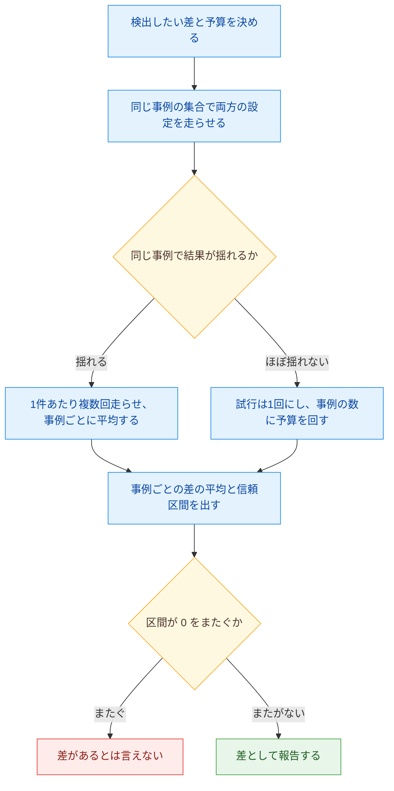

# 設定を比べる実験の設計

> ドメイン: 4. 評価・テスト・最適化（17%） ／ 更新: 2026-11-26

!!! abstract "ひとことで"
    2つの設定（プロンプトやモデル）の比較は、==同じ事例で両方を走らせて差をとる（対応のある比較）==。同じ事例でも結果が揺れるなら、==1件あたりの試行を複数回==にして、設定の差と実行ごとのぶれを分ける。差は信頼区間と一緒に報告する。

## 仕組み

評価の点には2種類のぶれがある。1つは事例の難しさの違いによるぶれで、事例の数を増やすと小さくなる。もう1つは、同じ事例を何度か走らせたときに結果が変わる、実行ごとのぶれだ。エージェントのタスクはこちらが大きいので、1回だけの結果では、設定の効果と偶然の当たり外れを区別できない。Anthropic の統計の記事は、標準誤差（SEM）と 95% 信頼区間（点 ± 1.96 × SEM）の報告、対応のある差の検定、検出したい差に必要な事例数を求める検出力分析を勧めている。

予算の配分は、どちらのぶれが大きいかで決める。事例を減らして試行を増やしすぎると、少数の事例の性質に引きずられ、本番の分布に一般化できない。逆に試行が1回だと、揺れの大きいタスクでは差が埋もれる（推論）。比べる2つの設定は、変える要素を1つに絞り、実行の環境（コンテナの資源、時間制限、実行する時間帯）をそろえる。

??? info "数字の目安と細かい決まり"
    - 正答率が 80% 前後で 400 件・各1回なら、SEM はおよそ 2 ポイント（√(0.8×0.2/400)）。95% 信頼区間はおよそ ±4 ポイントになる
    - 1つの文書から10問を作るように事例がまとまっているときは、まとまりの単位で標準誤差をとる（clustered standard errors）。記事では、素朴な標準誤差の3倍を超えることがあるとしている
    - 対応のある比較は、事例の難しさのぶれを打ち消す。記事は、差の平均・標準誤差・信頼区間・2つの点の相関を報告するよう勧める
    - Demystifying evals for AI agents: 1回の実行をトライアル（trial）と呼び、出力が揺れるので複数回走らせる。pass@k は k 回のうち少なくとも1回成功する確率、pass^k は k 回すべて成功する確率。1回の成功率が 75% なら pass^3 は約 42%
    - インフラのノイズの記事: Terminal-Bench 2.0 で、資源の設定だけで最大 6 ポイントの差が出た。資源の設定を実験の変数として固定し、複数の時間・日に分けて走らせることを勧めている
    - 「何回の試行で十分か」の決まった数は、確認した公式の資料には無い。未確認

## 試験での見分け方

| 問われること | ○ 正しい | × ひっかけ |
|---|---|---|
| 事例の割り当て | 両方の設定を同じ事例で走らせ、事例ごとの差をとる | 事例を半分ずつに分けて、別々の設定で走らせる |
| 揺れの大きいタスク | 1件あたり数回走らせ、事例の数も一定以上確保する | 少数の事例を何十回も走らせる |
| 小さな差の解釈 | 信頼区間を出し、0 をまたぐなら結論を出さない | 件数が多いので差は確かだと判断する |
| 実行の環境 | 資源・時間帯をそろえ、交互に走らせる | A を月曜、B を火曜に、別の資源の設定で走らせる |

## 確認問題

**Q1.** 社内のコード修正エージェントで、2つのプロンプトを比べる。予算は合計 2,400 回の実行だ。予備の実験では、同じ事例を5回走らせると3回だけ成功する、のような揺れがよく見られた。最も適切な実験の設計はどれか。（1つ選べ）
{ .quiz-q }

- A. 300 件の事例を、両方のプロンプトでそれぞれ4回ずつ走らせ、事例ごとの成功率の差の平均と信頼区間を出す
- B. 2,400 件の事例を半分に分け、1,200 件ずつを別々のプロンプトで1回ずつ走らせる
- C. 40 件の事例を、両方のプロンプトでそれぞれ30回ずつ走らせる
- D. 1,200 件の事例で、A を午前に、B を夜に、それぞれ1回ずつ走らせる

??? success "答えと解説"
    **正解: A。** 同じ事例で両方を走らせ、揺れに見合う数の試行と、一般化に足りる事例の数を両立している。

    - B: 事例が別々なので、難しさの違いが差に混ざる。1回では実行ごとのぶれも分けられない
    - C: 事例が少なすぎ、その40件の性質に結論が引きずられる
    - D: 1回では揺れを分けられない。時間帯もそろっていない

**Q2.** 文書の質問応答で、2つの設定を同じ 400 件の事例で1回ずつ走らせた。結果は A が 79.5%、B が 82.0% だった。事例は、40 件の文書から10問ずつ作ったものだ。この結果の解釈として正しいものはどれか。（2つ選べ）
{ .quiz-q }

- A. 各設定の標準誤差はおよそ 2 ポイントあり、この数字だけでは差があるとは言えない
- B. 400 件あれば十分に大きいので、2.5 ポイントの差は確かだと言える
- C. B の方が点が高いので、B をそのまま本番に出してよい
- D. 事例が文書ごとにまとまっているので、文書の単位で標準誤差をとると、不確かさはさらに大きくなる
- E. 同じ事例を使ったので、実行ごとのぶれは考えなくてよい

??? success "答えと解説"
    **正解: A と D。** 2.5 ポイントの差は、標準誤差と、事例のまとまりを考えると区別できない。

    - B: 件数だけでは決まらない。標準誤差と信頼区間で判断する
    - C: 差が確かでないうえ、遅延やコストなどほかの軸も見ていない
    - E: 同じ事例を使うと難しさのぶれは打ち消せるが、1回だけでは実行ごとのぶれは残る

**Q3.** 2つのモデルの設定を、エージェントのコーディングのタスクで比べた。A は月曜にメモリ2倍のコンテナで、B は火曜に標準のコンテナで走らせた。B は A より 4 ポイント低かった。この比較の問題と直し方として最も適切なものはどれか。（1つ選べ）
{ .quiz-q }

- A. 事例の数が足りない。事例を倍にして、同じ条件でもう一度走らせる
- B. 判定の基準が甘い。判定役のモデルを上の階層に替えて採点し直す
- C. 実行の環境が違う。資源の設定をそろえ、両方を同じ時間帯に交互に走らせてから比べる
- D. 差が 4 ポイントあるので比較としては十分で、A の設定を採用する

??? success "答えと解説"
    **正解: C。** 資源の設定と時間帯の違いだけで数ポイントの差が出うるので、設定の効果と分けられない。

    - A: 事例を増やしても、環境の違いによる差は消えない
    - B: 判定の問題を示す材料が無い
    - D: 環境の違いが差に混ざったままで、設定の効果だと言えない

## 出典
- Claude Certified Architect – Professional Exam Guide v1.1（Dec 7 版）, Domain 4「Experimental Design for Configuration Comparison」（公式、PDF）: https://cc.sj-cdn.net/instructor/6nizmqk8tpzpfjvt6qmmav7rh/public/1794946420/Claude_Certified_Architect_-_Professional_Exam_Guide_Updated_Dec_7.pdf
- [A statistical approach to model evaluations](https://www.anthropic.com/engineering/statistical-approach-to-model-evals)（公式、2024-11-19）
- [Demystifying evals for AI agents](https://www.anthropic.com/engineering/demystifying-evals-for-ai-agents)（公式、エンジニアリングブログ、2026-01-09）
- [Quantifying infrastructure noise in agentic coding evals](https://www.anthropic.com/engineering/infrastructure-noise)（公式、エンジニアリングブログ、2026-02-05）
