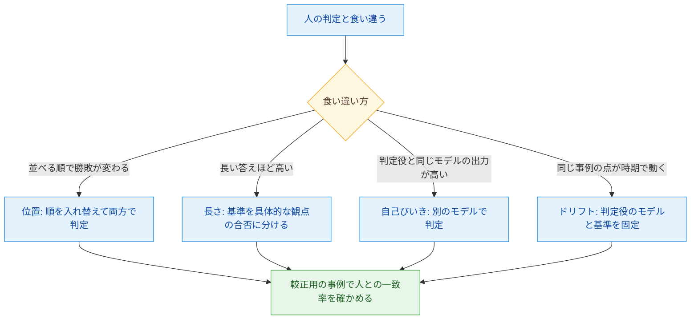

# LLM-as-judge の設計とバイアス

> ドメイン: 4. 評価・テスト・最適化（17%） ／ 更新: 2026-11-26

!!! abstract "ひとことで"
    判定用の LLM の結果が人の判定と食い違ったら、==食い違い方のパターン==から原因のバイアス（位置・長さ・自己びいき・ドリフト）を特定し、そのバイアスに効く対策を選ぶ。どの対策の後も、==人がラベルを付けた較正用の事例==で一致率を確かめる。

## 仕組み

LLM による採点（LLM-as-judge）は、速く、規模を広げやすく、複雑な判断にも使える。その代わり、結果が決定的でなく、人の専門家に合わせて較正しないと信用できない。公式ドキュメントの勧めは、詳しく明確な採点基準、「correct / incorrect」や 1〜5 のような具体的な出力、採点の前に考えさせる（thinking を有効にする）ことの3つだ。生成に使ったモデルとは別のモデルで採点することも、一般に良い方法とされる。

| バイアス | 見える症状 | 効く対策 |
|---|---|---|
| 位置 | 2つを比べる判定で、先（または後）に置いた方が勝ちやすい | 順を入れ替えて2回判定し、両方で同じ結論のときだけ勝ちとする |
| 長さ（冗長さ） | 点と応答の長さが強く相関し、人は短い答えを好む | 「最初の段落で問いに答える」のような観点ごとの合否に分ける |
| 自己びいき | 判定役と同じモデルが作った出力の点が高い | 生成したモデルとは別のモデルで採点する |
| ドリフト | 中身が同じ事例の点が、時期によって動く | 判定役のモデル ID と採点プロンプトの版を固定し、変えたら較正をやり直す |

「判定に偏りを持たないこと」とプロンプトに書くだけでは、どのバイアスも直らない（推論）。症状を数字で確かめ、仕組みで打ち消す。

??? info "細かい決まりと、確認できなかったこと"
    - Anthropic のエンジニアリング記事: 判定用の LLM は人の専門家と密に較正する。判断できないときの「Unknown」の選択肢を与えると、でっち上げが減る。観点ごとに別の判定役で採点する。トランスクリプトと点を多数読まないと、採点が効いているかは分からない
    - マルチエージェントの調査システムの記事では、0.0〜1.0 の点と合否を1回の呼び出しで出す判定が、人の判断に最も近かったとある
    - 公式ドキュメントの例では、判定の出力を「Output only 'yes' or 'no'」のように限定している
    - モデル ID は固定のスナップショットだが、周りの配信の仕組みの更新で、振る舞いがわずかに変わることがあると公式ドキュメントにある
    - 位置・長さ・自己びいきという名前と、表の対策（順の入れ替えなど）は、確認した公式ドキュメントには明記が無い。未確認で、一般に使われる手法としての（推論）

## 試験での見分け方

| 問われること | ○ 正しい | × ひっかけ |
|---|---|---|
| 先に置いた方が勝ちやすい | 順を入れ替えて両方で判定する | 判定の件数を増やす（偏りは平均しても消えない） |
| 長い答えほど高い | 基準を、観点ごとの合否に書き直す | 判定の前に全部の答えを同じ長さに切る（中身が欠ける） |
| 自社の候補のモデルが判定役も兼ねる | 別のモデルで判定する | 「公平に判定せよ」とプロンプトに書く |
| 同じ事例の点が上がっていく | 判定役のモデル ID と基準の版を固定する | 最新のモデルを判定役に自動で使う |

## 確認問題

**Q1.** 社内検索のアシスタントで、プロンプト A と B を2つ並べて判定役に比べさせている。A を常に先に置いた結果は、A の勝ちが 71% だった。人が同じ組を判定すると、ほぼ互角だった。並べる順を入れ替えると、B の勝ちが 68% になった。最も適切な対策はどれか。（1つ選べ）
{ .quiz-q }

- A. 判定の組を3倍に増やし、勝ちの割合の信頼区間を狭くする
- B. 判定のプロンプトに「表示の順番に影響されないこと」と書き足す
- C. 判定役のモデルを、上の階層のモデルに替える
- D. 各組を両方の順で判定し、両方で同じ側が勝ったときだけ勝ちとして、ほかは引き分けにする

??? success "答えと解説"
    **正解: D。** 順で勝敗が入れ替わるのは位置のバイアスなので、両方の順で判定して打ち消す。

    - A: 偏りは件数を増やしても消えない。偏った値の区間が狭くなるだけだ
    - B: 指示だけでは偏りは直らない
    - C: 上の階層のモデルでも位置の偏りが消える保証は無く、効いたかどうかも確かめていない

**Q2.** 医療機関向けの要約で、Claude の新しいモデルを候補として評価している。2つの問題が見つかった。1つ目は、判定役が候補と同じモデルで、候補の出力を人より高く採点すること。2つ目は、判定役の設定が「その時点の最新モデル」を指す環境変数で、中身の同じ事例の点が数か月で上がっていたこと。とるべき対策はどれか。（2つ選べ）
{ .quiz-q }

- A. 判定役には、比べる候補のどちらとも違うモデルを使う
- B. 判定役に、採点の理由をもっと長く書かせる
- C. 判定役のモデル ID と採点プロンプトの版を固定し、どちらかを変えたら較正用の事例で人との一致率を測り直す
- D. 事例を倍に増やし、点の平均のぶれを小さくする
- E. 判定役をやめて、参照の要約との ROUGE-L だけで採点する

??? success "答えと解説"
    **正解: A と C。** 1つ目は自己びいき、2つ目は判定役のドリフトで、それぞれ別の対策が要る。

    - B: 理由を長くしても、同じモデルをひいきする傾向も、判定役が替わることも直らない
    - D: どちらも系統的な偏りなので、件数を増やしても消えない
    - E: 要約の質の判断を失う。判定役をやめる理由にはならない

**Q3.** サポートの回答を、判定役が「役に立つか」を 1〜5 で採点している。点と回答の長さの相関は 0.6 あり、人の評価者は短く要点を押さえた回答を好む。最も適切な対策はどれか。（1つ選べ）
{ .quiz-q }

- A. 判定のプロンプトに「長さで点を変えないこと」と書き足す
- B. 基準を「最初の段落で問いに答える」「規程を根拠に示す」などの観点の合否に分け、人のラベルとの一致率を確かめる
- C. 判定の前に、すべての回答を 200 トークンで切りそろえる
- D. LLM の判定をやめ、すべての回答を人が採点する

??? success "答えと解説"
    **正解: B。** 長さに引っ張られるのは基準があいまいだからなので、観点ごとの具体的な合否にして、人との一致で確かめる。

    - A: 指示だけでは長さの偏りは直らない
    - C: 長い回答の後半の中身が欠け、正しく採点できなくなる
    - D: 人の採点は遅く費用がかかる。公式ドキュメントはできれば避けるとしている

## 出典
- Claude Certified Architect – Professional Exam Guide v1.1（Dec 7 版）, Domain 4「LLM-as-Judge Design and Bias」（公式、PDF）: https://cc.sj-cdn.net/instructor/6nizmqk8tpzpfjvt6qmmav7rh/public/1794946420/Claude_Certified_Architect_-_Professional_Exam_Guide_Updated_Dec_7.pdf
- [Define success criteria and build evaluations](https://platform.claude.com/docs/en/test-and-evaluate/define-success)（公式。Grade your evaluations、Tips for LLM-based grading）
- [Demystifying evals for AI agents](https://www.anthropic.com/engineering/demystifying-evals-for-ai-agents)（公式、エンジニアリングブログ、2026-01-09）
- [How we built our multi-agent research system](https://www.anthropic.com/engineering/multi-agent-research-system)（公式、エンジニアリングブログ）
- [Model IDs and versioning](https://platform.claude.com/docs/en/about-claude/models/model-ids-and-versions)（公式）
