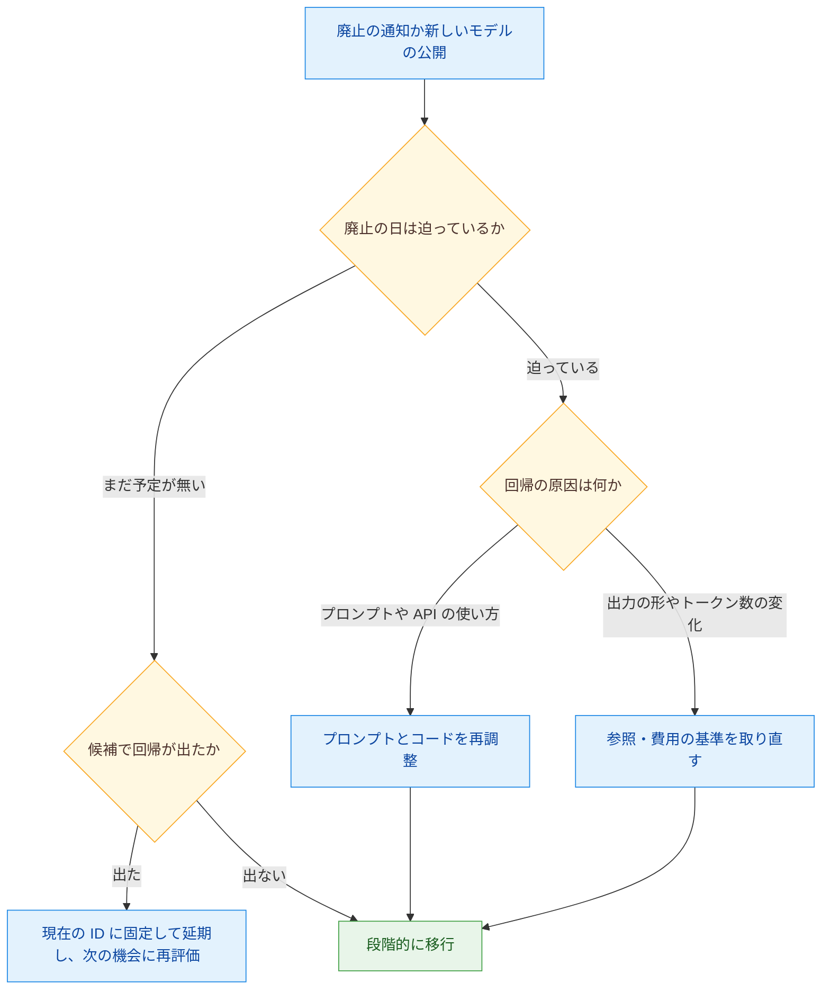

# モデルのバージョンの移行

> ドメイン: 4. 評価・テスト・最適化（17%） ／ 更新: 2026-11-26

!!! abstract "ひとことで"
    移行の判断は、==廃止（retired）の日までの残り時間==と、候補のモデルでの回帰の結果の2つで決める。選ぶのは、固定（pin）・プロンプトの再調整・評価の基準の取り直し・延期のどれかだ。廃止の日を越えて延期はできない。

## 仕組み

Claude のモデルには、Active・Legacy・Deprecated・Retired の段階がある。Deprecated になると推奨の後継と廃止の日が示され、廃止後のリクエストは失敗する（Claude API では 404 の `not_found_error`）。公開されたモデルは、廃止の少なくとも 60 日前に通知される。モデル ID は固定のスナップショットなので、同じ ID を使い続ける限り重みは変わらない。だから「固定」は、廃止の日までなら移行を急がずに済む手になる。

| 対応 | 選ぶ場面 | 落とし穴 |
|---|---|---|
| 固定 | 本番の挙動を変えたくない。廃止の予定がまだ無い | 廃止の日を越えられない。4.6 世代より前の短い別名（alias）は固定にならない |
| プロンプトの再調整 | 回帰の原因が、新しいモデルでの指示の効き方や API の変更にある | 評価を流さずに指示を足すと、別の場所で回帰する |
| 基準の取り直し | トークン数・費用・参照の出力が、モデルの違いで変わった | 品質のしきい値を下げて合格させることではない |
| 延期 | 回帰が重く、廃止の日まで十分な時間がある | 廃止の日が迫っていれば選べない |

移行ガイドには、壊れる変更が並ぶ。新しいモデルでは、アシスタントの先読み（prefill）、思考の予算の指定、`temperature` などのサンプリングの値が 400 エラーになることがある。同じ文章でもトークン数が変わるので、費用と `max_tokens` の基準も取り直す。

??? info "日付・ID の細かい決まり"
    - 4.6 世代からは日付の無い ID（例: `claude-sonnet-4-6`）が正式な ID で、1つの固定のスナップショットを指す。最新を自動で指す別名ではない。更新は新しい ID で出る
    - 4.6 世代より前は日付付きの ID（例: `claude-haiku-4-5-20251001`）。Claude API の短い別名（例: `claude-haiku-4-5`）は、その版の最新の日付付きスナップショットを指す。固定の保証は ID にあり、別名には無い
    - 重みは ID ごとに固定だが、配信の仕組みの更新で振る舞いがわずかに変わることがある
    - 廃止の日は、Anthropic が運営する基盤（Claude API、Claude Platform on AWS、Google Cloud の Anthropic 管理、Microsoft Foundry）に当てはまる。Amazon Bedrock と Google Cloud の Google 管理は、独自の予定を決める
    - 例（2026-11-26 時点）: `claude-sonnet-4-5-20250929` は 2026-09-30 に Deprecated、2026-11-30 に廃止予定。`claude-opus-4-5-20251101` は 2026-11-23 に Deprecated、2027-01-22 に廃止予定で、日付の無い `claude-opus-4-5` も含む
    - Claude Console の Usage のページから、API キーとモデルごとの利用を CSV で出し、古いモデルを使っている箇所を探せる
    - Sonnet 5.5 の移行ガイドの例: effort の水準は較正し直されているので、effort の比較をやり直す。思考の予算から effort への決まった対応は無いので、2〜3 の水準で評価する。Sonnet 4.6 以前と比べて、同じ文章が約 30% 多いトークンになる
    - Opus 5.5 の移行ガイドの例: 先読みは Opus 4.6 以降で 400 エラーになるので、Opus 4.5 以前からの移行で初めて効く変更になる。構造化出力かシステムプロンプトの指示に置き換える。Opus 4.7 で入ったトークナイザーは、それ以前のモデルの 1〜1.35 倍のトークンを使うことがある

## 試験での見分け方

| 問われること | ○ 正しい | × ひっかけ |
|---|---|---|
| 廃止の日が2か月後で、回帰がある | 原因に応じて再調整し、基準を取り直して、廃止の前に移す | 現在のモデルに固定して、直るまで待つ |
| 挙動を変えたくない | 日付付きの ID か、4.6 世代以降の ID を指定する | 4.6 世代より前の短い別名を指定する |
| 新しいモデルで、同じ文章のトークンが増えた | 費用の基準を取り直す | 品質のしきい値を下げて合格させる |
| 廃止の予定が無く、候補に重い回帰がある | 固定して延期し、回帰の事例を記録する | 新しいモデルだからとすぐに切り替える |

## 確認問題

**Q1.** 契約書の抽出システムは `claude-opus-4-5-20251101` で動いている。2026-11-23 に、2027-01-22 の廃止が通知された。後継の候補での回帰の結果は、抽出の正確さが +2 ポイントだった。一方で、プロンプトが先読み（prefill）に頼っていたため、4% の依頼が 400 エラーになった。1件あたりの費用は +25% だった。最も適切な対応はどれか。（1つ選べ）
{ .quiz-q }

- A. 現在の ID に固定し、後継のモデルが先読みに対応するまで待つ
- B. 移行を延期し、廃止の日の後に改めて評価する
- C. 日付の無い `claude-opus-4-5` に替え、廃止の影響を避ける
- D. 先読みを構造化出力に置き換えて評価をやり直し、費用の基準を取り直して、廃止の前に段階的に移す

??? success "答えと解説"
    **正解: D。** 廃止の日が決まっているので、回帰の原因（先読み）を直し、費用の基準を取り直して期限内に移す。

    - A: 固定は廃止の日を越えられない。後継が先読みに対応する保証も無い
    - B: 廃止の後は、リクエストが失敗する
    - C: 日付の無い ID も、同じく廃止の対象に含まれる

**Q2.** モデル ID と廃止について、正しい説明はどれか。（2つ選べ）
{ .quiz-q }

- A. `claude-sonnet-4-6` のような日付の無い ID は、1つの固定のスナップショットを指す
- B. 日付の無い ID は、同じ系統の最新版に自動で切り替わる
- C. `claude-haiku-4-5` のような 4.6 世代より前の短い別名は、その版の最新の日付付きスナップショットを指すので、固定するなら日付付きの ID を使う
- D. Amazon Bedrock での廃止の日は、Claude API の廃止の日と常に同じになる
- E. 廃止の日の後は、リクエストが推奨の後継のモデルに自動で送られる

??? success "答えと解説"
    **正解: A と C。** 固定の保証はモデル ID にあり、4.6 世代より前の別名には無い。

    - B: 4.6 世代以降の日付の無い ID は別名ではなく、スナップショットそのものだ
    - D: Bedrock は独自の廃止の予定を決めるので、日付が違うことがある
    - E: 廃止の後のリクエストは失敗する。自動で振り替えられない

**Q3.** 法務の調査アシスタントは、廃止の予定がまだ無いモデルで動いている。新しいモデルが公開されたので評価したところ、全体の正確さは同じだった。ただし、判例の引用の形式を誤る回帰が、事例の 3% で出た。業務からは、今の品質に不満は出ていない。最も適切な対応はどれか。（1つ選べ）
{ .quiz-q }

- A. 新しいモデルの方が新しいので、すぐに切り替え、引用の誤りは本番の監視で拾う
- B. 現在のモデル ID に固定したまま、回帰の事例を記録し、次のモデルの公開か廃止の通知のときに評価し直す
- C. 新しいモデルに替え、引用の形式の規則をシステムプロンプトに足して、評価をせずに出す
- D. 新しいモデルの出力を正解として評価の基準を取り直し、引用の事例も合格にする

??? success "答えと解説"
    **正解: B。** 廃止の期限が無く、移す利点も無いので、固定して延期し、次の機会に再評価する。

    - A: 移す利点が無いのに、わかっている回帰を本番に出す
    - C: プロンプトの再調整はよいが、評価をしないと直ったかも、別の回帰も分からない
    - D: 基準の取り直しは、回帰を隠すために正解を書き換えることではない

## 出典
- Claude Certified Architect – Professional Exam Guide v1.1（Dec 7 版）, Domain 4「Model Version Migration」（公式、PDF）: https://cc.sj-cdn.net/instructor/6nizmqk8tpzpfjvt6qmmav7rh/public/1794946420/Claude_Certified_Architect_-_Professional_Exam_Guide_Updated_Dec_7.pdf
- [Model deprecations](https://platform.claude.com/docs/en/about-claude/model-deprecations)（公式）
- [Model IDs and versioning](https://platform.claude.com/docs/en/about-claude/models/model-ids-and-versions)（公式）
- [Models overview](https://platform.claude.com/docs/en/models/overview)（公式）
- [Claude Opus 5.5 migration guide](https://platform.claude.com/docs/en/models/opus-5-5/migration-guide)（公式）
- [Claude Sonnet 5.5 migration guide](https://platform.claude.com/docs/en/models/sonnet-5-5/migration-guide)（公式）
- [Demystifying evals for AI agents](https://www.anthropic.com/engineering/demystifying-evals-for-ai-agents)（公式、エンジニアリングブログ、2026-01-09。評価があれば新しいモデルを数日で試せる、という指摘）
