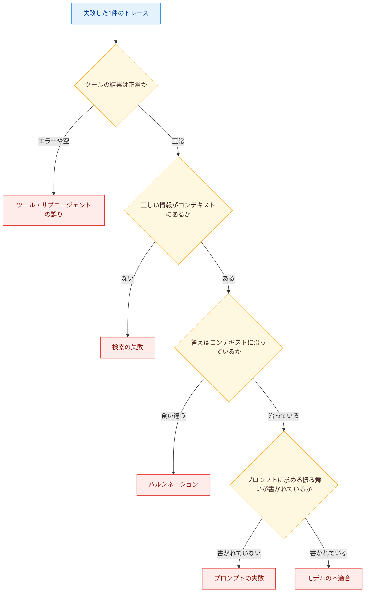

# ログとトレースからの原因の切り分け

> ドメイン: 4. 評価・テスト・最適化（17%） ／ 更新: 2026-11-26

!!! abstract "ひとことで"
    トレースを==上流から順に==たどり、必要な情報が「来ていない」のか「来たのに使われていない」のかを分ける。原因（プロンプト・検索・ハルシネーション・ツールやサブエージェントの誤り・モデルの不適合）ごとに、効く直し方は違う。

## 仕組み

最終の答えだけを見ると、どの原因でも「答えが間違っている」としか見えない。トレースで、Claude に渡ったコンテキストとツールの結果を確かめれば切り分けられる。正しい情報がコンテキストに無ければ、問題は検索かツールにある。あったのに答えが食い違えば、ハルシネーションかプロンプトの問題だ。Anthropic はマルチエージェントの調査システムで、本番の完全なトレースを入れて、失敗の原因を系統立てて直せるようになったと書いている。



| 原因 | トレースでの見え方 | 直し方 |
|---|---|---|
| ツール・サブエージェントの誤り | 結果がエラー・タイムアウト・空。下流がそれを事実として扱う | エラーを `is_error: true` と具体的な内容で返す。サブエージェントの出力を検証する |
| 検索の失敗 | 正しい文書が索引にあるのに、取得した結果に入っていない | クエリ・メタデータの絞り込み・チャンクの作り方を直し、取得の再現率を測る |
| ハルシネーション | 正しい情報がコンテキストにあるのに、答えが違う・根拠が無い | 引用を先に抜き出させる、主張ごとに引用を付けさせる、「分からない」と言ってよいと伝える |
| プロンプトの失敗 | モデルはプロンプトどおりに動いたが、求める振る舞いが書かれていない | 条件や優先順位をプロンプトに明記する |
| モデルの不適合 | 指示も情報も揃っているのに、複雑な推論を誤る。上の階層や高い effort では通る | モデルの階層や effort を上げるか、難しい事例だけ振り分ける |

直す前に、同じ型の失敗をほかの事例でも確かめる。1件だけで原因を決めると、たまたまの揺れを原因と取り違える（推論）。

??? info "細かい決まり"
    - ツールが失敗したら、`tool_result` に `is_error: true` を付けて返す。「failed」のような汎用の文でなく、何が起きて次に何を試すべきかを書くよう公式ドキュメントは勧めている
    - エラーを空の結果に変えて返すと、Claude は「該当なし」と区別できない（推論）
    - 公式のハルシネーション対策: 「分からない」と言うことを許す、長い文書（20k トークン超）では先に原文の引用を抜き出させる、主張ごとに引用で裏付けさせ、見つからなければ取り下げさせる。これらは減らすが、なくしはしない
    - 同じプロンプトを複数回走らせて出力を比べる（best-of-N）と、食い違いからハルシネーションに気づける
    - マルチエージェントの記事では、会話の中身を見ずに、エージェントの判断のパターンと相互作用の構造を監視して、利用者のプライバシーを守っている
    - モデル ID の重みは変わらないが、配信の仕組みの更新で振る舞いがわずかに変わることがある。同じ ID で急に振る舞いが変わったら、その可能性が高いと公式ドキュメントにある

## 試験での見分け方

<div class="vs" markdown>

| 問われること | ○ 正しい | × ひっかけ |
|---|---|---|
| 正しい文書が取得されていない | 検索の設定を直し、取得の再現率を測る | 「最新の情報を使え」とプロンプトに書く（来ていない情報は使えない） |
| 正しい情報が取得されたのに答えが違う | 引用での裏付けを求める | 取得する件数を増やす（もう取得できている） |
| ツールのタイムアウトが「該当なし」と答えられた | エラーを `is_error` で返し、空の結果と区別する | 大きなモデルに替える |
| 指示も情報も揃って推論を誤る | モデルの階層か effort を見直す | プロンプトに例を足し続ける |

</div>

## 確認問題

**Q1.** 人事の社内アシスタントが、2026 年の手当の額を聞かれて、2024 年の額を答えた。トレースは次のとおりだった。索引には 2026 年版の規程が登録されている。最も適切な対策はどれか。（1つ選べ）
{ .quiz-q }

```text
tool_use: search_policies {"query": "通勤手当 上限"}
tool_result: [chunk 412: 通勤手当規程（2024年版）…上限 月3万円 …]
             [chunk 413: 通勤手当規程（2024年版）…]
assistant: 通勤手当の上限は月3万円です。（2024年版 規程より）
```

<div class="quiz" data-answer="B" markdown>

- A. システムプロンプトに「必ず最新の規程にもとづいて答えること」と書き足す
- B. 検索に施行日のメタデータでの絞り込みを足し、年度を含む質問で正しい版を取得できるかを評価する
- C. モデルを上の階層に替え、複数の年度の規程を見比べられるようにする
- D. 回答の主張ごとに、取得した文書の引用を付けさせる

</div>

??? success "答えと解説"
    **正解: B。** 2026 年版が取得されていないので、原因は検索にある。

    - A: コンテキストに 2026 年版が無いので、指示しても使えない
    - C: モデルの能力の問題ではない。取得されていない文書は見比べられない
    - D: 答えは取得した 2024 年版に沿っており、引用を付けても誤りは残る

**Q2.** EC のサポートエージェントが、注文があるのに「該当する注文は見つかりません」と答えた。トレースでは、注文検索の API はタイムアウトしていた。ツールのラッパーは、例外を受けると空のリスト `[]` を返す実装だった。とるべき対策はどれか。（2つ選べ）
{ .quiz-q }

<div class="quiz" data-answer="A,C" markdown>

- A. 例外のときは `is_error: true` を付け、タイムアウトであることと再試行してよいことを書いて返す
- B. システムプロンプトに「結果が0件なら、もう一度検索すること」と書き足す
- C. 評価と監視で、ツールのエラーと本当の0件を分けて数え、エラーが「見つからない」と答えられた件数を測る
- D. モデルを上の階層に替え、空の結果の意味を推し量れるようにする
- E. 検索結果の並べ替え（リランキング）を入れ、上位の結果の質を上げる

</div>

??? success "答えと解説"
    **正解: A と C。** ツールのエラーが空の結果に化けているので、エラーとして返し、その型の失敗を測れるようにする。

    - B: 空のリストからは、本当の0件かエラーかを区別できない。本当に0件の質問でも再検索を繰り返す
    - D: 空のリストには、タイムアウトだったという情報が残っていない
    - E: 結果の質の問題ではなく、結果そのものが返っていない

**Q3.** 財務分析のエージェントが、四半期の売上を「12.4 億円」と答えた。トレースを見ると、取得した決算資料の該当の箇所には「14.2 億円」と書かれていた。プロンプトには、資料にもとづいて答えるよう書かれている。原因と対策の組み合わせとして最も適切なものはどれか。（1つ選べ）
{ .quiz-q }

<div class="quiz" data-answer="D" markdown>

- A. 検索の失敗。取得する件数を増やし、関係する資料をもっと渡す
- B. 検索の失敗。チャンクの大きさを変え、数字が切れないようにする
- C. プロンプトの失敗。システムプロンプトを短くし、指示を目立たせる
- D. ハルシネーション。答える前に該当の原文を引用させ、数字を引用と照合させる

</div>

??? success "答えと解説"
    **正解: D。** 正しい数字がコンテキストにあるのに答えが違うので、ハルシネーションだ。

    - A: 正しい箇所はもう取得できている
    - B: トレースでは、数字は切れずに取得されている
    - C: 資料にもとづけという指示は書かれている。短くしても数字の食い違いは直らない

## 出典
- Claude Certified Architect – Professional Exam Guide v1.1（Dec 7 版）, Domain 4「Root-Cause Isolation from Logs and Traces」（公式、PDF）: https://cc.sj-cdn.net/instructor/6nizmqk8tpzpfjvt6qmmav7rh/public/1794946420/Claude_Certified_Architect_-_Professional_Exam_Guide_Updated_Dec_7.pdf
- [Handle tool calls](https://platform.claude.com/docs/en/agents-and-tools/tool-use/handle-tool-calls)（公式。Handling errors with is_error）
- [Reduce hallucinations](https://platform.claude.com/docs/en/test-and-evaluate/strengthen-guardrails/reduce-hallucinations)（公式）
- [How we built our multi-agent research system](https://www.anthropic.com/engineering/multi-agent-research-system)（公式、エンジニアリングブログ）
- [Demystifying evals for AI agents](https://www.anthropic.com/engineering/demystifying-evals-for-ai-agents)（公式、エンジニアリングブログ、2026-01-09）
- [Model IDs and versioning](https://platform.claude.com/docs/en/about-claude/models/model-ids-and-versions)（公式）
