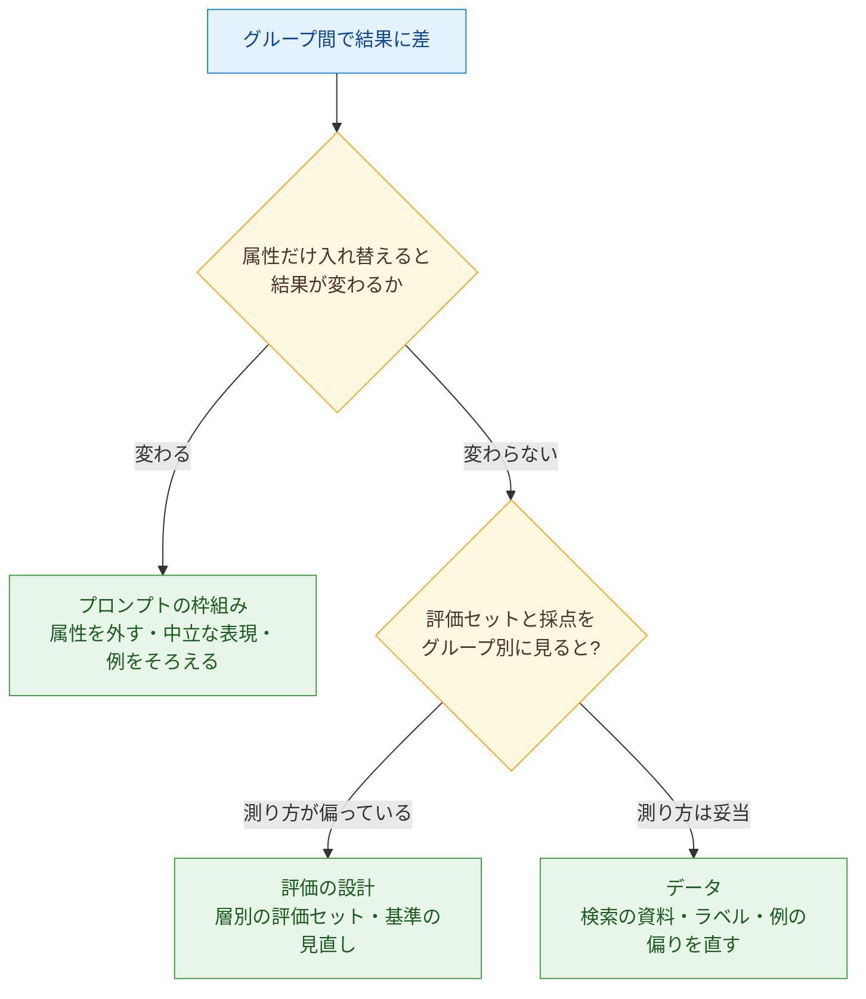

# バイアスの出どころの特定と対策

> ドメイン: 5. ガバナンス・安全性・リスク管理（16%） ／ 更新: 2026-11-26

!!! abstract "ひとことで"
    グループ間で結果に差が出たら、まず出どころを==データ・プロンプトの枠組み・評価の設計==のどれかに切り分ける。対策は出どころごとに違う。切り分けには、==属性だけを入れ替えて他を固定する==比較が効く。

## 仕組み

差が見えたというだけでは、どこを直すべきかは決まらない。プロンプトが判断に関係の無い属性（年齢、性別、出身地を思わせる名前など）を含んでいれば、出力はその枠組みに引きずられる。検索や学習に使ったデータが偏っていれば、プロンプトを変えても差は残る。評価セットや採点の基準が偏っていれば、モデルではなく測り方が差を作っている。Anthropic の研究（2023年）は、70の判断の場面で人物の属性だけを体系的に変えたプロンプトを作り、判断がどう変わるかで差別を測った。そのうえで、注意深いプロンプトの工夫で差を大きく減らせたと報告している。

| 出どころ | 見える証拠 | 対策 |
|---|---|---|
| データ | 属性を入れ替えても差が残る。差が、検索で取ってくる資料や、学習・few-shot の例の偏りと対応している | 資料の網羅を直す、ラベルを見直す、例の構成をそろえる |
| プロンプトの枠組み | 属性だけを入れ替えると判断が変わる。判断に不要な属性がプロンプトに入っている | 不要な属性を渡さない、中立な表現にする、差別をしないよう明示する |
| 評価の設計 | 人が属性を伏せて見直すと差が消える。評価セットに特定のグループの例が少ない。採点基準が特定の書き方を有利にする | グループ別に件数をそろえた評価セット、グループ別の指標の報告、明確な採点基準 |

切り分けの順番には理由がある。属性の入れ替えは安く速く試せて、効けばプロンプトの変更ですぐ直る。評価の設計の偏りを先に疑わずにデータを直し始めると、測り方の偏りを本物の差と取り違えたまま、データに手を入れることになる（この順番は推論）。研究は、調べた高リスクの用途で言語モデルに自動で判断させることを Anthropic が支持も許可もしない、とも明記している。差を減らしても、高リスクの判断は人が最終判断する構成にする。

??? info "細かい決まり・例外"
    - 研究（Evaluating and Mitigating Discrimination in Language Model Decisions）では、Claude 2.0 に、介入なしでは一部の場面で有利・不利の両方向の差別が見られた。データセットとプロンプトは公開されている
    - 研究で使った具体的なプロンプトの介入（「差別は違法だ」と伝える、属性が無いものとして答えさせる、など）は、検索結果の要約では見えたが、研究ページの本文では確認できなかった（未確認）
    - 評価の作り方（公式）: 実際のタスクの分布に合わせ、境界の事例も入れる。LLM で採点するときは、詳しく明確な基準を与え、「正しい／誤り」や 1〜5 のように具体的に出させ、採点の前に考えさせる
    - 公式の評価のコード例は「生成に使ったモデルとは別のモデルで採点するのが一般に望ましい」とコメントしている
    - LLM の採点者に特有の偏り（選択肢の並び順や、長い回答を好む傾向など）は、今回読んだ公式の評価のページには記述が無かった（未確認）
    - 全体の平均だけを報告すると、グループ間の差が隠れる。グループ別に指標を出す（推論）

## 試験での見分け方

| 問われること | ○ 正しい | × ひっかけ |
|---|---|---|
| 差が出たときの最初の一手 | 属性だけを入れ替え、他を固定した比較で出どころを切り分ける | すぐにモデルを替える、データを集め直す |
| 判断に不要な属性がプロンプトにある | 属性を渡さない。中立な枠組みにする | 出力の後でグループ間の比率を機械的にそろえる |
| 人が見直すと差が消える | 評価セットと採点基準を、グループ別にそろえて作り直す | モデルの出力に偏りがあると決めて、プロンプトを書き換える |
| 高リスクの判断 | 差を減らしたうえで、人が最終判断する | 差が小さくなったので自動の判断に任せる |

## 確認問題

**Q1.** 人材紹介会社が、応募書類から面接の推薦度を 1〜5 で出すエージェントを試験運用している。分析で、名前から推定される性別で推薦度の平均に差が出た。担当者が、同じ書類の名前だけを入れ替えた組を200組作って比べたところ、推薦度がほぼ同じ幅でずれた。最も適切な対策はどれか。（1つ選べ）
{ .quiz-q }

- A. 過去の採用実績のデータを集め直し、性別の比率をそろえた事例で few-shot の例を作り直す
- B. 出力の後で、性別ごとの推薦度の平均が同じになるように点数を補正する
- C. 名前など判断に不要な属性をプロンプトに渡さないようにし、評価の観点を職務の要件に絞って明示する
- D. 評価セットのうち、性別ごとの件数の差を埋めるために少ない側の書類を増やして測り直す

??? success "答えと解説"
    **正解: C。** 名前だけの入れ替えで判断が変わったので、出どころはプロンプトの枠組みだ。判断に不要な属性を渡さないのが直接の対策になる。

    - A: 入れ替えの比較で、データでなく枠組みが原因と分かっている。例を直しても名前の影響は残る
    - B: 出どころを直さずに結果だけそろえている。個々の判断の偏りは残る
    - D: 名前だけの入れ替えでずれが出ており、測り方の問題ではない

**Q2.** 社内のナレッジ検索エージェントで、海外拠点の社員の質問への回答の正答率が、本社の社員より低いという評価結果が出た。原因を切り分けるための調べ方として適切なものはどれか。（2つ選べ）
{ .quiz-q }

- A. 正答率の差は明らかなので、海外拠点向けにだけ別のシステムプロンプトをすぐに用意する
- B. 同じ内容の質問を、拠点を示す情報だけ入れ替えて送り、回答が変わるかを比べる
- C. 海外拠点の質問は難しいと考え、評価から除外して全体の正答率を報告する
- D. 評価セットの質問と正解が拠点ごとにそろっているか、正解の資料が検索の対象に入っているかを確かめる
- E. 生成と同じモデルに採点させ、採点の理由を出させずに点数だけを集計する

??? success "答えと解説"
    **正解: B と D。** 属性の入れ替えで枠組みを、評価セットと資料の網羅でデータと評価の設計を切り分ける。

    - A: 出どころを確かめずに対策を打っている。資料が無いのが原因なら効かない
    - C: 差を隠すだけで、原因が残る
    - E: 公式は、生成とは別のモデルで採点し、採点の前に考えさせることを勧めている

**Q3.** 保険の問い合わせ対応の品質評価で、方言の混じった問い合わせへの回答だけ、LLM の採点で点が低かった。人が問い合わせの書き方を伏せて回答だけを見直すと、点の差はほとんど無かった。採点基準には「標準的で丁寧な日本語であること」という項目がある。最も適切な対応はどれか。（1つ選べ）
{ .quiz-q }

- A. 採点基準を回答の正確さと必要な手続きの説明に絞って書き直し、方言の問い合わせを十分に含む評価セットで測り直す
- B. 方言の問い合わせを、送る前に標準語へ書き換える前処理をアプリに入れる
- C. 方言の問い合わせに対応できるよう、回答を生成するモデルを上位のモデルに替える
- D. 方言の問い合わせへの回答の点に、差の分だけ一律の加点をする

??? success "答えと解説"
    **正解: A。** 人が見直すと差が消えたので、出どころは評価の設計（採点基準と評価セット）だ。

    - B: 回答の品質に差は無い。直すべきは測り方で、入力の加工ではない
    - C: モデルの出力に問題は見つかっていない。替えても採点基準の偏りは残る
    - D: 採点の偏りを残したまま数字だけを調整している

## 出典
- Claude Certified Architect – Professional Exam Guide v1.1（Dec 7 版）, Domain 5「Bias Source Identification and Mitigation」（公式、PDF）: https://cc.sj-cdn.net/instructor/6nizmqk8tpzpfjvt6qmmav7rh/public/1794946420/Claude_Certified_Architect_-_Professional_Exam_Guide_Updated_Dec_7.pdf
- [Evaluating and mitigating discrimination in language model decisions](https://www.anthropic.com/research/evaluating-and-mitigating-discrimination-in-language-model-decisions)（公式、Anthropic の研究。2023-12）
- [Define success criteria and build evaluations](https://platform.claude.com/docs/en/test-and-evaluate/develop-tests)（公式）
