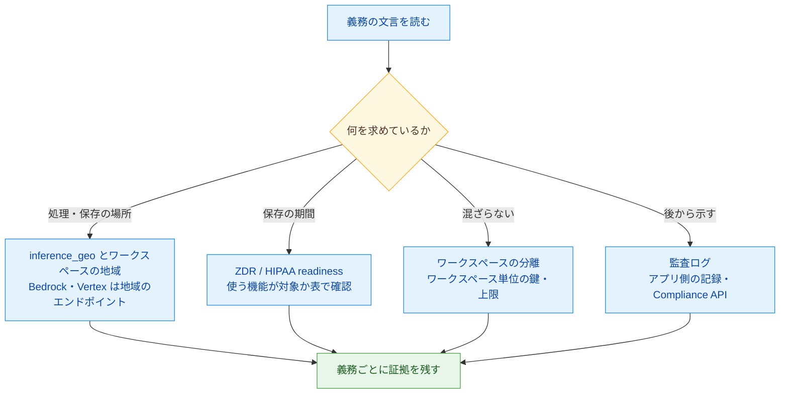

# コンプライアンスのための構成上の制御

> ドメイン: 5. ガバナンス・安全性・リスク管理（16%） ／ 更新: 2026-11-26

!!! abstract "ひとことで"
    義務を「どこで処理するか」「どれだけ保存するか」「誰のデータが混ざらないか」「後から何を示せるか」に分け、それぞれに効く制御を選ぶ。==所在と保持は別の設定==で、片方を満たしても、もう片方の証拠にはならない。

## 仕組み

コンプライアンスの問いでは、候補の制御が義務の文言に本当に対応しているかを1つずつ確かめる。データの所在（residency）は処理と保存の場所の話で、Claude API では `inference_geo` とワークスペースの地域で決まる。保持（retention）は保存の期間の話で、ZDR（zero data retention）の取り決めで決まる。どちらも、機能ごとに対象外がある。だから「ZDR を契約したから大丈夫」ではなく、構成が使う機能が ==ZDR の対象に入っているか== を表で確かめる。

| 義務 | 効く制御 | 証拠になるもの | 落とし穴 |
|---|---|---|---|
| 米国内で処理する | ワークスペースの `allowed_inference_geos: ["us"]` と `default_inference_geo: "us"` | 応答の `usage.inference_geo` | リクエストごとの指定だけだと、省いたコードが `"global"` に流れる |
| 入出力を保存させない | Legacy ZDR（組織ごとに営業経由で有効化） | 契約と、使う機能が対象であること | Batch・Files・Skills・コード実行・MCP connector・Managed Agents は対象外 |
| PHI を扱う | HIPAA readiness（BAA を結んだ組織） | 対象外の機能は API が 400 で拒否する | 組織単位なので、HIPAA 以外の用途は別の組織にする |
| テナントを混ぜない | テナントごとのワークスペースと、そのワークスペースだけの API キー | 応答ヘッダー `anthropic-workspace-id` | Google Cloud（Anthropic 管理）では、ワークスペースは誰が触れるかを分けない |
| 個人情報を外に出さない | 送る前に自社の処理で検出・黒塗りする（推論） | 黒塗りの前後の記録 | Claude API に組み込みの PII 黒塗り機能があるかは未確認 |
| 操作を後から示す | アプリ側で、テナント・利用者・ツール呼び出しを記録する | 自社の監査ログ | Compliance API の内容の取得は Claude Enterprise のデータが対象 |

ZDR のもとで対象外の機能を使っても、API は止めない。その機能の保持の方針に従うことを自分で選んだ扱いになる。HIPAA readiness は逆に、対象外の機能を含むリクエストを 400 で拒否する。この違いのせいで、ZDR の組織では「気づかずに対象外の機能を使う」事故が起きやすい（推論）。対象外かどうかは、構成図の段階で機能の一覧と突き合わせておく。

??? info "細かい決まり・例外"
    - `inference_geo` の値は `"global"`（既定）と `"us"` だけ。Claude 4.6 以降のモデルで使え、それより前のモデルに付けると 400。`"us"` は全トークン区分で標準の 1.1 倍の料金
    - ワークスペースの地域（保存と、画像の変換やコード実行などの処理の場所）は、作成時に決めて後から変えられない。現時点で選べるのは `"us"` だけ
    - Amazon Bedrock と Google Cloud（Google 管理）では、地域はエンドポイントや推論プロファイルで決まり、`inference_geo` は使えない。データ処理者もクラウド事業者になる。Microsoft Foundry の Azure ホストでは US Data Zone Standard を使う
    - Batch は29日間の保持、Files は削除か期限まで、コード実行のコンテナは最大30日。Managed Agents はセッションの記録を削除するまで残す（自前でホストする場合を除く）
    - ZDR の組織は、ブラウザから直接 API を呼べない（CORS を拒否する）。自社のバックエンドから送る
    - 取り決めにかかわらず、法の要請や、自動の安全システムに検知された内容は最大2年保持されうる
    - Covered Models（Claude Fable 5 系・Mythos 5 系）は30日間の保持が必要で、Anthropic の明示の許可が無い限り Legacy ZDR では使えない。ワークスペース単位で30日保持を有効にする方法がある
    - HIPAA: structured outputs と `strict: true` のツールのスキーマは、内容と別にキャッシュされ、PHI の保護の対象外。プロパティ名・`enum`・`const`・`pattern` に PHI を入れない
    - ワークスペースで分かれる資源: Files、Message Batches、Skills。プロンプトキャッシュも Claude API ではワークスペースごとに分かれる。ワークスペースごとに支出とレートの上限を付けられる。既定で1組織1,000個まで
    - Claude Platform on AWS では、ワークスペースの ARN を名指す IAM ポリシーで、主体を1つの顧客のワークスペースに限れる
    - Skills API の操作には監査ログがあるが、どの Skill がリクエストで使われたかの利用状況は API から取れない。アプリ側で記録する

## 試験での見分け方

| 問われること | ○ 正しい | × ひっかけ |
|---|---|---|
| 処理の場所の義務 | ワークスペースで許可する地域を絞り、応答の `inference_geo` を記録する | ZDR を有効にする（保存の期間であって、場所ではない） |
| 保存させない義務 | ZDR の対象機能だけで構成し、Batch・Files などの対象外を外す | ZDR の組織なら、どの機能を使っても保存されないと考える |
| テナントの分離 | テナントごとのワークスペースと、そのワークスペースだけの鍵 | システムプロンプトで「このテナントのデータだけ使え」と指示する |
| 監査の証拠 | アプリ側でテナント・利用者・ツール呼び出しを記録する | API の会話の中身を Compliance API で後から取れると考える |

## 確認問題

**Q1.** 法律事務所の文書レビューシステムで、「依頼人の文書と、モデルの出力をベンダー側に保存させない」という義務がある。事務所は Legacy ZDR の取り決めを結んだ。現在の構成は、文書を Files API に上げて参照し、夜間のまとめ処理は Message Batches API で行う。義務を満たす構成として最も適切なものはどれか。（1つ選べ）
{ .quiz-q }

- A. ZDR の取り決めがあるので、今の構成のまま運用し、契約書の写しを証拠として保管する
- B. 文書は Messages API に毎回インラインで送り、夜間の処理も Messages API で行う。ZDR の対象外の機能を構成から外す
- C. ワークスペースの `allowed_inference_geos` を `["us"]` にし、処理を米国内に限る
- D. HIPAA readiness を有効にし、対象外の機能を API に自動で拒否させる

??? success "答えと解説"
    **正解: B。** Files API と Batch は ZDR の対象外で、使えばその機能の保持の方針に従う。対象の機能だけで構成し直す。

    - A: ZDR の組織でも、対象外の機能は API が止めない。文書とまとめ処理の結果は保持される
    - C: 処理の場所の制御で、保存の期間の義務には対応しない
    - D: HIPAA readiness は PHI のための取り決めで、法律文書の保存の義務とは別の話だ。Files と Batch も対象外のまま

**Q2.** 人事向け SaaS が、顧客企業（テナント）ごとに従業員のデータを扱うエージェントを Claude API で提供する。義務は「テナントのデータが混ざらないこと」と「どのテナントの誰が、いつ、どのツールを使ったかを示せること」。選ぶべき制御はどれか。（2つ選べ）
{ .quiz-q }

- A. テナントごとにワークスペースを作り、そのワークスペースだけに効く API キーで呼ぶ。Files・Batch・Skills とキャッシュもテナントごとに分かれる
- B. 全テナントで1つのワークスペースを使い、システムプロンプトに「現在のテナント以外のデータを使わないこと」と書く
- C. 会話の中身と操作の記録は、Compliance API で後から全件を取り出す前提にし、アプリ側では記録しない
- D. アプリ側の監査ログに、テナント・利用者・ツール呼び出しと、応答ヘッダーの `anthropic-workspace-id` を記録する
- E. 全リクエストに `inference_geo: "us"` を付け、テナントのデータが国外に出ないことを分離の証拠にする

??? success "答えと解説"
    **正解: A と D。** 分離はワークスペースとその鍵で構成として作り、証拠はアプリ側の記録で残す。

    - B: 指示は分離を強制しない。Files やキャッシュも共有のままだ
    - C: Compliance API の内容の取得は Claude Enterprise のデータが対象で、自社アプリの API の会話を全件取れる前提は置けない
    - E: 処理の場所の制御で、テナント間の分離とは関係が無い

**Q3.** 米国の公共機関向けの案件で、「推論は米国内でのみ行い、その事実を監査で示せること」が求められている。開発チームは、アプリのコードの全リクエストに `inference_geo: "us"` を付けた。監査人は、新しく追加されるバッチ処理や別チームのスクリプトでも守られる保証を求めている。最も適切な対応はどれか。（1つ選べ）
{ .quiz-q }

- A. コードのレビュー規約に「`inference_geo: "us"` を必ず付けること」を足し、レビューで確認する
- B. Legacy ZDR を有効にして、データが米国外に保存されないことを示す
- C. 案件に使うモデルを、`inference_geo` を付けなくても米国内で動く古いモデルに切り替える
- D. ワークスペースの `allowed_inference_geos` を `["us"]`、`default_inference_geo` を `"us"` にし、応答の `usage.inference_geo` を記録する

??? success "答えと解説"
    **正解: D。** ワークスペースで許可する地域を絞れば、指定を省いたリクエストも米国内になり、`"global"` の指定は 400 で拒否される。応答の `inference_geo` が証拠になる。

    - A: 人のレビューに頼るので、漏れたリクエストは既定の `"global"` に流れうる
    - B: ZDR は保存の期間の取り決めで、推論の場所を決めない
    - C: `inference_geo` は Claude 4.6 以降で使える機能で、古いモデルが米国内で動く保証にはならない

## 出典
- Claude Certified Architect – Professional Exam Guide v1.1（Dec 7 版）, Domain 5「Architectural Controls for Compliance Obligations」（公式、PDF）: https://cc.sj-cdn.net/instructor/6nizmqk8tpzpfjvt6qmmav7rh/public/1794946420/Claude_Certified_Architect_-_Professional_Exam_Guide_Updated_Dec_7.pdf
- [API and data retention](https://platform.claude.com/docs/en/manage-claude/api-and-data-retention)（公式。`/build-with-claude/zero-data-retention` からこのページに移る）
- [Data residency](https://platform.claude.com/docs/en/manage-claude/data-residency)（公式）
- [Workspaces](https://platform.claude.com/docs/en/manage-claude/workspaces)（公式）
- [Compliance API](https://platform.claude.com/docs/en/manage-claude/compliance-api)（公式）
- [Agent Skills（Data retention）](https://platform.claude.com/docs/en/agents-and-tools/agent-skills/overview)（公式）
- [Skills for enterprise](https://platform.claude.com/docs/en/agents-and-tools/agent-skills/enterprise)（公式）
