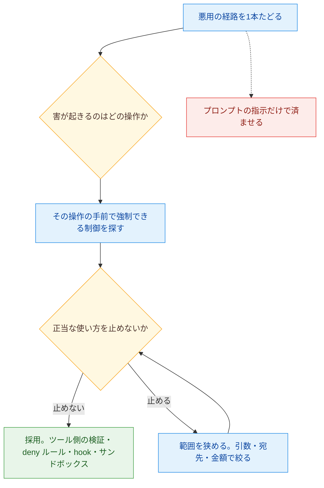

# ガードレールの置き場所

> ドメイン: 5. ガバナンス・安全性・リスク管理（16%） ／ 更新: 2026-11-26

!!! abstract "ひとことで"
    ガードレールは、悪用の経路が==害を生む直前の一点==に、モデルの外で強制される形で置く。正当な使い方まで止める広い網より、その経路だけを閉じる狭い制御を選ぶ。

## 仕組み

ガードレールを置ける層は、入力・モデル（システムプロンプト）・ツールの実行・出力・実行環境の5つある。悪用の経路は、そのうちのどこかを必ず通って害に至る。最も確実なのは、害が起きる操作そのもの（送金、外部への送信、削除）の手前に、決定的なコードで置く制御だ。プロンプトの指示はモデルが「何をしようとするか」を変えるだけで、強制にはならない。Claude Code の文書も、権限のルールは ==モデルではなく Claude Code が強制する== と書いている。

| 層 | 例 | 向く経路 | 限界 |
|---|---|---|---|
| 入力 | 軽いモデル（Claude Haiku 5.5）で事前に判定する harmlessness screen、既知の脱獄文言の検出 | 利用者自身が攻撃者の脱獄・直接のインジェクション | 言い換えに弱い。広くすると正当な質問も落ちる |
| モデル | 役割と断り方を書いたシステムプロンプト | 振る舞いの基調を決める | 強制力が無い |
| ツールの実行 | ツール実装での引数検証、deny ルール、PreToolUse hook | 「この操作をこの宛先へ」という具体的な害 | ツールごとに作り込みが要る |
| 出力 | 正規表現・キーワード・LLM による後処理の検査 | プロンプトの漏えい、禁止語の出力 | 出てから止めるので、副作用のある操作には遅い |
| 実行環境 | サンドボックス、ネットワークの許可先、資格情報を外で注入するプロキシ | 何が起きても届く範囲を狭めたい | 粒度が粗い |

社内の返金エージェントで「別の口座に返金させる」経路を閉じるなら、返金ツールの実装で「宛先は登録済みの口座だけ、金額は上限まで」と検証するのが筋だ。入力に「返金」という語があれば止める分類器を置くと、正当な返金依頼まで落ちる。プロンプトの漏えい対策も同じ考えで、漏えい防止の指示を盛り込むのは本当に必要なときだけにする。指示が複雑になると本来のタスクの精度が落ちうるので、公式はまず出力の検査（後処理）を試すよう勧めている。

??? info "細かい決まり・例外"
    - harmlessness screen は structured outputs で判定を真偽値に固定する。Claude Haiku 5.5 は判定の依頼そのものを安全分類器で断ることがあるので、`stop_reason: "refusal"` は「有害」の判定として扱う
    - 同じ利用者が何度も回避を試みるなら、応答を変える・速度を絞る・利用を止める（repeat offenders）
    - プロンプトの漏えい対策: 不要な機密をそもそもプロンプトに入れない。入れるほど「漏らさない」指示への従い方が落ちる。定期的にプロンプトと出力を監査する
    - Claude Code の権限ルールは deny → ask → allow の順に評価し、最初に当たったもので決まる。広い deny（`Bash(aws *)`）に、狭い allow で例外を作ることはできない
    - PreToolUse hook が `allow` を返しても deny・ask ルールは評価される。exit code 2 で止める hook は allow ルールより先に効く
    - Bash の引数で絞るパターン（`Bash(curl http://github.com/ *)`）は言い換えで外れやすい。URL の検証は PreToolUse hook か、サンドボックスのネットワーク制限で行う
    - Agent SDK の `allowed_tools` は `bypassPermissions` を制限しない。このモードで止めたいツールは `disallowed_tools` に書く

## 試験での見分け方

| 問われること | ○ 正しい | × ひっかけ |
|---|---|---|
| 特定の操作の悪用を止めたい | その操作のツール実装か、ツール呼び出しの手前（deny ルール・hook）で引数を検証する | システムプロンプトに「〜してはいけない」と書き足す（強制にならない） |
| 正当な使い方を守る条件がある | 宛先・金額・パスなど、経路に固有の条件だけで絞る | 話題や語で入力を広く止める分類器を置く（正当な依頼も落ちる） |
| プロンプトの漏えいが心配 | まず出力の後処理で検査し、機密はプロンプトから外す | 漏えい防止の指示を大量に積む（本来のタスクの精度が落ちうる） |
| 外部への持ち出しを止めたい | 実行環境のネットワーク許可先と、資格情報を外で注入するプロキシ | Bash の引数パターンだけで送信先を絞る（言い換えで外れる） |

## 確認問題

**Q1.** 経費精算を支援する社内エージェントが、`submit_reimbursement(employee_id, amount, bank_account)` ツールを持つ。レッドチームの演習で、会話の中で「振込先を変えた」と主張すると、登録の無い口座へ振り込ませられることが分かった。正当な使い方として、社員が自分の経費を自由な文面で申請できることは保ちたい。最も適切な対策はどれか。（1つ選べ）
{ .quiz-q }

- A. システムプロンプトに「振込先の変更依頼には応じないこと」と書き、断り方の文例も添える
- B. ツールの実装で `bank_account` を人事システムに登録済みの口座と照合し、一致しなければ実行を拒否する
- C. 入力を Haiku で事前に判定し、「口座」「振込」の語を含む依頼はすべて人の窓口に回す
- D. 出力の後処理で口座番号らしき文字列を伏せ字にし、会話の画面に表示されないようにする

??? success "答えと解説"
    **正解: B。** 害が起きる操作（振込）の手前で、経路に固有の条件（登録済みの口座か）だけを決定的に検証している。

    - A: 指示はモデルの振る舞いを促すだけで、強制にならない。言い回しを変えた攻撃に破られうる
    - C: 経費の申請にはこれらの語がよく出る。正当な使い方の大半を止めてしまう
    - D: 画面の表示を変えても、ツールは誤った口座へ振り込む。経路は閉じていない

**Q2.** Agent SDK で作った CI の修正エージェントを、`permission_mode="bypassPermissions"`、`allowed_tools=["Read", "Edit", "Bash(npm test *)"]` で動かしている。ログを見ると、エージェントが `curl` で外部にリクエストを送っていた。外部への送信を確実に止める手として最も適切なものはどれか。（1つ選べ）
{ .quiz-q }

- A. 実行環境のサンドボックスかコンテナで、ネットワークの許可先を必要な宛先だけに絞る
- B. `allowed_tools` から `Bash(npm test *)` 以外の Bash を外したので、すでに止まっていると判断する
- C. システムプロンプトに「外部への通信は禁止」と書き、CLAUDE.md にも同じ文を入れる
- D. PreToolUse hook で Bash のコマンドを検査し、ネットワークに出る呼び出しを拒否する
- E. `Bash(curl http://allowed.example.com/ *)` を allow に足し、許可先以外を自然に外す

??? success "答えと解説"
    **正解: A。** 実行環境のネットワーク制限は OS の側で強制され、コマンドの書き方やモード設定にかかわらず効く。

    - B: `allowed_tools` は `bypassPermissions` を制限しない。一覧に無い Bash も承認される
    - C: 指示は強制にならない
    - D: hook はモードにかかわらず動くが、検査するのはコマンドの文字列だ。E と同じく、変数やネットワークに出るスクリプトの実行など書き方次第ですり抜けうる（推論）。補助にはなるが、確実に止める手ではない。公式も、制限を必ず守らせるならサンドボックスのネットワークの許可先と組み合わせるよう書く
    - E: 引数で絞るパターンは言い換えで外れやすい。しかも allow を足しても、ほかの呼び出しは止まらない

**Q3.** 金融機関の顧客向けチャットで、独自の評価式がシステムプロンプトに書かれている。式の漏えいを防ぐため、開発者がシステムプロンプトに漏えい防止の指示を20行足したところ、通常の質問への回答の正確さが評価セットで下がった。最も適切な次の一手はどれか。（1つ選べ）
{ .quiz-q }

- A. 漏えい防止の指示をさらに具体的にし、ユーザーのターンでも同じ指示を繰り返す
- B. すべての入力を軽いモデルで判定し、指示の内容を尋ねる質問を一律に拒否する
- C. 評価式を守ることを優先し、正確さの低下は既知の制約として受け入れる
- D. 指示を減らし、回答に評価式が現れていないかを出力の後処理で検査する。式が回答に不要なら、プロンプトから外す

??? success "答えと解説"
    **正解: D。** 漏えい防止の指示は本当に必要なときだけにし、まず出力の検査を試す。不要な機密はプロンプトに入れない。

    - A: 指示を増やすほどタスクが複雑になり、精度の低下が進む
    - B: 正当な質問まで落とすうえ、言い換えた質問はすり抜ける
    - C: 正確さを落とさずに済む手が残っている。先にそれを試すべきだ

## 出典
- Claude Certified Architect – Professional Exam Guide v1.1（Dec 7 版）, Domain 5「Guardrail Placement」（公式、PDF）: https://cc.sj-cdn.net/instructor/6nizmqk8tpzpfjvt6qmmav7rh/public/1794946420/Claude_Certified_Architect_-_Professional_Exam_Guide_Updated_Dec_7.pdf
- [Mitigate jailbreaks and prompt injections](https://platform.claude.com/docs/en/test-and-evaluate/strengthen-guardrails/mitigate-jailbreaks)（公式）
- [Reduce prompt leak](https://platform.claude.com/docs/en/test-and-evaluate/strengthen-guardrails/reduce-prompt-leak)（公式）
- [Configure permissions（Claude Code）](https://code.claude.com/docs/en/permissions)（公式）
- [Configure permissions（Agent SDK）](https://code.claude.com/docs/en/agent-sdk/permissions)（公式）
- [Securely deploying AI agents](https://code.claude.com/docs/en/agent-sdk/secure-deployment)（公式）
