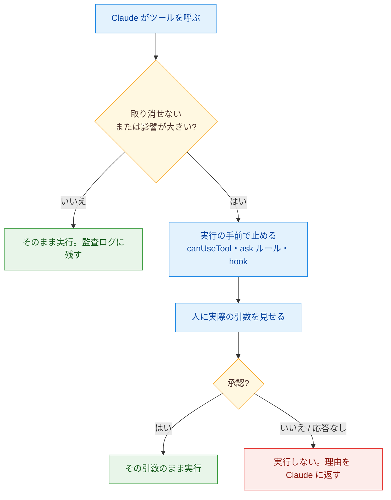

# 人による確認の関門

> ドメイン: 5. ガバナンス・安全性・リスク管理（16%） ／ 更新: 2026-11-26

!!! abstract "ひとことで"
    人の確認の関門は、==取り消せない操作か影響の大きい操作の直前==にだけ置き、モデルの外のコードで止める。人が承認するのは、実際に実行される引数そのものにする。

## 仕組み

関門を置く場所は、操作ごとに「取り消せるか」と「影響がどこまで及ぶか」で決める。取り消せて影響の小さい操作は止めずに流し、監査ログと取り消しの手順で事後に直す。すべての操作に関門を置くと待ちが積み上がり、承認する人も中身を見ずに通すようになる（推論）。Claude Code が、よく使う安全なコマンドを許可リストに入れる仕組みを「確認の疲れ（prompt fatigue）への対策」として挙げるのも同じ理由だ。関門そのものは、プロンプトの指示ではなく実行の仕組みで作る。指示はモデルが従えば効くだけで、強制にならないからだ。

| 操作の性質 | 置く関門 | 例 |
|---|---|---|
| 取り消せる・影響が小さい | 置かない。ログと取り消し手順で備える | 下書きの作成、社内チケットへのコメント |
| 取り消せるが影響が広い | 実行の前に範囲を制限する（宛先・件数・環境） | ステージング環境への反映 |
| 取り消せない・影響が大きい | 実行の直前に、実際の引数で人が承認する | 本番 DB の削除、外部への送金、顧客への一斉送信 |

承認の対象は「計画」ではなく「実行される呼び出し」にする。計画を承認したあと、Claude が引数を変えて呼ぶことがあるからだ。MCP の仕様も、クライアントはサーバーを呼ぶ前にツールの入力を利用者に見せるべき（SHOULD）としている。人がいない headless の実行では、確認を求める呼び出しが拒否に変わるモードがある。関門を承認の待ち行列につなぐなら、`canUseTool` のコールバックで受け、決まった時間に応答が無ければ実行しない側に倒す（待ち行列とタイムアウトの扱いは推論）。

??? info "細かい決まり・例外"
    - Agent SDK の評価の順: hooks → deny ルール → ask ルール → 権限モード → allow ルール → `canUseTool`。どこかの段で自動で承認された呼び出しは `canUseTool` に届かない。そこで確かめたい検査は PreToolUse hook に置く（hook は `bypassPermissions` でも動く）
    - `default` モードでは、承認が必要で allow ルールに当たらない呼び出しが `canUseTool` に回る。コールバックが無ければ拒否される
    - `dontAsk` モードは、確認を求める呼び出しをすべて拒否に変える。人のいない headless のエージェントで「確認」を「拒否」として固くしたいときに使う
    - ask ルールに当たる呼び出しは、`bypassPermissions` でも `canUseTool` に回る
    - TypeScript SDK のカスタムツールは `permission_policy` を `always_ask` にすると、どの allow ルールでも自動承認されない（`auto`・`plan`・`bypassPermissions` では例外あり）
    - MCP サーバーが `_meta["anthropic/requiresUserInteraction"]` を付けたツールは、allow ルールに当たってもコールバックに回る（Claude Code v2.1.199 以降）
    - plan モードの本体から呼んだサブエージェントは、自分に `acceptEdits` を設定していても plan モードのまま動く
    - MCP の仕様: 安全のため、ツールの呼び出しを拒否できる人が常にいるべき（SHOULD）。慎重を要する操作では確認を求め、ツールの使用は監査のために記録する

## 試験での見分け方

| 問われること | ○ 正しい | × ひっかけ |
|---|---|---|
| 関門をどの操作に置くか | 取り消せない・影響の大きい操作の直前だけ | すべてのツール呼び出しの前に置く（待ちが積み上がる） |
| 関門の作り方 | `canUseTool`・ask ルール・hook など、実行の仕組みで止める | 「実行前に必ず確認を取ること」とプロンプトに書く |
| 人が承認するもの | 実際に実行される引数 | 事前の計画だけ（実行時に引数が変わりうる） |
| 人がいない実行 | 確認が要る呼び出しは拒否か、待ち行列に回して応答が無ければ実行しない | 応答が無ければ承認とみなして進める |

## 確認問題

**Q1.** Claude Agent SDK で、インフラの変更を代行するエージェントを作っている。システムプロンプトに「`terraform apply` の前には必ずユーザーの確認を取ること」と書き、`allowed_tools=["Bash"]` を設定した。ログを見ると、確認を取らずに `terraform apply` が実行された回があった。最も適切な直し方はどれか。（1つ選べ）
{ .quiz-q }

- A. `allowed_tools` を読み取り系のコマンドに絞り、`terraform apply` は ask ルールで `canUseTool` に回して、人がコマンドを見て承認する
- B. システムプロンプトの確認の指示を太字にし、確認を取らなかった場合の悪影響も具体的に書き足す
- C. PostToolUse hook で `terraform apply` の結果を検査し、想定外の変更があれば自動で元に戻す
- D. `permission_mode="bypassPermissions"` にして、すべての呼び出しを事後に監査ログで確認する

??? success "答えと解説"
    **正解: A。** 関門は実行の仕組みで作る。bare の `Bash` を allow に入れると、すべての Bash が自動承認されて `canUseTool` に届かない。

    - B: 指示はモデルの振る舞いを促すだけで、強制にならない
    - C: PostToolUse は実行の後に動く。本番への適用は済んでおり、元に戻せない変更もある
    - D: 本番への適用は取り消せない。事後の監査では間に合わない

**Q2.** 医療機関の予約管理エージェントが、夜間に人のいない headless で動く。ツールは、予約の照会、予約の仮押さえ（24時間で自動解除）、患者への SMS 送信、予約の確定（キャンセル料が発生）の4つ。関門の設計として適切なものはどれか。（2つ選べ）
{ .quiz-q }

- A. 4つのツールすべてに人の承認を求め、夜間は朝まで処理を止める
- B. 照会と仮押さえは関門なしで実行させ、監査ログに残す
- C. 予約の確定は、Claude が「患者の同意を確認した」と応答に書いたときだけ実行させる
- D. 夜間は承認者がいないので、確認を求める呼び出しは応答が無ければ承認とみなす
- E. SMS 送信と予約の確定は承認の待ち行列に回し、朝に人が実際の宛先・日時を見て承認するまで実行しない

??? success "答えと解説"
    **正解: B と E。** 取り消せる操作は流し、取り消せない操作（送った SMS、キャンセル料）だけを実際の引数で人が承認する。

    - A: 取り消せる照会と仮押さえまで止めると、夜間に進められる仕事も止まる
    - C: 関門がモデルの自己申告に頼っている。実行の仕組みで止めていない
    - D: 応答が無いときは、実行しない側に倒す

**Q3.** 経理チームの支払いエージェントでは、Claude が支払いの計画を作り、担当者が画面で計画を承認すると、そのままエージェントが支払いツールを呼ぶ。監査で、承認された計画の金額と、実際に支払いツールに渡った金額が違う件が見つかった。最も適切な直し方はどれか。（1つ選べ）
{ .quiz-q }

- A. 計画の画面に、金額を変えないよう Claude に指示する一文を足し、承認後の実行でも同じ指示を繰り返す
- B. 計画を承認した担当者とは別の人に、支払いの完了後に監査ログを毎日確認させる
- C. 支払いツールの呼び出しを実行の直前で止め、実際の引数（宛先・金額）を担当者に見せて承認を取る
- D. 計画の作成と支払いの実行を別のモデルに分け、実行側は計画の文面を読んで支払う

??? success "答えと解説"
    **正解: C。** 承認は計画ではなく、実際に実行される呼び出しの引数に対して取る。

    - A: 指示では、引数が変わらないことを保証できない
    - B: 支払いは取り消しにくい。事後の確認では被害を防げない
    - D: 実行側が文面を読み直すだけで、承認と実行の引数を結び付けていない

## 出典
- Claude Certified Architect – Professional Exam Guide v1.1（Dec 7 版）, Domain 5「Human-in-the-Loop Checkpoints」（公式、PDF）: https://cc.sj-cdn.net/instructor/6nizmqk8tpzpfjvt6qmmav7rh/public/1794946420/Claude_Certified_Architect_-_Professional_Exam_Guide_Updated_Dec_7.pdf
- [Configure permissions（Agent SDK）](https://code.claude.com/docs/en/agent-sdk/permissions)（公式）
- [How the agent loop works](https://code.claude.com/docs/en/agent-sdk/agent-loop)（公式、Agent SDK）
- [Security（Claude Code）](https://code.claude.com/docs/en/security)（公式）
- [Configure permissions（Claude Code）](https://code.claude.com/docs/en/permissions)（公式）
- [MCP Specification: Tools](https://modelcontextprotocol.io/specification/2025-11-25/server/tools)（公式、MCP 仕様）
