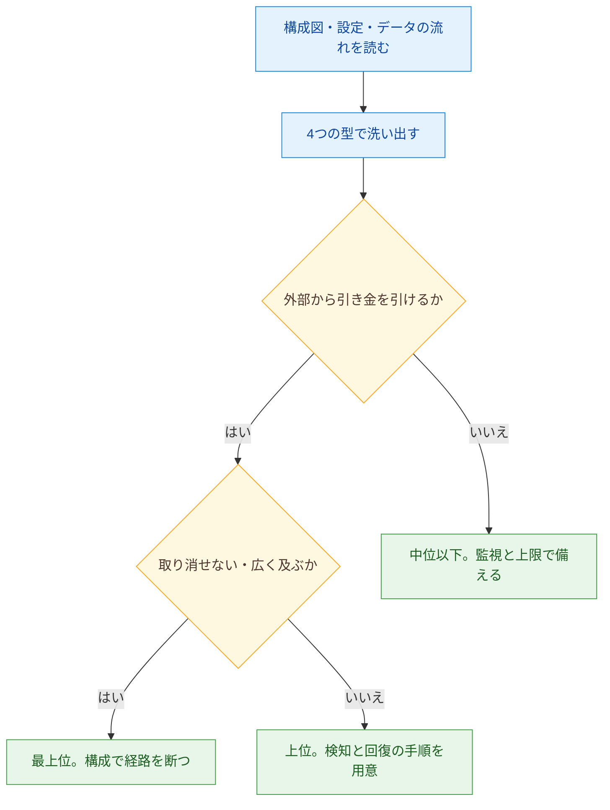

# リスクの評価と順位付け

> ドメイン: 5. ガバナンス・安全性・リスク管理（16%） ／ 更新: 2026-11-26

!!! abstract "ひとことで"
    リスクは4つの型（攻撃面、故障の型、トークンと割り当ての枯渇、依存とサプライチェーン）で洗い出し、==露出の大きさ==で順位を付ける。露出は「誰が引き金を引けるか」と「起きたら何がどこまで壊れるか」で決まる。

## 仕組み

提案された構成を読むときは、型ごとに「この構成のどの部品で起きるか」を具体的に書き出す。次に露出で並べる。外部の誰でも引き金を引け、取り消せない被害が多くのテナントに及ぶものが最上位になる。社内の限られた人しか触れず、再実行で直るものは下位だ（この順位付けの軸は、ガイドの「露出で順位を付ける」を具体化した推論）。技術的に派手な攻撃や、話題になりやすい脅威が上位とは限らない。



| 型 | 構成のどこを見るか | 典型的な対策 |
|---|---|---|
| 攻撃面 | 第三者の内容が入る経路と、書き込み・外部送信できるツール | 権限の最小化、ツール結果の検査、サンドボックス |
| 故障の型 | モデルの誤り、出力の形の崩れ、ツールのタイムアウト、途中で止まった処理 | 検証と再試行、冪等なツール、人への引き継ぎ |
| トークンと割り当ての枯渇 | 同じ組織・ワークスペースのレート制限を共有する処理、止まらないループ、月の支出上限 | ワークスペースごとの上限、バッチへの移動、ループの回数・予算の上限 |
| 依存とサプライチェーン | 第三者の MCP サーバー・Skills・パッケージ、モデルの廃止予定 | 出どころの限定、版の固定、許可リスト、移行計画 |

枯渇は見落としやすい。Claude API のレート制限は組織の単位で、モデルの区分ごとに RPM・ITPM・OTPM がかかる。夜間の一括処理と対話のチャットが同じ組織の枠を使えば、一括処理が枠を食い、チャットが 429 で止まる。ワークスペースごとに低い上限を付けると、ほかのワークスペースの分を守れる。急な増加には別に ramp limit がかかるので、一括処理は低い速度から始めて均等にならす。

??? info "細かい決まり・例外"
    - レート制限はトークンバケット方式で、決まった時刻にリセットされず連続して補充される。60 RPM が「毎秒1件」として効くこともあり、短い突発で超えうる
    - 既定の ITPM には、キャッシュから読んだ入力トークンを数えない。キャッシュが効けば実質の処理量が増える
    - 429 に `retry-after` があれば、その秒数だけ待つ。月の支出上限に達した 429 には `retry-after` が無く、翌月 1日 00:00 UTC まで再試行しても失敗する（`error.details.error_code` が `enforced_spend_limit_reached`）
    - ramp limit の 429 は `error_code` が `ramp_limit_exceeded`。Message Batches API は ramp limit の対象外で、モデル共通の別のレート制限を持つ
    - ワークスペースの上限は、組織の上限を超えて足し合わせても、組織全体の上限が常に優先する
    - レート制限は `inference_geo` の値（`"us"` と `"global"`）をまたいで共有される
    - Skills を API で使うとき `version` を省くと最新版が使われる。ワークスペースの誰かが新しい版を上げると、本番の動きがすぐ変わる
    - ローカルの MCP サーバーは、設定に書いた起動コマンドがクライアントと同じ権限で動く。悪意ある起動コマンドが紛れる経路がある（MCP 仕様のセキュリティの指針）
    - Agent SDK の `max_turns` と `max_budget_usd` は既定で無制限なので、暴走したループの費用の上限は自分で設ける

## 試験での見分け方

<div class="vs" markdown>

| 問われること | ○ 正しい | × ひっかけ |
|---|---|---|
| どのリスクを最優先にするか | 外部から引き金を引け、取り消せない被害が広く及ぶもの | 技術的に高度な攻撃、話題になっている脅威 |
| 一括処理が対話を止めた | ワークスペースを分けて上限を付ける。一括処理は Batch API に移すか、速度をならす | 429 のたびに即座に再試行を繰り返す |
| 支出上限の 429 | 上限の引き上げか、利用の削減で対応する | `retry-after` を待って再試行する（その 429 には無く、翌月まで失敗する） |
| 第三者の部品 | 出どころを限り、版を固定し、更新を新しいデプロイとして審査する | 最新版を自動で使い、問題が出たら戻す |

</div>

## 確認問題

**Q1.** 多テナントの契約書レビュー SaaS の構成案を評価している。次の4つのリスクのうち、露出が最も大きいものはどれか。前提として、どのテナントの利用者も契約書をアップロードでき、エージェントは全テナント共有の通知用 MCP サーバー経由で、任意のアドレスにメールを送れる。（1つ選べ）
{ .quiz-q }

<div class="quiz" data-answer="D" markdown>

- A. 社内の管理画面で、運用担当が誤ってモデルの設定を古い版に戻してしまう
- B. 夜間の集計処理が遅れ、翌朝のダッシュボードの数値が数時間古いまま表示される
- C. 長い契約書で出力が `max_tokens` に達し、要約の末尾が切れることがある
- D. アップロードされた契約書に埋め込まれた指示で、エージェントが別テナントの情報を外部へメール送信する

</div>

??? success "答えと解説"
    **正解: D。** 外部の誰でも引き金を引け（アップロード）、取り消せない持ち出しが他テナントにまで及ぶ。

    - A: 引き金を引けるのは社内の限られた人で、設定を戻せば回復できる
    - B: 回復可能で、影響は表示の遅れにとどまる
    - C: 検知して再生成すれば直る故障の型で、外部からの悪用の経路ではない

**Q2.** 社内のデータ分析エージェントの構成案に、次の記述がある。

```text
- 対話の分析と、毎晩のログ再集計（Messages API で約20万件）を同じワークスペースで実行
- コミュニティの Skill を Skills API で登録し、リクエストでは version を指定しない
- 失敗した 429 は、SDK の自動再試行に任せる
```

この構成のリスクの評価として正しいものはどれか。（2つ選べ）
{ .quiz-q }

<div class="quiz" data-answer="A,C" markdown>

- A. 再集計が組織のレート制限を食い、対話の分析が 429 で止まりうる。ワークスペースを分けて上限を付けるか、再集計を Batch API に移す
- B. 再集計は件数が多いだけなので、ITPM を上げる申請をすれば枯渇のリスクは解消する
- C. version を指定しないと最新版が使われ、誰かが上げた新しい版で本番の動きがすぐ変わる。版を固定し、更新は審査してから上げる
- D. SDK の自動再試行があるので、支出上限に達した場合も時間をおけば自然に回復する
- E. Skills API に登録した Skill は Anthropic が自動でスキャンするので、サプライチェーンのリスクは低い

</div>

??? success "答えと解説"
    **正解: A と C。** 共有の枠の枯渇と、版を固定しない依存の変化を、構成の記述から読み取っている。

    - B: 上限を上げても、同じ枠を共有する限り再集計が対話を押しのける構造は残る
    - D: 支出上限の 429 には `retry-after` が無く、翌月まで再試行しても失敗する
    - E: Skill の自動スキャンは claude.ai と Cowork が対象で、Skills API の Skill は対象外

**Q3.** 物流会社が、配送の問い合わせに答えるエージェントを公開する。リリース前のリスク一覧で、チームは「ジェイルブレイクで不適切な発言をする」を最上位にした。エージェントは配送の再手配ツール（取り消し可能）と、返金ツール（上限なし、取り消し不可）を持つ。返金ツールには利用者の本人確認との突き合わせが無い。順位の付け直しとして最も適切なものはどれか。（1つ選べ）
{ .quiz-q }

<div class="quiz" data-answer="B" markdown>

- A. 不適切な発言は評判に直結するので最上位のままにし、出力の検査を強める
- B. 本人確認と突き合わせない返金ツールの悪用を最上位にし、ツール側の検証と上限を先に入れる
- C. 再手配ツールの誤操作を最上位にする。呼ばれる回数が最も多いからだ
- D. 4つの型を同じ重みで並べ、それぞれに同じ工数の対策を割り当てる

</div>

??? success "答えと解説"
    **正解: B。** 外部の誰でも引き金を引け、被害が取り消せず上限も無い経路が、露出として最も大きい。

    - A: 発言の害は小さくないが、金銭の流出と比べると取り消しや訂正の余地がある
    - C: 回数が多くても、取り消せる操作なので露出は小さい
    - D: 順位付けをせずに均等に配ると、最も危ない経路の対策が遅れる

## 出典
- Claude Certified Architect – Professional Exam Guide v1.1（Dec 7 版）, Domain 5「Risk Assessment and Ranking」（公式、PDF）: https://cc.sj-cdn.net/instructor/6nizmqk8tpzpfjvt6qmmav7rh/public/1794946420/Claude_Certified_Architect_-_Professional_Exam_Guide_Updated_Dec_7.pdf
- [Rate limits](https://platform.claude.com/docs/en/api/rate-limits)（公式）
- [Skills for enterprise](https://platform.claude.com/docs/en/agents-and-tools/agent-skills/enterprise)（公式）
- [MCP Security Best Practices](https://modelcontextprotocol.io/specification/2025-06-18/basic/security_best_practices)（公式、MCP 仕様。読んだ時点の内容は 2025-11-25 版の仕様を参照していた）
- [Securely deploying AI agents](https://code.claude.com/docs/en/agent-sdk/secure-deployment)（公式）
- [How the agent loop works](https://code.claude.com/docs/en/agent-sdk/agent-loop)（公式、Agent SDK）
