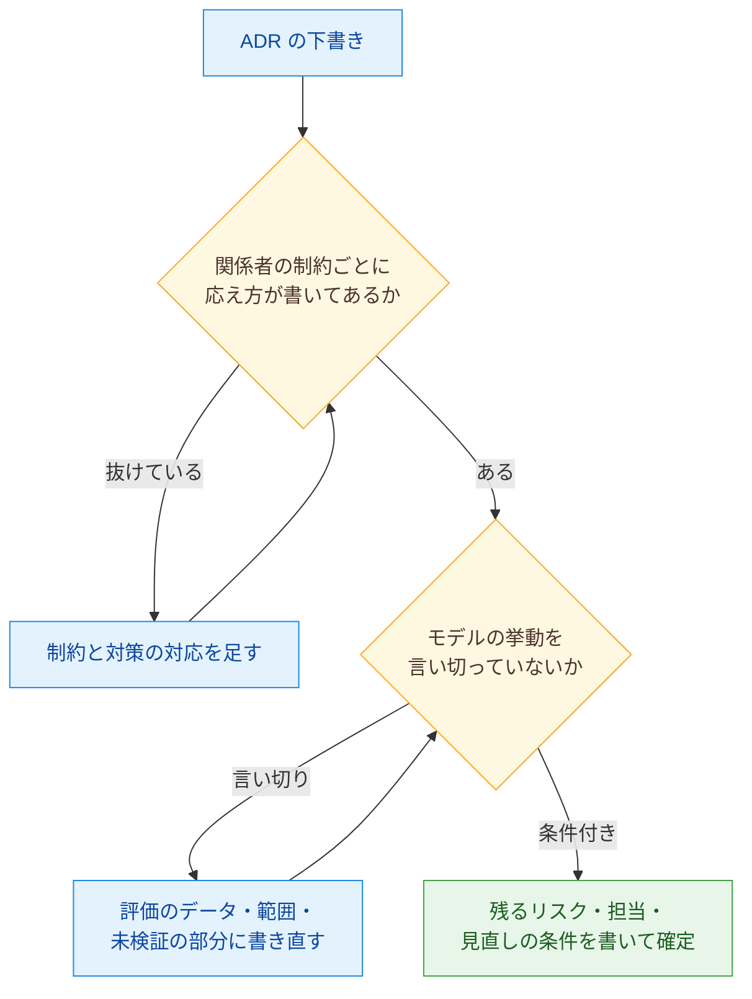

# アーキテクチャの決定記録（ADR）

> ドメイン: 6. 関係者とのコミュニケーションとライフサイクル管理（7%） ／ 更新: 2026-11-26

!!! abstract "ひとことで"
    Claude を使う構成の ADR では、関係者の制約1つずつに「どう応えたか」を書き、モデルの挙動は==条件付きの観測値==として書く。トレードオフと残るリスクを隠さず、言い切りで確実さを盛らない。

## 仕組み

ADR（Architecture Decision Record）は、決定・背景・検討した代替案・結果（トレードオフ）を1件ずつ残す文書だ（一般的な実務、推論）。Claude を部品に含む構成では、決定の根拠の多くが「モデルがこう振る舞う」という主張になる。ところがモデルの挙動は確率的で、評価した範囲の外では未検証だ。だから ADR の主張は「評価セット v3 の 420 件で正答率 94%、本番の分布では未検証」のように、根拠のデータと範囲を添えて書く（推論）。試験では、下書きの ADR を読み、満たしていない関係者の制約と、確実さを言い過ぎている文を見つけさせる。

| ADR の項目 | 弱い書き方 | Claude の構成で求める書き方（推論） |
|---|---|---|
| 背景・制約 | 技術的な事情だけ | 関係者ごとの制約（規制・コスト・遅延・データの所在）を列挙する |
| 決定 | 「Sonnet を使う」 | 固定したモデル ID、プロンプトの版、デプロイ先まで書く |
| 根拠 | 「十分に高精度」 | 評価セットの版・件数・試行回数・結果のばらつきを書く |
| 残るリスク | 書かない、または「プロンプトで禁止済み」 | 起きうる失敗、評価していない範囲、それを拾う仕組み（人の確認・コードでの検査）を書く |
| 見直しの条件 | 無い | モデルの退役の告知、評価の悪化、コストの変化で再判断する |

関係者の制約を「プロンプトで指示した」だけで満たしたことにする ADR は、残るリスクを隠している。ガードレールをコードやフックで強制したか、人が確認する関門を置いたかを書き、それでも残る失敗の率と担当者を明記する。

??? info "根拠に使える公式の事実"
    - モデル ID: 現行の Claude API のモデル ID はすべて固定のスナップショット（4.6 世代以降は日付の無い ID もスナップショット）。ADR に ID を書けば、どのモデルで評価したかが一意になる
    - 退役: 公開モデルは少なくとも 60 日前に告知される。Amazon Bedrock と Google 管理の Google Cloud は独自の退役日を持つので、デプロイ先ごとに日付を確かめる
    - 評価の目標: 具体的・測定可能・達成可能・関連性のあるものにし、現在のモデルの能力から見て非現実的な目標にしない（Define success criteria）
    - 幻覚を減らす技法は、幻覚を無くしはしない（Reduce hallucinations）
    - ADR の項目立て（背景・決定・代替案・結果）は一般的な実務で、Anthropic の公式の様式は確認できなかった（未確認）

## 試験での見分け方

| 問われること | ○ 正しい | × ひっかけ |
|---|---|---|
| 制約が抜けた ADR | 制約と対策の対応を足し、残るリスクを書く | 運用の話なので ADR の対象外として外す |
| モデルの挙動の書き方 | 評価の件数・試行回数・未検証の範囲を添える | 「起きない」「保証する」と言い切る |
| 大きいモデルへの変更 | 変更しても評価を取り直し、残るリスクは書く | 最上位のモデルなので残るリスクの節を消す |
| プロンプトの指示 | 指示に加えて、コードや人の確認で強制した点を書く | 「MUST と書いたので解決済み」とする |
| 将来の変化 | 退役や評価の悪化を見直しの条件にする | 将来のモデルでも同じ挙動になると書く |

## 確認問題

**Q1.** 保険会社が、問い合わせメールを分類して担当部署に回す仕組みを作る。ADR の下書きは「コストと遅延から Haiku 系のモデルを採用。社内の評価で正答率は十分」とだけ書く。コンプライアンス部門は「苦情（金融当局への報告対象）の取りこぼしは許されない」という制約を出している。ADR の直し方として最も適切なものはどれか。（1つ選べ）
{ .quiz-q }

- A. 「Haiku 系でも十分に高精度で、苦情の取りこぼしは起きない」と一文を足して制約に応えたことにする
- B. 最上位のモデルに切り替え、最も賢いモデルなので残るリスクの節は不要とする
- C. 苦情の再現率を評価の件数・試行回数とともに書き、取りこぼしの残るリスクと、それを拾う仕組み（確信度の低いものや苦情の語を含むものは人が確認）を足す
- D. 苦情の扱いは運用の手順の問題なので、ADR からは外して運用の手順書に移す

??? success "答えと解説"
    **正解: C。** 抜けている制約に、測った値と範囲、残るリスク、それを拾う仕組みで応える。

    - A: 根拠の無い言い切りで、確実さを盛っている
    - B: モデルを変えても取りこぼしの率はゼロにならない。残るリスクを消すのは誤り
    - D: 規制上の制約は構成の決定を左右する。ADR から外すと、トレードオフが記録に残らない

**Q2.** 社内規程を検索して答えるアシスタントの ADR に載せる文として、適切なものはどれか。（2つ選べ）
{ .quiz-q }

- A. 「評価セット v3（420 件、各3試行）で正答率 94%（試行間の幅 92〜95%）。本番の質問の分布での値は未検証」
- B. 「システムプロンプトで禁止したので、規程に無いことを答えることはない」
- C. 「モデルは `claude-sonnet-5-5` に固定する。退役の告知を受けたら、評価を取り直して再判断する」
- D. 「最新のモデルを使うので、幻覚は起きない」
- E. 「将来のモデルに切り替えても同じ挙動になるので、評価の取り直しは不要」

??? success "答えと解説"
    **正解: A と C。** 挙動は評価の条件付きで書き、モデルは固定したうえで見直しの条件を書く。

    - B: プロンプトの指示は保証にならない。残るリスクを隠している
    - D: 幻覚を減らす技法も、幻覚を無くしはしないと公式に書かれている
    - E: モデルが変われば挙動も変わりうる。評価の取り直しを見直しの条件にする

**Q3.** 通販会社の返金エージェントの ADR は「返金の判断はエージェントに任せる。5万円を超える返金は人に回すよう、システムプロンプトで指示する」と書く。経理部門の制約は「5万円を超える返金は、必ず人が承認する」。ADR の直し方として最も適切なものはどれか。（1つ選べ）
{ .quiz-q }

- A. 金額の上限を返金ツールの側のコードで強制し、プロンプトだけの案は退けた代替案として記録し、上限の判定を誤るケースなど残るリスクを書く
- B. プロンプトの指示を「必ず」「絶対に」と強め、制約は解決済みとして記録する
- C. 50 件の評価で上限を一度も破らなかった結果を載せ、「上限は守られる」と保証する
- D. 経理部門の制約は付録に移し、本文には決定だけを残して読みやすくする

??? success "答えと解説"
    **正解: A。** 「必ず」が求められる制約は、プロンプトでなくコードで強制し、退けた案と残るリスクを記録する。

    - B: 言い回しを強めても、確率的な挙動は保証にならない
    - C: 50 件で破らなかったことは、保証の根拠にならない。確実さの言い過ぎ
    - D: 制約を本文から外すと、どの制約にどう応えたかが読めなくなる

## 出典
- Claude Certified Architect – Professional Exam Guide v1.1（Dec 7 版）, Domain 6「Architecture Decision Records」（公式、PDF）: https://cc.sj-cdn.net/instructor/6nizmqk8tpzpfjvt6qmmav7rh/public/1794946420/Claude_Certified_Architect_-_Professional_Exam_Guide_Updated_Dec_7.pdf
- [Models overview](https://platform.claude.com/docs/en/about-claude/models/overview)（公式。モデル ID は固定のスナップショット）
- [Model deprecations](https://platform.claude.com/docs/en/about-claude/model-deprecations)（公式）
- [Define success criteria](https://platform.claude.com/docs/en/test-and-evaluate/define-success)（公式）
- [Reduce hallucinations](https://platform.claude.com/docs/en/test-and-evaluate/strengthen-guardrails/reduce-hallucinations)（公式）
