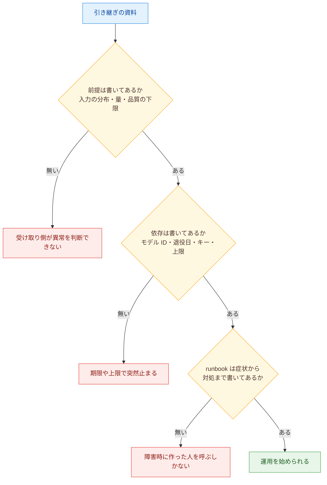

# 運用への引き継ぎの完全さ

> ドメイン: 6. 関係者とのコミュニケーションとライフサイクル管理（7%） ／ 更新: 2026-11-26

!!! abstract "ひとことで"
    引き継ぎの資料は「作った人がいなくても、受け取ったチームが運用を始められるか」で点検する。Claude の構成では、==固定したモデル ID と退役日、評価の基準値、エラーの種類ごとの runbook== が抜けやすい。

## 仕組み

引き継ぎの資料は、前提（どんな入力・量・品質を想定したか）、依存（モデル・キー・上限・外部のツール）、runbook（症状から対処までの手順）の3つで成り立つ（一般的な実務、推論）。Claude の構成に特有なのは、依存の中に「時間がたつと変わるもの」が多いことだ。モデルは退役し、レート制限は使い方で変わり、プロンプトを直せば品質が動く。だから、受け取ったチームが変化を検知して判断できるだけの材料（評価セットと基準値、退役の告知を受ける窓口）を渡さないと、運用は始められても続けられない。試験では、引き継ぎの資料を読み、運用を止める抜けを1つ見つけて、それを埋める文書を選ばせる。

| 区分 | 抜けやすいもの | 抜けたときに起きること |
|---|---|---|
| 前提 | 評価セット・基準値・取り直しの手順 | プロンプトやモデルを変えた後に、品質が落ちたかを判断できない |
| 前提 | 想定した量と、使っている利用階層 | 急な増加で 429 が出ても、想定内かどうかが分からない |
| 依存 | 固定したモデル ID、デプロイ先ごとの退役日、告知メールの受け手 | 退役の後、リクエストが失敗して止まる |
| 依存 | API キー・ワークスペース・支出上限の持ち主 | 月の上限で止まっても、上げる権限のある人が分からない |
| runbook | エラーの種類ごとの対処 | 支出上限の 429 を、待てば直る 429 と同じに扱う |
| runbook | 品質の劣化・インジェクションの疑いの扱い | 誰がいつ止めるかを決められない |

runbook は「429 なら再試行」のように1行で済ませがちだ。しかし同じ 429 でも、レート制限、ramp limit、月の支出上限では対処が違う。応答の `error.details.error_code` で見分け、それぞれの手順と担当を書く。

??? info "runbook とその依存に書く仕様の細部"
    - レート制限の 429: `retry-after` が付く。その秒数だけ待って再試行する
    - ramp limit の 429: `error_code` は `ramp_limit_exceeded`。成功する水準で止め、1分に1段ずつ増やす
    - 月の支出上限の 429: `error_code` は `enforced_spend_limit_reached`。`retry-after` は付かず、翌月まで再試行は失敗する。上の利用階層に移ると戻る
    - 自分で設定した支出上限に達すると 400（`invalid_request_error`）
    - レート制限は組織単位。ワークスペースごとに低い上限も設定できる
    - 退役: 公開モデルは少なくとも 60 日前にメールと文書で告知。退役後は失敗する（Claude API では 404 `not_found_error`）。Console の Usage から、キー別・モデル別の利用を CSV で出せる
    - Amazon Bedrock と Google 管理の Google Cloud は独自の退役日を持つ。Foundry と Claude Platform on AWS は Claude API の予定に従う
    - 3つの区分の立て方と「運用を始められるか」の基準は一般的な実務からの（推論）

## 試験での見分け方

| 問われること | ○ 正しい | × ひっかけ |
|---|---|---|
| 品質の維持 | 評価セット・基準値・実行の手順を渡す | 開発中の全プロンプトの履歴を渡せば十分とする |
| モデルの依存 | 固定した ID、デプロイ先の退役日、告知の受け手を書く | エイリアスや最新版を指すので期限は気にしなくてよいとする |
| 429 の runbook | `error_code` で種類を分け、種類ごとに手順と担当を書く | すべて指数バックオフで再試行する |
| 上限の持ち主 | 支出上限と利用階層を変えられる人を書く | API キーを増やせば上限が増えるとする |
| 資料の点検 | 受け取ったチームが作った人なしで動けるかで見る | 資料の量や図の見た目で完全さを判断する |

## 確認問題

**Q1.** 物流会社の配送問い合わせエージェントを運用チームに引き継いだ。runbook には「429 は `retry-after` に従って再試行する」とだけある。翌月1日の0時から、`retry-after` の無い 429 が出続け、再試行しても回復しない。引き継ぎの資料に足すべきものとして最も適切なものはどれか。（1つ選べ）
{ .quiz-q }

- A. 再試行の回数を増やし、指数バックオフの上限の待ち時間を長くする手順
- B. 429 が出たら Message Batches API に切り替えて処理を続ける手順
- C. API キーを追加で発行し、リクエストを複数のキーに振り分ける手順
- D. `error.details.error_code` で 429 の種類を見分ける手順と、支出上限のときに利用階層を上げる権限を持つ担当者

??? success "答えと解説"
    **正解: D。** `retry-after` の無い 429 が再試行で回復しないのは、月の支出上限（`enforced_spend_limit_reached`）の形だ。種類を見分ける手順と、上限を変えられる担当を書く。

    - A: 支出上限の 429 は、待っても再試行しても翌月まで回復しない
    - B: 即時の応答が要る問い合わせを、最長 24 時間かかるバッチに回すことになる。上限の原因も解決しない
    - C: 上限は組織単位でかかる。キーを増やしても上限は増えない

**Q2.** 契約書のレビューを支援するエージェントを、開発チームから法務の運用チームに引き継ぐ。資料の抜けのうち、運用の開始を妨げるものはどれか。（2つ選べ）
{ .quiz-q }

- A. 評価セットと現在の基準値、評価を流す手順が無い。プロンプトを直した後に、品質が落ちたかを判断できない
- B. 開発中に捨てたプロンプトの下書きの全履歴が無い
- C. 固定したモデル ID と退役日、Anthropic からの退役の告知を誰が受け取るかが無い
- D. 開発中に比べた別のモデルの全ログが無い
- E. Claude の内部で推論がどう行われるかの解説が無い

??? success "答えと解説"
    **正解: A と C。** 品質の変化を判断する材料と、期限で止まる依存の情報が無いと、運用を続けられない。

    - B: あれば参考になるが、無くても運用は始められる
    - D: 採用の経緯は ADR に要点があればよい。全ログは必須ではない
    - E: 運用の判断には要らない

**Q3.** 製薬会社の文献要約システムは Amazon Bedrock 上の Claude で動く。引き継ぎの資料の「依存」の節は、モデルの退役日を Anthropic の Model deprecations のページから写している。この節への指摘として最も適切なものはどれか。（1つ選べ）
{ .quiz-q }

- A. 退役日はどのデプロイ先でも同じなので、指摘は無い
- B. Bedrock は独自の退役日を持つので、Bedrock のモデル表の日付と、その告知の受け方に書き直す
- C. 退役日を書く代わりに、常に最新を指すエイリアスに切り替えて期限の管理をやめる
- D. 退役日を確実にするため、運用の開始前に Anthropic API に移す手順を足す

??? success "答えと解説"
    **正解: B。** Anthropic のページの日付は Anthropic が運用するプラットフォームのもので、Bedrock は独自の予定を持つ。

    - A: Bedrock と Google 管理の Google Cloud では、状態も日付も違いうる
    - C: 現行のモデル ID は固定のスナップショットで、退役は避けられない。期限の管理をやめる理由にならない
    - D: デプロイ先は別の制約（データの所在など）で選ばれている。引き継ぎの資料の抜けを埋める話ではない

## 出典
- Claude Certified Architect – Professional Exam Guide v1.1（Dec 7 版）, Domain 6「Operational Handoff Completeness」（公式、PDF）: https://cc.sj-cdn.net/instructor/6nizmqk8tpzpfjvt6qmmav7rh/public/1794946420/Claude_Certified_Architect_-_Professional_Exam_Guide_Updated_Dec_7.pdf
- [Rate limits](https://platform.claude.com/docs/en/api/rate-limits)（公式。429 の種類、支出上限、ramp limit）
- [Model deprecations](https://platform.claude.com/docs/en/about-claude/model-deprecations)（公式。告知、利用の監査、デプロイ先ごとの日付）
- [Models overview](https://platform.claude.com/docs/en/about-claude/models/overview)（公式）
- [Define success criteria](https://platform.claude.com/docs/en/test-and-evaluate/define-success)（公式）
