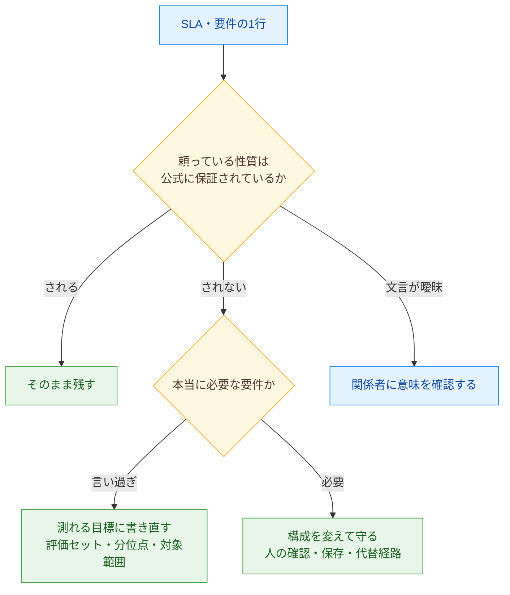

# 要件と SLA の守れない約束

> ドメイン: 6. 関係者とのコミュニケーションとライフサイクル管理（7%） ／ 更新: 2026-11-26

!!! abstract "ひとことで"
    要件や SLA の文言を、==モデルとプラットフォームが実際に保証している性質==と1行ずつ突き合わせる。保証の無い約束は、測れる目標に書き直すか、構成を変えて守れる形にする。

## 仕組み

ディスカバリーのメモや SLA の下書きには、「誤りゼロ」「同じ入力なら同じ出力」「ピークでも絶対に止まらない」のような、従来のシステムの感覚で書いた約束が混ざる。Claude の上に組んだ構成では、このうちいくつかは設定でもプロンプトでも保証できない。だから、約束を見つけたら、まず「どの部品の、どの性質に頼っているか」を特定する。そのうえで、要件の側を直す（明確化）か、構成の側を直す（設計変更）かを選ぶ。

| よくある約束 | 守れない理由（公式の根拠） | 直し方の例 |
|---|---|---|
| 事実の誤りゼロ | 幻覚を減らす技法は「減らすが無くしはしない」と公式に書かれている | 評価セットでの正答率を目標にし、高リスクの出力は人が確認する |
| 同じ入力には同じ出力 | サンプリングのパラメータは廃止され、出力の固定はプロンプトでは保証できない | 生成結果を保存し、監査では保存した出力を返す |
| ピークでも 429 を出さない | レート制限は上限であって、保証された最低値ではない | 再試行・待ち行列・人への引き継ぎを設計し、SLA の対象範囲を定義する |
| バッチで処理し数分で返す | バッチは大半が1時間以内に終わるが、最長 24 時間かかりうる | 即時性が要るものは同期の API に分ける |
| ZDR かつバッチで半額 | Message Batches API は ZDR の対象外 | どちらを優先するかを関係者に確認する |
| 同じモデルを何年も使い続ける | モデルは非推奨を経て退役する | 退役の告知を受けたら評価を取り直す手順を約束にする |

約束を消すだけでは関係者の懸念が残る。たとえば「誤りゼロ」の裏には「誤った回答で顧客に損害を出したくない」という本当の要件がある。それを「評価セットで 95% 以上、残りは人が確認する経路で拾う」のような、測れて守れる形に置き換える。

??? info "根拠になる仕様の細部"
    - 幻覚: 「これらの技法は幻覚を大きく減らすが、完全には無くさない。重要な情報は必ず検証する」（Reduce hallucinations）
    - サンプリング: `temperature`・`top_p`・`top_k` は API バージョン `2026-10-21` で廃止され、指定すると 400 になる。代わりにプロンプトで挙動を導くよう案内されている。出力を完全に固定する手段は公式に確認できなかった（未確認）
    - レート制限: RPM・ITPM・OTPM で測る。「上限であって、保証された最低値ではない」。急な増加には ramp limit がかかり、上限の手前でも 429 になる
    - 月の支出上限に達すると 429 が返るが、`retry-after` は付かず、再試行しても翌月まで失敗する（`enforced_spend_limit_reached`）
    - 標準のサービス階層は best-effort。Priority Tier（稼働率の目標 99.5%）は新規の購入ができない
    - バッチ: 大半は1時間以内。24 時間で終わらなければ期限切れ。結果は 29 日間取得できる。ZDR の対象外
    - モデルの退役: 公開モデルは少なくとも 60 日前に告知。退役後のリクエストは失敗する（Claude API では 404）
    - 「SLA の対象範囲を定義する」「本当の要件に置き換える」は一般的な実務からの（推論）

## 試験での見分け方

| 問われること | ○ 正しい | × ひっかけ |
|---|---|---|
| 「誤りゼロ」の約束 | 評価で測れる目標と、人の確認の経路に置き換える | プロンプトに「誤りを出すな」と書いて約束を残す |
| 出力の同一性 | 保存した出力を返す設計にする | サンプリングの設定や例の追加で同一性を保証できるとする |
| 稼働とピーク | 上限・ramp limit・支出上限を前提に、劣化時の動きを決める | 上位の階層の上限が需要より大きいので 429 は出ないとする |
| 即時性とコスト | 即時性が要る処理は同期、待てる処理だけバッチ | 全件をバッチにして「数分で返す」と約束する |
| 相反する要件 | ZDR とバッチのような衝突を関係者に戻して決めてもらう | 設計側で黙って片方を落とす |

## 確認問題

**Q1.** 証券会社の問い合わせ要約システムの要件メモに、監査部門の要望として「同じ問い合わせを再処理したら、必ず同じ要約が出ること」とある。構成は Messages API で Claude を呼ぶ。この要件への対応として最も適切なものはどれか。（1つ選べ）
{ .quiz-q }

- A. `temperature` を 0 に設定して出力を固定し、要件はそのまま SLA に載せる
- B. 生成した要約を入力・モデル ID・プロンプトの版と一緒に保存し、監査では保存した要約を返す形に要件を書き直す
- C. few-shot の例を増やして出力のぶれを抑え、同一性は保証できるものとして要件を残す
- D. 全件を Message Batches API で処理し、同じバッチの結果を正として同一性を担保する

??? success "答えと解説"
    **正解: B。** 出力の同一性はモデルの設定では保証できないので、保存した結果を返す構成で監査の本当の要件（後から同じものを示せること）を満たす。

    - A: サンプリングのパラメータは API バージョン `2026-10-21` で廃止され、指定すると 400 になる。設定で固定する前提が成り立たない
    - C: 例を足せばぶれは減るかもしれないが、保証にはならない。保証できないものを SLA に残している
    - D: バッチは処理の形が違うだけで、再処理したときの同一性とは関係しない

**Q2.** 病院の紹介状を夜間に一括で構造化する案件のディスカバリーのメモに、次の約束が並んでいる。提案する構成では守れないものはどれか。（2つ選べ）
{ .quiz-q }

- A. 「ゼロデータ保持（ZDR）を必須とし、かつ Message Batches API でコストを半分にする」
- B. 「1通が数十ページになっても、1回のリクエストで全文を読ませる」
- C. 「毎回同じシステムプロンプトと様式の説明は、プロンプトキャッシュで安くする」
- D. 「バッチに投入した紹介状は、すべて 15 分以内に結果を返す」
- E. 「モデルの退役が告知されたら、退役日までに評価を取り直して移行する」

??? success "答えと解説"
    **正解: A と D。** バッチは ZDR の対象外なので A は両立しない。バッチは大半が1時間以内だが最長 24 時間かかりうるので D は約束できない。

    - B: 現行のモデルのコンテキストは 1M トークンで、数十ページなら1回で読める範囲に収まる
    - C: 毎回同じ前置きをキャッシュするのは、仕様どおりの使い方
    - E: 退役は少なくとも 60 日前に告知されるので、手順として約束できる

**Q3.** EC 事業者のサポート用チャットボットの SLA 案に「年末のピークでも、API のエラーで応答できない状態を起こさない」とある。組織のレート制限は Scale 階層で、上限は想定ピークの2倍ある。この条項への対応として最も適切なものはどれか。（1つ選べ）
{ .quiz-q }

- A. Priority Tier の契約を追加し、稼働率の目標を根拠に条項をそのまま残す
- B. 429 を受けたら待たずに即座に再試行するループを入れ、条項をそのまま残す
- C. 上限が想定ピークの2倍あるので 429 は起きないと判断し、条項をそのまま残す
- D. 上限は保証された最低値ではない前提で、`retry-after` に従う再試行と人への引き継ぎを設計し、条項を劣化時の動きと対象範囲の定義に書き直す

??? success "答えと解説"
    **正解: D。** レート制限は上限にすぎず、急増時の ramp limit や支出上限でも 429 は起きる。起きる前提で劣化時の動きを約束に変える。

    - A: Priority Tier は新規の購入ができない。目標 99.5% も「起こさない」の保証ではない
    - B: 即時の再試行は負荷を上げるだけ。`retry-after` に従う必要があり、支出上限の 429 は再試行しても回復しない
    - C: 上限に余裕があっても、急な増加には ramp limit がかかり 429 になりうる

## 出典
- Claude Certified Architect – Professional Exam Guide v1.1（Dec 7 版）, Domain 6「Unsupportable Commitments in Requirements and SLAs」（公式、PDF）: https://cc.sj-cdn.net/instructor/6nizmqk8tpzpfjvt6qmmav7rh/public/1794946420/Claude_Certified_Architect_-_Professional_Exam_Guide_Updated_Dec_7.pdf
- [Reduce hallucinations](https://platform.claude.com/docs/en/test-and-evaluate/strengthen-guardrails/reduce-hallucinations)（公式）
- [Model deprecations](https://platform.claude.com/docs/en/about-claude/model-deprecations)（公式。退役の告知期間と、サンプリングのパラメータの廃止）
- [Rate limits](https://platform.claude.com/docs/en/api/rate-limits)（公式）
- [Service tiers](https://platform.claude.com/docs/en/api/service-tiers)（公式、legacy と明記）
- [Batch processing](https://platform.claude.com/docs/en/build-with-claude/batch-processing)（公式）
- [Define success criteria](https://platform.claude.com/docs/en/test-and-evaluate/define-success)（公式。目標は現在のモデルの能力から見て達成可能なものにする）
