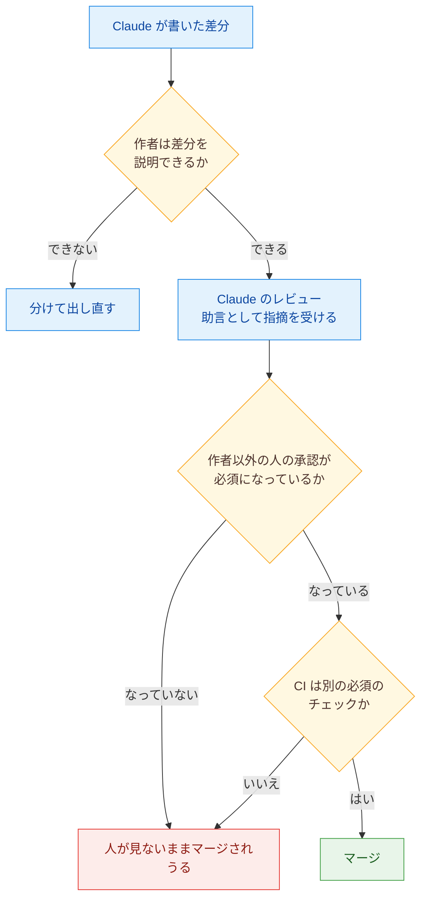

# AI が書いたコードの責任

> ドメイン: 7. 開発者の生産性と運用の支援（8%） ／ 更新: 2026-11-26

!!! abstract "ひとことで"
    Claude が書いたコードでも、責任を持つのは人だ。レビューと承認の流れを点検し、==少なくとも1人の、作者以外の人が承認しないとマージできない==経路を残す。Claude のレビューは助言として使い、人の承認の代わりにしない。

## 仕組み

公式の文書は「提案されたコードとコマンドを、承認の前に安全か確かめる責任は利用者にある」と書く。Claude のレビュー（Code Review）も、単独では PR を承認も拒否もせず、指摘ゼロでもコードに誤りが無いことは意味しない。ところが AI を使った開発では、作者（PR を出した人）が中身を読まないまま出し、レビューする人も量に押されて形だけ承認する、という形で人の責任が抜けていく（推論）。だから点検するのは「誰がその差分を説明できるか」と「人の承認なしでマージできる経路が無いか」の2点だ。試験では、チームのレビューと承認の流れ（ポリシーのファイル、ブランチの保護、CI）を読み、人の所有を守る制御を選ばせる。



| 抜け穴 | 何が起きるか | 塞ぐ制御 |
|---|---|---|
| Claude の承認を、ブランチの保護が求める1件の承認に数える | 人が誰も見ずにマージされる | 人の承認を必須の数に入れ、Claude は助言にする |
| 承認の人数を作者で満たせる | 作者だけでマージできる | 作者以外の人を求める |
| Claude Approvals のチェックが必須でない、または observe モード | ポリシーが強制されない | GitHub で必須のチェックにする |
| Code Review の指摘ゼロを合格とみなす | 見逃しがそのまま入る | 指摘ゼロでも人の確認を残す |
| 承認の条件で CI の結果を見ている前提 | 条件は CI を読めないので、テストが落ちてもマージされうる | CI を独立した必須のチェックにする |

Claude Approvals（`.claude/approvals.yml`）は、パスごとに必要な人数（`seats`）と、Claude が承認してよいか（`claude: approves` か `comments`）を決められる。課金のコードは2人、テスト用のデータは Code Review が通れば1人、のように、リスクで重みを変えられる。それでも、どのパスにも人の確認を残すかは自分で設計する必要がある。

??? info "公式の仕様の細部"
    - Code Review: 複数のエージェントが差分を読み、検証を経て、行ごとのコメントと check run を付ける。check run は失敗にならない。単独では承認も拒否もしない。「AI を使うので、バグや脆弱性を見逃すことがある。指摘が無くても誤りや脆弱性が無いことは意味しない」。Team と Enterprise のプラン
    - Claude Approvals: public beta、Team と Enterprise。`seats` は人数で、1人は作者でもよい。`seats: 0` だと、bot が書いた PR を人が誰も見ずにマージできる。`claude: approves` の規則は Code Review を自動では起動しないので、何もレビューしていない変更を Claude が承認しうる。条件は CI の結果を読めない
    - ZDR、HIPAA の構成、顧客管理の暗号鍵（CMEK）の組織では、Code Review も Approvals も使えない
    - auto モードの分類器は、人が承認していない PR のマージや CI のチェックの無効化を既定で止める
    - `attribution.commit`・`attribution.pr` で、Claude Code がコミットや PR に付ける帰属の表示を変えたり隠したりできる。隠すと後から AI の関与を追えなくなる（推論）
    - 「作者が説明できない差分はマージしない」「高リスクのパスは作者以外の人」は一般的な実務からの（推論）

## 試験での見分け方

<div class="vs" markdown>

| 問われること | ○ 正しい | × ひっかけ |
|---|---|---|
| 人の所有を守る制御 | 作者以外の人の承認を必須にする | Claude の承認で必須の1件を満たす |
| Claude のレビューの位置付け | 助言として指摘を受け、人が判断する | 指摘ゼロなら人のレビューを省く |
| 大きすぎる AI の差分 | 作者が説明できる大きさに分ける | レビューのレベルを上げて一括で通す |
| CI | 承認のポリシーとは別の必須のチェックにする | 承認の条件で CI も見ていると考える |
| 事故の後の責任 | 作者と承認者という人の責任を明確にする | 「Claude が書いたので」と人の責任から外す |

</div>

## 確認問題

**Q1.** あるチームのリポジトリには、次のポリシーがある。ポリシーは強制されており、Claude Approvals のチェックは必須にしてある。GitHub のブランチの保護は「承認1件」を求める。夜間に Claude が自動で出す依存更新の PR が、人が誰も見ないままマージされていた。最も適切な直し方はどれか。（1つ選べ）
{ .quiz-q }

```yaml
# .claude/approvals.yml
version: 1
rules:
  - purpose: "依存更新は Claude に任せる"
    paths: ["**"]
    verdict: { claude: approves, seats: 0 }
```

<div class="quiz" data-answer="A" markdown>

- A. 作者以外の人（`from: [humans, "!pr/authors"]`）の承認を1人求めるルールを足し、Claude は `comments` にして助言に回す
- B. Code Review のレベルを Deep に上げ、`seats: 0` と `claude: approves` はそのまま残す
- C. CLAUDE.md に「安全な依存更新だけを出すこと」と書き足し、ポリシーはそのまま残す
- D. ポリシーを observe モードに切り替えて、まず様子を見る

</div>

??? success "答えと解説"
    **正解: A。** `seats: 0` と `claude: approves` の組み合わせでは、Claude の承認がブランチの保護の1件を満たし、人が見ないままマージできる。作者以外の人の承認を必須にする。`seats: 1` は作者が埋められる席なので、人が PR を出す経路では作者だけでマージできてしまう。

    - B: レビューが深くなっても、人の承認が無いまま通る経路は残る
    - C: 指示はマージの条件を変えない
    - D: observe モードではポリシーが強制されず、状況はむしろ悪くなる

**Q2.** 決済サービスを開発する会社が、Claude Code を全開発者に広げる。AI が書いたコードに人が責任を持ち続けるための取り組みとして、適切なものはどれか。（2つ選べ）
{ .quiz-q }

<div class="quiz" data-answer="A,D" markdown>

- A. PR を出す人は差分を説明できることを条件にし、課金のパスは作者以外の人の承認を必須にする
- B. レビューの偏りを避けるため、コミットと PR の Claude の帰属の表示を隠す
- C. Code Review の指摘がゼロの PR は、人のレビューを省いてマージしてよいことにする
- D. テストの CI を、承認のポリシーとは別の必須のチェックにしておく
- E. すべてのパスで、Claude の承認をブランチの保護が求める1件の承認として数える

</div>

??? success "答えと解説"
    **正解: A と D。** 説明できる作者と、作者以外の人の承認で所有を保ち、承認の条件が読めない CI は独立の関門にする。

    - B: 帰属を隠すと、後から AI の関与を追えなくなる
    - C: 公式に、指摘が無くても誤りや脆弱性が無いことは意味しないと書かれている
    - E: Claude の承認だけで、人が見ないままマージできる経路ができる

**Q3.** 物流会社で、Claude が書いた 3,000 行の PR がほぼそのまま承認され、本番で障害を起こした。振り返りで、作者は「大半は Claude が書いたので細部は見ていない」、レビューした人は「量が多く、要点だけ見た」と話した。チームは開発の速さを落としたくない。再発を防ぐ制御として最も適切なものはどれか。（1つ選べ）
{ .quiz-q }

<div class="quiz" data-answer="B" markdown>

- A. 開発者の端末を auto モードにし、分類器に危険な変更を止めさせる
- B. 作者が説明できる大きさに PR を分けることを求め、高リスクのパスは作者以外の人が中身を確認してから承認する
- C. Code Review を Deep にし、指摘が無ければそのままマージしてよいことにする
- D. 本番に関わるリポジトリでは、AI による開発を全面的に禁止する

</div>

??? success "答えと解説"
    **正解: B。** 抜けたのは作者とレビューする人の両方の確認だ。説明できる単位に分け、作者以外の人の確認を必須にする。

    - A: auto の分類器は危険な操作を止める仕組みで、コードの正しさは判断しない
    - C: 指摘ゼロは誤りが無いことを意味しない。人の確認が抜けたままになる
    - D: 速さを落としたくないという制約に反する。確認の抜けという原因にも触れていない

## 出典
- Claude Certified Architect – Professional Exam Guide v1.1（Dec 7 版）, Domain 7「Accountability for AI-Generated Code」（公式、PDF）: https://cc.sj-cdn.net/instructor/6nizmqk8tpzpfjvt6qmmav7rh/public/1794946420/Claude_Certified_Architect_-_Professional_Exam_Guide_Updated_Dec_7.pdf
- [Security](https://code.claude.com/docs/en/security)（公式。User responsibility）
- [Code Review](https://code.claude.com/docs/en/code-review)（公式）
- [Claude Approvals](https://code.claude.com/docs/en/approvals)（公式、public beta）
- [Permission modes](https://code.claude.com/docs/en/permission-modes)（公式。auto モードが既定で止める操作）
- [Settings reference](https://code.claude.com/docs/en/settings-reference)（公式。`attribution`）
