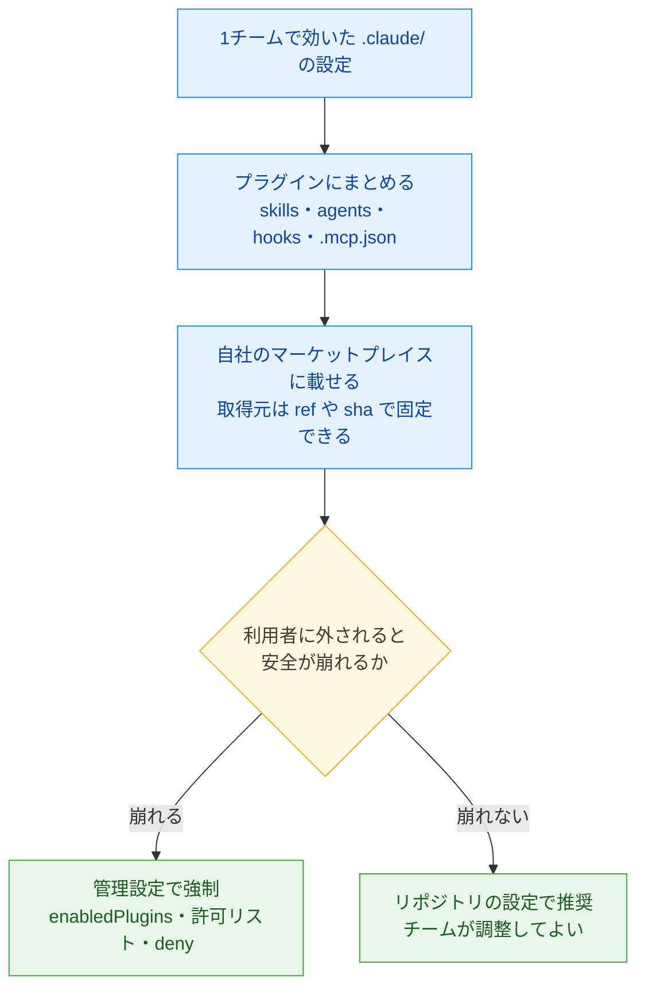

# Claude Code のワークフローの配布

> ドメイン: 7. 開発者の生産性と運用の支援（8%） ／ 更新: 2026-11-26

!!! abstract "ひとことで"
    1つのチームで効いたワークフローは、プラグイン（plugin）にまとめ、自社のマーケットプレイス（marketplace）で配る。==無人で動いても安全であるために外せない制御は、管理設定（managed settings）で中央から強制==し、中身の工夫はチームに任せる。

## 仕組み

プラグインは、スキル・サブエージェント・フック・MCP サーバーなどを1つの単位として入れるディレクトリで、`.claude-plugin/plugin.json` に名前と版を書く。マーケットプレイスは、プラグインの一覧と取得元を `.claude-plugin/marketplace.json` に書いたリポジトリで、ホストされた店ではなくカタログだ。配る経路は、リポジトリの `.claude/settings.json` と、管理設定の2つがある。リポジトリの設定は利用者が上書きできるうえ、`extraKnownMarketplaces` はフォルダを信頼した後でしか効かず、`enabledPlugins` もインストールまではしない。管理設定は利用者が上書きできず、組織の全マシンで強制できる。だから、外されると困る安全の制御は管理設定に置く。

| 置き場所 | 向いているもの | 効き方 |
|---|---|---|
| 管理設定 | マーケットプレイスの許可リスト、必須のプラグイン、deny のルール、bypass の禁止、組織のフック | 全マシンで強制。利用者の設定でも `--settings` でも上書きできない |
| リポジトリの `.claude/settings.json` | そのリポジトリで使うプラグインの推奨、チームの権限ルール | 信頼したフォルダで効く。各自の `settings.local.json` で上書きできる |
| 利用者の `~/.claude/settings.json` | 個人の好み | 自分のマシンだけ |

中央で強制しすぎると、チームが自分の作業に合わせて直せなくなる。何を中央に置くかは「無人で動いたときに、外されたら事故になるか」で決める（推論）。秘密情報の検査のフックや、本番の資格情報への deny は中央に置く。スキルの文面やレビューの観点はチームに任せる。

??? info "管理設定のキーと細かい決まり"
    - 配り方は3つ: claude.ai の管理画面からのサーバー管理設定、MDM（macOS の plist、Windows のレジストリ）、システムのパスに置く `managed-settings.json`。既定では、1台のマシンで効くのはこのうち1つだけ（サーバー管理 → MDM → ファイルの順で最初のもの）
    - `extraKnownMarketplaces` でマーケットプレイスを登録し、`enabledPlugins` に `名前@マーケットプレイス` を `true` で書くと強制有効。`false` はどのスコープでも無効にして一覧から隠す
    - `strictKnownMarketplaces`: 取得元の許可リスト。`[]` は公式も含めてすべて塞ぐ。許可リストは登録はしない
    - `blockedMarketplaces`: 拒否リスト。許可リストより先に照合する
    - `disableSideloadFlags`: `--plugin-dir`・`--plugin-url`・`--agents` などを起動時に拒否する。許可リストは `--plugin-dir` を塞がない
    - `strictPluginOnlyCustomization`: 利用者とプロジェクトのスキル・エージェント・フック・MCP を塞ぎ、プラグイン経由だけにする
    - `allowManagedHooksOnly`（組織が配ったフックだけ動かす）、`allowManagedPermissionRulesOnly`（権限ルールを管理設定だけにする）、`permissions.disableBypassPermissionsMode`・`permissions.disableAutoMode`
    - プラグインのサブエージェントは、安全のため `hooks`・`mcpServers`・`permissionMode` を無視する。フックはプラグインの `hooks/hooks.json` に置く
    - CI: 実行時に clone できないなら、ビルド時に入れた plugins ディレクトリを `CLAUDE_CODE_PLUGIN_SEED_DIR` で指す。`-p` ではインストールが裏で走るので、最初のターンから必要なら `CLAUDE_CODE_SYNC_PLUGIN_INSTALL=1`
    - プラグインは利用者の権限で動く。どの階層のマーケットプレイスでも同じ

## 試験での見分け方

| 問われること | ○ 正しい | × ひっかけ |
|---|---|---|
| 多数のリポジトリへの展開 | プラグイン＋自社のマーケットプレイス＋管理設定の `enabledPlugins` | `.claude/` をスクリプトで各リポジトリに複製する |
| 外されると困る安全の制御 | 管理設定で強制する | リポジトリの設定に置き、各自に外さないよう周知する |
| 入れてよい取得元の制限 | 管理設定の `strictKnownMarketplaces` | リポジトリの設定に許可リストを書く |
| 手元のディレクトリからの読み込み | `disableSideloadFlags` を併せて設定する | 許可リストだけで `--plugin-dir` も塞げるとする |
| プラグインのサブエージェント | フックは `hooks/hooks.json` に置く | エージェントの frontmatter の `hooks` や `permissionMode` に頼る |

## 確認問題

**Q1.** SaaS 企業の決済チームは、Claude Code 用のスキル・レビュー用のサブエージェント・秘密情報を検査する PreToolUse フックを `.claude/` に置いて使ってきた。これを社内の 40 のリポジトリに広げたい。夜間の無人の CI でも検査のフックは必ず動き、開発者が外せないことが条件だ。最も適切な配り方はどれか。（1つ選べ）
{ .quiz-q }

- A. プラグインにまとめて自社のマーケットプレイスに載せ、管理設定の `extraKnownMarketplaces` と `enabledPlugins` で強制し、検査のフックは組織のフックとして管理設定でも配る
- B. `.claude/` の中身を各リポジトリに複製するスクリプトを作り、変更があれば全リポジトリに PR を出す
- C. プラグインを Anthropic のディレクトリに提出し、各開発者が自分で入れるよう社内の wiki で案内する
- D. 各リポジトリの `.claude/settings.json` に `enabledPlugins` を書き、検査のフックを外さないよう README で周知する

??? success "答えと解説"
    **正解: A。** 「外せない」条件は、利用者が上書きできない管理設定でしか満たせない。中身の配布はプラグインとマーケットプレイスで行う。

    - B: 複製は版がずれやすく、各自の `settings.local.json` やフックの無効化で外せる
    - C: 社外に公開する話で、組織内での強制にならない
    - D: リポジトリの設定は利用者が上書きでき、`enabledPlugins` はインストールまではしない

**Q2.** 金融機関の管理者は「プラグインは Anthropic 公式のマーケットプレイスと自社のマーケットプレイスからだけ入れられる。手元のディレクトリからの読み込みもさせない」という方針を Claude Code に適用したい。設定として適切なものはどれか。（2つ選べ）
{ .quiz-q }

- A. 管理設定の `strictKnownMarketplaces` に、公式と自社のマーケットプレイスの取得元を並べる
- B. 各リポジトリの `.claude/settings.json` に `strictKnownMarketplaces` を書く
- C. 管理設定で `disableSideloadFlags` を `true` にする
- D. 管理設定の `strictKnownMarketplaces` を `[]` にする
- E. 配るプラグインのサブエージェントの frontmatter に `permissionMode: dontAsk` を書き、インストールを止める

??? success "答えと解説"
    **正解: A と C。** 取得元は管理設定の許可リストで絞り、許可リストが塞がない `--plugin-dir` などは `disableSideloadFlags` で塞ぐ。

    - B: `strictKnownMarketplaces` は管理設定のキーで、リポジトリの設定では効かない
    - D: `[]` は公式も自社も含めて、すべての取得元を塞ぐ
    - E: プラグインのサブエージェントは `permissionMode` を無視する。インストールの制御とも関係しない

**Q3.** プラットフォームチームが配るプラグインに、セキュリティの確認をするサブエージェント `sec-check` がある。その frontmatter に `hooks:`（危険なコマンドを止める PreToolUse）と `permissionMode: dontAsk` を書いた。CI で動かすと、フックが一度も動かない。最も適切な直し方はどれか。（1つ選べ）
{ .quiz-q }

- A. CI の実行に `--bare` を付けて起動を速くし、フックの読み込みを確実にする
- B. CI の環境変数に `CLAUDE_CODE_SYNC_PLUGIN_INSTALL=1` を設定し、最初のターンの前にプラグインを入れる
- C. フックをプラグインの `hooks/hooks.json` に移し、権限モードはプラグインのエージェントに頼らず CI の起動側で指定する
- D. frontmatter のキーを `permission_mode` のようなスネークケースに書き換える

??? success "答えと解説"
    **正解: C。** プラグインのサブエージェントは `hooks`・`mcpServers`・`permissionMode` を安全のため無視する。フックはプラグインの `hooks/hooks.json` に置く。

    - A: `--bare` はプラグインやフックの自動の読み込みを飛ばす。逆効果
    - B: プラグインが最初のターンに無い問題への対策で、frontmatter が無視される原因は変わらない
    - D: frontmatter のキーはキャメルケースで、知らないキーは黙って無視される。書き換えるとさらに効かない

## 出典
- Claude Certified Architect – Professional Exam Guide v1.1（Dec 7 版）, Domain 7「Packaging and Distributing Claude Code Workflows」（公式、PDF）: https://cc.sj-cdn.net/instructor/6nizmqk8tpzpfjvt6qmmav7rh/public/1794946420/Claude_Certified_Architect_-_Professional_Exam_Guide_Updated_Dec_7.pdf
- [Plugins overview](https://code.claude.com/docs/en/plugins)（公式）
- [Create a marketplace](https://code.claude.com/docs/en/plugin-marketplaces)（公式）
- [Manage Claude Code plugins for your organization](https://code.claude.com/docs/en/plugins/org)（公式。管理設定のキーの一覧）
- [Settings files and precedence](https://code.claude.com/docs/en/settings)（公式）
- [Subagents](https://code.claude.com/docs/en/sub-agents)（公式。プラグインのサブエージェントの制限）
- [Run Claude Code programmatically](https://code.claude.com/docs/en/headless)（公式。`--bare`）
