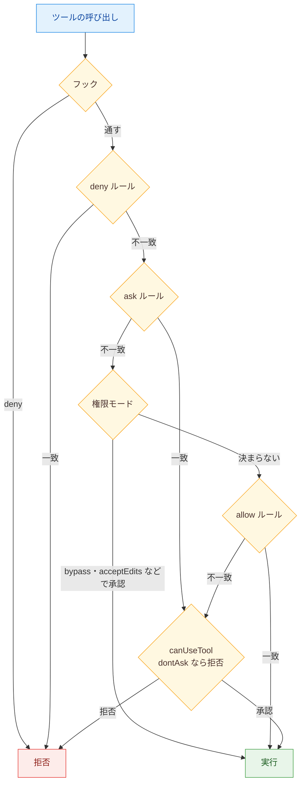

# Agent SDK と Claude Code の設定

> ドメイン: 7. 開発者の生産性と運用の支援（8%） ／ 更新: 2026-11-26

!!! abstract "ひとことで"
    権限は「フック → deny → ask → 権限モード → allow → `canUseTool`」の順で決まる。==`allowedTools` は事前の承認であって制限ではない==ので、無人の実行は `dontAsk` と狭い allow で組み、絶対に止めたいものは deny かフックで止める。

## 仕組み

権限モード（permission mode）は、確認なしで何を通すかの基準線だ。`default` は承認の要る呼び出しを確認に回し、`acceptEdits` は作業ディレクトリ内の編集と一部のファイル操作を通す。`plan` は調べて計画を出すだけ、`auto` は別の分類器が危険と判断したものを止める。`dontAsk` は確認に回るはずの呼び出しをすべて拒否し、`bypassPermissions` はほぼすべてを通す。deny のルールとフックの拒否は、どのモードより先に評価され、`bypassPermissions` でも効く。逆に `allowedTools` は列挙したツールを先に承認するだけで、列挙していないツールを消しはしない。だから CI のように確認する人がいない実行では、何を通すかを allow で狭く書き、残りを `dontAsk` で拒否させる。



| モード | 確認なしで通るもの | 向いている場面 |
|---|---|---|
| `default` | 作業ディレクトリ内の読み取りなど、承認の要らないもの | 慎重に進めたい作業 |
| `acceptEdits` | 上に加え、作業ディレクトリ内の編集と `mkdir`・`mv`・`rm` などのファイル操作 | 差分を見ながら進める開発 |
| `plan` | 読み取り（auto が使えれば、分類器が通したコマンドも） | 変更の前の調査と計画 |
| `auto` | 分類器が危険と判断しなかったもの | 長い作業で確認を減らしたいとき |
| `dontAsk` | 事前に許可したものだけ。確認に回るものは拒否 | 締めた CI・スクリプト |
| `bypassPermissions` | ほぼすべて | ネットワークの無いコンテナや VM だけ |

`auto` は確認を減らす仕組みで、安全を保証するものではないと公式に書かれている。分類器が強制プッシュ・本番へのデプロイ・人が承認していない PR のマージなどを既定で止めるとしても、止めたいものは deny で明示する（推論）。サブエージェントは frontmatter で `tools`・`model`・`permissionMode`・`hooks` などを持てるが、親が `plan`・`acceptEdits`・`auto`・`bypassPermissions` のときは親のモードを引き継ぐ。

??? info "設定の細かい決まり"
    - モードの指定: CLI は `--permission-mode`、SDK は `permissionMode`（Python は `permission_mode`）。既定は `permissions.defaultMode`
    - `permissions.defaultMode` の `auto` と `bypassPermissions` は、`.claude/settings.json` と `.claude/settings.local.json` に書いても効かない。ユーザーか管理設定に書くか、`--permission-mode` で渡す
    - 起動時のモード: v2.1.283 以降、対話の端末と VS Code は `auto` で始まる。`claude -p` と Agent SDK は `default`（Manual）で始まり、承認の要る呼び出しは許可が無ければ拒否される（v2.1.302 以降）
    - `allowedTools` に `Bash` のような広いルールを書いても、`auto` に入ると広い allow は外される（`Bash(npm test)` のような狭いものは残る）
    - `bypassPermissions` では `allowedTools` は何も絞らない。止めたいツールは `disallowedTools` に書く。素の名前（例: `Bash`）を書くと、ツールの定義そのものが外れる
    - 自動で承認された呼び出しは `canUseTool` に届かない。承認済みの呼び出しも検査したいなら PreToolUse フックを使う。フックの `allow` は deny と ask の評価を飛ばさない
    - PreToolUse フックが終了コード 2 で終わると、その呼び出しは止まり、stderr が理由として Claude に渡る
    - `bypassPermissions` は root や sudo では起動を拒否される。管理設定の `permissions.disableBypassPermissionsMode: "disable"` で禁止できる。`permissions.disableAutoMode: "disable"` で auto を外せる
    - auto の分類器が連続3回か合計20回止めると、auto は止まり確認に戻る
    - CI: `--bare` はフック・スキル・プラグイン・MCP・CLAUDE.md の自動の読み込みを飛ばし、スクリプトからの実行に推奨されている。確認する人がいない実行では `--permission-prompts none` で、待たずに拒否させられる
    - Agent SDK の文書によると、サブエージェントの定義（`AgentDefinition`）に `bypassPermissions` と書いても、その値は適用されない（v2.1.267 以降）。Subagents のページの frontmatter の表には値として載っており、ファイルで定義した場合の扱いは未確認

## 試験での見分け方

<div class="vs" markdown>

| 問われること | ○ 正しい | × ひっかけ |
|---|---|---|
| 締めた無人の実行 | `dontAsk` ＋ 狭い `allowedTools` | `bypassPermissions` ＋ `allowedTools` で絞ったつもりになる |
| 絶対に止めたい操作 | deny ルールか PreToolUse フック | `canUseTool` で止める（自動承認された呼び出しは届かない） |
| どのモードでも守る場所 | `disallowedTools` の `Edit(//secrets/**)` のような deny | プロンプトに「触るな」と書く |
| チームで auto や bypass を既定にしたい | ユーザー設定・管理設定か `--permission-mode` | `.claude/settings.json` の `defaultMode` に書く |
| 隔離した使い捨て環境 | `bypassPermissions` はコンテナや VM の中だけ | 共有のランナーや root で `--dangerously-skip-permissions` |

</div>

## 確認問題

**Q1.** 依存パッケージを夜間に更新する CI のジョブが、次の設定で動いている。共有のランナーには本番のデプロイ用の資格情報もある。ある夜、Claude が `git push --force` を実行していた。最も適切な直し方はどれか。（1つ選べ）
{ .quiz-q }

```bash
claude -p "依存を更新してテストを通す" \
  --permission-mode bypassPermissions \
  --allowedTools "Read,Edit,Bash(npm install *),Bash(npm test *)"
```

<div class="quiz" data-answer="C" markdown>

- A. `bypassPermissions` のまま、`--allowedTools` から `Edit` も外してさらに絞る
- B. `bypassPermissions` のまま、`--permission-prompt-tool` で承認用のツールを足して push を拒否させる
- C. `--permission-mode dontAsk` に変えて必要な操作だけを allow に残し、`Bash(git push *)` を deny に書き、資格情報の無い隔離したランナーで動かす
- D. `bypassPermissions` のまま、システムプロンプトに「強制プッシュは禁止」と書き足す

</div>

??? success "答えと解説"
    **正解: C。** `bypassPermissions` では `allowedTools` は何も絞らない。無人の実行は `dontAsk` と狭い allow で組み、止めたい操作を deny に書く。

    - A: `bypassPermissions` では列挙していないツールも承認される。絞る効果が無い
    - B: `bypassPermissions` では、ほとんどの呼び出しが承認の手前で通り、承認の仕組みに届かない
    - D: プロンプトの指示は強制にならない

**Q2.** 社内の障害調査を手伝うエージェントを Agent SDK で作る。調べるための読み取りは確認なしで通し、それ以外は人に聞かずに拒否したい。さらに、後で誰かが権限モードを `bypassPermissions` に変えても、`/secrets` の下への書き込みは必ず止めたい。設定として適切なものはどれか。（2つ選べ）
{ .quiz-q }

<div class="quiz" data-answer="A,C" markdown>

- A. `allowedTools: ["Read", "Glob", "Grep"]` と `permissionMode: "dontAsk"` を組み合わせる
- B. `allowedTools: ["Read"]` と `permissionMode: "bypassPermissions"` を組み合わせる
- C. `disallowedTools` に `Edit(//secrets/**)` を書く
- D. `canUseTool` の中で、`/secrets` への書き込みを拒否する
- E. 調査用のサブエージェントの定義に `permissionMode: bypassPermissions` を書き、速く動かす

</div>

??? success "答えと解説"
    **正解: A と C。** 締めた構成は `dontAsk` と狭い allow。deny のルールはどのモードでも効くので、モードが変わっても守れる。

    - B: `bypassPermissions` では `Read` 以外も承認されてしまう
    - D: `bypassPermissions` や allow で自動承認された呼び出しは `canUseTool` に届かない
    - E: 調査を締めたいという目的と逆。Agent SDK では、サブエージェントの定義の `bypassPermissions` は適用されないとも書かれている

**Q3.** あるチームは、使い捨ての devcontainer の中だけで Claude Code を `bypassPermissions` で動かしたい。リポジトリの `.claude/settings.json` に `"permissions": {"defaultMode": "bypassPermissions"}` を書いてコミットしたが、起動しても `bypassPermissions` にならない。最も適切な直し方はどれか。（1つ選べ）
{ .quiz-q }

<div class="quiz" data-answer="D" markdown>

- A. 同じ設定を `.claude/settings.local.json` に移す
- B. CLAUDE.md に「このリポジトリでは確認なしで実行してよい」と書く
- C. devcontainer の中で root として `--dangerously-skip-permissions` を付けて起動する
- D. devcontainer の起動コマンドで `--permission-mode bypassPermissions` を渡し、コンテナのネットワークを絞る

</div>

??? success "答えと解説"
    **正解: D。** `defaultMode` の `bypassPermissions` はプロジェクトとローカルの設定では効かない。起動時のフラグか、ユーザー設定で渡す。

    - A: `.claude/settings.local.json` でも効かない
    - B: CLAUDE.md は指示であって、権限の設定ではない
    - C: Linux と macOS では、root や sudo での起動は拒否される

## 出典
- Claude Certified Architect – Professional Exam Guide v1.1（Dec 7 版）, Domain 7「Agent SDK and Claude Code Configuration」（公式、PDF）: https://cc.sj-cdn.net/instructor/6nizmqk8tpzpfjvt6qmmav7rh/public/1794946420/Claude_Certified_Architect_-_Professional_Exam_Guide_Updated_Dec_7.pdf
- [Permission modes](https://code.claude.com/docs/en/permission-modes)（公式）
- [Configure permissions（Agent SDK）](https://code.claude.com/docs/en/agent-sdk/permissions)（公式。評価の順序、`allowedTools` と `bypassPermissions`）
- [Run Claude Code programmatically](https://code.claude.com/docs/en/headless)（公式。`-p`、`--bare`、`--permission-prompts`）
- [Subagents](https://code.claude.com/docs/en/sub-agents)（公式）
- [Hooks reference](https://code.claude.com/docs/en/hooks)（公式）
- [Settings files and precedence](https://code.claude.com/docs/en/settings)（公式）
