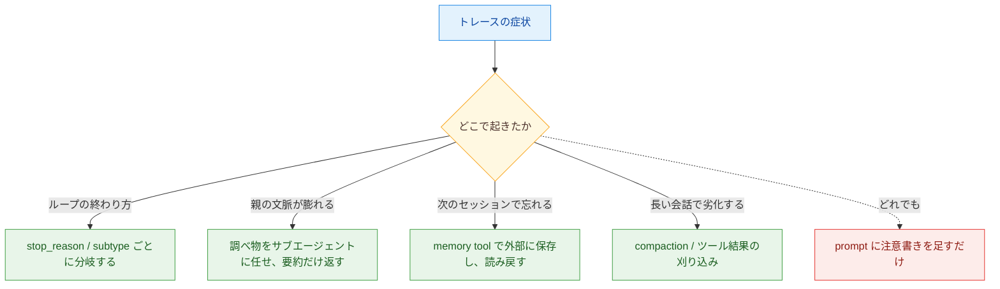

# うまく動かないエージェントのパターンの診断

> ドメイン: 1. エージェントとワークフロー（17%） ／ 更新: 2026-11-26

!!! abstract "ひとことで"
    トレースの症状から、欠けている設計パターンを1つ当てる。途中で止まる・止まらないなら ==ループの終了判定==、親のコンテキストが膨れるならサブエージェントでの分離、セッションをまたいで忘れるなら memory、長い会話で古い情報に埋もれるならコンテキストの管理だ。

## 仕組み

症状の多くは、モデルの能力でなく、harness に欠けた仕組みから起きる。だから、prompt に注意書きを足す前に、どの層で情報が失われたか・判定が誤ったかをトレースで確かめる。直すのは、その層の仕組みだ。

| 症状 | 欠けているパターン | 直し方 |
|---|---|---|
| 検索ツールの途中で、不完全な答えのまま終わる | `pause_turn` の扱い | 応答をそのまま assistant として足し、user を足さずに再送する |
| 長い答えが途中で切れたのに完了扱い | `max_tokens` の検出 | `stop_reason` を見て、上限を上げるか続きを生成させる |
| ツールを呼び続けて止まらない | 上限という安全装置 | `max_turns`・`max_budget_usd` を設け、正常な終了は別に判定する |
| 親が大量のファイルを自分で読み、コンテキストが溢れる | サブエージェントでの分離 | 調べ物を任せ、最終の要約だけを親に返させる |
| サブエージェントが「何を調べるのか分からない」と返す | 委任時の受け渡し | 親の会話は渡らないので、Agent ツールの prompt に必要な事実を書く |
| 翌日のセッションで、前日の決定を覚えていない | memory | memory tool で `/memories` に記録させ、次のセッションで読ませる |
| 古いツール結果が積み上がり、応答が遅く高くなる | コンテキストの管理 | compaction、または古いツール結果の削除（context editing） |

memory tool は client 側で動く。Claude は `/memories` への操作を頼むだけで、保存先はアプリが決める。だから、ユーザーごとの保存先への対応付けと、パスの検証はアプリの責任になる。compaction で要約すると、初期の細かい指示が失われることがある。Agent SDK の公式ページは、ずっと守らせたい規則を最初の prompt でなく CLAUDE.md に置くよう勧めている。CLAUDE.md は毎回のリクエストに入り直すからだ。

??? info "細かい決まり"
    - memory tool: `{"type": "memory_20250818", "name": "memory"}`。コマンドは `view`・`create`・`str_replace`・`insert`・`delete`・`rename`。tools に入れると、API が「最初に memory を見よ」という指示を system prompt に自動で足す
    - memory のパスは `/memories/../../secrets.env` のような traversal に備え、正規化して `/memories` の内側か確かめる
    - context editing は beta（`context-management-2025-06-27`）。`clear_tool_uses_20250919` の既定は、入力 100,000 トークンで発動し、直近3つのツールの組を残す。`exclude_tools` で消さないツールを指定できる
    - 公式は、長い会話の主な手段を server 側の compaction（`compact_20260112`）としている。context editing は細かく制御したい場合のもの
    - `pause_turn` は server ツールのループが反復の上限（既定で10回）に達したときに返る
    - Agent SDK の compaction は `compact_boundary` の system メッセージを出す。`PreCompact` の hook で、要約の前に transcript を保存できる

## 試験での見分け方

| 問われること | ○ 正しい | × ひっかけ |
|---|---|---|
| server ツールの途中で答えが返った | `pause_turn` なら同じ内容を返して続けさせる | エラーとみなして、最初のリクエストから再試行する |
| 親のコンテキストの溢れ | 調べ物をサブエージェントに分ける | もっと大きいコンテキストのモデルに変えて済ませる |
| セッションをまたぐ記憶 | memory tool で外部に保存し、読み戻す | 過去の全履歴を毎回 system prompt に詰める |
| ツール結果の積み上がり | compaction や古い結果の削除 | `max_tokens` を上げる（出力の上限で、入力は減らない） |

## 確認問題

**Q1.** 社内リサーチのエージェントを Messages API で自作した。ループは「`stop_reason` が `tool_use` ならツールを実行して続け、それ以外なら応答のテキストを最終回答として返す」だ。server ツールの `web_search` を使う質問で、ときどき調べかけの短い答えが返る。トレースのその応答は `stop_reason: "pause_turn"` だった。最も適切な直し方はどれか。（1つ選べ）
{ .quiz-q }

- A. `pause_turn` のときは応答の `content` をそのまま assistant として足し、user メッセージを足さずに同じ `tools` で再送する
- B. `max_tokens` を上げ、応答が途中で切れないようにする
- C. `tool_choice` を `{"type": "any"}` にし、毎回ツールを使わせる
- D. `pause_turn` を一時的なエラーとみなし、最初のリクエストを指数バックオフで再送する

??? success "答えと解説"
    **正解: A。** `pause_turn` は server ツールのループが反復の上限で止まった印で、応答を返せば続きから再開する。

    - B: 出力の上限で切れたのではない。`max_tokens` なら `stop_reason` が `max_tokens` になる
    - C: ツールを使わせても、止まった応答の続きを取る処理が無いままだ
    - D: 最初からやり直すと、止まるまでの検索が無駄になり、同じところでまた止まりうる

**Q2.** サポート用のエージェントで、次の2つの問題が起きている。(1) 翌日に戻ってきた顧客に、前日に聞いた契約番号や決定事項をまた尋ねる。(2) 1回の注文照会の結果が約5,000トークンあり、長いセッションでは古い照会の結果が積み上がって応答が遅く高くなる。適切な対策はどれか。（2つ選べ）
{ .quiz-q }

- A. 顧客の過去の会話の全文を、毎回 system prompt の先頭に入れる
- B. `max_tokens` を上げ、長いセッションでも応答に余裕を持たせる
- C. memory tool を足して `/memories` を顧客ごとの保存先に対応付け、パスは保存先の内側か検証する
- D. 会話をサブエージェントに分け、親の会話履歴の全文をそのサブエージェントに渡す
- E. compaction か、古いツール結果を消す context editing で、積み上がった照会の結果を刈り込む

??? success "答えと解説"
    **正解: C と E。** セッションをまたぐ記憶は memory で外部に持ち、セッション内の積み上がりはコンテキストの管理で減らす。

    - A: コンテキストがさらに膨れ、問題 (2) を悪化させる
    - B: `max_tokens` は出力の上限で、入力の積み上がりは減らない
    - D: 履歴の全文を渡すと分離にならず、どちらの問題も解決しない

**Q3.** 調査のエージェントで、親のエージェントが関連ファイル40件を自分で `Read` して比べ、途中でコンテキストの上限近くに達し、最初に決めた調査方針を見失った。最も適切な直し方はどれか。（1つ選べ）
{ .quiz-q }

- A. 自動 compaction が早めに発動するように設定し、読んだ内容を頻繁に要約させる
- B. ファイルを読む調べ物をサブエージェントに任せ、親には結論と根拠のパスだけを返させる
- C. コンテキストウィンドウの大きいモデルに切り替え、40件を一度に読めるようにする
- D. 1件読むたびに、その全文を memory に書き写させる

??? success "答えと解説"
    **正解: B。** サブエージェントは最終の応答だけを返すので、親のコンテキストは要約の分しか増えない。

    - A: 要約では初期の細かい指示が失われることがあり、親が全文を読み込む原因も残る
    - C: 件数が増えれば同じことが起きる。原因である親への積み上げが残る
    - D: 全文を書き写しても、読み戻せば同じだけコンテキストを使う

## 出典
- Claude Certified Developer – Foundations Exam Guide v1.1, Domain 1「Agent Pattern Diagnosis」（公式、PDF）: https://cc.sj-cdn.net/instructor/6nizmqk8tpzpfjvt6qmmav7rh/public/1794946771/Claude_Certified_Developer_-_Foundations_Exam_Guide_Updated_Dec_7.pdf
- [Handling stop reasons](https://platform.claude.com/docs/en/build-with-claude/handling-stop-reasons)（公式）
- [Memory tool](https://platform.claude.com/docs/en/agents-and-tools/tool-use/memory-tool)（公式）
- [Context editing](https://platform.claude.com/docs/en/build-with-claude/context-editing)（公式）
- [How the agent loop works](https://code.claude.com/docs/en/agent-sdk/agent-loop)（公式、Agent SDK）
- [Subagents in the SDK](https://code.claude.com/docs/en/agent-sdk/subagents)（公式、Agent SDK）
