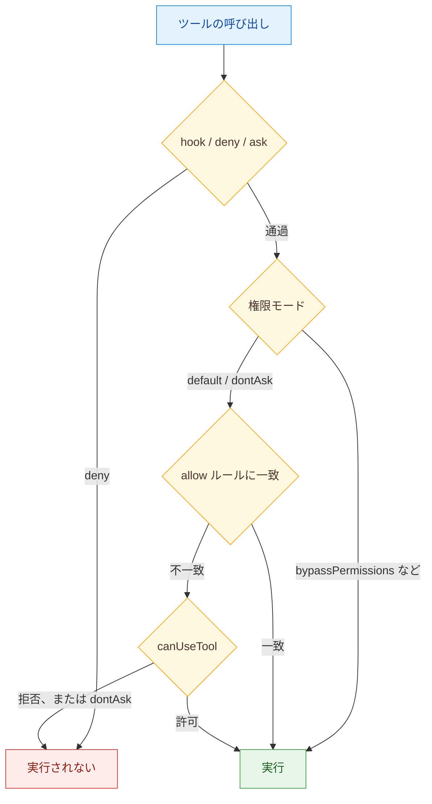

# Agent SDK でのエージェントの定義と自作のループ

> ドメイン: 1. エージェントとワークフロー（17%） ／ 更新: 2026-11-26

!!! abstract "ひとことで"
    Agent SDK は Claude Code のループをライブラリとして使う。`allowed_tools` は ==自動で承認するツールの一覧== で、使えるツールを絞る設定ではない。絞るなら `disallowed_tools` かサブエージェントの `tools` を使い、終わり方は `ResultMessage` の `subtype` で判定する。

## 仕組み

`query()` を呼ぶと、SDK は `claude` CLI を子プロセスとして起動し、ツールの実行と結果の返却を自動で繰り返す。ツールを呼ばない応答が来るとループが終わり、最後に `ResultMessage` が届く。ツールの呼び出しを通すかどうかは、決まった順で判定される。hook → deny ルール → ask ルール → 権限モード → allow ルール → `canUseTool` の順で、先に決まった段で止まる。だから `bypassPermissions` では `allowed_tools` に無いツールも承認される。一方、deny ルールと hook の deny は、どのモードでも効く。

| 設定（Python / TypeScript） | 効果 |
|---|---|
| `allowed_tools` / `allowedTools` | 並べたツールを自動承認する。並べないツールも使え、承認が要る呼び出しは権限モードに回る |
| `disallowed_tools` / `disallowedTools` | ツール名だけなら定義ごと外す。`Bash(rm *)` のような形なら、その呼び出しを全モードで拒否する |
| `permission_mode` / `permissionMode` | `default`・`acceptEdits`・`plan`・`dontAsk`・`auto`・`bypassPermissions` |
| `agents` | 名前 → `AgentDefinition`（`description`・`prompt`・`tools`・`model` など） |
| `setting_sources` / `settingSources` | CLAUDE.md・skills・settings のどれを読むか。既定の `query()` では project を読む |
| `max_turns`・`max_budget_usd` | 暴走を止める上限。既定は無制限 |

サブエージェントは、自分の `prompt` と、親が Agent ツールに渡した prompt の文字列だけを受け取る。親の会話履歴や system prompt は渡らない。だから、必要なファイルのパスや決定事項は、その prompt に書かせる。Claude がどのサブエージェントを使うかは `description` で決まる。

`ResultMessage` の `subtype` は `success`・`error_max_turns`・`error_max_budget_usd`・`error_during_execution`・`error_max_structured_output_retries` のどれかだ。`result`（最終テキスト）があるのは `success` のときだけなので、`subtype` を見てから読む。どの `subtype` にも `session_id` が付くので、上限で止まっても `resume` で続きから再開できる。

??? info "細かい決まり"
    - Messages API で自分のループを書くときは、`stop_reason` が `tool_use` ならツールを実行して `tool_result` を返し、`end_turn` なら終える。`max_tokens` は途中で切れた印。切れた `tool_use` は上限を上げて再送する
    - `default` モードで `canUseTool` が無いと、承認が要る呼び出しは拒否される。Claude Code v2.1.302 以降、モードを指定しない SDK の実行は `default`（Manual）で始まる
    - `AgentDefinition.tools` にツールを並べても、そのツールの承認にはならない。`maxTurns` に達したサブエージェントの出力は partial と印が付く
    - 単発の `query()` は、エラーの結果を出したあとで例外を投げる。続けたい処理があるなら try で囲む
    - サブエージェントの入れ子は既定で3段まで（`CLAUDE_CODE_MAX_SUBAGENT_SPAWN_DEPTH`）、同時実行は既定で20（`CLAUDE_CODE_MAX_CONCURRENT_SUBAGENTS`）
    - `bypassPermissions` は Unix の root では起動できない。TypeScript では `allowDangerouslySkipPermissions: true` も要る

## 試験での見分け方

| 問われること | ○ 正しい | × ひっかけ |
|---|---|---|
| 読むだけのエージェントに固める | `dontAsk` と、読むツールだけの `allowed_tools` を組み合わせる | `bypassPermissions` と `allowed_tools` で絞ったつもりになる |
| 特定のツールを禁じる | `disallowed_tools` に入れる | system prompt で「使うな」と書く |
| サブエージェントに文脈を渡す | Agent ツールの prompt にパスや決定事項を書く | 親の会話を覚えている前提で「さっきの件」と頼む |
| 終わり方の判定 | `subtype` で分岐し、`success` のときだけ `result` を使う | `result` が空かどうかで判定する |

## 確認問題

**Q1.** 社内のコードレビュー用エージェントを Agent SDK で作った。設定は `allowed_tools=["Read", "Grep", "Glob"]`、`permission_mode="bypassPermissions"` で、読むだけのつもりだった。ところが実行ログに `Bash: git push origin main` が残っていた。最も適切な直し方はどれか。（1つ選べ）
{ .quiz-q }

- A. `allowed_tools` に `"Bash(git status *)"` を足し、Bash で使ってよいコマンドを明示する
- B. system prompt に「push などリポジトリを変える操作は絶対にしないこと」と書き足す
- C. `permission_mode` を `dontAsk` にし、読むツールだけを `allowed_tools` に残す
- D. `max_turns` を小さくし、push に至る前にループが止まるようにする

??? success "答えと解説"
    **正解: C。** `bypassPermissions` では一覧に無いツールも承認される。`dontAsk` なら、承認が要る呼び出しは拒否される。

    - A: `bypassPermissions` のままなら、一覧に無い Bash の呼び出しも承認され続ける
    - B: prompt の指示は強制にならない
    - D: 回数を減らしても、push を止める仕組みにはならない

**Q2.** `agents` に契約書チェック用のサブエージェントを定義する。`AgentDefinition` の書き方として正しいものはどれか。（2つ選べ）
{ .quiz-q }

- A. `description` に、どんな依頼のときにこのサブエージェントを使うかを具体的に書く
- B. `tools` に並べたツールは、サブエージェントの中では承認なしで実行される
- C. 親の会話は渡らないので、対象のファイルパスや確認の観点は Agent ツールの prompt に含めさせる
- D. サブエージェントは親の system prompt を引き継ぐので、`prompt` は空にしておく
- E. `maxTurns` に達するとサブエージェントの出力は破棄されるので、上限は設けない

??? success "答えと解説"
    **正解: A と C。** 委任先は `description` で選ばれ、親から渡るのは Agent ツールの prompt だけだ。

    - B: `tools` は使えるツールの一覧で、承認にはならない
    - D: サブエージェントは親の system prompt を受け取らない。役割は `prompt` に書く
    - E: 上限に達した出力は partial と印が付いて返る。上限は暴走への備えとして設ける

**Q3.** 夜間のバッチで Agent SDK のエージェントを回している。結果の処理は「`message.result` を保存し、保存できたら完了の通知を送る」だ。ある夜のログは `ResultMessage(subtype="error_max_turns", num_turns=30)` で、保存された結果は空だったのに、完了の通知が送られていた。最も適切な直し方はどれか。（1つ選べ）
{ .quiz-q }

- A. `subtype` が `success` のときだけ `result` を使い、`error_max_turns` なら `session_id` で再開するか上限を見直す
- B. `max_turns` を外して、エージェントが自分で終えるまで回し続ける
- C. `result` が空文字のときだけ、同じ prompt で最初から実行し直す
- D. 例外を try で握りつぶし、最後に届いたメッセージを完了として扱う

??? success "答えと解説"
    **正解: A。** 終わり方は `subtype` で判定する。`result` は `success` にしか無く、どの結果にも `session_id` が付く。

    - B: 上限は暴走への備え。外すと止まらなくなる
    - C: 空かどうかは判定の代わりにならず、ここまでの作業も捨てる
    - D: 上限で止まったことを隠し、未完了を完了として扱う点が変わらない

## 出典
- Claude Certified Developer – Foundations Exam Guide v1.1, Domain 1「Agent SDK Construction and Hooks」（公式、PDF）: https://cc.sj-cdn.net/instructor/6nizmqk8tpzpfjvt6qmmav7rh/public/1794946771/Claude_Certified_Developer_-_Foundations_Exam_Guide_Updated_Dec_7.pdf
- [How the agent loop works](https://code.claude.com/docs/en/agent-sdk/agent-loop)（公式、Agent SDK）
- [Configure permissions](https://code.claude.com/docs/en/agent-sdk/permissions)（公式、Agent SDK）
- [Subagents in the SDK](https://code.claude.com/docs/en/agent-sdk/subagents)（公式、Agent SDK）
- [Handling stop reasons](https://platform.claude.com/docs/en/build-with-claude/handling-stop-reasons)（公式）
