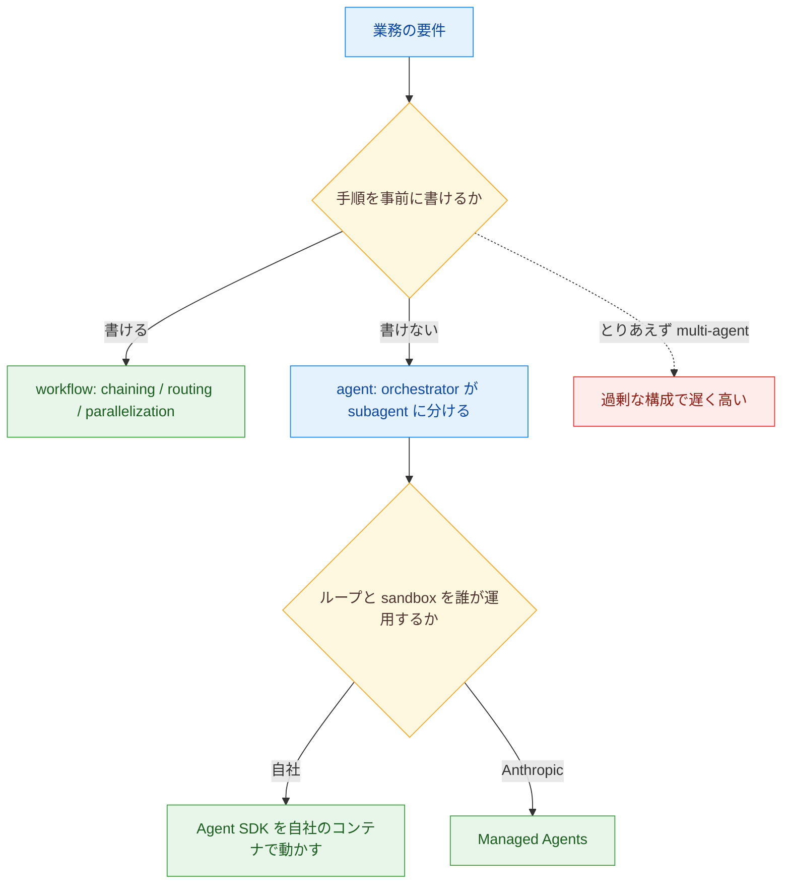

# workflow と agent の選択、分解、実行環境の選択

> ドメイン: 1. エージェントとワークフロー（17%） ／ 更新: 2026-11-26

!!! abstract "ひとことで"
    手順を事前にコードで書けるなら ==workflow==、手順が入力ごとに変わって予測できないときだけ agent にする。実行環境は「ループと sandbox を誰が運用するか」で選ぶ。自社のプロセスで回すなら Agent SDK、Anthropic にホストさせるなら Managed Agents だ。

## 仕組み

workflow は、LLM とツールを決め打ちのコードの経路でつなぐ。agent は、次に何をしてどのツールを使うかを LLM 自身が決める。agent は柔軟だが、遅延とコストが増え、誤りが積み重なりやすい。だから公式は、まず単純な構成で始め、評価で必要と分かったときだけ複雑にするよう勧めている。監査で各ステップの入出力を説明する必要があるときや、誤りの許容度が低いときは、経路が固定された workflow の方が検証しやすい。

| パターン | 使う場面 |
|---|---|
| prompt chaining | 決まった順のサブタスクに分けられる。途中に検証のゲートを置ける |
| routing | 入力をカテゴリに分け、それぞれ専用の処理に回す |
| parallelization | 独立した部分を同時に処理する（sectioning）、同じ処理を複数回して票を取る（voting） |
| orchestrator-workers | サブタスクが事前に分からない。中央の LLM が動的に分けて任せる |
| evaluator-optimizer | 評価の基準が明確で、作り直すと目に見えて良くなる |

実行環境は3つある。Messages API で自分でループを書く方法、Agent SDK で Claude Code のループを自社のプロセスに組み込む方法（self-hosted の harness）、Managed Agents に agent・environment・session を作って Anthropic にループを回させる方法だ。Managed Agents は、数分〜数時間かかる非同期の作業、sandbox やツール実行層を自作したくない場合、セッションをまたいで状態を保つ場合に向く。一方、ループ自体を細かく制御したい場合や、データの保存先を自社で握る必要がある場合は Agent SDK か Messages API を選ぶ。

??? info "実行環境ごとの細かい決まり"
    - Managed Agents は beta。全エンドポイントに `managed-agents-2026-04-01` の beta ヘッダーが要る（SDK は自動で付ける）。概念は Agent（モデル・system prompt・ツール・MCP・skills）、Environment（Anthropic の cloud sandbox か self-hosted sandbox）、Session、Events
    - Managed Agents は会話履歴と sandbox の状態をサーバー側に保存するため、ZDR の対象外（self-hosted の Managed Agents は例外）で、HIPAA の対象外（2026-11-26 時点の公式ページ）
    - Agent SDK は `query()` ごとに `claude` CLI の子プロセスを起動する。1セッション＝1プロセスで、transcript はローカルディスクに置かれ、コンテナの再起動で消える。別ホストで再開するなら `SessionStore` が要る
    - Agent SDK の資源の目安は、1エージェントあたり RAM 1 GiB、ディスク 5 GiB、CPU 1。セッションの型は ephemeral・long-running・hybrid・multi-agent container の4つ
    - Agent SDK 自体の HIPAA の扱いは、公式ページで確認できなかった（未確認）

## 試験での見分け方

| 問われること | ○ 正しい | × ひっかけ |
|---|---|---|
| 毎回同じ手順で監査が要る | 固定のステップをコードでつなぐ workflow にし、各ステップの入出力を記録する | 自律エージェントにし、「必ず記録せよ」と prompt に書く |
| サブタスクが事前に分からない | orchestrator-workers で動的に分ける | 全ステップを if 文で決め打ちする |
| 長時間・非同期で、基盤を作る人がいない | Managed Agents | 自前でループ・sandbox・再開の仕組みを一から作る |
| データの保存先を自社で握る規制要件 | 自社のインフラで動く構成にし、保存先を自分で管理する | Managed Agents の cloud sandbox に、prompt で「保存しない」と指示する |

## 確認問題

**Q1.** 経費精算サービスの請求書処理を作っている。処理は毎回「OCR → 項目の抽出 → 社内規程との照合 → 承認者への振り分け → 記録」の5段で、監査では各段の入力と出力を後から説明できる必要がある。誤りの許容度は低い。チームの一人が「orchestrator が必要に応じて subagent を起動するエージェント」を提案した。最も適切な設計はどれか。（1つ選べ）
{ .quiz-q }

- A. 全ツールを持つ1つのエージェントにし、system prompt に「5段を順に行い、各段の結果を記録すること」と書く
- B. 5段をコードで順につなぐ workflow にし、段の間に検証を置き、各段の入出力をログに残す
- C. 提案どおり orchestrator-workers にし、orchestrator の判断で段を飛ばせるようにする
- D. 1つのエージェントに `max_turns` を5で設定し、5ターンで5段が終わるようにする

??? success "答えと解説"
    **正解: B。** 手順が固定で監査が要るなら、経路をコードで決める workflow が検証しやすい。

    - A: 記録が prompt の指示頼みになり、段の順序も保証されない
    - C: 動的な分解は、サブタスクが事前に分からないときのもの。過剰な構成で、経路の説明も難しくなる
    - D: ターン数は段の数と対応しない。上限は安全装置にすぎない

**Q2.** 次の要件のうち、Claude Managed Agents を選ぶ理由になるものはどれか。（2つ選べ）
{ .quiz-q }

- A. 毎回のリクエストの `messages` を自社のコードで組み立て、ループの1回ごとに介入したい
- B. 数時間かかる作業を非同期で走らせたいが、sandbox やツールの実行層を自社で作りたくない
- C. 患者のデータを扱うため、HIPAA の BAA の対象として運用したい
- D. 既存のサーバーで動く自作のツール実行ループに、最小の変更で Claude を組み込みたい
- E. 会話履歴と sandbox のファイルをセッションをまたいで保ち、定期実行もさせたい

??? success "答えと解説"
    **正解: B と E。** 長時間・非同期の作業、基盤を作らずに済むこと、状態を保つセッションと定期実行は、Managed Agents が向く要件だ。

    - A: ループを1回ずつ制御したいなら、Messages API で自分のループを書く
    - C: Managed Agents は HIPAA の対象外（2026-11-26 時点）
    - D: 自作のループを残すなら Messages API を使う。Managed Agents はループごと任せる仕組み

**Q3.** 医療系 SaaS の会社が、診療記録を読んで要約する長時間のエージェントを作る。HIPAA の対象データで、記録はセッションをまたいで再開できる必要がある。チームは Managed Agents の cloud sandbox で動かす予定だ。最も適切な判断はどれか。（1つ選べ）
{ .quiz-q }

- A. Managed Agents のまま、system prompt に「患者を特定できる情報は保存しないこと」と書く
- B. Managed Agents のまま、作業が終わるたびに API でセッションを削除する
- C. ツールを使わない1回の Messages API 呼び出しにまとめ、再開の要件は諦める
- D. Agent SDK を自社管理のコンテナで動かし、transcript を自社の `SessionStore` に保存する。API 側の HIPAA の対象範囲は別途確認する

??? success "答えと解説"
    **正解: D。** Managed Agents は HIPAA の対象外なので、保存先を自社で握れる構成にする。

    - A: prompt の指示では、サービスの対象範囲は変わらない
    - B: 削除できても、Managed Agents の機能は HIPAA の対象外のまま
    - C: 長時間の作業と再開という要件を満たさない

## 出典
- Claude Certified Developer – Foundations Exam Guide v1.1, Domain 1「Architecture and Runtime Selection」（公式、PDF）: https://cc.sj-cdn.net/instructor/6nizmqk8tpzpfjvt6qmmav7rh/public/1794946771/Claude_Certified_Developer_-_Foundations_Exam_Guide_Updated_Dec_7.pdf
- [Building effective agents](https://www.anthropic.com/engineering/building-effective-agents)（公式、エンジニアリングブログ）
- [Claude Managed Agents overview](https://platform.claude.com/docs/en/managed-agents/overview)（公式）
- [Agent SDK overview](https://code.claude.com/docs/en/agent-sdk/overview)（公式）
- [Hosting the Agent SDK](https://code.claude.com/docs/en/agent-sdk/hosting)（公式）
