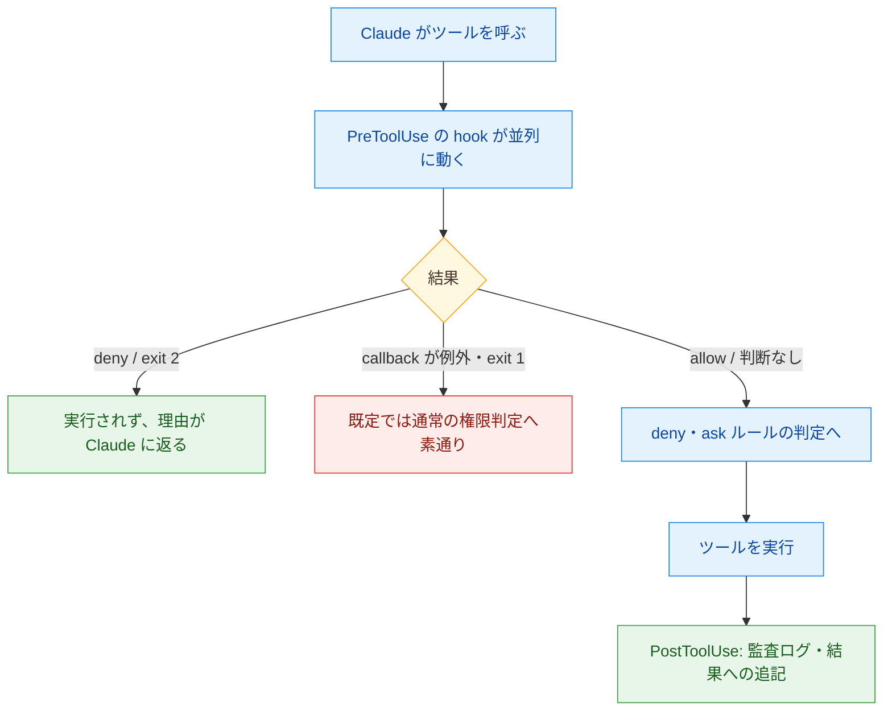

# フックで必要な処理を決定的に実行する

> ドメイン: 1. エージェントとワークフロー（17%） ／ 更新: 2026-11-26

!!! abstract "ひとことで"
    必ず実行したい処理と、決して実行させたくない処理は、prompt でなく hook に書く。`PreToolUse` の `deny` は `bypassPermissions` でも効く。ただし ==hook が失敗すると既定では処理が通る== ので、ガードには失敗時に止める設定を付ける。

## 仕組み

hook は、ツールの実行前後やエージェントの停止といった決まった時点で、アプリ側のコードを必ず呼ぶ仕組みだ。Claude が判断して呼ぶものではないので、prompt の指示と違って守られ方が揺れない。Agent SDK では `hooks` にイベント名と `HookMatcher`（`matcher`・`hooks`・`timeout`・`on_failure`）を渡し、callback の戻り値で結果を決める。Claude Code の settings.json では、同じイベントにシェルのコマンドを登録し、終了コードか JSON の出力で結果を返す。

| イベント | 主な使い道 | 止められるか |
|---|---|---|
| `PreToolUse` | 危険な呼び出しを拒否する、入力を書き換える（`updatedInput`）、人の承認に回す（`ask`） | 止められる |
| `PostToolUse` | 監査ログ、結果への情報の追記（`additionalContext`）、結果の差し替え（`updatedToolOutput`） | ツールは実行済みで、取り消せない |
| `UserPromptSubmit` | prompt に文脈を足す、prompt を止める | 止められる |
| `Stop` / `SubagentStop` | 終わる前の検証。`decision: "block"` と `reason` で続けさせる | 停止を止められる |
| `PreCompact` | compaction の前に transcript を保存する | — |

同じイベントの hook は並列に動き、完了の順は決まらない。複数の `PreToolUse` が違う判断を返したときは、`deny` > `defer` > `ask` > `allow` の順で強い方が勝つ。hook が `allow` を返しても、deny ルールと ask ルールは評価される。だから hook の `allow` で禁止を飛び越えることはできない。

失敗の扱いが試験の急所だ。SDK の callback が例外を投げるか、何も返さないと、既定では処理がそのまま通常の権限判定に進む。ガードに使うなら、matcher に `on_failure="block"`（TypeScript は `onFailure: "block"`）を付ける。Claude Code のコマンドの hook も同じで、止めるのは終了コード 2 だけだ。終了コード 1 は止まらないエラーとして扱われ、処理は進む。

??? info "細かい決まり"
    - `PreToolUse` の `permissionDecision` は `allow`・`deny`・`ask`・`defer`。`defer` はターンを終え、結果の `stop_reason` が `tool_deferred` になる（後で再開できる。Claude Code では `-p` が必要）
    - `updatedInput` は `permissionDecision: "allow"` と組にすると書き換えた入力で自動承認、`ask` と組にすると利用者に見せる。元の `tool_input` を書き換えず、新しいオブジェクトを返す
    - タイムアウトの既定は多くのイベントで 600 秒（`UserPromptSubmit` は 30 秒）。`PreToolUse` の callback がタイムアウトすると、その呼び出しは止められる
    - `Stop` の hook の入力には `stop_hook_active` があり、hook のせいで続いている最中なら `true`。stop hook が8回続けて続行させると、Claude Code は次の block を無視してターンを終える（`CLAUDE_CODE_STOP_HOOK_BLOCK_CAP` で変更）
    - 副作用だけの hook は `async_: True`（TypeScript は `async: true`）を返すと待たれない。止める・書き換える・文脈を足すことはできない
    - Claude Code の hook の種類は `command`・`http`・`mcp_tool`・`prompt`・`agent`。設定は user・project・local・managed の settings、plugin の `hooks/hooks.json`、skill と subagent の frontmatter に書け、階層をまたいでマージされる。settings のコマンドの hook の `"onFailure": "block"` は Claude Code v2.1.295 以降

## 試験での見分け方

| 問われること | ○ 正しい | × ひっかけ |
|---|---|---|
| 禁止の操作を確実に止める | `PreToolUse` で `deny`（コマンドなら exit 2） | CLAUDE.md や system prompt に「禁止」と書く |
| ガードのスクリプトが落ちたとき | `on_failure="block"` で止める側に倒す | 例外を握りつぶして `{}` を返し、処理を続けさせる |
| 実行後に気づいた危険な操作 | 実行前の `PreToolUse` に移す | `PostToolUse` で取り消せると考える |
| 終わる前にテストを通させる | `Stop` で block し、`stop_hook_active` を見て無限ループを防ぐ | 失敗するたびに無条件で block し続ける |

## 確認問題

**Q1.** CI で Claude Code を動かしている。`.claude/settings.json` に、Bash の `PreToolUse` で `.claude/hooks/guard.sh` を呼ぶ hook を登録した。スクリプトは `rm -rf` を見つけると、標準エラーに理由を出して `exit 1` する。ところがログでは、`rm -rf build/` がそのまま実行されていた。最も適切な直し方はどれか。（1つ選べ）
{ .quiz-q }

- A. hook を `PostToolUse` に移し、実行されたコマンドを見て元に戻す処理を書く
- B. CLAUDE.md に「`rm -rf` は使わないこと」と書き足し、hook と二重にする
- C. hook の `timeout` を延ばし、スクリプトが最後まで動くようにする
- D. 止めるときは `exit 2` で終える（または JSON で `permissionDecision: "deny"` を返す）

??? success "答えと解説"
    **正解: D。** コマンドの hook で呼び出しを止めるのは終了コード 2 だけで、1 は止まらないエラーとして扱われる。

    - A: `PostToolUse` の時点でツールは実行済みで、取り消せない
    - B: CLAUDE.md は文脈で、強制にならない。hook が止めていない点も直らない
    - C: スクリプトは最後まで動いている。問題は終了コードの意味

**Q2.** 送金を扱う社内エージェントを Agent SDK で作る。要件は「`mcp__bank__transfer` で 100万円を超える送金は、必ず人の承認を経る」と「すべてのツール呼び出しを監査ログに残す」の2つだ。適切な実装はどれか。（2つ選べ）
{ .quiz-q }

- A. system prompt に「100万円を超える送金の前には、必ず利用者に確認を求めること」と書く
- B. `matcher="mcp__bank__transfer"` の `PreToolUse` で金額を調べ、超えていれば `permissionDecision: "ask"` を返し、`on_failure="block"` を付ける
- C. ガードの callback では例外を捕まえて `{}` を返し、ガードが落ちても送金の流れを止めない
- D. 監査ログは `PostToolUse` と `PostToolUseFailure` の hook で書き、記録だけなので async の出力にする
- E. 監査ログ用の hook を `PreToolUse` に置き、記録したら `allow` を返して承認も兼ねる

??? success "答えと解説"
    **正解: B と D。** 承認の要否は実行前の hook で決定的に判定し、記録は実行後の hook に任せる。

    - A: prompt の指示は、Claude が守るかどうかに依存する
    - C: ガードが落ちたときに送金が通ってしまう。ガードは失敗時に止める側に倒す
    - E: 結果を記録できないうえ、記録のための hook が送金を自動承認してしまう

**Q3.** `Stop` の hook でテストを実行し、失敗していれば `decision: "block"` と失敗の内容を返して続けさせている。あるテストは環境の問題で必ず失敗し、エージェントは同じ修正を繰り返した末に、8回続けたところで打ち切られた。hook の入力には `stop_hook_active: true` が入っていた。最も適切な直し方はどれか。（1つ選べ）
{ .quiz-q }

- A. `CLAUDE_CODE_STOP_HOOK_BLOCK_CAP` を大きくし、直るまで続けさせる
- B. テストの実行を `PreToolUse` の hook に移し、ツールを呼ぶたびにテストを回す
- C. `stop_hook_active` が `true` なら block せず、失敗の内容を報告して終わらせる
- D. hook の終了コードを 1 にして、テストが失敗しても止めずに進める

??? success "答えと解説"
    **正解: C。** `stop_hook_active` は、hook のせいで続いている最中であることを示す。見ないと、解決しない条件で止め続ける。

    - A: 解決しない条件のまま、回数とコストが増えるだけ
    - B: ツールの呼び出しごとに重いテストが走り、停止前の検証にもならない
    - D: テストが失敗したまま終わり、検証の役目を果たさない

## 出典
- Claude Certified Developer – Foundations Exam Guide v1.1, Domain 1「Agent SDK Construction and Hooks」（公式、PDF）: https://cc.sj-cdn.net/instructor/6nizmqk8tpzpfjvt6qmmav7rh/public/1794946771/Claude_Certified_Developer_-_Foundations_Exam_Guide_Updated_Dec_7.pdf
- [Intercept and control agent behavior with hooks](https://code.claude.com/docs/en/agent-sdk/hooks)（公式、Agent SDK）
- [Hooks reference](https://code.claude.com/docs/en/hooks)（公式、Claude Code）
- [Configure permissions](https://code.claude.com/docs/en/agent-sdk/permissions)（公式、Agent SDK）
