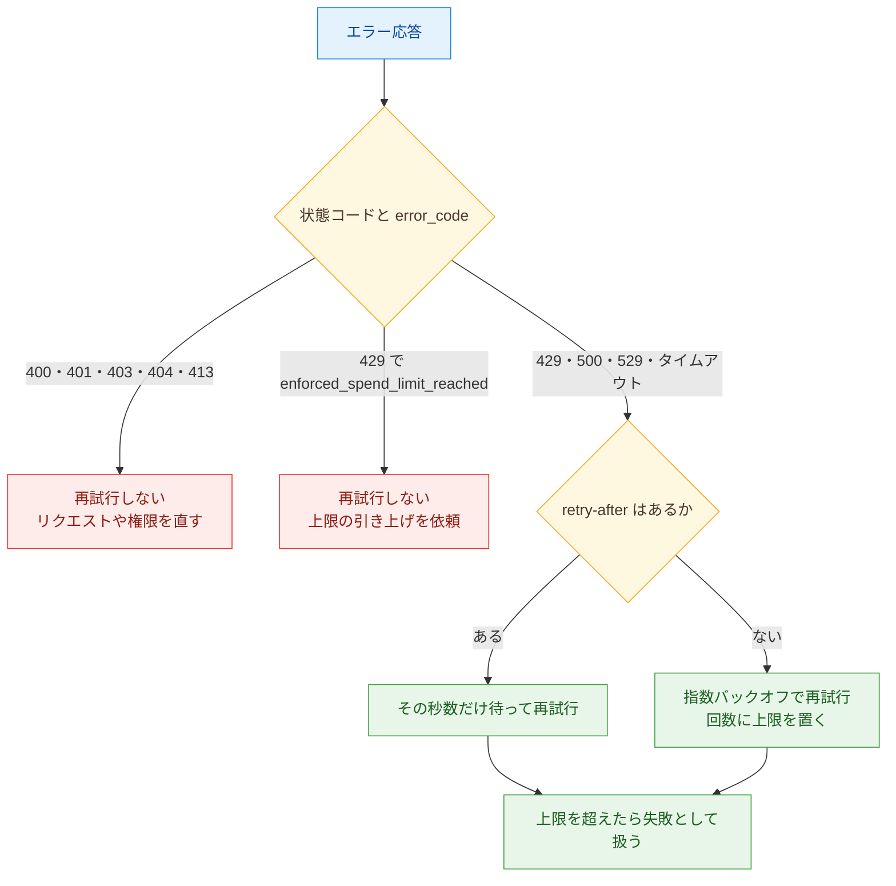

# API のエラーの種類に沿った再試行とフォールバック

> ドメイン: 2. アプリケーションと統合（20%） ／ 更新: 2026-11-26

!!! abstract "ひとことで"
    再試行するのは ==一時的な失敗（429・500・529・タイムアウト）だけ== で、`retry-after` があればその秒数だけ待つ。400 などリクエスト側の誤りは、直すまで何度送っても失敗する。

## 仕組み

エラーは常に JSON で返り、`error.type` と `error.message`、追跡用の `request_id` を持つ。種類は HTTP の状態コードと対応している。再試行で直るかどうかは種類で決まるので、まず状態コードと `error.type` で分ける。さらに `error.details.error_code` があれば、同じ種類の中の原因まで分かる。



| 状態 | `error.type` | 意味 | 対応 |
|---|---|---|---|
| 400 | `invalid_request_error` | リクエストの形や中身の誤り。自分で決めた支出上限に達したときも 400 | 直す。再試行しない |
| 401 / 403 | `authentication_error` / `permission_error` | キーの誤り・失効、権限不足 | キーや権限を直す |
| 413 | `request_too_large` | リクエストが大きすぎる | 小さくする。大きなファイルは Files API |
| 429 | `rate_limit_error` | レート制限、ランプ制限、利用階層の月の支出上限 | `retry-after` を待つ。支出上限の 429 は待っても直らない |
| 500 | `api_error` | Anthropic 側の想定外の誤り | `x-should-retry` が `false` でなければ再試行する |
| 504 | `timeout_error` | 処理中のタイムアウト | 長い要求はストリーミングかバッチにする |
| 529 | `overloaded_error` | API 全体が一時的に過負荷 | 待って再試行する |

429 には、待てば直るものと直らないものが混ざる。利用階層の月の支出上限に達したときの 429 には `retry-after` が無く、`error_code` が `enforced_spend_limit_reached` になり、翌月まで失敗し続ける。だから、==狭い分岐（`error_code`）を広い分岐（429）より先に== 書く。529 は自分の使い方ではなく、全利用者の混雑で起きる。待っても続くときに別のモデルへ切り替えるのは、可用性と品質の取り引きとして設計で決める（推論）。

??? info "SDK の再試行と細かい決まり"
    - SDK は既定で2回まで再試行する（計3回）。`max_retries`（TypeScript は `maxRetries`）で変え、0 で止める
    - 再試行するか: 応答に `x-should-retry` があれば従う。無ければ接続エラー、タイムアウト、408・409・429・500 以上を再試行する
    - 待つ時間: `retry-after` があればその秒数。無ければ 0.5〜8秒の指数バックオフ
    - SDK を使わないなら、`x-should-retry` と `retry-after` を自分で読み、バックオフと回数の上限を入れる
    - ランプ制限の 429 は `error_code` が `ramp_limit_exceeded`。成功する量に抑え、1分に1段ずつ増やす。大量の仕事は低い速度で始めて均す
    - 503 の `overloaded_error` は、SDK の型では 529 ではなく 5xx 全体として扱われる
    - ストリームが始まった後の `error` イベントは、SDK が再試行しない（「ストリーミングのイベント」のノートを参照）
    - 支援に問い合わせるときは `request-id` ヘッダー（本文の `request_id`）を添える
    - `refusal` は HTTP 200 の正常応答で、エラーではない。別モデルへのフォールバックは `stop_reason` で判断する
    - 新しい `error.type` や `error_code` が足されることがある。知らないものは状態コードで扱う

## 試験での見分け方

<div class="vs" markdown>

| 問われること | ○ 正しい | × ひっかけ |
|---|---|---|
| 429 が続く | `retry-after` を待ち、並列数を抑える | 固定の短い間隔で即座に送り直す。キーを増やして回す |
| 400 が出た | メッセージを読んでリクエストを直す | バックオフで何度も再試行する |
| 429 が何時間も直らない | `error_code` を見て支出上限と見分け、止めて知らせる | ほかの 429 と同じく再試行を続ける |
| 長い生成が 504 になる | ストリーミングかバッチにする | タイムアウトを延ばして同じ非ストリーミング要求を送る |

</div>

## 確認問題

**Q1.** 小売企業の商品説明を生成するジョブが、夕方に止まる。ログは次のとおりで、再試行は1秒おきに5回で打ち切っている。最も適切な直し方はどれか。（1つ選べ）
{ .quiz-q }

```text
HTTP 429 rate_limit_error  retry-after: 20
retry #1 (1s later) -> 429 ... retry #5 (5s later) -> 429  job failed
```

<div class="quiz" data-answer="C" markdown>

- A. 429 は回復しない失敗とみなし、最初の 429 でジョブ全体を止める
- B. 並列数を上げ、制限が解ける前に残りの要求を送り切る
- C. `retry-after` の秒数だけ待ってから再試行し、それ以降は回数に上限のある指数バックオフにする
- D. 同じ組織の API キーを複数作り、429 が出たら別のキーに切り替えて送る

</div>

??? success "答えと解説"
    **正解: C。** `retry-after` はそれより早い再試行が失敗しうる秒数を示すので、その間は待つ。

    - A: レート制限の 429 は待てば直る。全体を止める必要は無い
    - B: 制限を超えているところへさらに送るので、悪化する
    - D: レート制限は組織単位でかかるので、キーを替えても同じ上限に当たる

**Q2.** ある社内ツールの再試行ラッパーは、例外の種類を見ずに5回まで再試行する。ログには2つの問題がある。1つは 400 `invalid_request_error`（プレフィルを受け付けない旨）を5回送り直していること。もう1つは、`error.details.error_code` が `enforced_spend_limit_reached` の 429 を、数時間にわたって再試行し続けていることだ。直し方として適切なものはどれか。（2つ選べ）
{ .quiz-q }

<div class="quiz" data-answer="A,E" markdown>

- A. 400 は再試行の対象から外し、メッセージが示すリクエストの誤りを直す
- B. 400 にも指数バックオフをかければ、そのうち受け付けられる
- C. 支出上限の 429 も、`retry-after` の秒数だけ待って再試行する
- D. 401 もキーの一時的な不調として、再試行の対象に加える
- E. `enforced_spend_limit_reached` を 429 の分岐より先に判定し、再試行を止めて知らせる

</div>

??? success "答えと解説"
    **正解: A と E。** 再試行するかどうかは、状態コードと `error_code` で決める。

    - B: 400 はリクエストの形の誤りで、待っても直らない
    - C: 支出上限の 429 には `retry-after` が無く、翌月か上限の引き上げまで失敗し続ける
    - D: 401 はキーの形の誤り・失効・期限切れで、再試行では直らない

**Q3.** 研究支援サービスが、長い調査レポートを `max_tokens` を大きくした非ストリーミングの要求で作っている。長いものほど `timeout_error` で失敗し、応答が何も届かないこともある。最も適切な対応はどれか。（1つ選べ）
{ .quiz-q }

<div class="quiz" data-answer="A" markdown>

- A. ストリーミングに切り替える。すぐに結果が要らないものは Message Batches API に回す
- B. クライアント側のタイムアウトを延ばし、同じ非ストリーミングの要求を再試行する
- C. タイムアウトのたびに、より小さいモデルへ切り替えて同じ要求を送る
- D. `max_tokens` を小さくし、レポートが途中で切れても受け入れる

</div>

??? success "答えと解説"
    **正解: A。** 長い要求にはストリーミングかバッチを使うよう案内されている。途中で何も流れない接続は、ネットワークが切ることがある。

    - B: 待ち時間を延ばしても、途中で接続が切られる問題は残る
    - C: 長さの問題で、モデルを替えても解決しない。品質も変わる
    - D: タイムアウトは減っても、要件のレポートが作れない

## 出典
- Claude Certified Developer – Foundations Exam Guide v1.1, Domain 2「Integration Resilience」（公式、PDF）: https://cc.sj-cdn.net/instructor/6nizmqk8tpzpfjvt6qmmav7rh/public/1794946771/Claude_Certified_Developer_-_Foundations_Exam_Guide_Updated_Dec_7.pdf
- [Claude API errors](https://platform.claude.com/docs/en/api/errors)（公式。HTTP errors、Retries、Error codes、Long requests の節）
- [Handle errors](https://platform.claude.com/docs/en/api/handle-errors)（公式）
- [Rate limits](https://platform.claude.com/docs/en/api/rate-limits)（公式。Spend limits、Ramp limits、Response headers の節）
- [Stop reasons and fallback](https://platform.claude.com/docs/en/build-with-claude/handling-stop-reasons)（公式。refusal の扱い）
