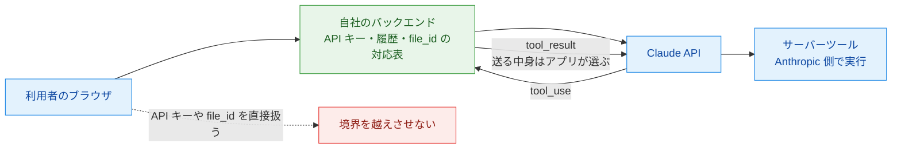

# アプリの境界と、面（surface）ごとの振る舞い

> ドメイン: 2. アプリケーションと統合（20%） ／ 更新: 2026-11-26

!!! abstract "ひとことで"
    同じモデルでも、==面（surface）ごとに最初から入っている指示が違う==。API には既定のシステムプロンプトが無く、何を境界の外へ送り、何を残すかはアプリが決める。

## 仕組み

claude.ai やデスクトップ・モバイルのアプリは、会話の最初に独自のシステムプロンプトを入れていて、その更新は API には効かない。Claude Code も公開されていない独自のシステムプロンプトを使う。Agent SDK は、`systemPrompt` を指定しなければツール呼び出しだけを扱う最小限のプロンプトで動く。`claude_code` プリセットの安全上の指示も含まれない。だから、ある面でうまく動いた指示を別の面へ移すときは、その面の既定を確かめ、足りない指示を自分で書く。

| 面 | 既定の指示 | プロジェクトの指示の入り方 |
|---|---|---|
| claude.ai・アプリ | 独自のシステムプロンプト（公開版あり） | プロジェクトなどの機能（本ノートでは未確認） |
| Messages API | なし。`system` に書いたものだけ | アプリが送る |
| Claude Code（CLI、`claude -p`） | Claude Code のシステムプロンプト | CLAUDE.md を会話に差し込む |
| Agent SDK | 最小限。`claude_code` プリセットか自前の文字列を選ぶ | `settingSources` に含めた階層の CLAUDE.md（既定の `query()` は user と project の両方） |

境界を越えるものはアプリが決める。自分で定義したツールはアプリの中で動くので、`tool_result` に何を入れるかで、モデルに渡す情報を選べる。Files API のファイルは ==ワークスペース単位== で見えるので、利用者ごとに分かれてはいない。利用者から受け取った `file_id` をそのまま使うと、別の利用者のファイルを読めてしまう。

session の設計も面で変わる。Messages API は状態を持たず、履歴はアプリが保存する。Agent SDK のセッションは、最初の要求のシステムプロンプトを記録して使い回すので、再開時に `systemPrompt` を変えても、次のターンには届かない。途中で指示を変えるなら、次の user メッセージか、フックの `additionalContext` で会話に入れる。

??? info "細かい決まり"
    - 一部の組織（ZDR などの保持の取り決めがある組織を含む）は、ブラウザから API を直接呼べない。`Origin` ヘッダー付きの要求が 401（`CORS requests are not allowed for this Organization`）になる。要求は自前のバックエンドから送る
    - マルチテナントでファイルを分けるなら、テナントごとにワークスペースを作る。既定では1組織1,000ワークスペースまで
    - ZDR の対象かどうかは機能ごとに違う。Messages API・PDF・思考は対象（一部のモデルを除く）、Files API・Message Batches・コード実行・Managed Agents は対象外
    - Agent SDK で自前の `systemPrompt` を使うときは、CLAUDE.md やフックの出力が「アプリからの文脈で、利用者の発言ではない」と一文で伝えておく
    - Agent SDK の `snapshot: false` はプロンプトを毎回組み直す。文面を試すとき用で、本番では記録を有効のままにする

## 試験での見分け方

| 問われること | ○ 正しい | × ひっかけ |
|---|---|---|
| claude.ai で試した指示が API で効かない | API の `system` に必要な指示を自分で書く | claude.ai のシステムプロンプトが API にも入ると考える |
| Agent SDK に移したら安全上の振る舞いが減った | `claude_code` プリセットか、必要な指示を含む自前のプロンプトを使う | `systemPrompt` を省けば Claude Code と同じになると考える |
| 利用者が `file_id` を送ってくる | 対応表をサーバー側で持ち、テナントはワークスペースで分ける | 「他人のファイルは見ないこと」とプロンプトで頼む |
| 途中でモードが変わった | 次のメッセージかフックの `additionalContext` で伝える | 再開時に `systemPrompt` だけ差し替える |

## 確認問題

**Q1.** 法律事務所向けのマルチテナント SaaS で、ブラウザが Files API の `file_id` を保持し、質問と一緒にバックエンドへ送っている。バックエンドはその `file_id` を `document` ブロックに入れて Claude API を呼ぶ。全テナントが同じワークスペースを使っている。テナント B の利用者がテナント A の契約書の要約を得られた。最も適切な直し方はどれか。（1つ選べ）
{ .quiz-q }

- A. 利用者とファイルの対応をサーバー側で持って `file_id` は受け取らず、テナントごとにワークスペースを分ける
- B. システムプロンプトに「依頼したテナント以外の文書の内容は答えない」と書き足す
- C. `file_id` を推測されにくくするため、アップロードのたびにファイル名を乱数にする
- D. アップロードの際に、ファイルの中身を暗号化してから Files API に送る

??? success "答えと解説"
    **正解: A。** Files API のファイルはワークスペース単位で見えるので、`file_id` は信頼できない入力から受け取らず、分離はワークスペースで行う。

    - B: モデルへの頼みでは、境界の制御にならない。`file_id` を渡した時点で中身はモデルに届く
    - C: 名前を変えても、正しい `file_id` を持つ者は読める
    - D: 暗号化した中身は、Claude にも読めなくなる

**Q2.** 社内の調達チームが claude.ai で「調達アシスタント」の指示を作り、うまく動いた。同じ指示を user メッセージに入れて、`systemPrompt` を指定しない Agent SDK のエージェントに移したところ、口調が変わり、危ない操作の前の確認もしなくなった。原因と対応として正しいものはどれか。（2つ選べ）
{ .quiz-q }

- A. claude.ai のシステムプロンプトの更新は API にも入るので、claude.ai 側の設定を合わせればよい
- B. Agent SDK は既定で CLAUDE.md を読まないので、CLAUDE.md を足せば claude.ai と同じになる
- C. claude.ai のシステムプロンプトは API には入らないので、必要な指示はエージェントのシステムプロンプトに書く
- D. Agent SDK の既定は最小限のプロンプトなので、`claude_code` プリセットか、安全上の指示を含む自前の文字列を設定する
- E. 応答の揺れが原因なので、`temperature` を 0 に固定する

??? success "答えと解説"
    **正解: C と D。** 面ごとに既定の指示が違う。API と Agent SDK では、必要な指示を自分で入れる。

    - A: claude.ai のシステムプロンプトの更新は API に効かないと明記されている
    - B: 既定の `query()` は user と project の CLAUDE.md を読む。CLAUDE.md は claude.ai の指示の代わりにもならない
    - E: 揺れではなく指示の欠けが原因だ。新しい API バージョンでは `temperature` を送ると 400 になる

**Q3.** Agent SDK で作った経理の支援エージェントで、利用者が画面で「読み取り専用モード」に切り替えた。書き込み系のツールは権限の設定で止めてある。そのうえで、Claude にも今は読み取り専用だと伝えたい。開発者はセッションを再開するときに `systemPrompt` の `append` を書き換えたが、次のターンの応答はその指示を知らないままだった。最も適切な対応はどれか。（1つ選べ）
{ .quiz-q }

- A. 書き換えた `append` が読まれるまで、同じ要求を何度か送り直す
- B. 本番の設定で `snapshot: false` にし、要求のたびにシステムプロンプトを組み直させる
- C. 次の user メッセージか、フックの `additionalContext` で「今は読み取り専用だ」と会話に入れる
- D. 切り替えのたびにセッションを捨て、履歴の無い新しいセッションで続ける

??? success "答えと解説"
    **正解: C。** セッションは最初の要求のシステムプロンプトを記録して使い回すので、途中の変更は会話の中で伝える。

    - A: 記録されたプロンプトは、圧縮（compaction）か新しいセッションまで変わらない。送り直しても届かない
    - B: 文面を試すとき用の設定で、本番では記録を有効のままにするよう案内されている。キャッシュも効かなくなる
    - D: 指示は届くが、それまでの作業の文脈を失う

## 出典
- Claude Certified Developer – Foundations Exam Guide v1.1, Domain 2「Application Boundary and Surface Behavior」（公式、PDF）: https://cc.sj-cdn.net/instructor/6nizmqk8tpzpfjvt6qmmav7rh/public/1794946771/Claude_Certified_Developer_-_Foundations_Exam_Guide_Updated_Dec_7.pdf
- [System prompts（release notes）](https://platform.claude.com/docs/en/release-notes/system-prompts/overview)（公式）
- [Modifying system prompts](https://code.claude.com/docs/en/agent-sdk/modifying-system-prompts)（公式、Agent SDK）
- [Settings files and precedence](https://code.claude.com/docs/en/settings)（公式。Claude Code のシステムプロンプトが非公開である旨）
- [Files API](https://platform.claude.com/docs/en/build-with-claude/files)（公式。workspace-scoped access の警告）
- [Tool use with Claude](https://platform.claude.com/docs/en/agents-and-tools/tool-use/overview)（公式）
- [Claude API errors](https://platform.claude.com/docs/en/api/errors)（公式。401 の CORS の説明）
- [Using the Messages API](https://platform.claude.com/docs/en/build-with-claude/working-with-messages)（公式）
