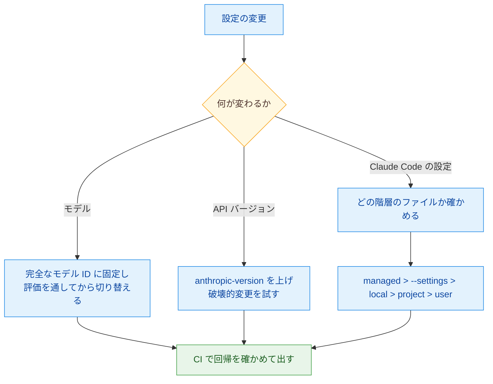

# 設定と SDLC への組み込み

> ドメイン: 2. アプリケーションと統合（20%） ／ 更新: 2026-11-26

!!! abstract "ひとことで"
    本番の振る舞いは、==モデル ID・プロンプト・設定ファイルを版として固定== して決める。エイリアスや既定値に任せると、知らないうちに変わる。

## 仕組み

Claude API のモデル ID は、どれも固定のスナップショットを指す。4.6 世代からの日付の無い ID（例: `claude-opus-5-5`）もエイリアスではなくスナップショットで、重みも設定も更新されない。新しい版は別の ID で出る。一方、4.5 以前の短いエイリアス（例: `claude-haiku-4-5`）は最新の日付付きスナップショットを指す。Claude Code の `opus`・`sonnet`・`haiku` は時とともに更新され、提供元（Anthropic API、Bedrock、Foundry など）ごとに指すモデルも違う。固定したいなら、完全なモデル名か `ANTHROPIC_DEFAULT_OPUS_MODEL` などの環境変数で指定する。

| 設定ファイル | 効く範囲 | git |
|---|---|---|
| managed（`managed-settings.json`、MDM、サーバー管理） | 組織が配る全員。誰も上書きできない | 組織が配る |
| `.claude/settings.json` | そのプロジェクトで作業する全員 | コミットして共有する |
| `.claude/settings.local.json` | 自分の、そのプロジェクトだけ | 入れない |
| `~/.claude/settings.json` | 自分の、全プロジェクト | 対象外 |

同じキーは上の階層が勝つ（managed、コマンドラインの `--settings`、local、project、user の順）。`permissions.allow` のような配列は、上書きでなく ==各階層の分が足し合わされる==。環境変数は階層の外で、キーごとに決まる。たとえばシェルの `ANTHROPIC_MODEL` は、どのファイルの `model` よりも優先される。

API の `anthropic-version` ヘッダーも版の固定だ。同じ版の中では既存の入出力が保たれ、足されるのは任意の入力、出力の値、新しいイベントの種類などに限られる。版を上げると破壊的変更が入る。たとえば `2026-10-21` では `temperature`・`top_p`・`top_k` が廃止され、送ると 400 になる。

??? info "細かい決まり"
    - モデルの重みは ID ごとに固定だが、ルーターや安全のための分類器など、周りの基盤は変わりうる。同じ ID で小さな振る舞いの差が出たら、まず基盤の更新を疑う
    - モデル ID ごとに非推奨と廃止の予定がある。廃止されたモデルへの要求はすべて失敗する
    - Claude Code の GitHub Action（`anthropics/claude-code-action@v1`）は、`claude_args` に `--model` が無いと Claude Code の既定のモデルを使う。API キーは GitHub Secrets に置き、`anthropic_api_key: ${{ secrets.ANTHROPIC_API_KEY }}` で渡す。`--max-turns` で反復を抑える
    - project の `.claude/settings.json` の一部（`permissions.allow`、`extraKnownMarketplaces`、多くの `env`）は、各人がフォルダを信頼するまで効かない。`deny` と `ask` はすぐ効く
    - クラウドのセッションは user と local の設定を読まない。届くのはコミットされた project の設定と、サーバー管理の設定
    - プラグインの `plugin.json` の `version` を書くと、その版に固定される。`dependencies` に、有効でなければならない別のプラグインを書く。CI では `claude plugin validate --strict` で警告も失敗にできる
    - プロンプトの版管理: Managed Agents のエージェントは、変更のたびに `version` が1ずつ増え、版の履歴を一覧できる。セッションを特定の版に固定する方法は、本ノートでは未確認

## 試験での見分け方

| 問われること | ○ 正しい | × ひっかけ |
|---|---|---|
| ある日から CI の出力が変わった | `--model` に完全なモデル ID を書いて固定する | 既定のモデルやエイリアスのまま、プロンプトだけ直す |
| 自分だけ別のモデルを使いたい | `.claude/settings.local.json` に書く | チームの `.claude/settings.json` を書き換えてコミットする |
| 組織の禁止がどうしても外れない | managed の設定は誰も上書きできないと判断し、管理者に相談する | user や local の設定で打ち消そうとする |
| API バージョンを上げる | 破壊的変更を確かめ、回帰を試してから切り替える | 同じ版の中と同じく、何も壊れないと考える |

## 確認問題

**Q1.** あるフィンテック企業が、Claude Code の GitHub Action で PR のレビューをしている。ワークフローは `claude_args: "--max-turns 8"` だけを渡し、`--model` を書いていない。ある週から、指摘の傾向と1回あたりのトークン数が変わった。プロンプトもワークフローも、その間に変えていない。最も適切な対応はどれか。（1つ選べ）
{ .quiz-q }

- A. レビュー用のプロンプトに「以前と同じ観点で指摘すること」と書き足す
- B. `claude_args` に `--model` と完全なモデル ID を書いて固定し、切り替えるときは評価を通す
- C. `--max-turns` を下げ、1回あたりのトークン数を前の水準に戻す
- D. ワークフローに `temperature` を 0 にする設定を足し、出力を毎回そろえる

??? success "答えと解説"
    **正解: B。** `--model` が無いと Action は Claude Code の既定のモデルを使う。エイリアスは時とともに更新され、既定も自分で固定した値ではない（推論）。完全なモデル ID なら中身は変わらない。

    - A: モデルが入れ替わったこと自体は、プロンプトでは防げない
    - C: トークン数は下がるかもしれないが、モデルが変わる原因は残る
    - D: 原因はモデルの変更で、ばらつきではない。新しい API バージョンでは `temperature` を送ると 400 になる

**Q2.** あるチームのリポジトリでは、`.claude/settings.json` に `"model": "claude-sonnet-5"` と `permissions.allow` の規則がある。開発者の Sato は、自分だけ Opus を使い、さらに自分用の allow 規則を1つ足したい。チームの設定は変えたくない。正しい理解はどれか。（2つ選べ）
{ .quiz-q }

- A. `~/.claude/settings.json` に `model` を書けば、user の階層が project より上なので Opus になる
- B. `.claude/settings.local.json` に `"model": "claude-opus-5-5"` を書けば、Sato のセッションだけが Opus になる
- C. local に `permissions.allow` を書くと、チームの allow 規則は置き換えられて消える
- D. local に書いた allow 規則は、チームの allow 規則に足し合わされる
- E. `.claude/settings.local.json` はコミットして、チームにも同じ上書きを配る

??? success "答えと解説"
    **正解: B と D。** local は project より上なので単一の値は上書きでき、配列は階層をまたいで足し合わされる。

    - A: user は project より下で、チームの `model` が勝つ
    - C: 配列は置き換わらず、合わさる
    - E: local は個人の上書きのためのファイルで、git に入れない

**Q3.** 文書抽出のサービスが、`anthropic-version: 2023-06-01` から `2026-10-21` へ上げる準備をしている。コードを `grep` すると、`temperature=0.2` を全リクエストで送っていた。この切り替えで最も適切な進め方はどれか。（1つ選べ）
{ .quiz-q }

- A. 同じ API の中の更新は既存の入力を保つので、ヘッダーだけ書き換えて本番に出す
- B. `temperature` を 0 に変えれば受け付けられるので、値だけ直して切り替える
- C. 新しい版で 400 が出たら、自動で古い版のヘッダーに戻して送り直す仕組みを足す
- D. `temperature` を外し、移行ガイドの破壊的変更を確かめ、回帰の評価を通してから切り替える

??? success "答えと解説"
    **正解: D。** 既存の入力が保たれるのは同じ版の中だけで、版を上げると破壊的変更が入る。

    - A: `2026-10-21` では `temperature` が廃止され、送ると 400 になる
    - B: この版では、値にかかわらず送ると 400 になる
    - C: 失敗を隠すだけで、移行が終わらない。版が要求ごとに揺れる

## 出典
- Claude Certified Developer – Foundations Exam Guide v1.1, Domain 2「Configuration and SDLC Integration」（公式、PDF）: https://cc.sj-cdn.net/instructor/6nizmqk8tpzpfjvt6qmmav7rh/public/1794946771/Claude_Certified_Developer_-_Foundations_Exam_Guide_Updated_Dec_7.pdf
- [Model IDs and versioning](https://platform.claude.com/docs/en/about-claude/models/model-ids-and-versions)（公式）
- [Models overview](https://platform.claude.com/docs/en/models/overview)（公式）
- [API versions](https://platform.claude.com/docs/en/api/versioning)（公式）
- [Settings files and precedence](https://code.claude.com/docs/en/settings)（公式、Claude Code）
- [Model configuration](https://code.claude.com/docs/en/model-config)（公式、Claude Code。エイリアスと固定）
- [Claude Code GitHub Actions](https://code.claude.com/docs/en/github-actions)（公式）
- [Plugin manifest reference](https://code.claude.com/docs/en/plugins-reference)（公式。`version`、`dependencies`、`claude plugin validate`）
- [Define your agent](https://platform.claude.com/docs/en/managed-agents/agent-setup)（公式、Managed Agents。エージェントの版）
