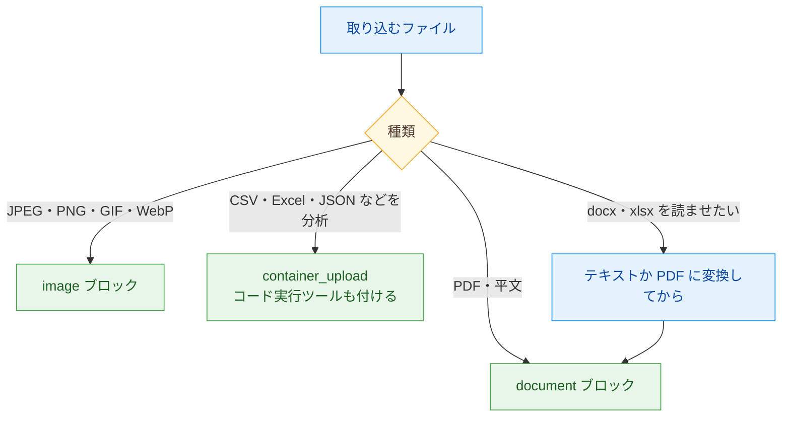

# Files API による多形式の取り込み

> ドメイン: 2. アプリケーションと統合（20%） ／ 更新: 2026-11-26

!!! abstract "ひとことで"
    Files API は一度上げたファイルを `file_id` で何度も参照する仕組みで、==ファイルの種類ごとに入れるブロックが決まっている==。PDF と平文は `document`、画像は `image`、表計算などのデータは `container_upload` に入れる。

## 仕組み

`POST /v1/files` でファイルを上げると `file_id` が返り、以後の Messages の要求ではその ID を参照するだけで済む。毎回 base64 で送り直さずに済み、要求も小さくなる。種類とブロックが合わないと 400 になるので、取り込みのコードは MIME タイプを見て、入れるブロックを選ぶ。`document` ブロックが扱えない形式は、前もって変換する。

| 症状 | 原因 | 直し方 |
|---|---|---|
| 400（種類が合わない） | 画像を `document` に入れた、など | MIME タイプでブロックを選ぶ |
| 400（コンテキストを超える） | ファイルがコンテキストウィンドウより大きい | 分割する。PDF は節ごとに分ける |
| 404 | `file_id` が無いか、別のワークスペースのもの | 上げたワークスペースのキーで参照する |
| 413 | 1ファイル 500 MB を超えた | 分割するか小さくする |
| 400（ダウンロード不可） | 自分で上げたファイルを取り出そうとした | 取り出せるのは skills とコード実行が作ったファイルだけ |

.docx や .xlsx は `document` ブロックが扱わない。中身を読ませたいならテキストに変換して本文に入れる。画像を含む .docx は PDF に変換すると、PDF の画像の読み取りと出典（citations）が使える。数字の集計や分析なら、ファイルを `container_upload` で渡し、コード実行ツールに処理させる。CSV や Markdown は平文なので、本文に入れるか、`text/plain` を明示して上げる。

ファイルは ==ワークスペース単位== で見え、利用者ごとには分かれない。`file_id` はサーバー側の参照として扱い、利用者から受け取らない。

??? info "細かい決まり（2026-11-26 時点）"
    - Files API は一般提供になり、ベータヘッダーは不要。`files-api-2025-04-14` を送り続けると、ベータの応答の形のまま動く
    - 使える面: Claude API、Claude Platform on AWS、Claude Models on Google Cloud（Anthropic managed）、Microsoft Foundry（Hosted on Anthropic）。Amazon Bedrock は一覧に無い。Bedrock と Google managed の PDF・画像は base64 のみ
    - 容量: 1ファイル 500 MB、組織で 1 TB。ファイルは変更も改名もできず、作り直して古いものを消す
    - 期限: アップロード時の `expires_in_seconds`（3,600〜7,776,000秒）で自動で失効させられる。後から変えられない。失効したファイルを参照する Messages の要求は、推論の前に失敗する
    - 料金: アップロード・一覧・取得・削除は無料。要求で使った中身は入力トークンとして課金される。ファイル関連の呼び出しは約 500 回/分まで
    - ZDR と HIPAA の対象外（削除か失効まで保持される）
    - PDF: 1要求 600ページまで（コンテキストが 1M 未満なら 100ページ）、要求全体で 128 MB。パスワードや暗号化のある PDF は不可。各ページは画像とテキストで渡り、テキストは1ページ 1,500〜3,000 トークン、画像は最大 1,568 トークン
    - `container_upload` のファイルは、コード実行のコンテナに入る。置かれる場所のパスは本ノートでは未確認

## 試験での見分け方

| 問われること | ○ 正しい | × ひっかけ |
|---|---|---|
| 画像だけ 400 になる | 画像は `image` ブロックに入れる | すべての `file_id` を `document` に入れ、再試行する |
| .docx や .xlsx が読めない | テキスト・PDF に変換する。分析なら `container_upload` | MIME タイプを書き換えて `document` に入れる |
| Bedrock に移したら参照が通らない | Bedrock では base64 で送る | ベータヘッダーを足して `file_id` を使い続ける |
| 利用者がファイルを選ぶ | 対応表をサーバーで持ち、`file_id` を受け取らない | ブラウザから受け取った `file_id` を信じる |

## 確認問題

**Q1.** 経費精算のパイプラインが、領収書の PNG と請求書の PDF を Files API で上げ、受け取った `file_id` をすべて `{"type": "document", "source": {"type": "file", "file_id": ...}}` に入れている。PDF は通るが、PNG は毎回 400 になる。最も適切な直し方はどれか。（1つ選べ）
{ .quiz-q }

- A. 400 は一時的な失敗とみなし、PNG の要求だけ指数バックオフで再試行する
- B. PNG を base64 にして、`document` ブロックの `data` に直接入れる
- C. `files-api-2025-04-14` のベータヘッダーを足して、PNG も `document` で扱わせる
- D. アップロード時の MIME タイプを見て、画像は `image` ブロック、PDF は `document` ブロックに入れる

??? success "答えと解説"
    **正解: D。** ファイルの種類とブロックが合わないと 400 になる。画像は `image` ブロックで参照する。

    - A: 種類の不一致は、何度送っても 400 になる
    - B: 送り方を変えても、画像を `document` に入れる誤りは残る
    - C: Files API は一般提供で、ベータヘッダーはブロックの扱いを変えない

**Q2.** 人事部の規程集を取り込むツールで、図入りの .docx と、手当の表が入った .xlsx を上げて `document` ブロックで参照したところ、どちらも失敗した。規程の文章は出典付きで答えさせたい。手当の表は、条件ごとの合計を計算させたい。適切な対応はどれか。（2つ選べ）
{ .quiz-q }

- A. .docx の MIME タイプを `application/pdf` と申告してアップロードし直し、`document` で参照する
- B. .docx は PDF に変換してから上げ、`document` ブロックで citations を有効にして参照する
- C. .xlsx は `container_upload` で渡し、要求にコード実行ツールを含めて計算させる
- D. .xlsx の拡張子を .csv に変え、`text/plain` として上げて `document` で参照する
- E. .docx を `image` ブロックで参照し、ページの見た目から読ませる

??? success "答えと解説"
    **正解: B と C。** 画像入りの .docx は PDF にすると図も出典も使え、表の計算はコード実行に任せる。

    - A: 中身は .docx のままなので、申告だけ変えても PDF として読めない
    - D: .xlsx はバイナリで、拡張子を変えても平文にはならない
    - E: `image` ブロックは JPEG・PNG・GIF・WebP の画像のためのもので、.docx は入れられない

**Q3.** 契約書のレビューツールを、Claude API から Amazon Bedrock へ移すことになった。今は PDF を Files API で上げ、`file_id` で参照している。移行先では、この参照の方式が通らない。最も適切な対応はどれか。（1つ選べ）
{ .quiz-q }

- A. Bedrock への要求に `files-api-2025-04-14` のベータヘッダーを足し、`file_id` の参照を続ける
- B. Bedrock では PDF を base64 にして、`document` ブロックの中に直接入れて送る
- C. PDF を公開の URL に置き、`document` ブロックの `url` の参照で送る
- D. 参照が失敗したら、指数バックオフで同じ要求を再試行する

??? success "答えと解説"
    **正解: B。** Files API を使える面の一覧に Bedrock は無く、Bedrock の PDF は base64 だけを受け付ける。

    - A: ベータヘッダーでは、Bedrock で使える機能は増えない
    - C: Bedrock の PDF は base64 のみで、URL の参照は使えない
    - D: 面が対応していないので、何度送っても通らない

## 出典
- Claude Certified Developer – Foundations Exam Guide v1.1, Domain 2「Integration Resilience」（公式、PDF）: https://cc.sj-cdn.net/instructor/6nizmqk8tpzpfjvt6qmmav7rh/public/1794946771/Claude_Certified_Developer_-_Foundations_Exam_Guide_Updated_Dec_7.pdf
- [Files API](https://platform.claude.com/docs/en/build-with-claude/files)（公式）
- [PDF support](https://platform.claude.com/docs/en/build-with-claude/pdf-support)（公式）
- [Vision](https://platform.claude.com/docs/en/build-with-claude/vision)（公式）
- [Code execution tool](https://platform.claude.com/docs/en/agents-and-tools/tool-use/code-execution-tool)（公式。Upload and analyze your own files の節）
- [Claude API errors](https://platform.claude.com/docs/en/api/errors)（公式。Request size limits の節）
