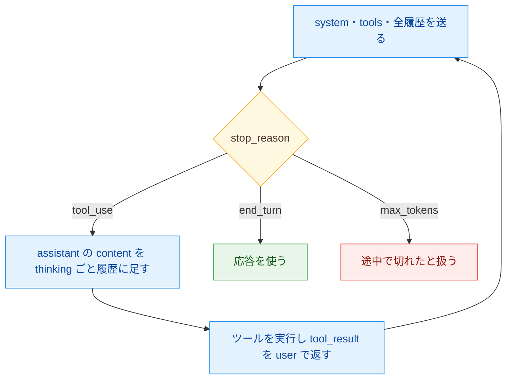

# Messages API の仕組み

> ドメイン: 2. アプリケーションと統合（20%） ／ 更新: 2026-11-26

!!! abstract "ひとことで"
    Messages API は状態を持たないので、毎回 ==会話の全履歴== を送る。応答は content ブロックの配列で、次に何をするかは `stop_reason` で決める。

## 仕組み

リクエストは `model`、`max_tokens`、トップレベルの `system`、`user` と `assistant` が交互に並ぶ `messages` からなる。API は前のやり取りを覚えないので、2ターン目以降は自分で保存した履歴をすべて付けて送る。応答の `content` には `text`、`tool_use`、`thinking` などのブロックが並ぶ。ツール使用（tool use）では、自分で定義したツール（client tool）はアプリが実行して `tool_result` を返し、`web_search` などのサーバーツールは Anthropic 側で実行される。

| stop_reason | 意味 | 扱い |
|---|---|---|
| `end_turn` | 自然に応答を終えた | そのまま使う |
| `tool_use` | ツールを呼びたい | 実行して `tool_result` を返す |
| `max_tokens` | 出力の上限に達した | 上限を上げるか続きを生成させる。途中の `tool_use` は上限を上げて再送する |
| `pause_turn` | サーバーツールのループが反復の上限に達した | content をそのまま assistant として足し、user を足さずに再送する |
| `refusal` | 応答を断った | HTTP 200 の正常応答。`stop_details` を読み、別モデルで再試行する |
| `model_context_window_exceeded` | コンテキストウィンドウを使い切った | 途中で切れたと扱う |

思考（thinking）は、現行の多くのモデルで既定で有効になっている。ツールを使う1ターンの途中では、assistant の ==`thinking` ブロックを並びも中身も変えずに返す==。種類で絞り込んで `text` と `tool_use` だけを返すと、400 になる。思考のトークンは `max_tokens` に含まれる。画像（vision）は `image` ブロックで、`base64`・`url`・`file`（Files API の `file_id`）のどれかで渡す。

Claude 4.5 以前を除くモデルは、最後の assistant メッセージに書き出しを置くプレフィル（prefill）を受け付けず、400 を返す。JSON の形を守らせたいなら構造化出力（`output_config.format`）を、書式の指定ならシステムプロンプトを使う。

??? info "細かい決まり（2026-11-26 時点）"
    - 画像: `image/jpeg`・`png`・`gif`・`webp`。1枚 8000×8000 px まで。1リクエスト 600枚（200k トークンのモデルは 100枚）。20枚を超えると1枚あたりの寸法の上限が厳しくなる。base64 で 10 MB（Bedrock は 5 MB）
    - `display`: 現行モデルの多くは既定が `"omitted"` で、思考の本文は空で返る。`signature` に暗号化された全文が入るので、そのまま返す。省いても課金は思考の全トークン分
    - 思考の無効化: `thinking: {"type": "disabled"}` を受け付けない（400 になる）モデルがある。受け付けるかは Models API の `capabilities.thinking.types.disabled.supported` で確かめられる
    - API バージョン `2026-10-21` では `temperature`・`top_p`・`top_k` を送ると、どのモデルでも 400 になる
    - message threads（ベータ）を使うと、API 側が会話を保持し、新しいメッセージだけを送ればよい。スレッドは最後のリクエストの5分後に失効する
    - `refusal` で別モデルに回すサーバー側フォールバックがある。細部は「Refusals and fallback」のページ（本ノートでは未確認）

## 試験での見分け方

| 問われること | ○ 正しい | × ひっかけ |
|---|---|---|
| 2ターン目で前の話を覚えていない | アプリ側で保存した全履歴を毎回送る | API が API キーやセッション単位で覚えてくれると考える |
| ツールの結果を返したら 400 | assistant の content を `thinking` ごと変えずに返す | `text` と `tool_use` だけに絞って返す |
| 新しいモデルで JSON の書き出しが 400 | 構造化出力かシステムプロンプトに切り替える | プレフィルを残したまま再試行する |
| ペルソナや規則の置き場所 | トップレベルの `system` に置く | 最初の user メッセージに混ぜる |

## 確認問題

**Q1.** 保険会社 Hoshizora の契約照会エージェントが、思考を有効にしたモデルでツールを使う。ツールの結果を返す2回目のリクエストが、毎回 400 `invalid_request_error`（`thinking` blocks in the latest assistant message cannot be modified）で失敗する。コードは、assistant の content のうち `type` が `text` か `tool_use` のブロックだけを履歴に足している。最も適切な直し方はどれか。（1つ選べ）
{ .quiz-q }

- A. ツールの結果を返すリクエストだけ思考を無効にし、次のターンから有効に戻す
- B. assistant の content を、`thinking` と `redacted_thinking` も含めて受け取ったまま履歴に足す
- C. `thinking` ブロックの本文を取り出し、次のリクエストのシステムプロンプトに書き足す
- D. 400 は一時的な失敗とみなし、指数バックオフで同じリクエストを再試行する

??? success "答えと解説"
    **正解: B。** ツールを使う1ターンの途中では、思考のブロックを並びも中身も変えずに返す。

    - A: ターンの途中で思考を切り替えると、その要求では思考が黙って無効になる。そもそも無効にできないモデルもある
    - C: 思考は `thinking` ブロックとして返す。system に移しても、ブロックの欠けは直らない
    - D: 400 はリクエストの形の誤りで、同じものを再送しても同じ結果になる

**Q2.** 社内ヘルプデスクのチャットを Messages API で作った。2ターン目で「さっきの件」が通じない。ログでは、各リクエストの `messages` に最新の user メッセージ1件だけが入り、「あなたは社内ヘルプデスクの担当者です…」という指示はその user メッセージの先頭に毎回つないでいる。直し方として適切なものはどれか。（2つ選べ）
{ .quiz-q }

- A. アプリ側で保存した全ターンの user と assistant を、毎回 `messages` に並べて送る
- B. 同じ API キーで送れば API が会話を覚えるので、リクエストの間隔を短くする
- C. 応答のぶれを抑えるため、`temperature` を 0 にして送る
- D. 担当者としての指示は、トップレベルの `system` に移す
- E. 前の回答を最後の assistant メッセージに置き、続きを書かせる

??? success "答えと解説"
    **正解: A と D。** API は状態を持たないので履歴はアプリが送り、役割の指示は `system` に置く。

    - B: API キーや間隔で会話が保持されることはない
    - C: 履歴が無いことは直らない。API バージョン `2026-10-21` では `temperature` を送ると 400 になる
    - E: 最後に assistant を置くのはプレフィルで、新しいモデルは 400 を返す

**Q3.** 請求書から項目を抜き出すパイプラインを新しいモデルへ移したところ、全件が 400 になった。リクエストは最後に `{"role": "assistant", "content": "{\"invoice_id\": \""}` を置き、続きを JSON として受け取る作りだった。最も適切な対応はどれか。（1つ選べ）
{ .quiz-q }

- A. プレフィルを受け付ける古いモデルに戻し、新しいモデルへの移行を見送る
- B. プレフィルの末尾の空白と引用符を消して、同じ構造のまま送り直す
- C. 400 の応答を検知したら、同じリクエストを数回まで再試行する
- D. プレフィルを外し、`output_config.format` に JSON スキーマを指定する

??? success "答えと解説"
    **正解: D。** プレフィルを受け付けないモデルでは、構造化出力でスキーマに沿った JSON を受け取る。

    - A: 古いモデルは非推奨や廃止に向かう。移行の問題を先送りするだけになる
    - B: 新しいモデルは、プレフィルそのものを受け付けない。書き方を変えても 400 になる
    - C: リクエストの形の誤りなので、何度送っても 400 になる

## 出典
- Claude Certified Developer – Foundations Exam Guide v1.1, Domain 2「Messages API Mechanics」（公式、PDF）: https://cc.sj-cdn.net/instructor/6nizmqk8tpzpfjvt6qmmav7rh/public/1794946771/Claude_Certified_Developer_-_Foundations_Exam_Guide_Updated_Dec_7.pdf
- [Using the Messages API](https://platform.claude.com/docs/en/build-with-claude/working-with-messages)（公式）
- [Stop reasons and fallback](https://platform.claude.com/docs/en/build-with-claude/handling-stop-reasons)（公式）
- [Thinking](https://platform.claude.com/docs/en/build-with-claude/thinking)（公式）
- [Tool use with Claude](https://platform.claude.com/docs/en/agents-and-tools/tool-use/overview)（公式）
- [Vision](https://platform.claude.com/docs/en/build-with-claude/vision)（公式）
- [Claude API errors](https://platform.claude.com/docs/en/api/errors)（公式。Common validation errors の節）
