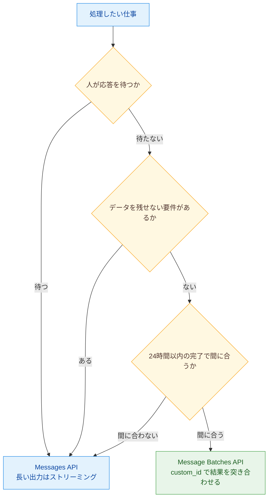

# リアルタイムとバッチの選択

> ドメイン: 2. アプリケーションと統合（20%） ／ 更新: 2026-11-26

!!! abstract "ひとことで"
    誰も待っていない大量の処理は、==Message Batches API== で料金を半分にする。人が待つ処理、結果がすぐ要る処理、データを残せない処理はリアルタイムの Messages API で行う。

## 仕組み

Message Batches API は、Messages のリクエストをまとめて出し、非同期に処理させる仕組みだ。各リクエストは `custom_id` と、通常の Messages API と同じ `params` からなる。料金は通常の半分で、ほとんどのバッチは1時間以内に終わる。ただし完了の時刻は約束されず、24時間で終わらなかったリクエストは `expired` になる。だから、締め切りまでに24時間の余裕がある仕事に向く。

| | Messages API（リアルタイム） | Message Batches API |
|---|---|---|
| 応答 | すぐ。ストリーミングできる | 非同期。`processing_status` が `ended` になってから結果を取る |
| 料金 | 通常 | 半額 |
| 結果の順番 | 1要求に1応答 | 順不同。`custom_id` で対応させる |
| 使えない機能 | なし | `stream: true`、fast mode（`speed`）、サーバー側フォールバック（`fallbacks`）、`max_tokens: 0` |
| データの保持 | ゼロデータ保持（ZDR）の対象 | ZDR の対象外。結果は作成から29日間残る |

結果は1件ずつ `succeeded`・`errored`・`canceled`・`expired` のどれかになり、1件の失敗はほかの処理に影響しない。`errored`・`canceled`・`expired` は課金されない。`errored` は中の `error` の種類を見る。`invalid_request_error` はリクエストを直さない限り再び失敗する。サーバー側の誤りや `expired` は、そのまま出し直せばよい（推論）。

??? info "細かい決まり（2026-11-26 時点）"
    - 1バッチは 100,000 リクエストか 256 MB の、先に達した方まで。超えると 413 `request_too_large`
    - 結果は、全件が終わるか24時間たった時点で取り出せる。`results_url` から `.jsonl` で、ストリームで読む
    - レート制限は Messages API と別で、全モデル共通。API への RPM と、処理待ちのリクエスト数に上限がある。ランプ制限（急な増加への制限）はかからない
    - 価格の割引はプロンプトキャッシュと重ねられる。ただしバッチでのキャッシュヒットは保証されない（例として 30〜98%）。処理が5分を超えうるので、1時間のキャッシュを使うとヒットしやすい
    - サーバーツールもバッチで使える。`pause_turn` で返ったら、続きを別の要求で出す
    - `output-300k-2026-03-24` ベータヘッダーで、バッチに限り一部のモデルの `max_tokens` を 300,000 まで上げられる
    - 処理中のバッチは取り消せる（`canceling` を経て `ended`）。取り消し前に処理された分の結果は残る

## 試験での見分け方

| 問われること | ○ 正しい | × ひっかけ |
|---|---|---|
| 夜間の大量分類で 429 が出る | 10万件ごとのバッチに分けて出す | 同期の並列数を上げ、バックオフで押し切る |
| 結果を入力と対応させる | `custom_id` で突き合わせる | 結果の並び順を入力の順とみなす |
| チャットの応答を安くしたい | リアルタイムのまま、キャッシュやモデルの階層で下げる | 人が待つ要求をバッチに回す |
| ZDR が必須の業務 | 同期の Messages API を使う | バッチを使い、取り出した後すぐ消せばよいと考える |

## 確認問題

**Q1.** カスタマーサポートの SaaS が、毎晩40万件の問い合わせに分類ラベルを付ける。結果は翌朝9時までに要る。今は同期の Messages API を一斉に呼んでいて、開始直後に 429（`ramp_limit_exceeded`）が続く。最も適切な設計はどれか。（1つ選べ）
{ .quiz-q }

- A. 並列数をさらに上げ、429 には `retry-after` を守った再試行で対応する
- B. 同期のまま、すべての要求を最も小さいモデルに切り替える
- C. 40万件を1つのバッチにまとめて出し、終わるまで待つ
- D. 10万件ずつのバッチに分けて Message Batches API に出し、`custom_id` で結果を戻す

??? success "答えと解説"
    **正解: D。** 待てる大量処理はバッチに回す。バッチは半額で、ランプ制限がかからない。

    - A: 急な増加そのものが原因で、並列数を上げると悪化する
    - B: モデルを変えても、一斉に送る限りランプ制限は残る
    - C: 1バッチは10万件までで、40万件は出せない

**Q2.** ある分析チームのバッチ結果の処理コードに、次の2つの問題が見つかった。結果を入力の順に並んでいるとみなして書き戻している。`succeeded` 以外はすべて同じリクエストのまま出し直している。直し方として適切なものはどれか。（2つ選べ）
{ .quiz-q }

- A. 結果は順不同なので、`custom_id` で入力と突き合わせて書き戻す
- B. 入力の順を保つため、バッチの `params` に `stream: true` を付ける
- C. `invalid_request_error` で `errored` になったものは直してから、`expired` はそのまま出し直す
- D. 結果を入力の順にそろえるため、リクエストを1件ずつ別のバッチで出す
- E. `expired` と `canceled` の分も課金済みとして、予算から差し引く

??? success "答えと解説"
    **正解: A と C。** 結果は `custom_id` で対応させ、失敗は種類ごとに扱いを分ける。

    - B: バッチは `stream: true` を受け付けず、検証エラーになる
    - D: バッチの利点を捨てるうえ、順番の問題は `custom_id` で解ける
    - E: `errored`・`canceled`・`expired` は課金されない

**Q3.** 医療機関向けの文書要約サービスで、契約上ゼロデータ保持（ZDR）が必須とされている。コストを下げるため、夜間の要約をバッチにしたいという案が出た。最も適切な判断はどれか。（1つ選べ）
{ .quiz-q }

- A. バッチを使い、結果を取り出した直後にバッチを削除すれば ZDR を満たせる
- B. バッチは ZDR の対象外なので、同期の Messages API のままにする
- C. バッチを使い、1時間のプロンプトキャッシュでデータの保持を短くする
- D. 入力を Files API で上げてから、その `file_id` をバッチで参照する

??? success "答えと解説"
    **正解: B。** バッチは処理が終わるまで入力と出力をサーバー側に保存するので、ZDR の対象外だ。

    - A: 削除はできるが、処理中の保存は避けられず、対象外であることは変わらない
    - C: キャッシュの期間は、バッチのデータ保持とは関係が無い
    - D: Files API も、削除か期限まで保持するので ZDR の対象外だ

## 出典
- Claude Certified Developer – Foundations Exam Guide v1.1, Domain 2「Messages API Mechanics」（公式、PDF）: https://cc.sj-cdn.net/instructor/6nizmqk8tpzpfjvt6qmmav7rh/public/1794946771/Claude_Certified_Developer_-_Foundations_Exam_Guide_Updated_Dec_7.pdf
- [Batch processing](https://platform.claude.com/docs/en/build-with-claude/batch-processing)（公式）
- [Rate limits](https://platform.claude.com/docs/en/api/rate-limits)（公式。Ramp limits、Message Batches API の節）
- [Claude API errors](https://platform.claude.com/docs/en/api/errors)（公式。Long requests の節）
- [Files API](https://platform.claude.com/docs/en/build-with-claude/files)（公式。Data handling の節）
